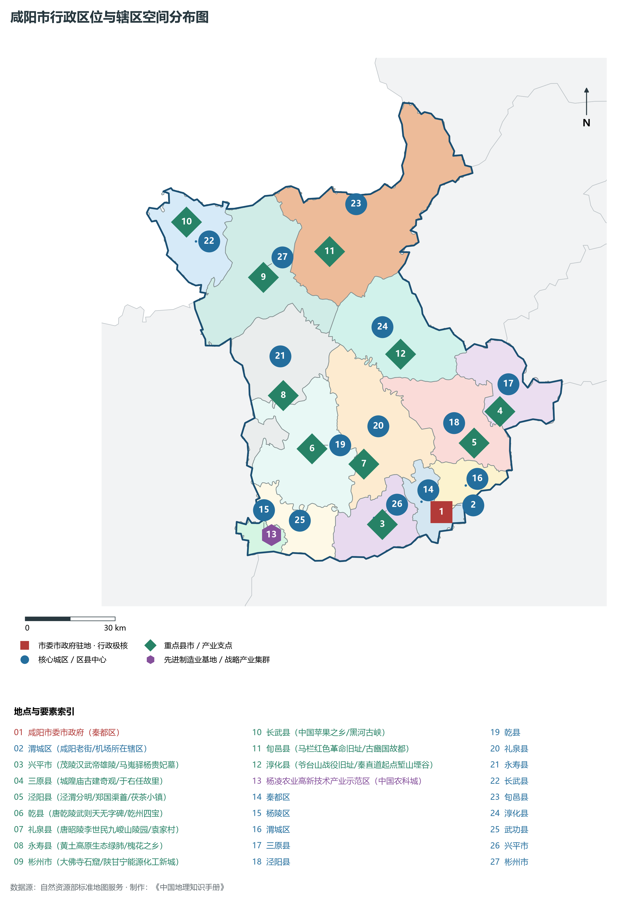
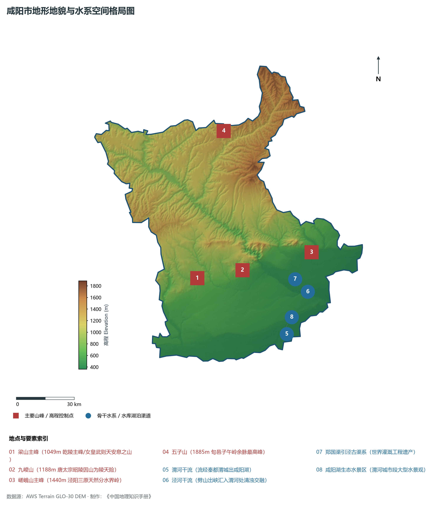
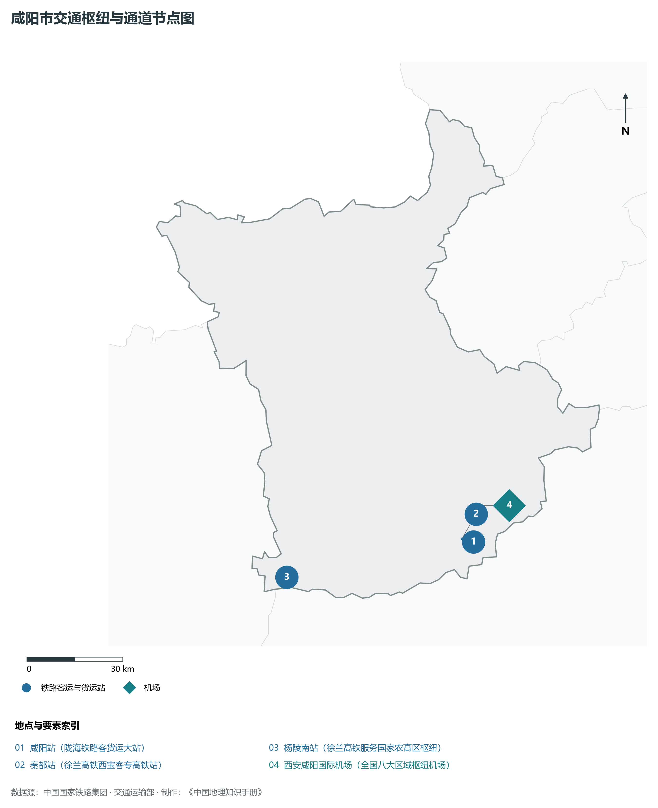
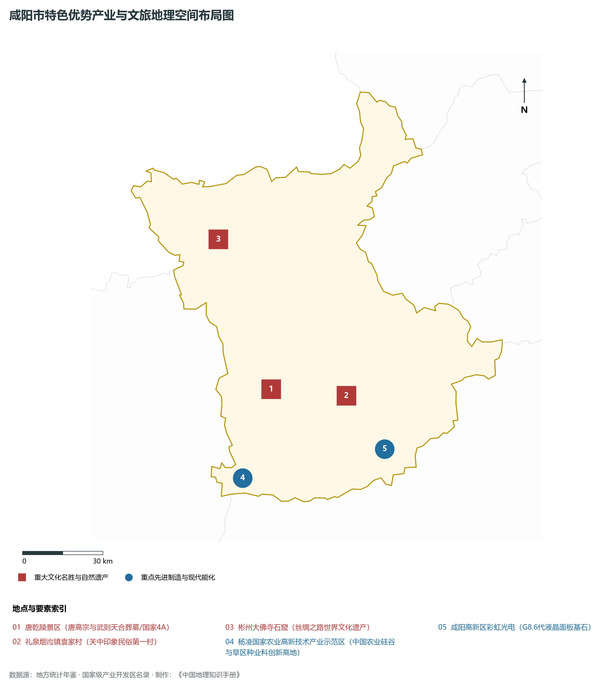
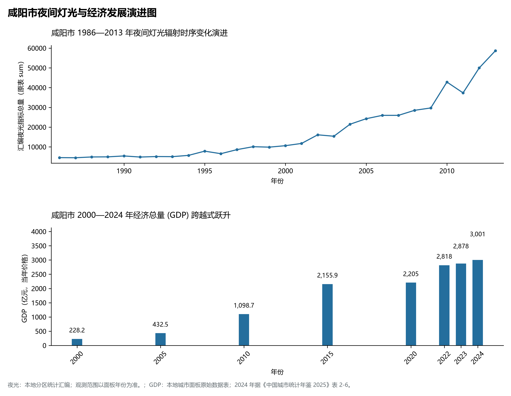

# 25.4 咸阳市

## 一、自然地理底盘与生态格局

咸阳市地处陕西省西咸一体化核心区·大秦帝国故都·中国第一帝都·临空先进智造高地·杨凌现代农业硅谷核心板块，位于东经 107.65° ～ 109.09°、北纬 34.13° ～ 35.36° 之间。2024 年常住人口 **408 万人**，常住人口城镇化率 **61.55%**，地区生产总值 **3,001 亿元**（当年价格），人均地区生产总值 **73,187 元**，三次产业构成为 **14.14 : 37.11 : 48.76**。

辖区内各层级重点行政极核、区县中心及战略功能节点布局如下：

- **咸阳市委市政府 (秦都区)**：坐标 (108.71°E, 34.33°N)，功能定位：gov；
- **渭城区 (咸阳老街/机场所在辖区)**：坐标 (108.73°E, 34.35°N)，功能定位：subdistrict；
- **兴平市 (茂陵汉武帝雄陵/马嵬驿杨贵妃墓)**：坐标 (108.49°E, 34.3°N)，功能定位：town；
- **三原县 (城隍庙古建奇观/于右任故里)**：坐标 (108.94°E, 34.62°N)，功能定位：town；
- **泾阳县 (泾渭分明/郑国渠首/茯茶小镇)**：坐标 (108.84°E, 34.53°N)，功能定位：town；
- **乾县 (唐乾陵武则天无字碑/乾州四宝)**：坐标 (108.24°E, 34.53°N)，功能定位：town；
- **礼泉县 (唐昭陵李世民九嵕山陵园/袁家村)**：坐标 (108.43°E, 34.48°N)，功能定位：town；
- **永寿县 (黄土高原生态绿肺/槐花之乡)**：坐标 (108.14°E, 34.69°N)，功能定位：town；
- **彬州市 (大佛寺石窟/陕甘宁能源化工新城)**：坐标 (108.08°E, 35.04°N)，功能定位：town；
- **长武县 (中国苹果之乡/黑河古峡)**：坐标 (107.8°E, 35.21°N)，功能定位：town；
- **旬邑县 (马栏红色革命旧址/古豳国故都)**：坐标 (108.33°E, 35.11°N)，功能定位：town；
- **淳化县 (爷台山战役旧址/秦直道起点堑山堙谷)**：坐标 (108.58°E, 34.8°N)，功能定位：town；
- **杨凌农业高新技术产业示范区 (中国农科城)**：坐标 (108.08°E, 34.28°N)，功能定位：tech；

辖区地势格局呈现出独特的起伏演化特征，高程极值范围在 **362 m ～ 1885.0 m** 之间，全域最大相对高差达 **1523.0 m**：

辖区重点山脉峰峦与控制性地理高程节点如下：

- **梁山主峰 (1049m 乾陵主峰/女皇武则天安息之山)**：海拔标高 **1049.0 m**，空间坐标 (108.22°E, 34.58°N)；
- **九嵕山 (1188m 唐太宗昭陵因山为陵天险)**：海拔标高 **1188.0 m**，空间坐标 (108.48°E, 34.61°N)；
- **嵯峨山主峰 (1440m 泾阳三原天然分水界岭)**：海拔标高 **1440.0 m**，空间坐标 (108.88°E, 34.68°N)；
- **五子山 (1885m 旬邑子午岭余脉最高峰)**：海拔标高 **1885.0 m**，空间坐标 (108.4°E, 35.25°N)；

辖区骨干水系脉络与关键控制地标：

- **渭河干流 (流经秦都渭城出咸阳湖)**：标定坐标 (108.72°E, 34.31°N)；
- **泾河干流 (劈山出峡汇入渭河处清浊交融)**：标定坐标 (108.85°E, 34.5°N)；
- **郑国渠引泾古渠系 (世界灌溉工程遗产)**：标定坐标 (108.78°E, 34.56°N)；
- **咸阳湖生态水景区 (渭河城市段大型水景观)**：标定坐标 (108.7°E, 34.32°N)；

独特的自然地理底盘塑造了辖区深厚的气候、水土与生态本底。辖区积极践行“绿水青山就是金山银山”理念，坚决当好秦岭生态卫士，统筹山水林田湖草沙一体化保护和系统治理，严格落实黄河流域生态保护和高质量发展重大国家战略与长江十年禁渔，筑牢国家生态安全屏障。

---

## 二、综合立体交通网络与区位优势

作为陕西省综合立体交通网与丝绸之路经济带上的重要战略枢纽，咸阳市区位优势得天独厚、内联外通网络日臻完备。近年来，辖区全方位抢抓高质量共建“一带一路”、亚欧陆海贸易大通道与内陆开放型经济新体制机遇，客货综合保障能级实现历史性跨越：

骨干交通基础设施与重要立体物流枢纽节点包括：

- **咸阳站 (陇海铁路客货运大站)**：空间标定 (108.72°E, 34.34°N)，设施类型：station；
- **秦都站 (徐兰高铁西宝客专高铁站)**：空间标定 (108.68°E, 34.35°N)，设施类型：rail；
- **杨陵南站 (徐兰高铁服务国家农高区枢纽)**：空间标定 (108.07°E, 34.26°N)，设施类型：rail；
- **西安咸阳国际机场 (全国八大区域枢纽机场)**：空间标定 (108.75°E, 34.44°N)，设施类型：airport；

通过高速铁路、高速公路枢纽环线与现代化空港、陆港无缝衔接，咸阳市全面融入关中平原城市群“1小时交通圈”与成渝双城经济圈、京津冀、长三角高铁通达网，深度嵌入全国统一大市场与向西开放前沿走廊。

---

## 三、特色优势产业集群、重点园区与现代经济版图

2024 年咸阳市全市地区生产总值为 3,001 亿元（当年价格）。

辖区核心产业平台、重大战略工程与重点开发区展示如下：

- **唐乾陵景区 (唐高宗与武则天合葬墓/国家4A)**：空间坐标 (108.21°E, 34.57°N)，核心功能：全国唯一未被盗掘的双帝合葬陵；
- **杨凌国家农业高新技术产业示范区**：空间坐标 (108.08°E, 34.28°N)，核心功能：中国农业硅谷与旱区种业科创新高地；
- **咸阳高新区彩虹光电 (G8.6代液晶面板基石)**：空间坐标 (108.67°E, 34.36°N)，核心功能：打造千亿级电子显示新材料产业集群；
- **礼泉烟霞镇袁家村 (关中印象民俗第一村)**：空间坐标 (108.52°E, 34.54°N)，核心功能：全国乡村振兴文旅超级网红标杆；
- **彬州大佛寺石窟 (丝绸之路世界文化遗产)**：空间坐标 (108.01°E, 35.07°N)，核心功能：唐代开国规模宏大阿弥陀佛造像；

在现代化产业布局与建圈强链战略中，辖区因地制宜打造特色优势产业生态圈：

1. **战略性新兴产业与先进制造业**：聚焦高端装备制造、新材料、电子信息、新能源汽车及关键零部件，培育高新技术企业与专精特新“小巨人”企业；
2. **现代特色农业与优质食品工业**：持续做优做精地理标志特色农产品，推进农产品精深加工全产业链升级，擦亮农业金色招牌；
3. **现代服务业、物流与数字经济赋能**：加快布局现代物流枢纽、算力中心、数字文旅与康养产业新业态，激发新质生产力澎湃动能。

---

## 四、历史文化胜迹、世界遗产与生态文旅名胜

咸阳市历史厚重，人文荟萃，是中华民族和华夏文明的重要发祥地之一，壮丽山川与厚重文脉交相辉映，是世界级文旅胜地：

- **世界文化遗产与国家级重点文保**：拥有享誉中外的世界文化遗产、国家历史文化名城与全国重点文物保护单位，古遗址、古墓葬、摩崖石刻与革命旧址完好保存，生动记录了周秦汉唐盛世文明与中国革命的光辉史诗；
- **国家级风景名胜区与生态地质奇观**：大自然造化赐予辖区雄奇险秀的山川胜景、湿地湖泊、国家森林公园与世界地质公园，空气清冽、风景如画，是绝佳的休闲避暑与生态康养度假胜地；
- **非物质文化遗产与红色基因传承**：秦腔、皮影、剪纸等非遗瑰宝代代相传，红色精神历久弥新，共同构筑起新时代三秦儿女昂扬奋进的精神家园。

---

## 五、夜间灯光遥感时序演变与新时代现代化发展变化

本节夜光图的观测年份为 1986—2013 年，指标为行政区汇总值（原表 sum）。

### 1. 1986—2013 年夜间灯光遥感演化分析

- **1996年演化特征**：渭河北岸老纺织城与秦都微弱灯火；
- **2006年演化特征**：世纪大道拉通·西咸共建框架拉开；
- **2014年演化特征**：咸阳机场二期·西咸新区国家级批复；
- **2023年演化特征**：光电显示全链突破·西咸一体化同城璀璨；

### 2. 2000—2024 年经济跨越式发展时序汇总
下表记录了 咸阳市 自 2000 年以来核心年份地区生产总值（GDP）的翻番跨越历程：

| 年份 | 地区生产总值（亿元，当年价格） |
|:---|---:|
| 2000 年 | 228.2 |
| 2005 年 | 432.5 |
| 2010 年 | 1,098.7 |
| 2015 年 | 2,155.9 |
| 2020 年 | 2,205 |
| 2022 年 | 2,818 |
| 2023 年 | 2,878 |
| 2024 年 | 3,001 |

### 3. 新征程高质量跨越式发展愿景
迈向中国式现代化新征程，咸阳市将全面贯彻新发展理念，主动融入和服务国家重大发展战略：

1. 深入推进新型工业化与新型城镇化，做强做优做大优势实体经济，培育壮大战略性新兴产业和未来产业；
2. 协同推进高水平生态环境保护与绿色低碳转型，筑牢国家生态安全屏障；
3. 统筹城乡融合发展与民生保障，奋力谱写中国式现代化建设的陕西新篇章。

---

## 六、国家级杨凌农业高新技术产业示范区专题专述

杨凌农业高新技术产业示范区（简称“杨凌示范区”），位于咸阳市武功县与宝鸡市扶风县之间、渭河北岸台塬之上，是中国第一个国家级农业高新技术产业示范区，被誉为“中国农科城”：

1. **农科圣地与国家战略**：
   - 1997 年由国务院批准设立，实行“省部共建”领导体制，是我国唯一的农业自贸试验片区和综合保税区；
   - 境内集聚了西北农林科技大学（双一流 A 类高校）、陕西省农业科学院等顶尖科教力量，被誉为中国干旱半干旱地区现代农业的“种业硅谷”与农业科技策源地；
2. **“农科高地·惠及全国·走向世界”辐射示范**：
   - 杨凌农高会已成功举办 30 多届，成为国际农业合作与科技成果转化的金字招牌；
   - 依托上海合作组织农业技术交流培训示范基地，杨凌农业科技良种、节水灌溉技术深度辐射“一带一路”沿线共建国家，书写了中国农业科技创新的辉煌篇章。

2024 年统计来源：《中国城市统计年鉴 2025》表 2-1、2-6、2-7（2024 年，全市）。其他年份 GDP 据本地城市面板“原始数据”表，单位为亿元、当年价格。
