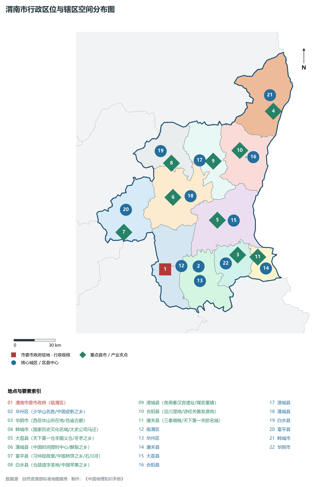
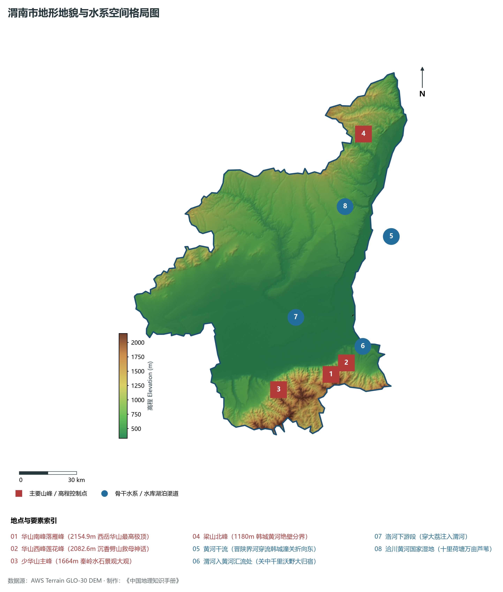
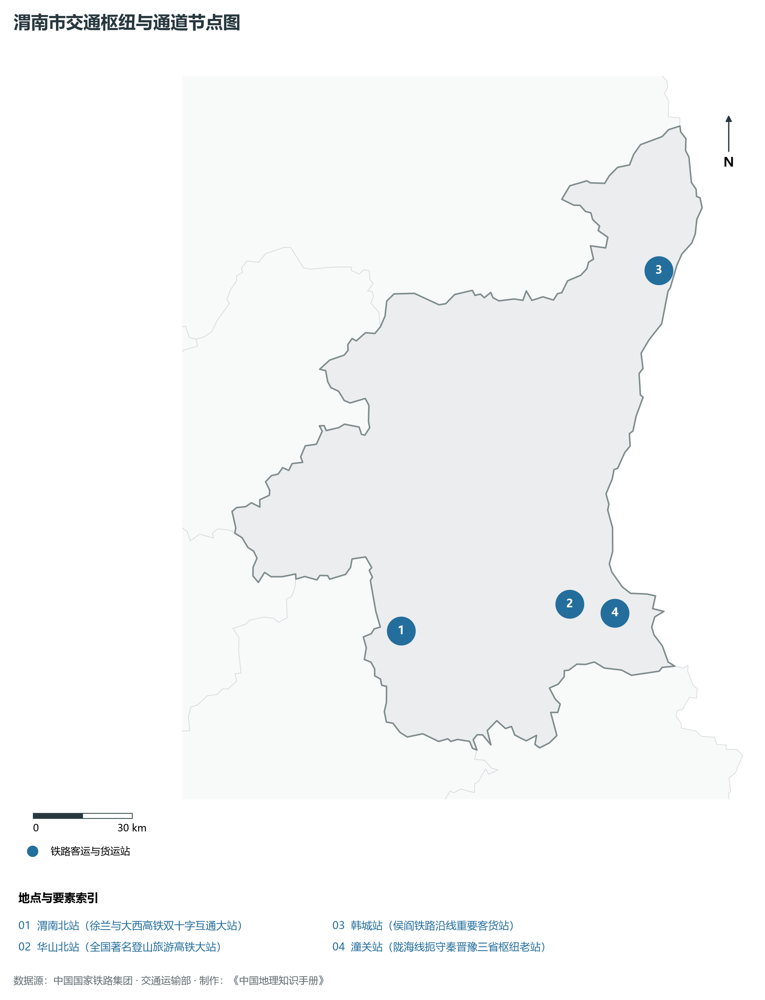
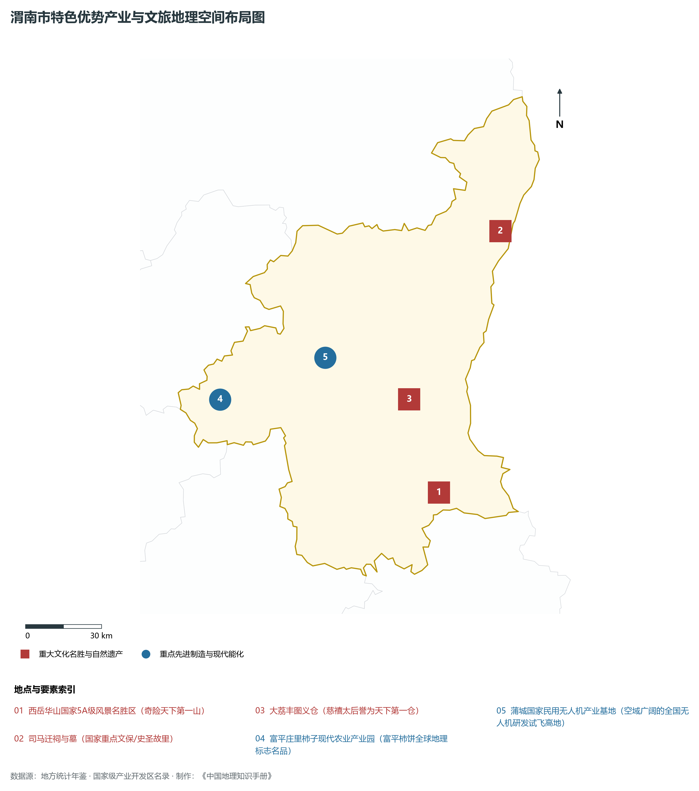
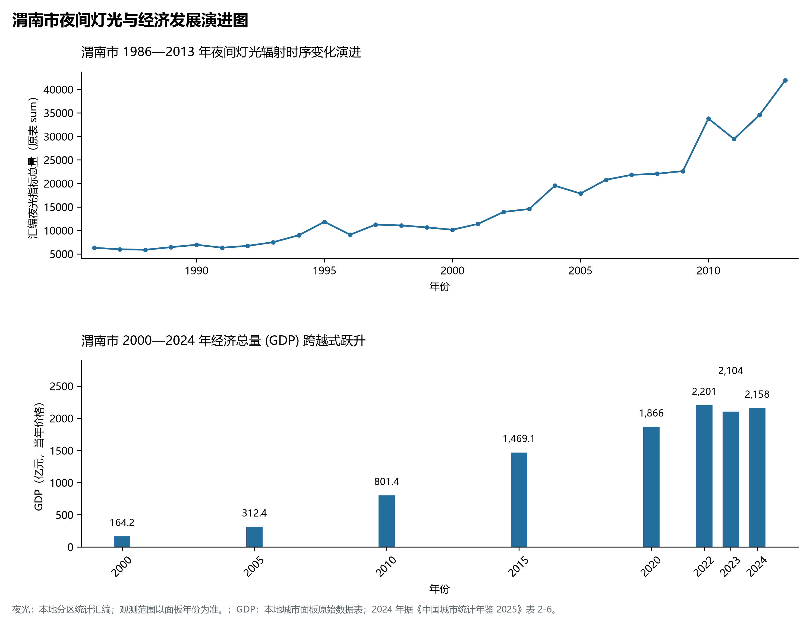

# 25.5 渭南市

## 一、自然地理底盘与生态格局

渭南市地处陕西省关中东大门·西岳华山奇险圣地·黄渭洛三河交汇金三角·司马迁史记名城·现代农业与能源高地核心板块，位于东经 109.03° ～ 110.59°、北纬 34.35° ～ 35.63° 之间。2024 年常住人口 **458 万人**，常住人口城镇化率 **53.66%**，地区生产总值 **2,158 亿元**（当年价格），人均地区生产总值 **46,970 元**，三次产业构成为 **19.8 : 26.54 : 53.66**。

辖区内各层级重点行政极核、区县中心及战略功能节点布局如下：

- **渭南市委市政府 (临渭区)**：坐标 (109.5°E, 34.5°N)，功能定位：gov；
- **华州区 (少华山名胜/中国皮影之乡)**：坐标 (109.77°E, 34.51°N)，功能定位：subdistrict；
- **华阴市 (西岳华山所在地/岳庙古都)**：坐标 (110.09°E, 34.57°N)，功能定位：town；
- **韩城市 (国家历史文化名城/太史公司马迁)**：坐标 (110.44°E, 35.48°N)，功能定位：town；
- **大荔县 (天下第一仓丰图义仓/冬枣之乡)**：坐标 (109.94°E, 34.8°N)，功能定位：town；
- **蒲城县 (中国时间授时中心/酥梨之乡)**：坐标 (109.59°E, 34.96°N)，功能定位：town；
- **富平县 (习仲勋故里/中国柿饼之乡/石川河)**：坐标 (109.18°E, 34.75°N)，功能定位：town；
- **白水县 (仓颉造字圣地/中国苹果之乡)**：坐标 (109.59°E, 35.18°N)，功能定位：town；
- **澄城县 (良周秦汉宫遗址/煤炭重镇)**：坐标 (109.93°E, 35.18°N)，功能定位：town；
- **合阳县 (洽川湿地/诗经关雎发源地)**：坐标 (110.15°E, 35.24°N)，功能定位：town；
- **潼关县 (三秦咽喉/天下第一关防名城)**：坐标 (110.25°E, 34.55°N)，功能定位：town；

辖区地势格局呈现出独特的起伏演化特征，高程极值范围在 **330 m ～ 2154.9 m** 之间，全域最大相对高差达 **1824.9 m**：

辖区重点山脉峰峦与控制性地理高程节点如下：

- **华山南峰落雁峰 (2154.9m 西岳华山最高极顶)**：海拔标高 **2154.9 m**，空间坐标 (110.088°E, 34.478°N)；
- **华山西峰莲花峰 (2082.6m 沉香劈山救母神话)**：海拔标高 **2082.6 m**，空间坐标 (110.075°E, 34.485°N)；
- **少华山主峰 (1664m 秦岭水石景观大观)**：海拔标高 **1664.0 m**，空间坐标 (109.78°E, 34.42°N)；
- **梁山北峰 (1180m 韩城黄河绝壁分界)**：海拔标高 **1180.0 m**，空间坐标 (110.35°E, 35.58°N)；

辖区骨干水系脉络与关键控制地标：

- **黄河干流 (晋陕界河穿流韩城潼关折向东)**：标定坐标 (110.48°E, 35.1°N)；
- **渭河入黄河汇流处 (关中千里沃野大归宿)**：标定坐标 (110.28°E, 34.6°N)；
- **洛河下游段 (穿大荔注入渭河)**：标定坐标 (109.9°E, 34.75°N)；
- **洽川黄河国家湿地 (十里荷塘万亩芦苇)**：标定坐标 (110.22°E, 35.25°N)；

独特的自然地理底盘塑造了辖区深厚的气候、水土与生态本底。辖区积极践行“绿水青山就是金山银山”理念，坚决当好秦岭生态卫士，统筹山水林田湖草沙一体化保护和系统治理，严格落实黄河流域生态保护和高质量发展重大国家战略与长江十年禁渔，筑牢国家生态安全屏障。

---

## 二、综合立体交通网络与区位优势

作为陕西省综合立体交通网与丝绸之路经济带上的重要战略枢纽，渭南市区位优势得天独厚、内联外通网络日臻完备。近年来，辖区全方位抢抓高质量共建“一带一路”、亚欧陆海贸易大通道与内陆开放型经济新体制机遇，客货综合保障能级实现历史性跨越：

骨干交通基础设施与重要立体物流枢纽节点包括：

- **渭南北站 (徐兰与大西高铁双十字互通大站)**：空间标定 (109.52°E, 34.54°N)，设施类型：rail；
- **华山北站 (全国著名登山旅游高铁大站)**：空间标定 (110.09°E, 34.59°N)，设施类型：rail；
- **韩城站 (侯阎铁路沿线重要客货站)**：空间标定 (110.45°E, 35.47°N)，设施类型：station；
- **潼关站 (陇海线扼守秦晋豫三省枢纽老站)**：空间标定 (110.24°E, 34.56°N)，设施类型：station；

通过高速铁路、高速公路枢纽环线与现代化空港、陆港无缝衔接，渭南市全面融入关中平原城市群“1小时交通圈”与成渝双城经济圈、京津冀、长三角高铁通达网，深度嵌入全国统一大市场与向西开放前沿走廊。

---

## 三、特色优势产业集群、重点园区与现代经济版图

2024 年渭南市全市地区生产总值为 2,158 亿元（当年价格）。

辖区核心产业平台、重大战略工程与重点开发区展示如下：

- **西岳华山国家5A级风景名胜区 (奇险天下第一山)**：空间坐标 (110.09°E, 34.49°N)，核心功能：中华文明华夏之根重要地理标识；
- **司马迁祠与墓 (国家重点文保/史圣故里)**：空间坐标 (110.42°E, 35.39°N)，核心功能：文史公千秋绝唱无韵之离骚；
- **大荔丰图义仓 (慈禧太后誉为天下第一仓)**：空间坐标 (109.98°E, 34.82°N)，核心功能：全国唯一保存完好的古代大型粮仓；
- **富平庄里柿子现代农业产业园**：空间坐标 (109.15°E, 34.85°N)，核心功能：富平柿饼全球地理标志名品；
- **蒲城国家民用无人机产业基地**：空间坐标 (109.62°E, 34.98°N)，核心功能：空域广阔的全国无人机研发试飞高地；

在现代化产业布局与建圈强链战略中，辖区因地制宜打造特色优势产业生态圈：

1. **战略性新兴产业与先进制造业**：聚焦高端装备制造、新材料、电子信息、新能源汽车及关键零部件，培育高新技术企业与专精特新“小巨人”企业；
2. **现代特色农业与优质食品工业**：持续做优做精地理标志特色农产品，推进农产品精深加工全产业链升级，擦亮农业金色招牌；
3. **现代服务业、物流与数字经济赋能**：加快布局现代物流枢纽、算力中心、数字文旅与康养产业新业态，激发新质生产力澎湃动能。

---

## 四、历史文化胜迹、世界遗产与生态文旅名胜

渭南市历史厚重，人文荟萃，是中华民族和华夏文明的重要发祥地之一，壮丽山川与厚重文脉交相辉映，是世界级文旅胜地：

- **世界文化遗产与国家级重点文保**：拥有享誉中外的世界文化遗产、国家历史文化名城与全国重点文物保护单位，古遗址、古墓葬、摩崖石刻与革命旧址完好保存，生动记录了周秦汉唐盛世文明与中国革命的光辉史诗；
- **国家级风景名胜区与生态地质奇观**：大自然造化赐予辖区雄奇险秀的山川胜景、湿地湖泊、国家森林公园与世界地质公园，空气清冽、风景如画，是绝佳的休闲避暑与生态康养度假胜地；
- **非物质文化遗产与红色基因传承**：秦腔、皮影、剪纸等非遗瑰宝代代相传，红色精神历久弥新，共同构筑起新时代三秦儿女昂扬奋进的精神家园。

---

## 五、夜间灯光遥感时序演变与新时代现代化发展变化

本节夜光图的观测年份为 1986—2013 年，指标为行政区汇总值（原表 sum）。

### 1. 1986—2013 年夜间灯光遥感演化分析

- **1996年演化特征**：临渭老街与韩城矿区微光初显；
- **2006年演化特征**：西潼高速与渭南高新区骨架延展；
- **2014年演化特征**：大西客专通车·渭南高铁枢纽成型；
- **2023年演化特征**：渭北现代工业聚落连片·华山文旅火热；

### 2. 2000—2024 年经济跨越式发展时序汇总
下表记录了 渭南市 自 2000 年以来核心年份地区生产总值（GDP）的翻番跨越历程：

| 年份 | 地区生产总值（亿元，当年价格） |
|:---|---:|
| 2000 年 | 164.2 |
| 2005 年 | 312.4 |
| 2010 年 | 801.4 |
| 2015 年 | 1,469.1 |
| 2020 年 | 1,866 |
| 2022 年 | 2,201 |
| 2023 年 | 2,104 |
| 2024 年 | 2,158 |

### 3. 新征程高质量跨越式发展愿景
迈向中国式现代化新征程，渭南市将全面贯彻新发展理念，主动融入和服务国家重大发展战略：

1. 深入推进新型工业化与新型城镇化，做强做优做大优势实体经济，培育壮大战略性新兴产业和未来产业；
2. 协同推进高水平生态环境保护与绿色低碳转型，筑牢国家生态安全屏障；
3. 统筹城乡融合发展与民生保障，奋力谱写中国式现代化建设的陕西新篇章。

2024 年统计来源：《中国城市统计年鉴 2025》表 2-1、2-6、2-7（2024 年，全市）。其他年份 GDP 据本地城市面板“原始数据”表，单位为亿元、当年价格。
