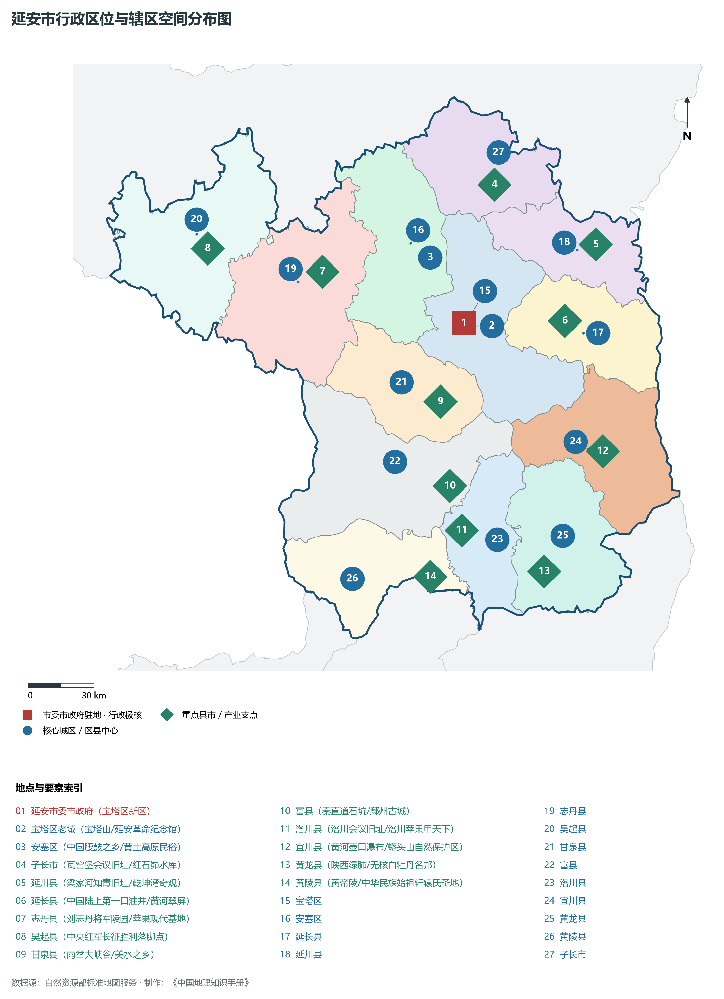
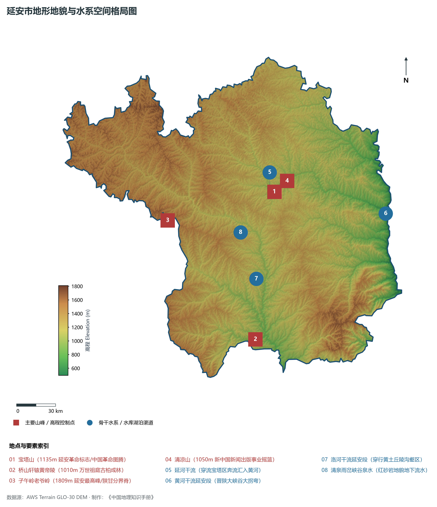
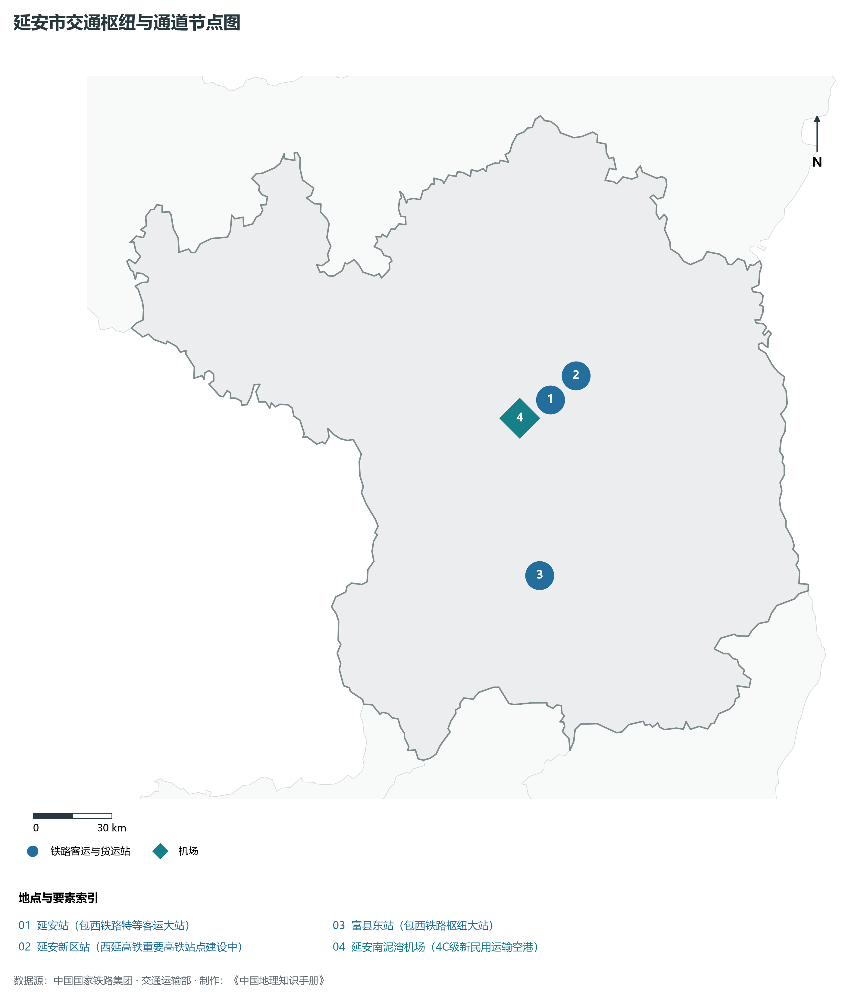
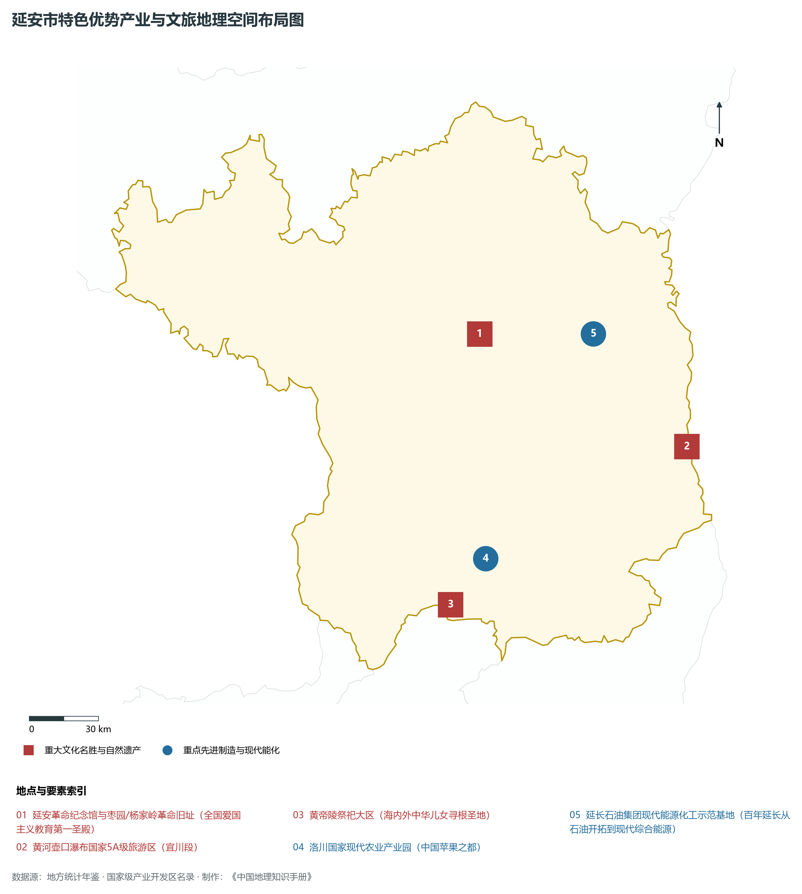
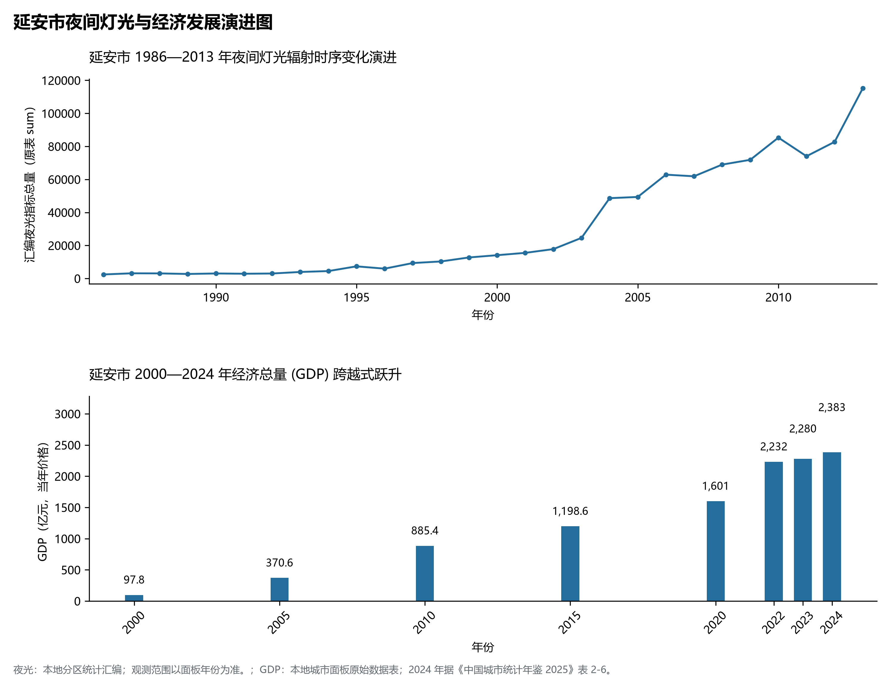

# 25.6 延安市

## 一、自然地理底盘与生态格局

延安市地处陕西省中国革命圣地·新中国摇篮·黄河壶口瀑布大奇观·现代高端能源化工基地·世界优质苹果之都核心板块，位于东经 108.03° ～ 110.34°、北纬 35.43° ～ 37.29° 之间。2024 年常住人口 **225 万人**，常住人口城镇化率 **63.54%**，地区生产总值 **2,383 亿元**（当年价格），人均地区生产总值 **101,105 元**，三次产业构成为 **10.31 : 54.94 : 34.75**。

辖区内各层级重点行政极核、区县中心及战略功能节点布局如下：

- **延安市委市政府 (宝塔区新区)**：坐标 (109.49°E, 36.59°N)，功能定位：gov；
- **宝塔区老城 (宝塔山/延安革命纪念馆)**：坐标 (109.48°E, 36.58°N)，功能定位：subdistrict；
- **安塞区 (中国腰鼓之乡/黄土高原民俗)**：坐标 (109.33°E, 36.86°N)，功能定位：subdistrict；
- **子长市 (瓦窑堡会议旧址/红石峁水库)**：坐标 (109.68°E, 37.14°N)，功能定位：town；
- **延川县 (梁家河知青旧址/乾坤湾奇观)**：坐标 (110.19°E, 36.88°N)，功能定位：town；
- **延长县 (中国陆上第一口油井/黄河翠屏)**：坐标 (110.01°E, 36.58°N)，功能定位：town；
- **志丹县 (刘志丹将军陵园/苹果现代基地)**：坐标 (108.77°E, 36.82°N)，功能定位：town；
- **吴起县 (中央红军长征胜利落脚点)**：坐标 (108.18°E, 36.93°N)，功能定位：town；
- **甘泉县 (雨岔大峡谷/美水之乡)**：坐标 (109.35°E, 36.28°N)，功能定位：town；
- **富县 (秦直道石坑/鄜州古城)**：坐标 (109.38°E, 35.94°N)，功能定位：town；
- **洛川县 (洛川会议旧址/洛川苹果甲天下)**：坐标 (109.43°E, 35.76°N)，功能定位：town；
- **宜川县 (黄河壶口瀑布/蟒头山自然保护区)**：坐标 (110.17°E, 36.05°N)，功能定位：town；
- **黄龙县 (陕西绿肺/无核白牡丹名邦)**：坐标 (109.84°E, 35.58°N)，功能定位：town；
- **黄陵县 (黄帝陵/中华民族始祖轩辕氏圣地)**：坐标 (109.26°E, 35.58°N)，功能定位：town；

辖区地势格局呈现出独特的起伏演化特征，高程极值范围在 **495 m ～ 1809.0 m** 之间，全域最大相对高差达 **1314.0 m**：

辖区重点山脉峰峦与控制性地理高程节点如下：

- **宝塔山 (1135m 延安革命标志/中国革命图腾)**：海拔标高 **1135.0 m**，空间坐标 (109.49°E, 36.585°N)；
- **桥山轩辕黄帝陵 (1010m 万世祖庭古柏成林)**：海拔标高 **1010.0 m**，空间坐标 (109.27°E, 35.59°N)；
- **子午岭老爷岭 (1809m 延安最高峰/陕甘分界脊)**：海拔标高 **1809.0 m**，空间坐标 (108.55°E, 36.42°N)；
- **清凉山 (1050m 新中国新闻出版事业摇篮)**：海拔标高 **1050.0 m**，空间坐标 (109.47°E, 36.6°N)；

辖区骨干水系脉络与关键控制地标：

- **延河干流 (穿流宝塔区奔流汇入黄河)**：标定坐标 (109.45°E, 36.6°N)；
- **黄河干流延安段 (晋陕大峡谷大拐弯)**：标定坐标 (110.45°E, 36.4°N)；
- **洛河干流延安段 (穿行黄土丘陵沟壑区)**：标定坐标 (109.3°E, 36.0°N)；
- **清泉雨岔峡谷泉水 (红砂岩地貌地下流水)**：标定坐标 (109.18°E, 36.32°N)；

独特的自然地理底盘塑造了辖区深厚的气候、水土与生态本底。辖区积极践行“绿水青山就是金山银山”理念，坚决当好秦岭生态卫士，统筹山水林田湖草沙一体化保护和系统治理，严格落实黄河流域生态保护和高质量发展重大国家战略与长江十年禁渔，筑牢国家生态安全屏障。

---

## 二、综合立体交通网络与区位优势

作为陕西省综合立体交通网与丝绸之路经济带上的重要战略枢纽，延安市区位优势得天独厚、内联外通网络日臻完备。近年来，辖区全方位抢抓高质量共建“一带一路”、亚欧陆海贸易大通道与内陆开放型经济新体制机遇，客货综合保障能级实现历史性跨越：

骨干交通基础设施与重要立体物流枢纽节点包括：

- **延安站 (包西铁路特等客运大站)**：空间标定 (109.48°E, 36.54°N)，设施类型：station；
- **延安新区站 (西延高铁重要高铁站点建设中)**：空间标定 (109.52°E, 36.62°N)，设施类型：rail；
- **延安南泥湾机场 (4C级新民用运输空港)**：空间标定 (109.42°E, 36.48°N)，设施类型：airport；
- **富县东站 (包西铁路枢纽大站)**：空间标定 (109.4°E, 35.95°N)，设施类型：station；

通过高速铁路、高速公路枢纽环线与现代化空港、陆港无缝衔接，延安市全面融入关中平原城市群“1小时交通圈”与成渝双城经济圈、京津冀、长三角高铁通达网，深度嵌入全国统一大市场与向西开放前沿走廊。

---

## 三、特色优势产业集群、重点园区与现代经济版图

2024 年延安市全市地区生产总值为 2,383 亿元（当年价格）。

辖区核心产业平台、重大战略工程与重点开发区展示如下：

- **延安革命纪念馆与枣园/杨家岭革命旧址**：空间坐标 (109.46°E, 36.61°N)，核心功能：全国爱国主义教育第一圣殿；
- **黄河壶口瀑布国家5A级旅游区 (宜川段)**：空间坐标 (110.45°E, 36.14°N)，核心功能：中华民族自强不息力量之源；
- **黄帝陵祭祀大区 (海内外中华儿女寻根圣地)**：空间坐标 (109.26°E, 35.58°N)，核心功能：国务院第一号全国重点文物保护单位；
- **洛川国家现代农业产业园 (中国苹果之都)**：空间坐标 (109.44°E, 35.75°N)，核心功能：全球公认优质苹果核心产区；
- **延长石油集团现代能源化工示范基地**：空间坐标 (110.02°E, 36.59°N)，核心功能：百年延长从石油开拓到现代综合能源；

在现代化产业布局与建圈强链战略中，辖区因地制宜打造特色优势产业生态圈：

1. **战略性新兴产业与先进制造业**：聚焦高端装备制造、新材料、电子信息、新能源汽车及关键零部件，培育高新技术企业与专精特新“小巨人”企业；
2. **现代特色农业与优质食品工业**：持续做优做精地理标志特色农产品，推进农产品精深加工全产业链升级，擦亮农业金色招牌；
3. **现代服务业、物流与数字经济赋能**：加快布局现代物流枢纽、算力中心、数字文旅与康养产业新业态，激发新质生产力澎湃动能。

---

## 四、历史文化胜迹、世界遗产与生态文旅名胜

延安市历史厚重，人文荟萃，是中华民族和华夏文明的重要发祥地之一，壮丽山川与厚重文脉交相辉映，是世界级文旅胜地：

- **世界文化遗产与国家级重点文保**：拥有享誉中外的世界文化遗产、国家历史文化名城与全国重点文物保护单位，古遗址、古墓葬、摩崖石刻与革命旧址完好保存，生动记录了周秦汉唐盛世文明与中国革命的光辉史诗；
- **国家级风景名胜区与生态地质奇观**：大自然造化赐予辖区雄奇险秀的山川胜景、湿地湖泊、国家森林公园与世界地质公园，空气清冽、风景如画，是绝佳的休闲避暑与生态康养度假胜地；
- **非物质文化遗产与红色基因传承**：秦腔、皮影、剪纸等非遗瑰宝代代相传，红色精神历久弥新，共同构筑起新时代三秦儿女昂扬奋进的精神家园。

---

## 五、夜间灯光遥感时序演变与新时代现代化发展变化

本节夜光图的观测年份为 1986—2013 年，指标为行政区汇总值（原表 sum）。

### 1. 1986—2013 年夜间灯光遥感演化分析

- **1996年演化特征**：延河狭谷两岸窑洞与石油矿区微火；
- **2006年演化特征**：延安经济技术开发区大扩展·包茂高速通达；
- **2014年演化特征**：延安新区削山建城·红色文旅全域升温；
- **2023年演化特征**：现代煤油气电化工千亿级成形·黄土高原全绿；

### 2. 2000—2024 年经济跨越式发展时序汇总
下表记录了 延安市 自 2000 年以来核心年份地区生产总值（GDP）的翻番跨越历程：

| 年份 | 地区生产总值（亿元，当年价格） |
|:---|---:|
| 2000 年 | 97.8 |
| 2005 年 | 370.6 |
| 2010 年 | 885.4 |
| 2015 年 | 1,198.6 |
| 2020 年 | 1,601 |
| 2022 年 | 2,232 |
| 2023 年 | 2,280 |
| 2024 年 | 2,383 |

### 3. 新征程高质量跨越式发展愿景
迈向中国式现代化新征程，延安市将全面贯彻新发展理念，主动融入和服务国家重大发展战略：

1. 深入推进新型工业化与新型城镇化，做强做优做大优势实体经济，培育壮大战略性新兴产业和未来产业；
2. 协同推进高水平生态环境保护与绿色低碳转型，筑牢国家生态安全屏障；
3. 统筹城乡融合发展与民生保障，奋力谱写中国式现代化建设的陕西新篇章。

2024 年统计来源：《中国城市统计年鉴 2025》表 2-1、2-6、2-7（2024 年，全市）。其他年份 GDP 据本地城市面板“原始数据”表，单位为亿元、当年价格。
