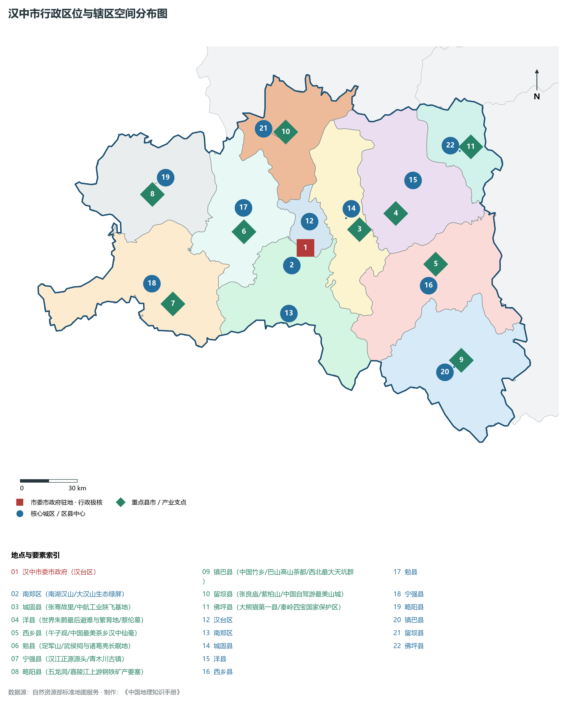
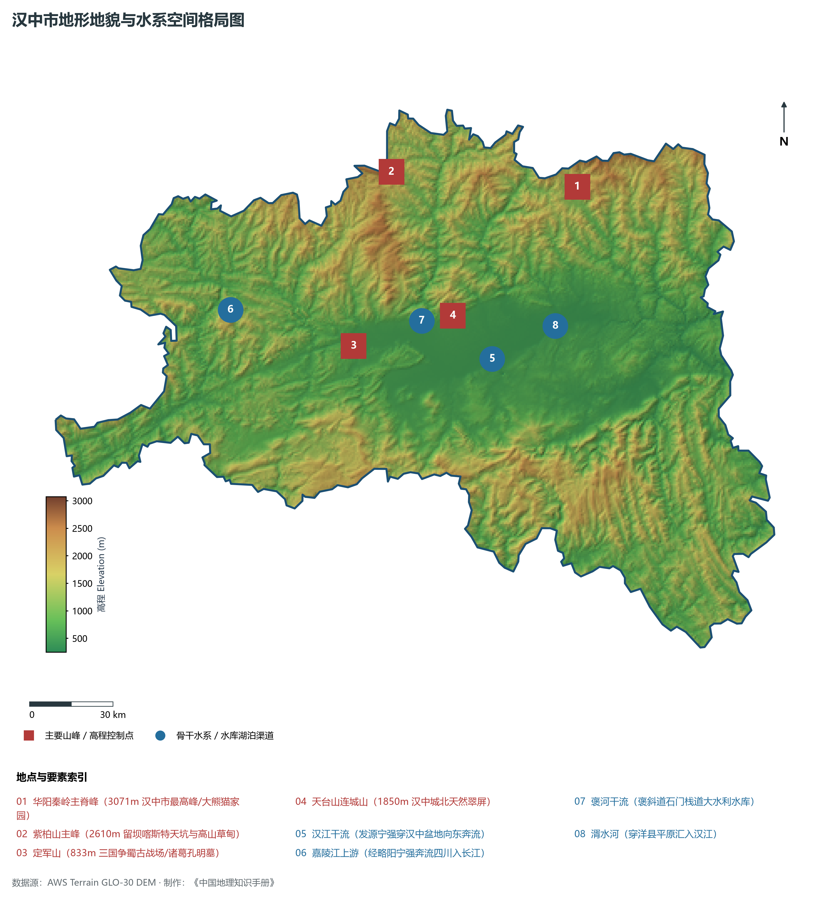
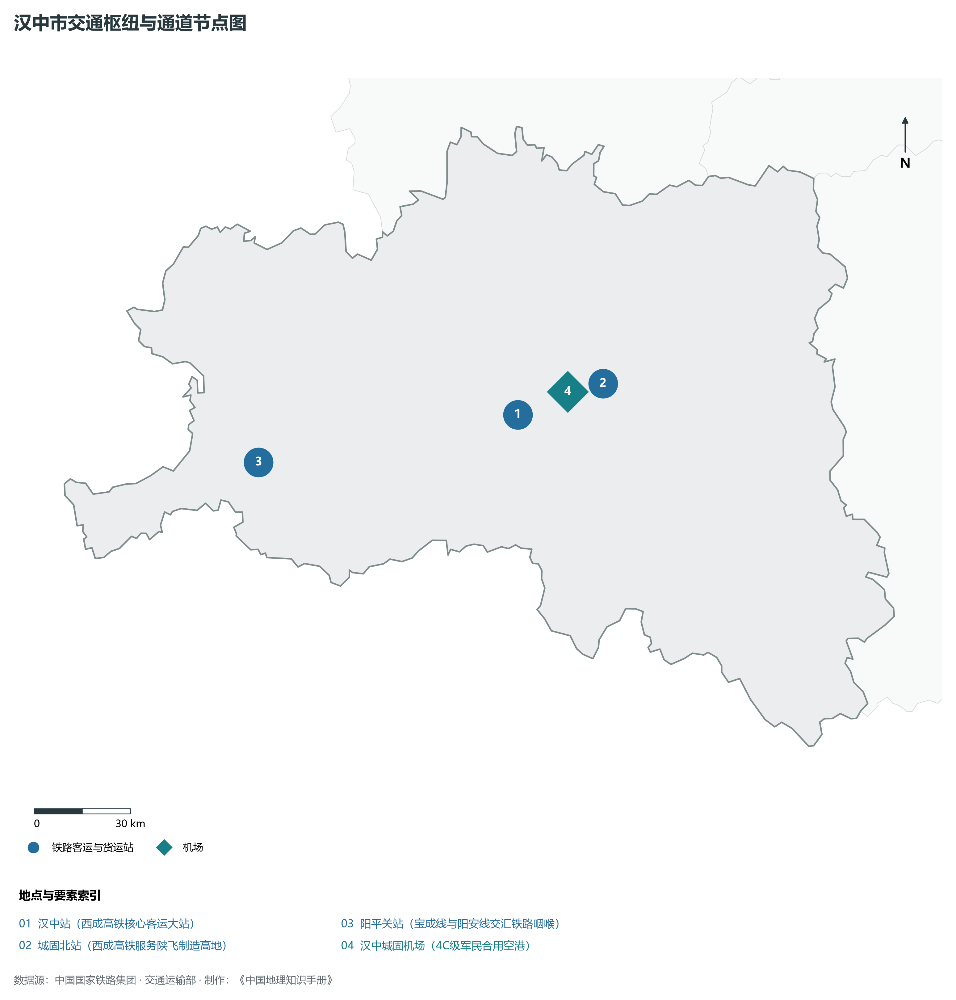
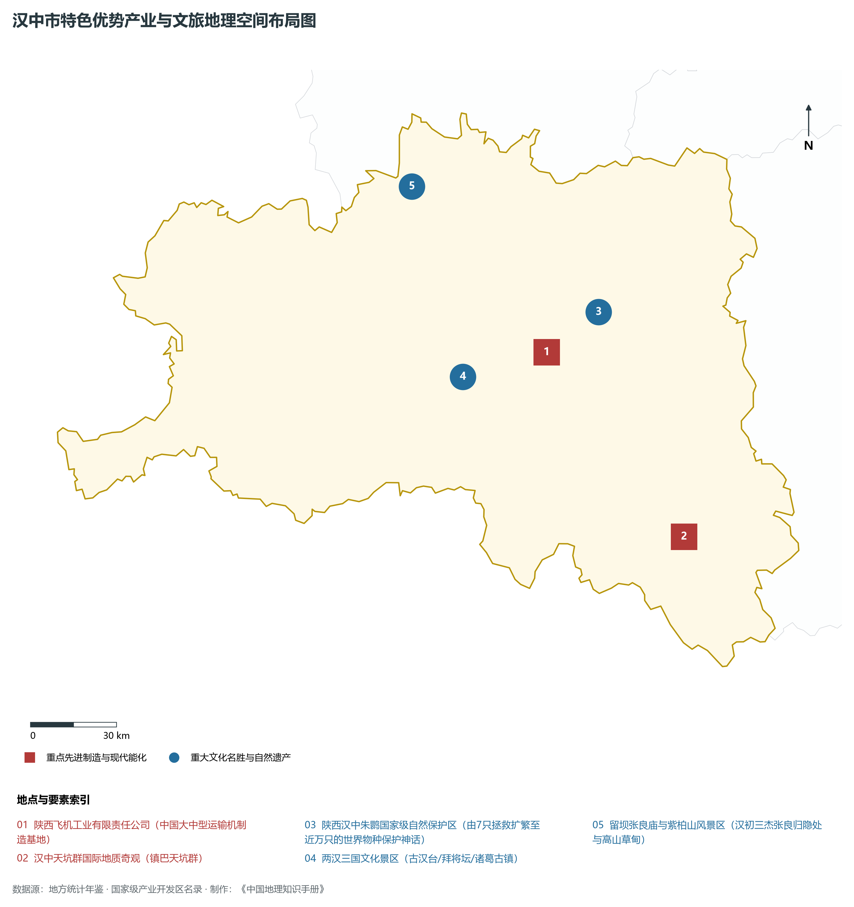
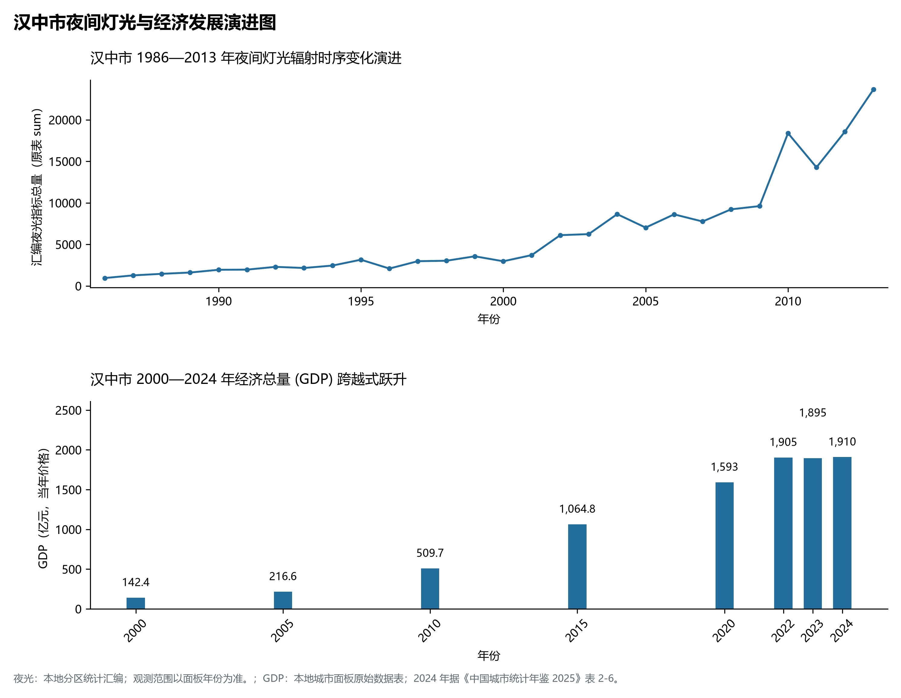

# 25.7 汉中市

## 一、自然地理底盘与生态格局

汉中市地处陕西省两汉三国文化发祥地·汉家发祥地·南水北调中线水源涵养核心区·大熊猫与朱鹮家园·大国空天陕飞基地核心板块，位于东经 106.00° ～ 108.13°、北纬 32.38° ～ 33.76° 之间。2024 年常住人口 **316 万人**，常住人口城镇化率 **55.19%**，地区生产总值 **1,910 亿元**（当年价格），人均地区生产总值 **60,391 元**，三次产业构成为 **15.76 : 32.3 : 51.94**。

辖区内各层级重点行政极核、区县中心及战略功能节点布局如下：

- **汉中市委市政府 (汉台区)**：坐标 (107.02°E, 33.07°N)，功能定位：gov；
- **南郑区 (南湖汉山/大汉山生态绿屏)**：坐标 (106.94°E, 32.99°N)，功能定位：subdistrict；
- **城固县 (张骞故里/中航工业陕飞基地)**：坐标 (107.33°E, 33.15°N)，功能定位：town；
- **洋县 (世界朱鹮最后避难与繁育地/蔡伦墓)**：坐标 (107.54°E, 33.22°N)，功能定位：town；
- **西乡县 (午子观/中国最美茶乡汉中仙毫)**：坐标 (107.76°E, 32.98°N)，功能定位：town；
- **勉县 (定军山/武侯祠与诸葛亮长眠地)**：坐标 (106.67°E, 33.15°N)，功能定位：town；
- **宁强县 (汉江正源源头/青木川古镇)**：坐标 (106.26°E, 32.82°N)，功能定位：town；
- **略阳县 (五龙洞/嘉陵江上游钢铁矿产要塞)**：坐标 (106.15°E, 33.33°N)，功能定位：town；
- **镇巴县 (中国竹乡/巴山高山茶都/西北最大天坑群)**：坐标 (107.89°E, 32.53°N)，功能定位：town；
- **留坝县 (张良庙/紫柏山/中国自驾游最美山城)**：坐标 (106.92°E, 33.61°N)，功能定位：town；
- **佛坪县 (大熊猫第一县/秦岭四宝国家保护区)**：坐标 (107.98°E, 33.52°N)，功能定位：town；

辖区地势格局呈现出独特的起伏演化特征，高程极值范围在 **248 m ～ 3071.0 m** 之间，全域最大相对高差达 **2823.0 m**：

辖区重点山脉峰峦与控制性地理高程节点如下：

- **华阳秦岭主脊峰 (3071m 汉中市最高峰/大熊猫家园)**：海拔标高 **3071.0 m**，空间坐标 (107.55°E, 33.62°N)；
- **紫柏山主峰 (2610m 留坝喀斯特天坑与高山草甸)**：海拔标高 **2610.0 m**，空间坐标 (106.82°E, 33.68°N)；
- **定军山 (833m 三国争蜀古战场/诸葛孔明墓)**：海拔标高 **833.0 m**，空间坐标 (106.66°E, 33.13°N)；
- **天台山连城山 (1850m 汉中城北天然翠屏)**：海拔标高 **1850.0 m**，空间坐标 (107.05°E, 33.22°N)；

辖区骨干水系脉络与关键控制地标：

- **汉江干流 (发源宁强穿汉中盆地向东奔流)**：标定坐标 (107.2°E, 33.08°N)；
- **嘉陵江上游 (经略阳宁强奔流四川入长江)**：标定坐标 (106.18°E, 33.25°N)；
- **褒河干流 (褒斜道石门栈道大水利水库)**：标定坐标 (106.98°E, 33.18°N)；
- **湑水河 (穿洋县平原汇入汉江)**：标定坐标 (107.45°E, 33.18°N)；

独特的自然地理底盘塑造了辖区深厚的气候、水土与生态本底。辖区积极践行“绿水青山就是金山银山”理念，坚决当好秦岭生态卫士，统筹山水林田湖草沙一体化保护和系统治理，严格落实黄河流域生态保护和高质量发展重大国家战略与长江十年禁渔，筑牢国家生态安全屏障。

---

## 二、综合立体交通网络与区位优势

作为陕西省综合立体交通网与丝绸之路经济带上的重要战略枢纽，汉中市区位优势得天独厚、内联外通网络日臻完备。近年来，辖区全方位抢抓高质量共建“一带一路”、亚欧陆海贸易大通道与内陆开放型经济新体制机遇，客货综合保障能级实现历史性跨越：

骨干交通基础设施与重要立体物流枢纽节点包括：

- **汉中站 (西成高铁核心客运大站)**：空间标定 (107.03°E, 33.08°N)，设施类型：rail；
- **城固北站 (西成高铁服务陕飞制造高地)**：空间标定 (107.32°E, 33.16°N)，设施类型：rail；
- **汉中城固机场 (4C级军民合用空港)**：空间标定 (107.2°E, 33.14°N)，设施类型：airport；
- **阳平关站 (宝成线与阳安线交汇铁路咽喉)**：空间标定 (106.15°E, 32.96°N)，设施类型：station；

通过高速铁路、高速公路枢纽环线与现代化空港、陆港无缝衔接，汉中市全面融入关中平原城市群“1小时交通圈”与成渝双城经济圈、京津冀、长三角高铁通达网，深度嵌入全国统一大市场与向西开放前沿走廊。

---

## 三、特色优势产业集群、重点园区与现代经济版图

2024 年汉中市全市地区生产总值为 1,910 亿元（当年价格）。

辖区核心产业平台、重大战略工程与重点开发区展示如下：

- **陕西飞机工业有限责任公司 (中国大中型运输机制造基地)**：空间坐标 (107.35°E, 33.13°N)，核心功能：运-8/运-9预警机等大国战鹰摇篮；
- **陕西汉中朱鹮国家级自然保护区**：空间坐标 (107.55°E, 33.25°N)，核心功能：由7只拯救扩繁至近万只的世界物种保护神话；
- **两汉三国文化景区 (古汉台/拜将坛/诸葛古镇)**：空间坐标 (107.03°E, 33.06°N)，核心功能：大汉基业肇始与三国蜀汉传奇；
- **留坝张良庙与紫柏山风景区**：空间坐标 (106.85°E, 33.65°N)，核心功能：汉初三杰张良归隐处与高山草甸；
- **汉中天坑群国际地质奇观 (镇巴天坑群)**：空间坐标 (107.85°E, 32.55°N)，核心功能：全球北纬33度最大最美超级天坑群；

在现代化产业布局与建圈强链战略中，辖区因地制宜打造特色优势产业生态圈：

1. **战略性新兴产业与先进制造业**：聚焦高端装备制造、新材料、电子信息、新能源汽车及关键零部件，培育高新技术企业与专精特新“小巨人”企业；
2. **现代特色农业与优质食品工业**：持续做优做精地理标志特色农产品，推进农产品精深加工全产业链升级，擦亮农业金色招牌；
3. **现代服务业、物流与数字经济赋能**：加快布局现代物流枢纽、算力中心、数字文旅与康养产业新业态，激发新质生产力澎湃动能。

---

## 四、历史文化胜迹、世界遗产与生态文旅名胜

汉中市历史厚重，人文荟萃，是中华民族和华夏文明的重要发祥地之一，壮丽山川与厚重文脉交相辉映，是世界级文旅胜地：

- **世界文化遗产与国家级重点文保**：拥有享誉中外的世界文化遗产、国家历史文化名城与全国重点文物保护单位，古遗址、古墓葬、摩崖石刻与革命旧址完好保存，生动记录了周秦汉唐盛世文明与中国革命的光辉史诗；
- **国家级风景名胜区与生态地质奇观**：大自然造化赐予辖区雄奇险秀的山川胜景、湿地湖泊、国家森林公园与世界地质公园，空气清冽、风景如画，是绝佳的休闲避暑与生态康养度假胜地；
- **非物质文化遗产与红色基因传承**：秦腔、皮影、剪纸等非遗瑰宝代代相传，红色精神历久弥新，共同构筑起新时代三秦儿女昂扬奋进的精神家园。

---

## 五、夜间灯光遥感时序演变与新时代现代化发展变化

本节夜光图的观测年份为 1986—2013 年，指标为行政区汇总值（原表 sum）。

### 1. 1986—2013 年夜间灯光遥感演化分析

- **1996年演化特征**：汉台老城与城固陕飞基地点点灯影；
- **2006年演化特征**：西汉高速全线贯通·秦岭天堑变通途；
- **2014年演化特征**：西成高铁全线开建·汉中盆地组团铺展；
- **2023年演化特征**：高铁经济爆发·绿色循环与生态文旅繁荣；

### 2. 2000—2024 年经济跨越式发展时序汇总
下表记录了 汉中市 自 2000 年以来核心年份地区生产总值（GDP）的翻番跨越历程：

| 年份 | 地区生产总值（亿元，当年价格） |
|:---|---:|
| 2000 年 | 142.4 |
| 2005 年 | 216.6 |
| 2010 年 | 509.7 |
| 2015 年 | 1,064.8 |
| 2020 年 | 1,593 |
| 2022 年 | 1,905 |
| 2023 年 | 1,895 |
| 2024 年 | 1,910 |

### 3. 新征程高质量跨越式发展愿景
迈向中国式现代化新征程，汉中市将全面贯彻新发展理念，主动融入和服务国家重大发展战略：

1. 深入推进新型工业化与新型城镇化，做强做优做大优势实体经济，培育壮大战略性新兴产业和未来产业；
2. 协同推进高水平生态环境保护与绿色低碳转型，筑牢国家生态安全屏障；
3. 统筹城乡融合发展与民生保障，奋力谱写中国式现代化建设的陕西新篇章。

2024 年统计来源：《中国城市统计年鉴 2025》表 2-1、2-6、2-7（2024 年，全市）。其他年份 GDP 据本地城市面板“原始数据”表，单位为亿元、当年价格。
