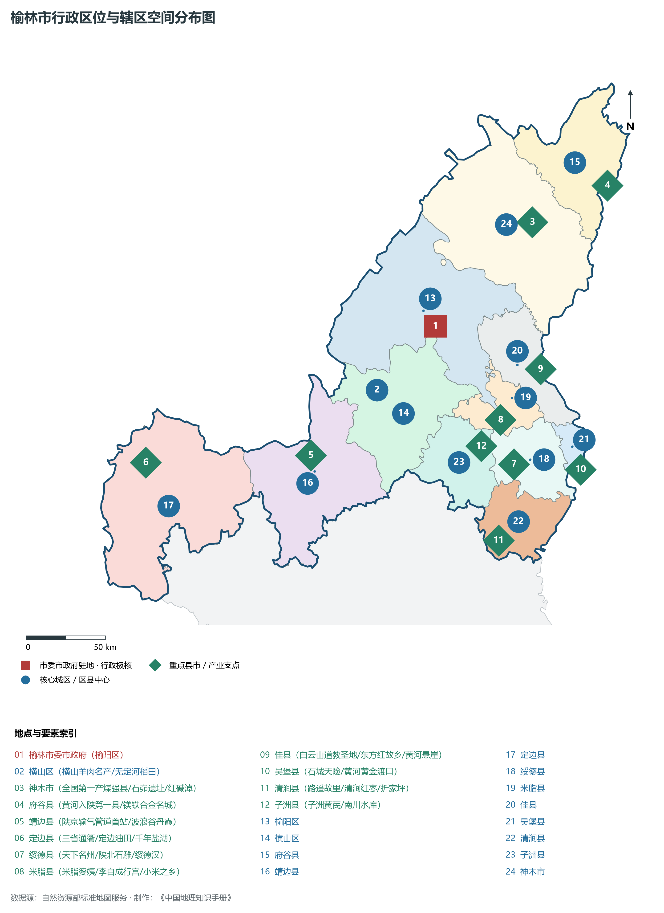
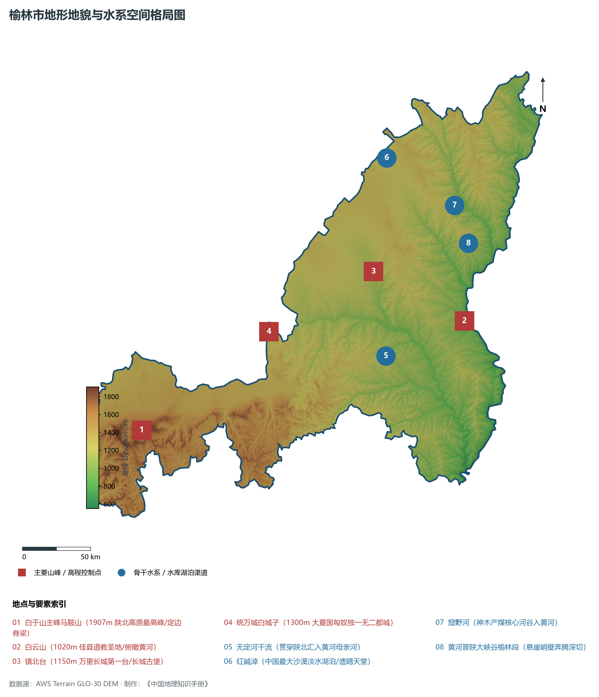
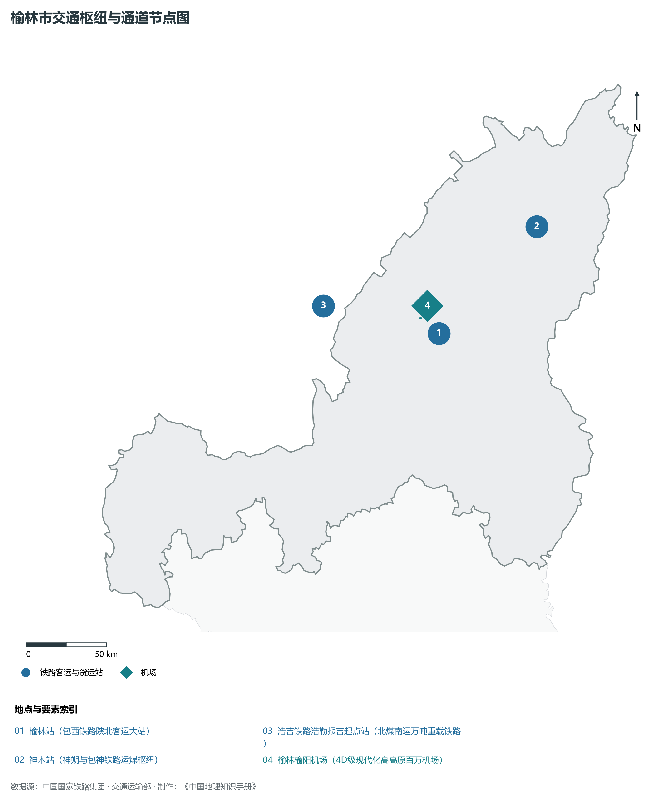
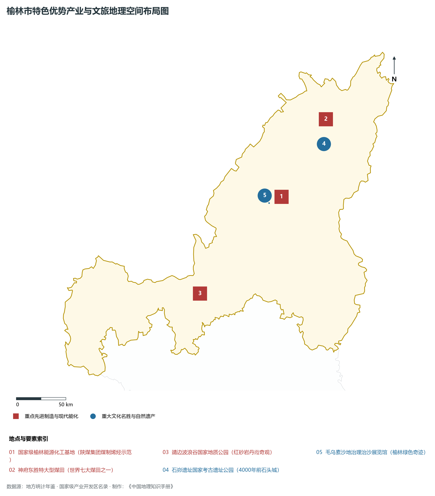
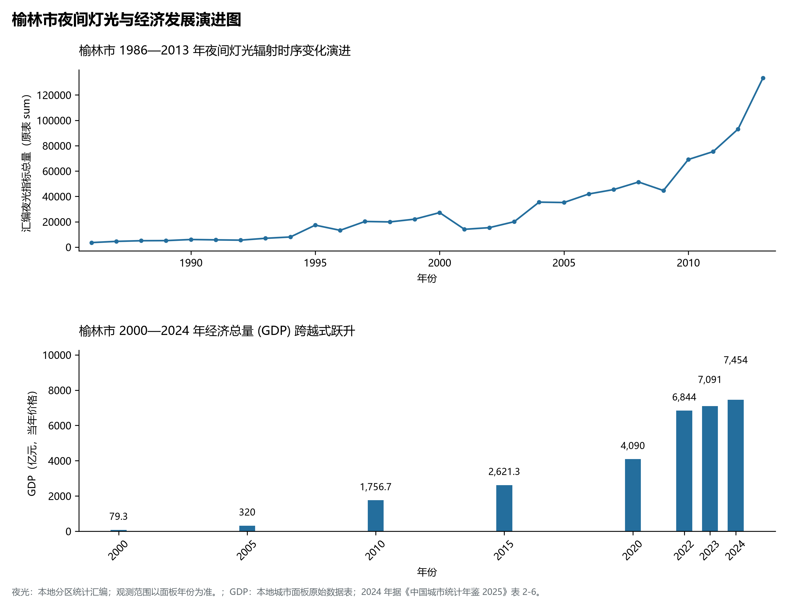

# 25.8 榆林市

## 一、自然地理底盘与生态格局

榆林市地处陕西省陕西经济第二极·国家级现代能源化工基地·塞上明珠·世界级神府煤田·毛乌素沙地生态奇迹核心板块，位于东经 107.44° ～ 111.21°、北纬 36.93° ～ 39.17° 之间。2024 年常住人口 **362 万人**，常住人口城镇化率 **64.48%**，地区生产总值 **7,454 亿元**（当年价格），人均地区生产总值 **208,995 元**，三次产业构成为 **4.22 : 69.94 : 25.84**。

辖区内各层级重点行政极核、区县中心及战略功能节点布局如下：

- **榆林市委市政府 (榆阳区)**：坐标 (109.74°E, 38.29°N)，功能定位：gov；
- **横山区 (横山羊肉名产/无定河稻田)**：坐标 (109.29°E, 37.95°N)，功能定位：subdistrict；
- **神木市 (全国第一产煤强县/石峁遗址/红碱淖)**：坐标 (110.49°E, 38.84°N)，功能定位：town；
- **府谷县 (黄河入陕第一县/镁铁合金名城)**：坐标 (111.06°E, 39.02°N)，功能定位：town；
- **靖边县 (陕京输气管道首站/波浪谷丹霞)**：坐标 (108.79°E, 37.6°N)，功能定位：town；
- **定边县 (三省通衢/定边油田/千年盐湖)**：坐标 (107.59°E, 37.59°N)，功能定位：town；
- **绥德县 (天下名州/陕北石雕/绥德汉)**：坐标 (110.26°E, 37.5°N)，功能定位：town；
- **米脂县 (米脂婆姨/李自成行宫/小米之乡)**：坐标 (110.18°E, 37.75°N)，功能定位：town；
- **佳县 (白云山道教圣地/东方红故乡/黄河悬崖)**：坐标 (110.49°E, 38.02°N)，功能定位：town；
- **吴堡县 (石城天险/黄河黄金渡口)**：坐标 (110.74°E, 37.45°N)，功能定位：town；
- **清涧县 (路遥故里/清涧红枣/折家坪)**：坐标 (110.12°E, 37.08°N)，功能定位：town；
- **子洲县 (子洲黄芪/南川水库)**：坐标 (110.03°E, 37.61°N)，功能定位：town；

辖区地势格局呈现出独特的起伏演化特征，高程极值范围在 **548 m ～ 1907.0 m** 之间，全域最大相对高差达 **1359.0 m**：

辖区重点山脉峰峦与控制性地理高程节点如下：

- **白于山主峰马鞍山 (1907m 陕北高原最高峰/定边脊梁)**：海拔标高 **1907.0 m**，空间坐标 (107.72°E, 37.38°N)；
- **白云山 (1020m 佳县道教圣地/俯瞰黄河)**：海拔标高 **1020.0 m**，空间坐标 (110.48°E, 38.0°N)；
- **镇北台 (1150m 万里长城第一台/长城古堡)**：海拔标高 **1150.0 m**，空间坐标 (109.73°E, 38.35°N)；
- **统万城白城子 (1300m 大夏国匈奴独一无二都城)**：海拔标高 **1300.0 m**，空间坐标 (108.82°E, 37.99°N)；

辖区骨干水系脉络与关键控制地标：

- **无定河干流 (贯穿陕北汇入黄河母亲河)**：标定坐标 (109.8°E, 37.8°N)；
- **红碱淖 (中国最大沙漠淡水湖泊/遗鸥天堂)**：标定坐标 (109.89°E, 39.08°N)；
- **窟野河 (神木产煤核心河谷入黄河)**：标定坐标 (110.45°E, 38.75°N)；
- **黄河晋陕大峡谷榆林段 (悬崖峭壁奔腾深切)**：标定坐标 (110.55°E, 38.5°N)；

独特的自然地理底盘塑造了辖区深厚的气候、水土与生态本底。辖区积极践行“绿水青山就是金山银山”理念，坚决当好秦岭生态卫士，统筹山水林田湖草沙一体化保护和系统治理，严格落实黄河流域生态保护和高质量发展重大国家战略与长江十年禁渔，筑牢国家生态安全屏障。

---

## 二、综合立体交通网络与区位优势

作为陕西省综合立体交通网与丝绸之路经济带上的重要战略枢纽，榆林市区位优势得天独厚、内联外通网络日臻完备。近年来，辖区全方位抢抓高质量共建“一带一路”、亚欧陆海贸易大通道与内陆开放型经济新体制机遇，客货综合保障能级实现历史性跨越：

骨干交通基础设施与重要立体物流枢纽节点包括：

- **榆林站 (包西铁路陕北客运大站)**：空间标定 (109.73°E, 38.27°N)，设施类型：station；
- **神木站 (神朔与包神铁路运煤枢纽)**：空间标定 (110.48°E, 38.83°N)，设施类型：station；
- **榆林榆阳机场 (4D级现代化高高原百万机场)**：空间标定 (109.6°E, 38.36°N)，设施类型：airport；
- **浩吉铁路浩勒报吉起点站 (北煤南运万吨重载铁路)**：空间标定 (108.9°E, 38.45°N)，设施类型：port；

通过高速铁路、高速公路枢纽环线与现代化空港、陆港无缝衔接，榆林市全面融入关中平原城市群“1小时交通圈”与成渝双城经济圈、京津冀、长三角高铁通达网，深度嵌入全国统一大市场与向西开放前沿走廊。

---

## 三、特色优势产业集群、重点园区与现代经济版图

2024 年榆林市全市地区生产总值为 7,454 亿元（当年价格）。

辖区核心产业平台、重大战略工程与重点开发区展示如下：

- **国家级榆林能源化工基地 (陕煤集团煤制烯烃示范)**：空间坐标 (109.85°E, 38.35°N)，核心功能：世界级高端煤化工大国创新典范；
- **神府东胜特大型煤田 (世界七大煤田之一)**：空间坐标 (110.42°E, 39.02°N)，核心功能：中国能源安全压舱石超级矿区；
- **石峁遗址国家考古遗址公园 (4000年前石头城)**：空间坐标 (110.38°E, 38.8°N)，核心功能：华夏文明前夜惊世大发现；
- **靖边波浪谷国家地质公园 (红砂岩丹霞奇观)**：空间坐标 (108.85°E, 37.52°N)，核心功能：宛若时光刻痕的时光指纹大地；
- **毛乌素沙地治理治沙展览馆 (榆林绿色奇迹)**：空间坐标 (109.7°E, 38.3°N)，核心功能：将陕西版图上沙漠彻底抹绿的绿色丰碑；

在现代化产业布局与建圈强链战略中，辖区因地制宜打造特色优势产业生态圈：

1. **战略性新兴产业与先进制造业**：聚焦高端装备制造、新材料、电子信息、新能源汽车及关键零部件，培育高新技术企业与专精特新“小巨人”企业；
2. **现代特色农业与优质食品工业**：持续做优做精地理标志特色农产品，推进农产品精深加工全产业链升级，擦亮农业金色招牌；
3. **现代服务业、物流与数字经济赋能**：加快布局现代物流枢纽、算力中心、数字文旅与康养产业新业态，激发新质生产力澎湃动能。

---

## 四、历史文化胜迹、世界遗产与生态文旅名胜

榆林市历史厚重，人文荟萃，是中华民族和华夏文明的重要发祥地之一，壮丽山川与厚重文脉交相辉映，是世界级文旅胜地：

- **世界文化遗产与国家级重点文保**：拥有享誉中外的世界文化遗产、国家历史文化名城与全国重点文物保护单位，古遗址、古墓葬、摩崖石刻与革命旧址完好保存，生动记录了周秦汉唐盛世文明与中国革命的光辉史诗；
- **国家级风景名胜区与生态地质奇观**：大自然造化赐予辖区雄奇险秀的山川胜景、湿地湖泊、国家森林公园与世界地质公园，空气清冽、风景如画，是绝佳的休闲避暑与生态康养度假胜地；
- **非物质文化遗产与红色基因传承**：秦腔、皮影、剪纸等非遗瑰宝代代相传，红色精神历久弥新，共同构筑起新时代三秦儿女昂扬奋进的精神家园。

---

## 五、夜间灯光遥感时序演变与新时代现代化发展变化

本节夜光图的观测年份为 1986—2013 年，指标为行政区汇总值（原表 sum）。

### 1. 1986—2013 年夜间灯光遥感演化分析

- **1996年演化特征**：榆溪河畔古城与神木土法煤窑弱光；
- **2006年演化特征**：神府煤田大开发·西煤东运主干线成网；
- **2014年演化特征**：榆横工业园现代煤化工巨头云集；
- **2023年演化特征**：突破7000亿大关·高能级现代能源化工基地崛起；

### 2. 2000—2024 年经济跨越式发展时序汇总
下表记录了 榆林市 自 2000 年以来核心年份地区生产总值（GDP）的翻番跨越历程：

| 年份 | 地区生产总值（亿元，当年价格） |
|:---|---:|
| 2000 年 | 79.3 |
| 2005 年 | 320 |
| 2010 年 | 1,756.7 |
| 2015 年 | 2,621.3 |
| 2020 年 | 4,090 |
| 2022 年 | 6,844 |
| 2023 年 | 7,091 |
| 2024 年 | 7,454 |

### 3. 新征程高质量跨越式发展愿景
迈向中国式现代化新征程，榆林市将全面贯彻新发展理念，主动融入和服务国家重大发展战略：

1. 深入推进新型工业化与新型城镇化，做强做优做大优势实体经济，培育壮大战略性新兴产业和未来产业；
2. 协同推进高水平生态环境保护与绿色低碳转型，筑牢国家生态安全屏障；
3. 统筹城乡融合发展与民生保障，奋力谱写中国式现代化建设的陕西新篇章。

2024 年统计来源：《中国城市统计年鉴 2025》表 2-1、2-6、2-7（2024 年，全市）。其他年份 GDP 据本地城市面板“原始数据”表，单位为亿元、当年价格。
