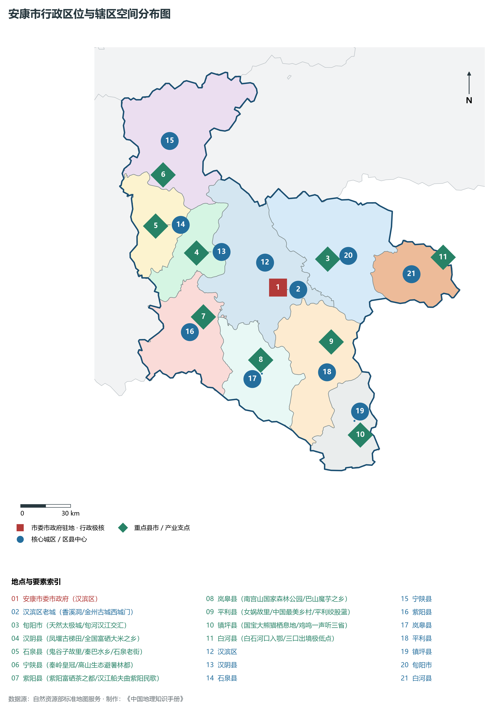
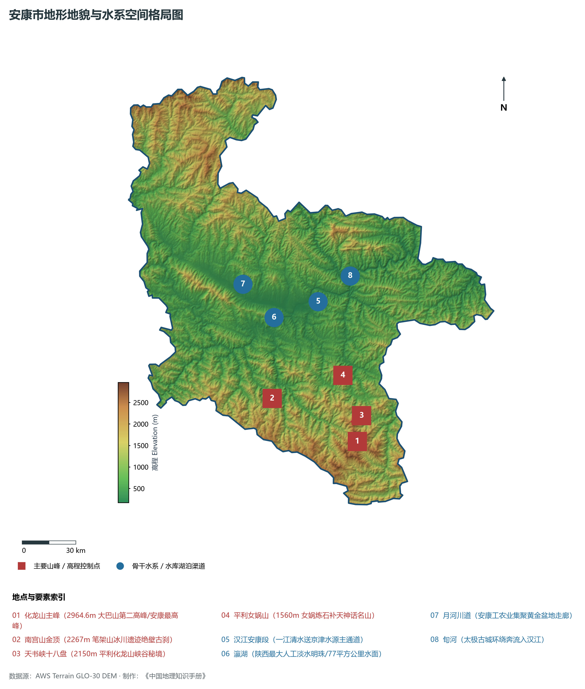
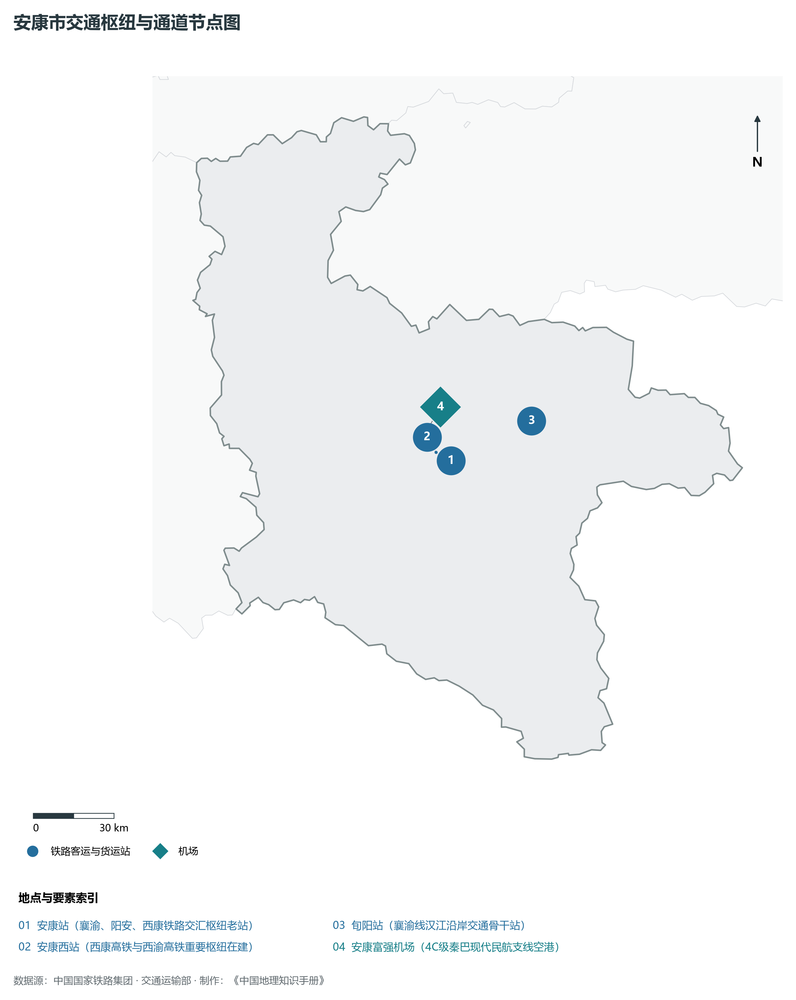
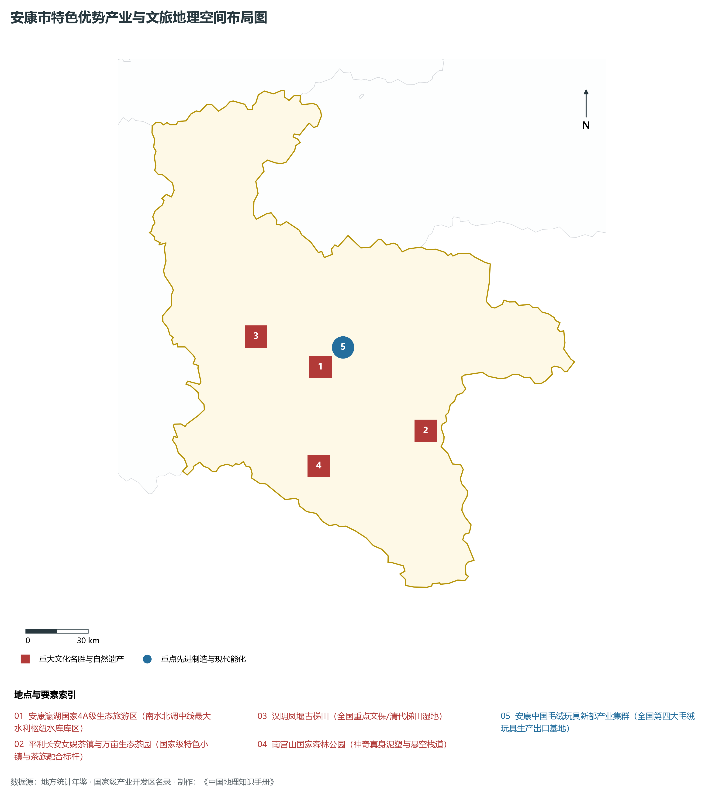
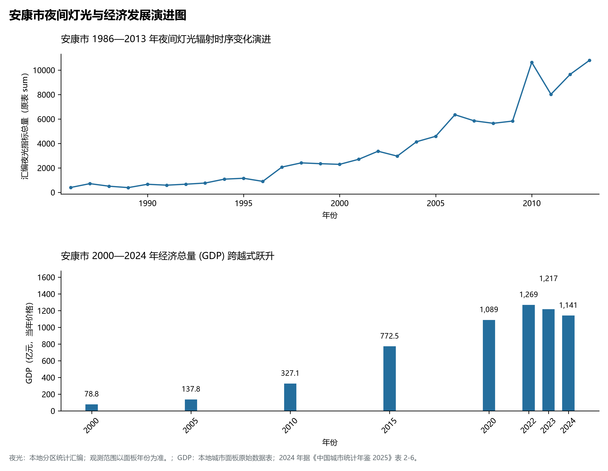

# 25.9 安康市

## 一、自然地理底盘与生态格局

安康市地处陕西省秦巴明珠·中国硒谷·南水北调中线汉江水源涵养地·绿色循环发展示范区·全国毛绒玩具新都核心板块，位于东经 108.10° ～ 110.26°、北纬 31.74° ～ 33.46° 之间。2024 年常住人口 **245 万人**，常住人口城镇化率 **55.21%**，地区生产总值 **1,141 亿元**（当年价格），人均地区生产总值 **46,470 元**，三次产业构成为 **15.66 : 25.46 : 58.88**。

辖区内各层级重点行政极核、区县中心及战略功能节点布局如下：

- **安康市委市政府 (汉滨区)**：坐标 (109.03°E, 32.69°N)，功能定位：gov；
- **汉滨区老城 (香溪洞/金州古城西城门)**：坐标 (109.02°E, 32.68°N)，功能定位：subdistrict；
- **旬阳市 (天然太极城/旬河汉江交汇)**：坐标 (109.36°E, 32.83°N)，功能定位：town；
- **汉阴县 (凤堰古梯田/全国富硒大米之乡)**：坐标 (108.51°E, 32.89°N)，功能定位：town；
- **石泉县 (鬼谷子故里/秦巴水乡/石泉老街)**：坐标 (108.25°E, 33.04°N)，功能定位：town；
- **宁陕县 (秦岭皇冠/高山生态避暑林都)**：坐标 (108.31°E, 33.31°N)，功能定位：town；
- **紫阳县 (紫阳富硒茶之都/汉江船夫曲紫阳民歌)**：坐标 (108.54°E, 32.55°N)，功能定位：town；
- **岚皋县 (南宫山国家森林公园/巴山魔芋之乡)**：坐标 (108.9°E, 32.31°N)，功能定位：town；
- **平利县 (女娲故里/中国最美乡村/平利绞股蓝)**：坐标 (109.36°E, 32.39°N)，功能定位：town；
- **镇坪县 (国宝大熊猫栖息地/鸡鸣一声听三省)**：坐标 (109.52°E, 31.89°N)，功能定位：town；
- **白河县 (白石河口入鄂/三口出境极低点)**：坐标 (110.11°E, 32.81°N)，功能定位：town；

辖区地势格局呈现出独特的起伏演化特征，高程极值范围在 **169 m ～ 2964.6 m** 之间，全域最大相对高差达 **2796.0 m**：

辖区重点山脉峰峦与控制性地理高程节点如下：

- **化龙山主峰 (2964.6m 大巴山第二高峰/安康最高峰)**：海拔标高 **2964.6 m**，空间坐标 (109.35°E, 32.02°N)；
- **南宫山金顶 (2267m 笔架山冰川遗迹绝壁古刹)**：海拔标高 **2267.0 m**，空间坐标 (108.85°E, 32.25°N)；
- **天书峡十八盘 (2150m 平利化龙山峡谷秘境)**：海拔标高 **2150.0 m**，空间坐标 (109.32°E, 32.12°N)；
- **平利女娲山 (1560m 女娲炼石补天神话名山)**：海拔标高 **1560.0 m**，空间坐标 (109.28°E, 32.35°N)；

辖区骨干水系脉络与关键控制地标：

- **汉江安康段 (一江清水送京津水源主通道)**：标定坐标 (109.15°E, 32.72°N)；
- **瀛湖 (陕西最大人工淡水明珠/77平方公里水面)**：标定坐标 (108.88°E, 32.65°N)；
- **月河川道 (安康工农业集聚黄金盆地走廊)**：标定坐标 (108.7°E, 32.82°N)；
- **旬河 (太极古城环绕奔流入汉江)**：标定坐标 (109.35°E, 32.84°N)；

独特的自然地理底盘塑造了辖区深厚的气候、水土与生态本底。辖区积极践行“绿水青山就是金山银山”理念，坚决当好秦岭生态卫士，统筹山水林田湖草沙一体化保护和系统治理，严格落实黄河流域生态保护和高质量发展重大国家战略与长江十年禁渔，筑牢国家生态安全屏障。

---

## 二、综合立体交通网络与区位优势

作为陕西省综合立体交通网与丝绸之路经济带上的重要战略枢纽，安康市区位优势得天独厚、内联外通网络日臻完备。近年来，辖区全方位抢抓高质量共建“一带一路”、亚欧陆海贸易大通道与内陆开放型经济新体制机遇，客货综合保障能级实现历史性跨越：

骨干交通基础设施与重要立体物流枢纽节点包括：

- **安康站 (襄渝、阳安、西康铁路交汇枢纽老站)**：空间标定 (109.04°E, 32.7°N)，设施类型：station；
- **安康西站 (西康高铁与西渝高铁重要枢纽在建)**：空间标定 (108.98°E, 32.73°N)，设施类型：rail；
- **安康富强机场 (4C级秦巴现代民航支线空港)**：空间标定 (108.93°E, 32.78°N)，设施类型：airport；
- **旬阳站 (襄渝线汉江沿岸交通骨干站)**：空间标定 (109.37°E, 32.82°N)，设施类型：station；

通过高速铁路、高速公路枢纽环线与现代化空港、陆港无缝衔接，安康市全面融入关中平原城市群“1小时交通圈”与成渝双城经济圈、京津冀、长三角高铁通达网，深度嵌入全国统一大市场与向西开放前沿走廊。

---

## 三、特色优势产业集群、重点园区与现代经济版图

2024 年安康市全市地区生产总值为 1,141 亿元（当年价格）。

辖区核心产业平台、重大战略工程与重点开发区展示如下：

- **安康瀛湖国家4A级生态旅游区**：空间坐标 (108.89°E, 32.66°N)，核心功能：南水北调中线最大水利枢纽水库库区；
- **安康中国毛绒玩具新都产业集群**：空间坐标 (109.01°E, 32.74°N)，核心功能：全国第四大毛绒玩具生产出口基地；
- **平利长安女娲茶镇与万亩生态茶园**：空间坐标 (109.42°E, 32.37°N)，核心功能：国家级特色小镇与茶旅融合标杆；
- **汉阴凤堰古梯田 (全国重点文保/清代梯田湿地)**：空间坐标 (108.56°E, 32.8°N)，核心功能：秦巴山区移民农耕水利智慧活化石；
- **南宫山国家森林公园 (神奇真身泥塑与悬空栈道)**：空间坐标 (108.86°E, 32.24°N)，核心功能：国家4A级高山地质地貌奇观；

在现代化产业布局与建圈强链战略中，辖区因地制宜打造特色优势产业生态圈：

1. **战略性新兴产业与先进制造业**：聚焦高端装备制造、新材料、电子信息、新能源汽车及关键零部件，培育高新技术企业与专精特新“小巨人”企业；
2. **现代特色农业与优质食品工业**：持续做优做精地理标志特色农产品，推进农产品精深加工全产业链升级，擦亮农业金色招牌；
3. **现代服务业、物流与数字经济赋能**：加快布局现代物流枢纽、算力中心、数字文旅与康养产业新业态，激发新质生产力澎湃动能。

---

## 四、历史文化胜迹、世界遗产与生态文旅名胜

安康市历史厚重，人文荟萃，是中华民族和华夏文明的重要发祥地之一，壮丽山川与厚重文脉交相辉映，是世界级文旅胜地：

- **世界文化遗产与国家级重点文保**：拥有享誉中外的世界文化遗产、国家历史文化名城与全国重点文物保护单位，古遗址、古墓葬、摩崖石刻与革命旧址完好保存，生动记录了周秦汉唐盛世文明与中国革命的光辉史诗；
- **国家级风景名胜区与生态地质奇观**：大自然造化赐予辖区雄奇险秀的山川胜景、湿地湖泊、国家森林公园与世界地质公园，空气清冽、风景如画，是绝佳的休闲避暑与生态康养度假胜地；
- **非物质文化遗产与红色基因传承**：秦腔、皮影、剪纸等非遗瑰宝代代相传，红色精神历久弥新，共同构筑起新时代三秦儿女昂扬奋进的精神家园。

---

## 五、夜间灯光遥感时序演变与新时代现代化发展变化

本节夜光图的观测年份为 1986—2013 年，指标为行政区汇总值（原表 sum）。

### 1. 1986—2013 年夜间灯光遥感演化分析

- **1996年演化特征**：汉江两岸老安康与襄渝铁路站灯火；
- **2006年演化特征**：西康铁路全线贯通·瀛湖大水面形成；
- **2014年演化特征**：安康高新区建设·富硒产业链条铺开；
- **2023年演化特征**：毛绒玩具产业狂飙·一江清水送京津生辉；

### 2. 2000—2024 年经济跨越式发展时序汇总
下表记录了 安康市 自 2000 年以来核心年份地区生产总值（GDP）的翻番跨越历程：

| 年份 | 地区生产总值（亿元，当年价格） |
|:---|---:|
| 2000 年 | 78.8 |
| 2005 年 | 137.8 |
| 2010 年 | 327.1 |
| 2015 年 | 772.5 |
| 2020 年 | 1,089 |
| 2022 年 | 1,269 |
| 2023 年 | 1,217 |
| 2024 年 | 1,141 |

### 3. 新征程高质量跨越式发展愿景
迈向中国式现代化新征程，安康市将全面贯彻新发展理念，主动融入和服务国家重大发展战略：

1. 深入推进新型工业化与新型城镇化，做强做优做大优势实体经济，培育壮大战略性新兴产业和未来产业；
2. 协同推进高水平生态环境保护与绿色低碳转型，筑牢国家生态安全屏障；
3. 统筹城乡融合发展与民生保障，奋力谱写中国式现代化建设的陕西新篇章。

2024 年统计来源：《中国城市统计年鉴 2025》表 2-1、2-6、2-7（2024 年，全市）。其他年份 GDP 据本地城市面板“原始数据”表，单位为亿元、当年价格。
