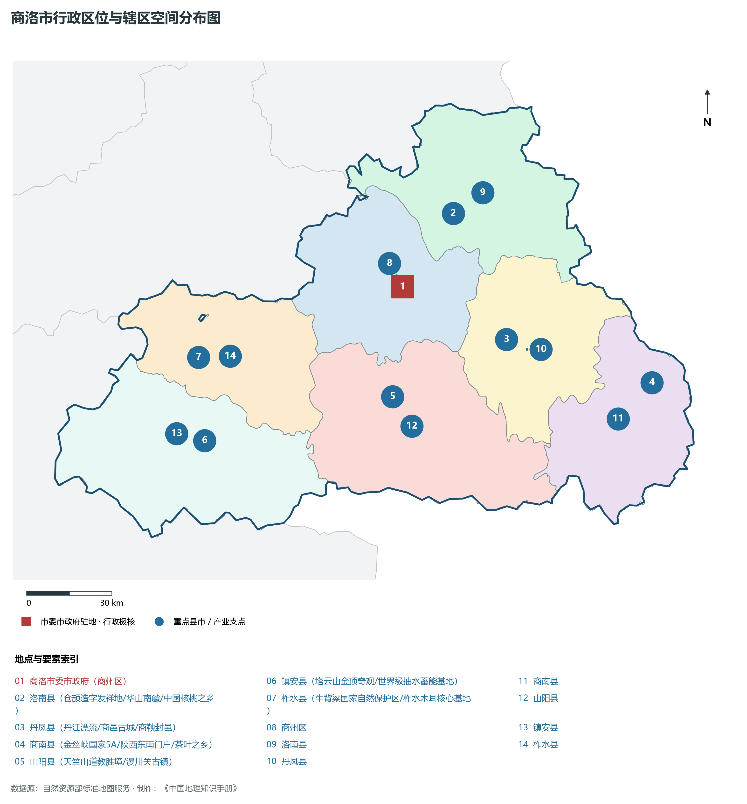
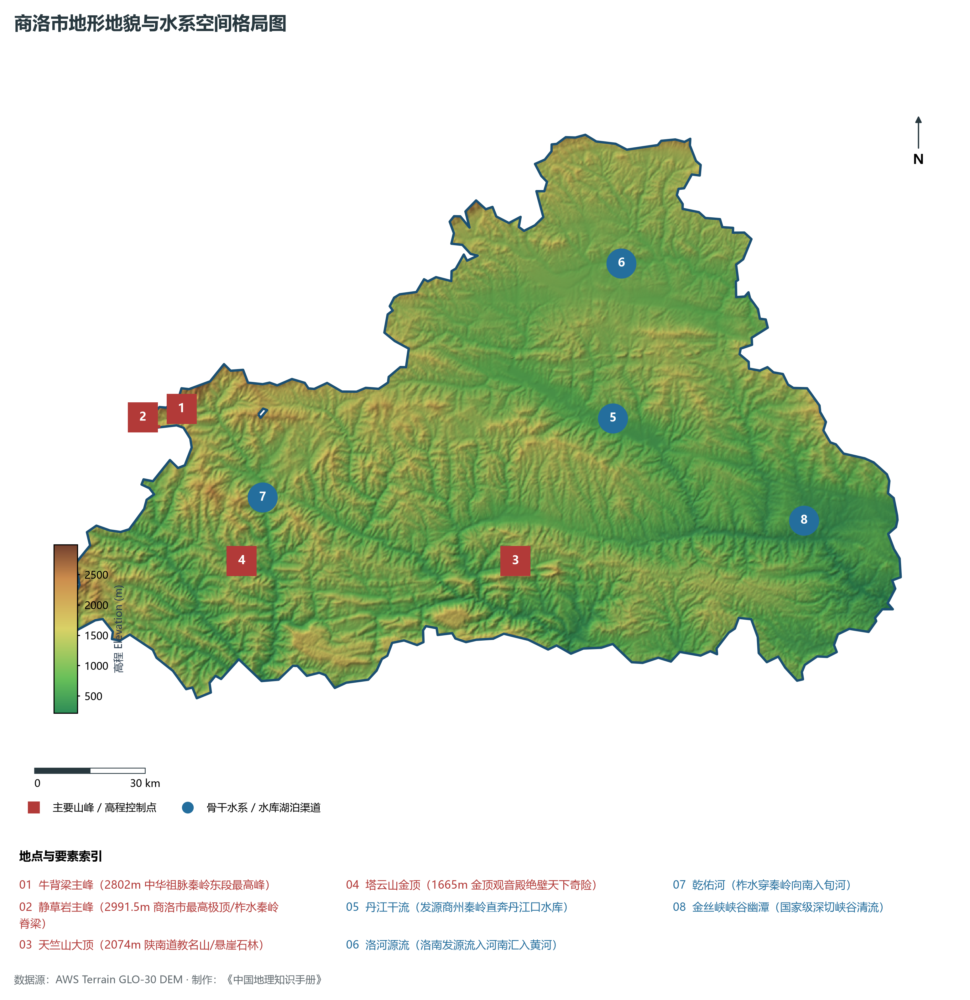
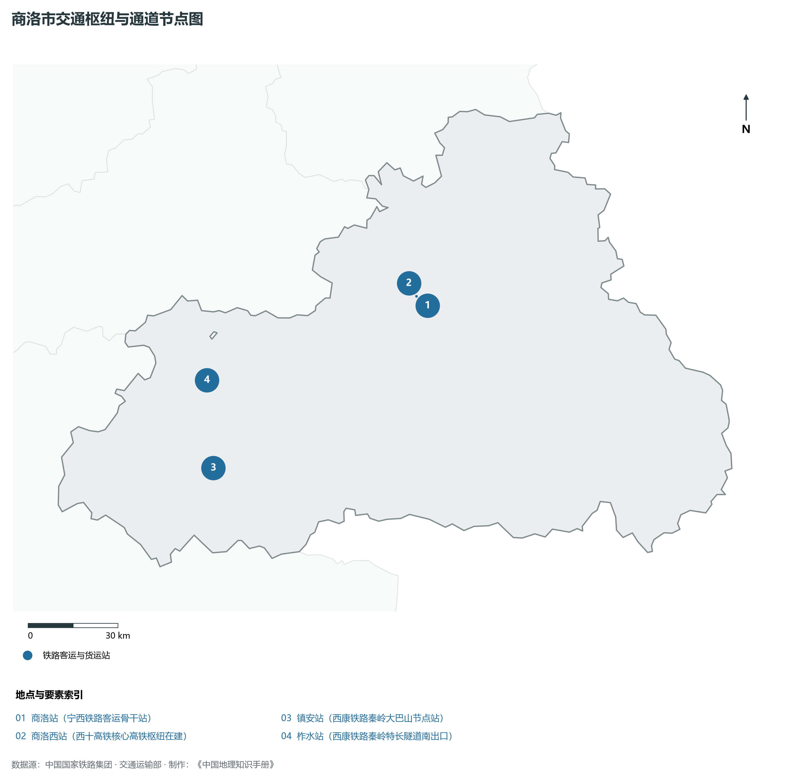
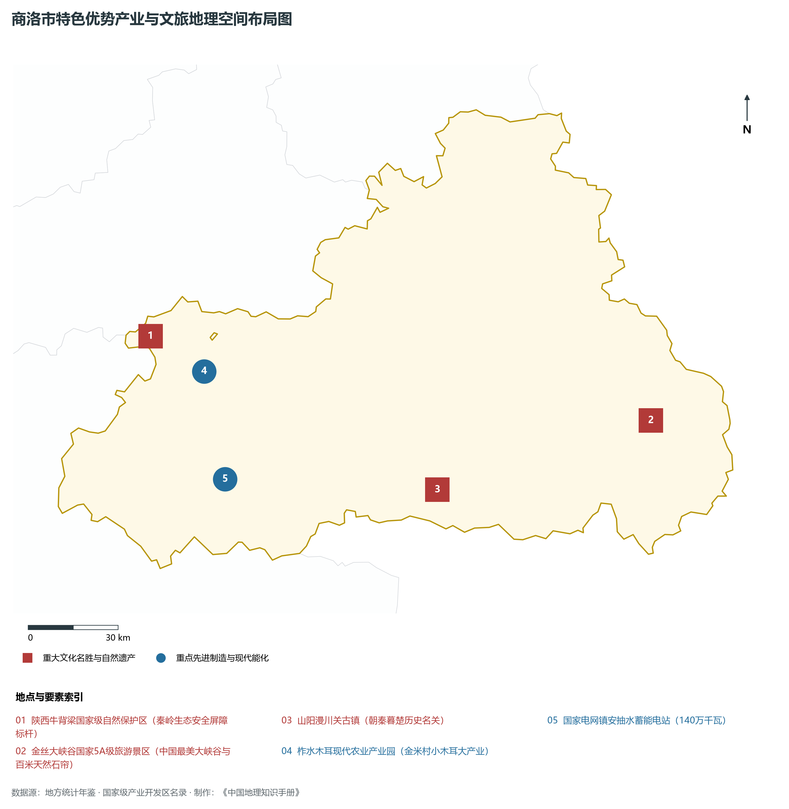
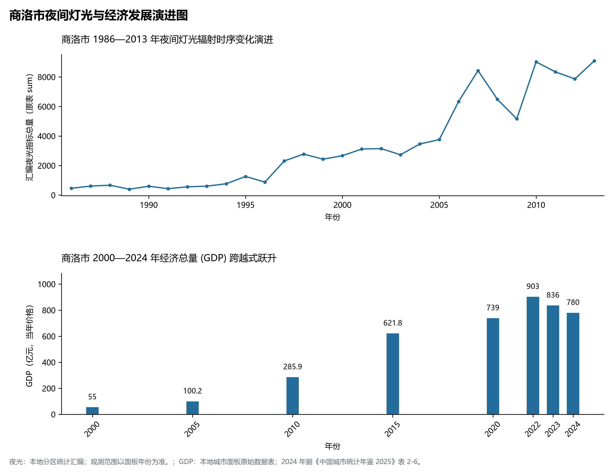

# 25.10 商洛市

## 一、自然地理底盘与生态格局

商洛市地处陕西省秦岭最美是商洛·中国气候康养之都·西安生态后花园·商鞅变法封邑名城·南水北调水源屏障核心板块，位于东经 108.99° ～ 111.03°、北纬 33.27° ～ 34.24° 之间。2024 年常住人口 **201 万人**，常住人口城镇化率 **53.42%**，地区生产总值 **780 亿元**（当年价格），人均地区生产总值 **38,773 元**，三次产业构成为 **16.1 : 23.47 : 60.43**。

辖区内各层级重点行政极核、区县中心及战略功能节点布局如下：

- **商洛市委市政府 (商州区)**：坐标 (109.94°E, 33.87°N)，功能定位：gov；
- **洛南县 (仓颉造字发祥地/华山南麓/中国核桃之乡)**：坐标 (110.15°E, 34.09°N)，功能定位：town；
- **丹凤县 (丹江漂流/商邑古城/商鞅封邑)**：坐标 (110.33°E, 33.69°N)，功能定位：town；
- **商南县 (金丝峡国家5A/陕西东南门户/茶叶之乡)**：坐标 (110.88°E, 33.53°N)，功能定位：town；
- **山阳县 (天竺山道教胜境/漫川关古镇)**：坐标 (109.88°E, 33.53°N)，功能定位：town；
- **镇安县 (塔云山金顶奇观/世界级抽水蓄能基地)**：坐标 (109.15°E, 33.42°N)，功能定位：town；
- **柞水县 (牛背梁国家自然保护区/柞水木耳核心基地)**：坐标 (109.14°E, 33.68°N)，功能定位：town；

辖区地势格局呈现出独特的起伏演化特征，高程极值范围在 **215 m ～ 2991.5 m** 之间，全域最大相对高差达 **2776.5 m**：

辖区重点山脉峰峦与控制性地理高程节点如下：

- **牛背梁主峰 (2802m 中华祖脉秦岭东段最高峰)**：海拔标高 **2802.0 m**，空间坐标 (108.92°E, 33.82°N)；
- **静草岩主峰 (2991.5m 商洛市最高极顶/柞水秦岭脊梁)**：海拔标高 **2991.5 m**，空间坐标 (108.85°E, 33.78°N)；
- **天竺山大顶 (2074m 陕南道教名山/悬崖石林)**：海拔标高 **2074.0 m**，空间坐标 (109.89°E, 33.42°N)；
- **塔云山金顶 (1665m 金顶观音殿绝壁天下奇险)**：海拔标高 **1665.0 m**，空间坐标 (109.08°E, 33.45°N)；

辖区骨干水系脉络与关键控制地标：

- **丹江干流 (发源商州秦岭直奔丹江口水库)**：标定坐标 (110.2°E, 33.75°N)；
- **洛河源流 (洛南发源流入河南汇入黄河)**：标定坐标 (110.25°E, 34.12°N)；
- **乾佑河 (柞水穿秦岭向南入旬河)**：标定坐标 (109.15°E, 33.6°N)；
- **金丝峡峡谷幽潭 (国家级深切峡谷清流)**：标定坐标 (110.75°E, 33.48°N)；

独特的自然地理底盘塑造了辖区深厚的气候、水土与生态本底。辖区积极践行“绿水青山就是金山银山”理念，坚决当好秦岭生态卫士，统筹山水林田湖草沙一体化保护和系统治理，严格落实黄河流域生态保护和高质量发展重大国家战略与长江十年禁渔，筑牢国家生态安全屏障。

---

## 二、综合立体交通网络与区位优势

作为陕西省综合立体交通网与丝绸之路经济带上的重要战略枢纽，商洛市区位优势得天独厚、内联外通网络日臻完备。近年来，辖区全方位抢抓高质量共建“一带一路”、亚欧陆海贸易大通道与内陆开放型经济新体制机遇，客货综合保障能级实现历史性跨越：

骨干交通基础设施与重要立体物流枢纽节点包括：

- **商洛站 (宁西铁路客运骨干站)**：空间标定 (109.95°E, 33.86°N)，设施类型：station；
- **商洛西站 (西十高铁核心高铁枢纽在建)**：空间标定 (109.91°E, 33.89°N)，设施类型：rail；
- **镇安站 (西康铁路秦岭大巴山节点站)**：空间标定 (109.14°E, 33.41°N)，设施类型：station；
- **柞水站 (西康铁路秦岭特长隧道南出口)**：空间标定 (109.13°E, 33.67°N)，设施类型：station；

通过高速铁路、高速公路枢纽环线与现代化空港、陆港无缝衔接，商洛市全面融入关中平原城市群“1小时交通圈”与成渝双城经济圈、京津冀、长三角高铁通达网，深度嵌入全国统一大市场与向西开放前沿走廊。

---

## 三、特色优势产业集群、重点园区与现代经济版图

2024 年商洛市全市地区生产总值为 780 亿元（当年价格）。

辖区核心产业平台、重大战略工程与重点开发区展示如下：

- **陕西牛背梁国家级自然保护区 (秦岭生态安全屏障标杆)**：空间坐标 (108.93°E, 33.81°N)，核心功能：国宝大熊猫羚牛天然庇护所；
- **金丝大峡谷国家5A级旅游景区**：空间坐标 (110.74°E, 33.49°N)，核心功能：中国最美大峡谷与百米天然石帘；
- **柞水木耳现代农业产业园 (金米村小木耳大产业)**：空间坐标 (109.12°E, 33.7°N)，核心功能：全国脱贫攻坚与产业振兴时代样板；
- **国家电网镇安抽水蓄能电站 (140万千瓦)**：空间坐标 (109.18°E, 33.38°N)，核心功能：服务西北电网调峰巨型超级充电宝；
- **山阳漫川关古镇 (朝秦暮楚历史名关)**：空间坐标 (109.95°E, 33.32°N)，核心功能：秦楚咽喉古水运码头会馆古建群；

在现代化产业布局与建圈强链战略中，辖区因地制宜打造特色优势产业生态圈：

1. **战略性新兴产业与先进制造业**：聚焦高端装备制造、新材料、电子信息、新能源汽车及关键零部件，培育高新技术企业与专精特新“小巨人”企业；
2. **现代特色农业与优质食品工业**：持续做优做精地理标志特色农产品，推进农产品精深加工全产业链升级，擦亮农业金色招牌；
3. **现代服务业、物流与数字经济赋能**：加快布局现代物流枢纽、算力中心、数字文旅与康养产业新业态，激发新质生产力澎湃动能。

---

## 四、历史文化胜迹、世界遗产与生态文旅名胜

商洛市历史厚重，人文荟萃，是中华民族和华夏文明的重要发祥地之一，壮丽山川与厚重文脉交相辉映，是世界级文旅胜地：

- **世界文化遗产与国家级重点文保**：拥有享誉中外的世界文化遗产、国家历史文化名城与全国重点文物保护单位，古遗址、古墓葬、摩崖石刻与革命旧址完好保存，生动记录了周秦汉唐盛世文明与中国革命的光辉史诗；
- **国家级风景名胜区与生态地质奇观**：大自然造化赐予辖区雄奇险秀的山川胜景、湿地湖泊、国家森林公园与世界地质公园，空气清冽、风景如画，是绝佳的休闲避暑与生态康养度假胜地；
- **非物质文化遗产与红色基因传承**：秦腔、皮影、剪纸等非遗瑰宝代代相传，红色精神历久弥新，共同构筑起新时代三秦儿女昂扬奋进的精神家园。

---

## 五、夜间灯光遥感时序演变与新时代现代化发展变化

本节夜光图的观测年份为 1986—2013 年，指标为行政区汇总值（原表 sum）。

### 1. 1986—2013 年夜间灯光遥感演化分析

- **1996年演化特征**：丹江谷地商州老街点点星火；
- **2006年演化特征**：西合铁路与西商高速全线贯通；
- **2014年演化特征**：牛背梁与金丝峡名胜打造·商山洛水绿意浓；

### 2. 2000—2024 年经济跨越式发展时序汇总
下表记录了 商洛市 自 2000 年以来核心年份地区生产总值（GDP）的翻番跨越历程：

| 年份 | 地区生产总值（亿元，当年价格） |
|:---|---:|
| 2000 年 | — |
| 2005 年 | 100.2 |
| 2010 年 | 285.9 |
| 2015 年 | 621.8 |
| 2020 年 | 739 |
| 2022 年 | 903 |
| 2023 年 | 836 |
| 2024 年 | 780 |

### 3. 新征程高质量跨越式发展愿景
迈向中国式现代化新征程，商洛市将全面贯彻新发展理念，主动融入和服务国家重大发展战略：

1. 深入推进新型工业化与新型城镇化，做强做优做大优势实体经济，培育壮大战略性新兴产业和未来产业；
2. 协同推进高水平生态环境保护与绿色低碳转型，筑牢国家生态安全屏障；
3. 统筹城乡融合发展与民生保障，奋力谱写中国式现代化建设的陕西新篇章。

2024 年统计来源：《中国城市统计年鉴 2025》表 2-1、2-6、2-7（2024 年，全市）。其他年份 GDP 据本地城市面板“原始数据”表，单位为亿元、当年价格。
