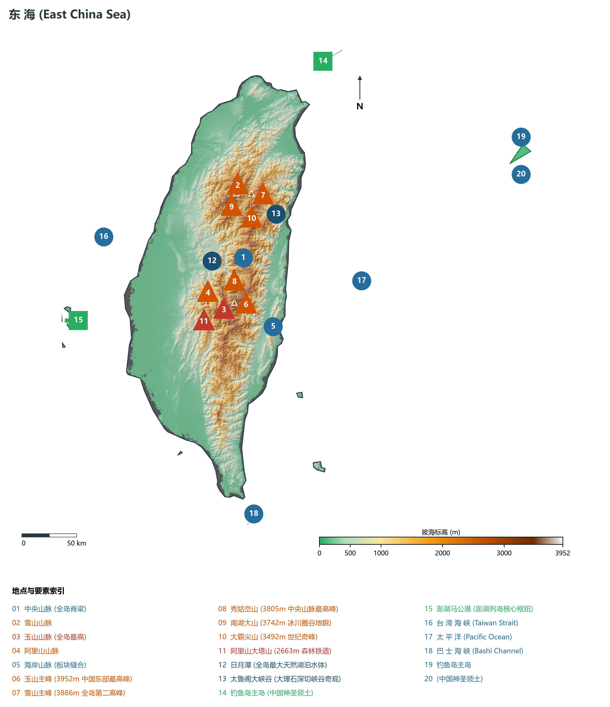
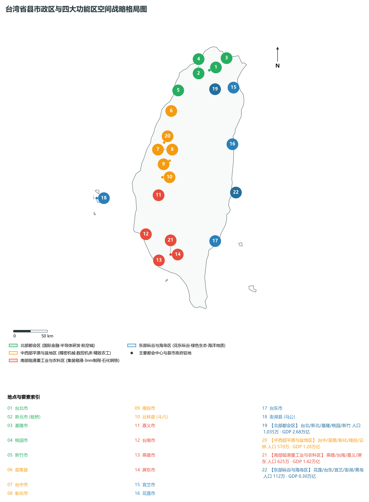
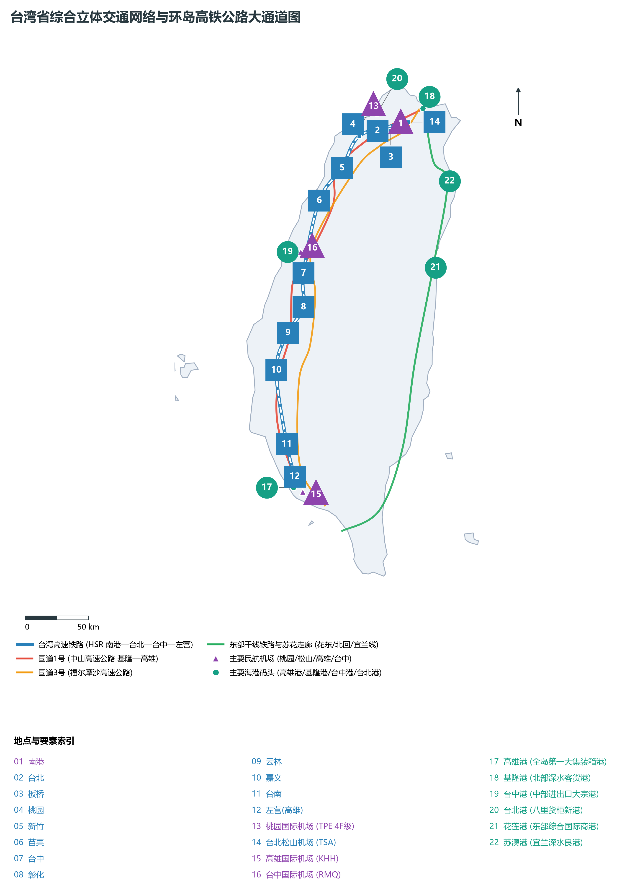
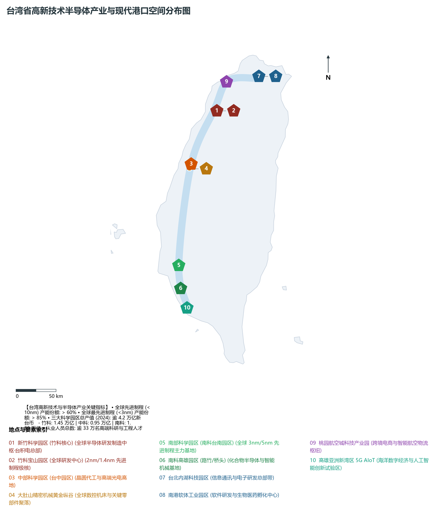
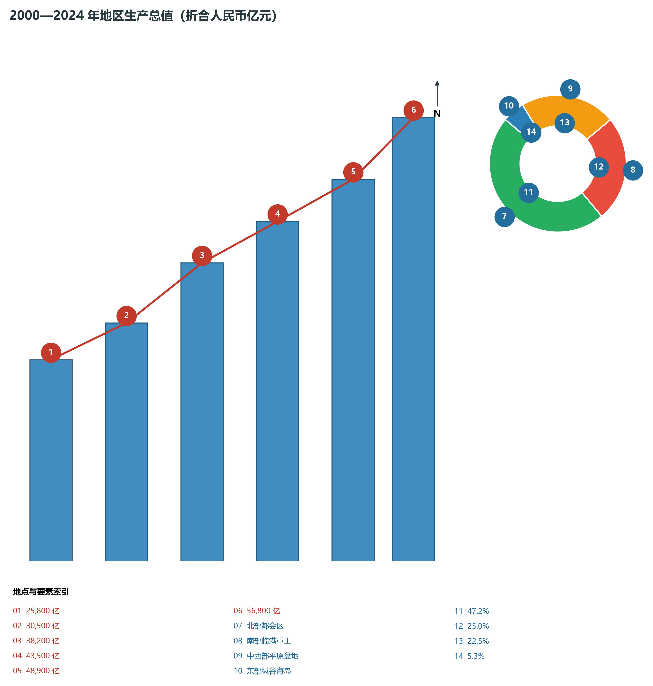

# 26.0 台湾省地理统揽

台湾省（Taiwan Province，简称“台”），是中国第一大岛及其附属岛屿组成的省级行政区，位于中国东南沿海的大陆架东缘，东临浩瀚的太平洋，东北濒东海并隔东海与琉球群岛相望，南界巴士海峡与菲律宾群岛相对，西隔宽约 130～200 公里的台湾海峡与福建省相望。全省陆地总面积达 **36,197.0 km²**，由台湾本岛（面积约 35,883 km²）及兰屿、绿岛、钓鱼岛、赤尾屿、彭佳屿、澎湖列岛等 80 余个大小岛屿共同组成。

截至 2024 年末，台湾省常住人口约 **2,342.0 万人**，城镇化率约 **80.0%**，全省平均人口密度达每平方公里 647 人，其中西部平原各大都会区人口密度常年超每平方公里 4,000 人以上，呈现极度高度集聚的人口与产业经济走廊格局。2024 年，台湾地区生产总值（GDP）折合人民币约 **56,800 亿元**（按当年平均汇率约合 8,000 亿美元），人均本地生产总值折合人民币约 **24.25 万元**（折合 3.42 万美元）；三次产业结构呈现先进制造业与现代高端服务业并重的发达经济特征，三次产业结构比为 **1.5 : 37.5 : 61.0**。台湾自古以来就是中国领土不可分割的一部分，在地缘政治、国家安全与全球先进集成电路产业供应链中占据着极其关键的核心枢纽地位，素有“祖国东南海锁钥”、“东方糖库”、“水果王国”与“全球半导体硅岛”之盛誉。

---

## 一、板块俯冲碰撞、五大山脉纵贯与“山高海深·水急林茂”自然地理底盘

台湾岛地处欧亚板块与菲律宾海板块强烈的碰撞缝合带上，构造运动极其活跃，造就了崇山峻岭连绵、平原逼仄狭长、高差悬殊的世界级年轻褶皱山地地貌：

1. **“山地占三分之二”的地形骨架与五大山脉纵贯格局**：
   - 全岛约三分之二的陆域为山地和丘陵，平原多偏居西部沿海；
   - **中央山脉（全岛脊梁）**：北起苏澳乌岩角，南抵恒春半岛鹅銮鼻，纵贯全岛长达 340 公里，平均海拔在 3,000 米以上，高大巍峨地阻挡了太平洋强劲水汽与东来台风；
   - **雪山山脉**：纵贯北部中北部，极顶**雪山主峰（3,886.0 m）**为全岛第二高峰，拥有壮美的第四纪冰川圈谷遗迹；
   - **玉山山脉**：居全岛中南部，极顶**玉山主峰（3,952.0 m）**巍然耸立，不仅是台湾第一高峰，更是中国东部、东亚大陆架边缘的最高极顶；
   - **阿里山山脉**：位于玉山山脉西侧，山势相对平缓，平均海拔约 2,000 米，以壮丽的高山云海、千年红桧红杉巨木林与高山森林铁道闻名于世；
   - **海岸山脉**：紧贴东太平洋沿岸，北起花莲溪口，南抵卑南溪口，长约 150 公里，与中央山脉之间夹峙着世界著名的板块缝合构造奇观——**花东纵谷（台东纵谷）**；
2. **惊人的垂直地貌落差与水系特征**：
   - **最高峰**：玉山主峰（**3,952.0 m**）；
   - **最低点**：太平洋深海海沟与台湾海峡海面（**0.0 m**，东侧数海里外即骤降至深度数千米的深海）；
   - **水系特征**：全岛河流源短流急、比降极大、落差惊人，洪水期波涛汹涌，枯水期溪床裸露。主要大河包括：
     - **浊水溪**：发源于中央山脉合欢山，全长 **186.6 km**，为全岛最长河流，也是南北地理与气候的分界线；
     - **高屏溪**：全长 171.0 km，流域面积达 **3,257 km²**，为全岛流域面积第一大水系；
     - **淡水河**：纵贯大台北都会区，全长 158.7 km，流域面积 2,728 km²；
     - **曾文溪**：灌溉嘉南平原大粮仓，上游建有全岛蓄水量最大的**曾文水库（容量超 6.0 × 10⁸ m³）**；
3. **附属群岛与东海屏障**：
   - **澎湖列岛**：地处台湾海峡南部，由 64 个玄武岩火山熔岩台地岛屿组成，地势平坦、柱状节理极其壮观；
   - **钓鱼岛及其附属岛屿**：位于台湾基隆东北约 170 公里海域，包括钓鱼岛、黄尾屿、赤尾屿、南小岛、北小岛等，自古即为中国渔民传统渔场与神圣固有领土；
   - **兰屿与绿岛**：耸立于东部太平洋海域的火山热带岛屿，珊瑚礁环绕，为达悟族人聚居地与海底温泉胜地。

**台湾省“台湾海峡—嘉南平原—阿里山—玉山主峰—花东纵谷—海岸山脉—太平洋”立体大剖面图**

| 台湾海峡 0m (浅海) | 嘉南平原 10-50m | 阿里山 2200m | 玉山主峰 3952m | 花东纵谷 100-200m | 海岸山脉 1682m | 太平洋 (水深>4000m) |
| --- | --- | --- | --- | --- | --- | --- |
| 澎湖列岛·玄武岩熔岩；沿海滩涂·虱目鱼养殖 | 浊水溪冲积平原；嘉南大圳·高科技带 | 千年红桧神木林；祝山日出·云海晚霞 | 中国东部最高极顶；亚寒带针叶林·积雪 | 板块缝合线·池上稻浪；卑南溪·台九线绿廊 | 秀姑峦溪切穿峡谷；奇石崖壁·三仙台 | 黑潮暖流主轴通道；远洋渔业·深海海沟 |

台湾海峡西侧浅水 · → 嘉南平原粮仓 · → 阿里山山脉 · → 玉山山脉极顶 · → 花东纵谷断层带 · → 海岸山脉 · → 太平洋深海盆

---

## 二、县市政区架构与“四大功能区”空间战略宏观版图

台湾省现行行政区划包括 6 个“直辖市”（台北市、新北市、桃园市、台中市、台南市、高雄市）、3 个市（基隆市、新竹市、嘉义市）以及 11 个县（新竹县、苗栗县、彰化县、南投县、云林县、嘉义县、屏东县、宜兰县、花莲县、台东县、澎湖县），在地理与空间经济格局上形成四大功能板块：

1. **北部都会区（政经中枢·半导体研发·航空城门户）**：
   - 涵盖台北市、新北市、基隆市、桃园市、新竹市、新竹县，陆域总面积约 **4,600 km²**，常住人口达 **1,035 万人**（占全省约 44.2%）；
   - 2024 年地区生产总值超 **26,800 亿元人民币**（占全省近一半），以台北信义金融总部、新竹科学园区（竹科）集成电路全球研发中心、桃园国际机场航空城为核心；
2. **中西部平原与盆地区（精密机械·数控装备·精致农工走廊）**：
   - 涵盖苗栗县、台中市、彰化县、南投县、云林县，面积约 **9,300 km²**，常住人口 **570 万人**；
   - 2024 年地区生产总值达 **12,800 亿元人民币**，以台中七期现代都会、中部科学园区、大肚山精密机械黄金纵谷、云林麦寮重化工业区及日月潭山水名胜为骨架；
3. **南部临港重工业与农科区（国际深水港城·先进晶圆制造·绿色重化）**：
   - 涵盖嘉义市、嘉义县、台南市、高雄市、屏东县，面积约 **11,400 km²**，常住人口 **625 万人**；
   - 2024 年地区生产总值达 **14,200 亿元人民币**，依托高雄深水集装箱巨港、南部科学园区（南科台南台积电 3nm/5nm 先进制程极核基地）、中钢/台船重工以及嘉南平原热带现代农业基地；
4. **东部纵谷与海岛区（花东纵谷·绿色生态走廊·海洋地质奇观）**：
   - 涵盖宜兰县、花莲县、台东县、澎湖县、钓鱼岛及各离岛，面积约 **10,897 km²**，常住人口约 **112 万人**；
   - 2024 年地区生产总值约 **3,000 亿元人民币**，以太鲁阁大理石峡谷、苏花海岸断崖、花东绿色纵谷田园生态、澎湖海岛旅游为核心，是全省最重要的生态涵养与多元文化宝库。

---

## 三、综合立体交通网络：台湾高铁、环岛铁路与国际海空港口走廊

台湾构建了贯通东西、环绕全岛的超高密度综合立体交通体系：

1. **台湾高速铁路（HSR 纵贯大动脉）**：
   - 全长 **349.5 km**，最高设计时速 300 公里，贯穿西部走廊（南港—台北—板桥—桃园—新竹—苗栗—台中—彰化—云林—嘉义—台南—左营/高雄），将台北至高雄的旅行时间压缩至 90 分钟以内，彻底实现了西部平原“一日生活圈”；
2. **环岛铁路干线系统（台铁网络）**：
   - 包括西部干线（纵贯线）、东部干线（宜兰线、北回线、台东花东线）与南回铁路，实现全线电气化环岛无缝闭环运行；
3. **高快速公路大网络**：
   - **国道1号（中山高速公路）**：全长 374 公里，基隆至高雄，全岛第一条高速公路动脉；
   - **国道3号（福尔摩沙高速公路）**：全长 431 公里，复线并行分流西部过境交通；
   - **国道5号（蒋渭水高速公路）**：横穿雪山山脉，拥有全长 **12.9 km** 的**雪山隧道**（全岛最长公路隧道），将台北至宜兰行车时间缩短至 40 分钟；
   - **苏花公路改善工程（苏花改）**：穿行悬崖峭壁之间，打通东部安全全天候交通生命线；
4. **国际海空枢纽门户**：
   - **桃园国际机场（TPE，4F 级）**：年旅客吞吐量超 4,500 万人次，航空货运量位列全球前十强；
   - **高雄港（Kaohsiung Port）**：全岛第一大深水综合商港，拥有优异的天然港湾和现代化深水集装箱码头群，集装箱年吞吐量近千万标箱（TEU），航线网络通达全球各大洋；
   - **基隆港、台中港、台北港、花莲港、苏澳港**：构建起全方位外向型航运港口集群。

---

## 四、全球“半导体硅岛”与先进制程产业高地

台湾省拥有全球最完整、最具竞争力的半导体产业链与先进制造集群：

1. **“硅岛”产业带三大核心支柱**：
   - **新竹科学园区（竹科，1980 年成立）**：全球半导体产业圣地与“台湾硅谷”，孕育了台积电（TSMC）、联电（UMC）、联发科（MediaTek）等全球半导体行业巨头，建有全球研发中心；
   - **中部科学园区（中科）**：布局晶圆代工先进制程与精密数控机械装备；
   - **南部科学园区（南科台南/高雄）**：全岛产值最大的科学园区，集聚全球最顶尖的 3nm 与 5nm 晶圆制造超大工厂（GigaFab），是全球先进制程技术的心脏；
2. **在全球集成电路供应链中的绝对制高点**：
   - 晶圆代工制造全球市场份额超 **65%**；
   - 10nm 以下先进制程产能占全球 **60% 以上**，3nm 及以下最尖端制程产能全球占比高达 **85% 以上**；
   - 芯片封装测试全球份额超 **50%**，IC 设计位居全球第二位，构筑起无法替代的高端制造产业生态。

---

## 五、经济飞跃历程与空间繁荣演进

2000 年以来，台湾经济经历了由传统电子加工向核心关键技术先进制程与高附加值外向型经济的历史性跃迁：

1. **总量跨越与人均攀升**：
   - 地区生产总值从 2000 年的约 25,800 亿元人民币稳健跨越至 2024 年的 56,800 亿元人民币；
   - 人均 GDP 由 1.2 万美元攀升至 3.4 万美元以上，居民富裕程度与科技创新实力位居亚洲前列；
2. **两岸经贸融合与产业互补**：
   - 大陆常年保持为台湾地区最大出口市场和最大贸易顺差来源地；
   - 两岸电子信息、精密制造、农业科技产业链深度嵌合，经贸往来为台湾经济繁荣发展提供了最深厚、最广阔的坚实腹地依托。
