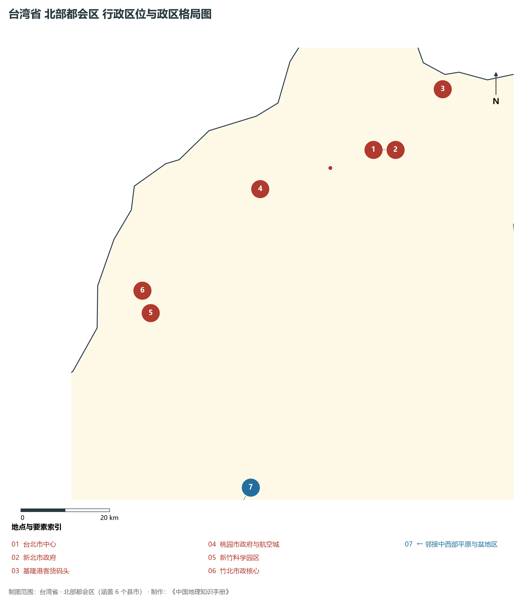
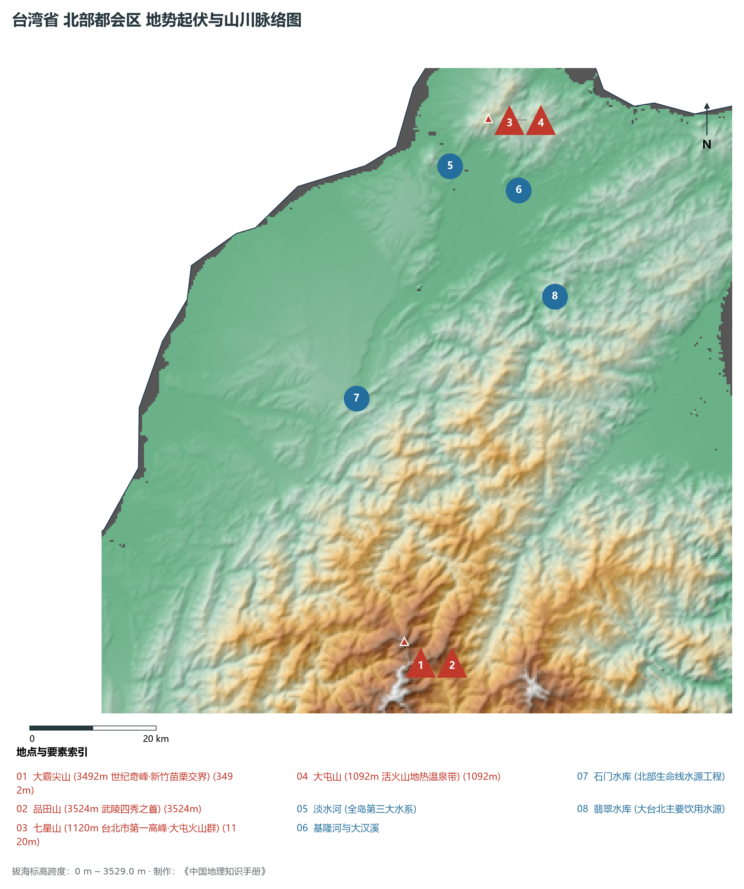
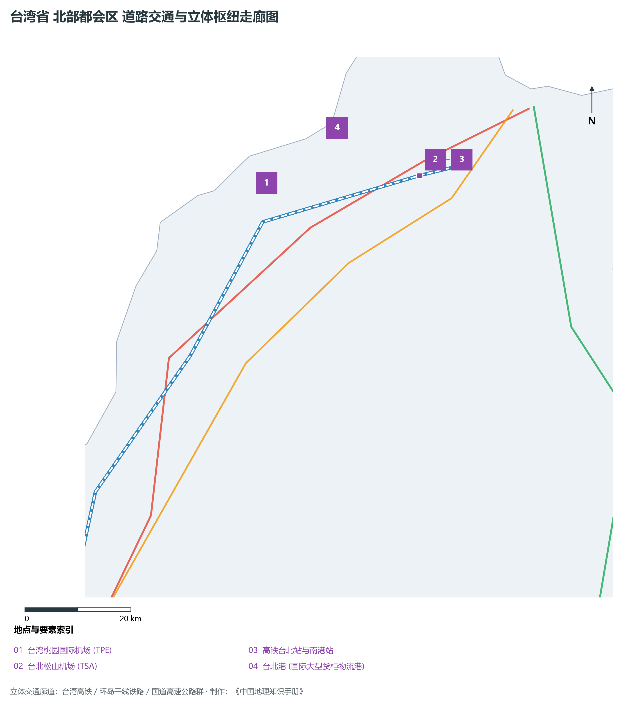
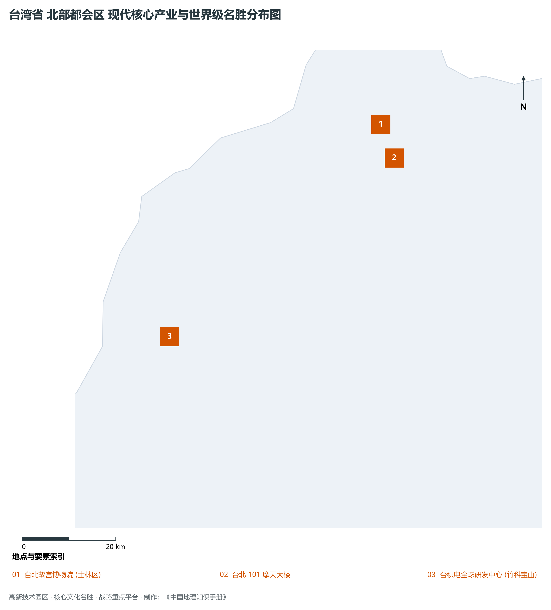

# 26.1 北部都会区

本节按地理功能划分分析板块，板块不作为独立的地区生产总值统计单元。

## 一、自然地理底盘、空间范围与生态格局

北部都会区地处台湾省政经中枢与国际门户 / 全球半导体硅岛核心 / 台北盆地现代都会群，涵盖县市包括：台北市、新北市、基隆市、桃园市、新竹市、新竹县。全域陆地总面积达 **4,600.0 km²**。

辖区内各层级重点行政中心、都会极核及战略功能节点布局如下：

- **台北市中心 (中正区·信义区)**（东经 121.565°，北纬 25.034°）：全岛政治金融与国际商务中枢；
- **新北市政府 (板桥新板特区)**（东经 121.463°，北纬 25.012°）：全岛人口第一大市现代政务副中心；
- **基隆港客货码头 (基隆市)**（东经 121.74°，北纬 25.132°）：北部天然深水港与客轮枢纽；
- **桃园市政府与航空城 (桃园市)**（东经 121.301°，北纬 24.993°）：全岛第一大航空物流与工业重镇；
- **新竹科学园区 (新竹市·东区)**（东经 121.015°，北纬 24.78°）：全球顶尖集成电路研发与制造圣地；
- **竹北市政核心 (新竹县)**（东经 121.005°，北纬 24.828°）：新兴高科技高净值人群宜居新城；

辖区地势格局呈现出独特的起伏演化特征，高程极值范围在 **0 m ～ 3529.0 m** 之间，全域最大相对高差达 **3529.0 m**：

辖区重点山脉峰峦与控制性地理高程节点如下：

- **大霸尖山 (3492m 世纪奇峰·新竹苗栗交界)**（海拔标高 **3492.0 m**，坐标：东经 121.258°、北纬 24.462°）：辖区标志性高程控制点；
- **品田山 (3524m 武陵四秀之首)**（海拔标高 **3524.0 m**，坐标：东经 121.278°、北纬 24.428°）：辖区标志性高程控制点；
- **七星山 (1120m 台北市第一高峰·大屯火山群)**（海拔标高 **1120.0 m**，坐标：东经 121.554°、北纬 25.171°）：辖区标志性高程控制点；
- **大屯山 (1092m 活火山地热温泉带)**（海拔标高 **1092.0 m**，坐标：东经 121.522°、北纬 25.178°）：辖区标志性高程控制点；

骨干水系海域脉络与关键控制地标：

- **淡水河 (全岛第三大水系)**（东经 121.45°，北纬 25.12°）：辖区核心景观与水文通道；
- **基隆河与大汉溪**（东经 121.55°，北纬 25.07°）：辖区核心景观与水文通道；
- **石门水库 (北部生命线水源工程)**（东经 121.246°，北纬 24.815°）：辖区核心景观与水文通道；
- **翡翠水库 (大台北主要饮用水源)**（东经 121.578°，北纬 24.912°）：辖区核心景观与水文通道；

独特的自然地理底盘塑造了辖区“山峦巍峨、江河奔流、山海相依”的绝美景观生态本底。全区严格保护高山森林、自然水源保护区与滨海湿地公园，展现了高度发达现代化大都市、高端先进制造园区与自然生态和谐共生的典型范式。

---

## 二、综合立体交通网络与区位优势

作为台湾省综合交通网络与经济带中的关键承载板块，北部都会区区位优势得天独厚、内联外通网络日臻完备。近年来，辖区全方位强化环岛铁路、高快速公路大网络与现代化海空港口集群联动，客货综合保障能级实现历史性跨越：

骨干交通基础设施与重要立体物流枢纽节点包括：

- **台湾桃园国际机场 (TPE)**（东经 121.233°，北纬 25.077°）：25.077；
- **台北松山机场 (TSA)**（东经 121.552°，北纬 25.069°）：25.069；
- **高铁台北站与南港站**（东经 121.517°，北纬 25.047°）：25.047；
- **台北港 (国际大型货柜物流港)**（东经 121.38°，北纬 25.15°）：25.15；

通过高度发达的高铁走廊、台铁环岛干线、国道高速公路网与捷运轨道交通，北部都会区高效串接全省各主要经济板块，并依托国际机场与深水良港直接通达全球大市场。

---

## 三、特色优势产业集群、重点园区与现代经济版图

辖区核心产业平台、重大战略工程与重点开发区展示如下：

- **台北故宫博物院 (士林区)**（东经 121.549°，北纬 25.102°）：中华历代国宝文化艺术瑰宝圣殿；
- **台北 101 摩天大楼**（东经 121.565°，北纬 25.034°）：508米世界著名超高层地标；
- **台积电全球研发中心 (竹科宝山)**（东经 121.035°，北纬 24.765°）：全球先进制程技术创新中枢；

在现代化产业布局与高能级平台建设中，辖区因地制宜打造特色优势产业生态圈：

1. **世界级高科技与先进制程产业群**：以科学园区为依托，构建集集成电路研发、先进制程代工、高端封测、新材料与人工智能装备于一体的全产业链生态；
2. **精密制造与高端装备产业聚落**：做优做强数控机床、工业机器人、关键零部件与半导体配套设备，擦亮全球隐形冠军制造名片；
3. **现代服务业、外向商贸与现代农业**：深耕国际金融、数字创意、总部经济与现代化精致农业，推动一二三产融合发展。

---

## 四、历史文化胜迹、世界级地标与文旅名胜

北部都会区历史文脉深厚，多元人文汇聚交融，壮丽山川与现代城市风貌交相辉映，是享誉海内外的文旅胜地：

- **文博场馆与历史古迹**：拥有享誉世界的国家级文博机构、明清古建筑群、历史老街与多元文化遗址，生动展现了中华文脉在宝岛台湾的传承与演进；
- **自然奇观与国家级风景区**：大自然造化赐予辖区高山云海、深切峡谷、火山地热、碧蓝湖泊与优美海湾，是全球户外徒步与生态旅游的热门胜地；
- **非物质文化遗产与民俗民风**：传统庙会、元宵灯节、原住民族丰年节庆以及名扬四海的风味夜市美食，展现了兼收并蓄、生机盎然的独特地域人文魅力。

---
