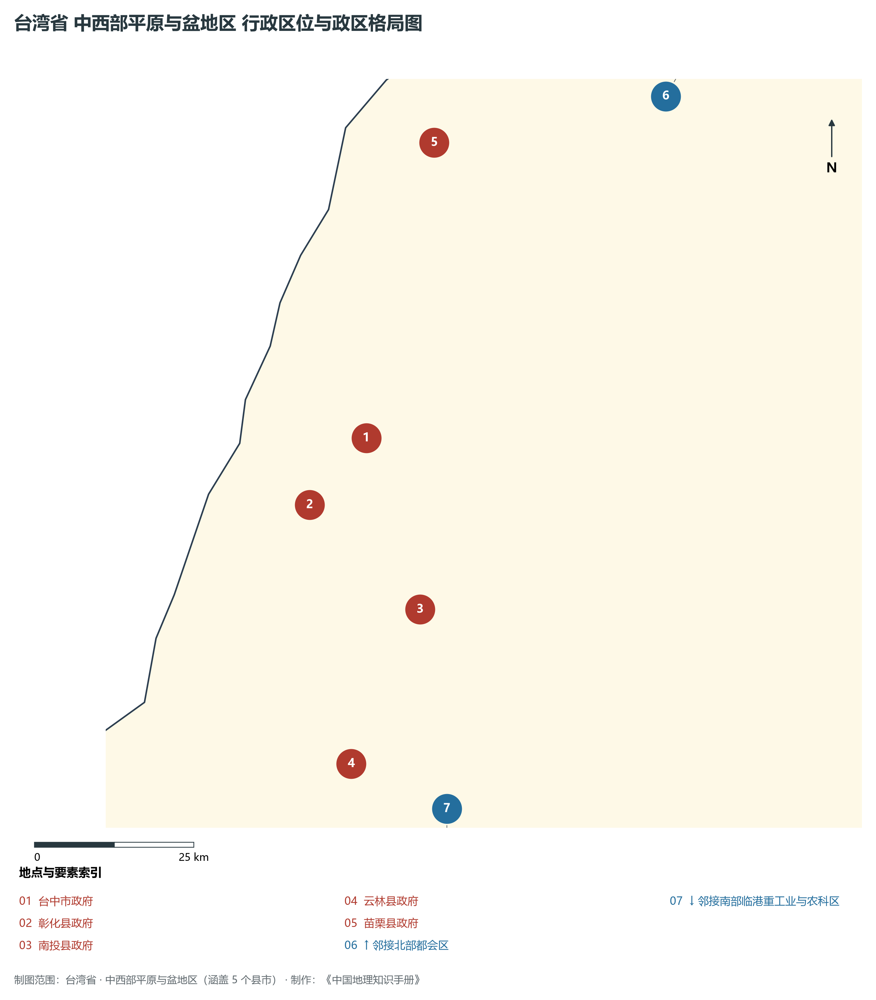
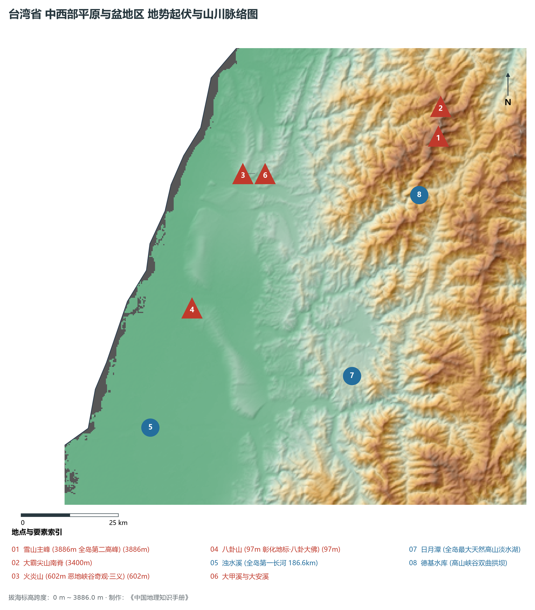
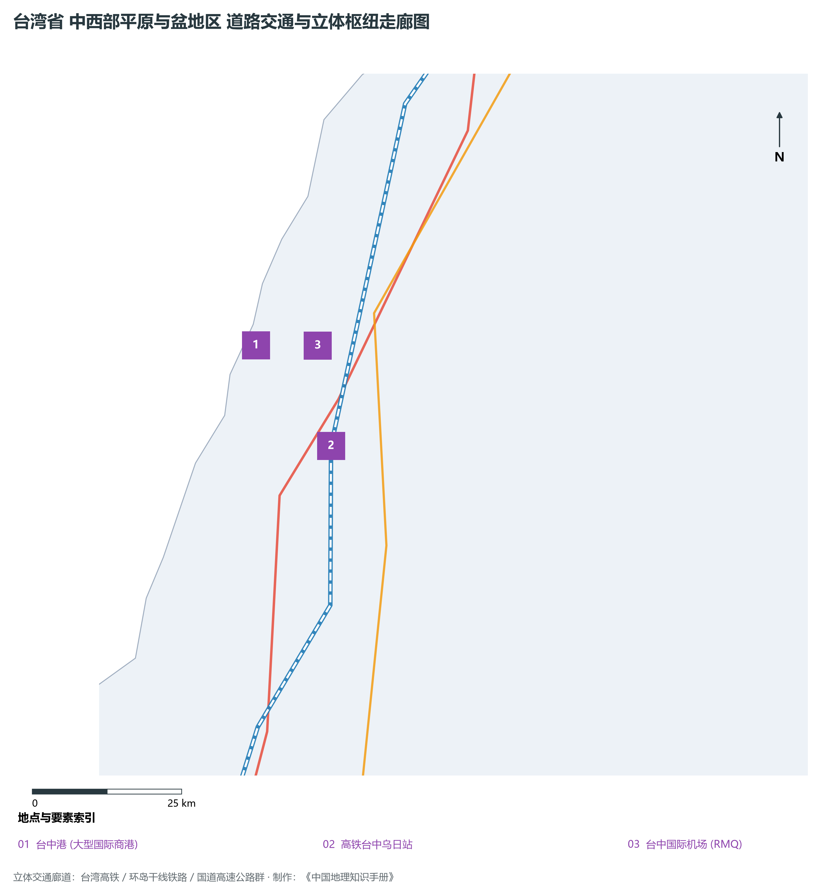
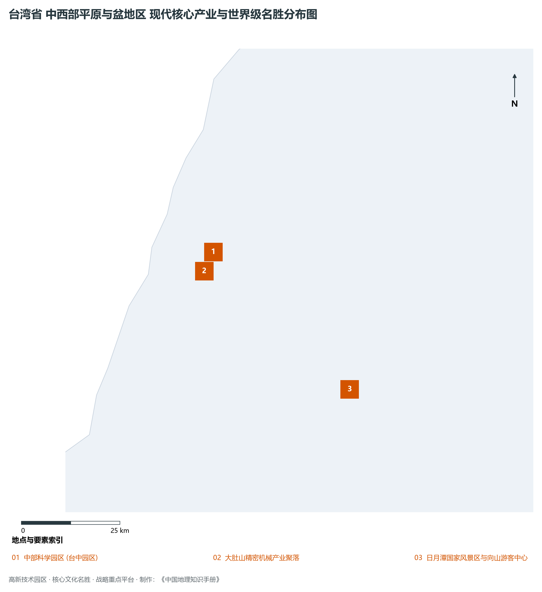

# 26.2 中西部平原与盆地区

本节按地理功能划分分析板块，板块不作为独立的地区生产总值统计单元。

## 一、自然地理底盘、空间范围与生态格局

中西部平原与盆地区地处台湾省精密机械与制造高地 / 现代精致农工走廊 / 日月潭山海生态心脏，涵盖县市包括：苗栗县、台中市、彰化县、南投县、云林县。全域陆地总面积达 **9,300.0 km²**。

辖区内各层级重点行政中心、都会极核及战略功能节点布局如下：

- **台中市政府 (西屯区七期特区)**（东经 120.645°，北纬 24.162°）：中台湾都会核心与商贸中心；
- **彰化县政府 (彰化市)**（东经 120.543°，北纬 24.081°）：农业与精密零部件重镇；
- **南投县政府 (南投市)**（东经 120.685°，北纬 23.91°）：全岛唯一不靠海之内陆山地中心；
- **云林县政府 (斗六市)**（东经 120.544°，北纬 23.709°）：全岛最大农业粮仓与畜禽基地；
- **苗栗县政府 (苗栗市)**（东经 120.82°，北纬 24.56°）：山城特色与竹南科学生医产业区；

辖区地势格局呈现出独特的起伏演化特征，高程极值范围在 **0 m ～ 3886.0 m** 之间，全域最大相对高差达 **3886.0 m**：

辖区重点山脉峰峦与控制性地理高程节点如下：

- **雪山主峰 (3886m 全岛第二高峰)**（海拔标高 **3886.0 m**，坐标：东经 121.232°、北纬 24.383°）：辖区标志性高程控制点；
- **大霸尖山南脊**（海拔标高 **3400.0 m**，坐标：东经 121.25°、北纬 24.45°）：辖区标志性高程控制点；
- **火炎山 (602m 恶地峡谷奇观·三义)**（海拔标高 **602.0 m**，坐标：东经 120.73°、北纬 24.37°）：辖区标志性高程控制点；
- **八卦山 (97m 彰化地标·八卦大佛)**（海拔标高 **97.0 m**，坐标：东经 120.55°、北纬 24.08°）：辖区标志性高程控制点；

骨干水系海域脉络与关键控制地标：

- **浊水溪 (全岛第一长河 186.6km)**（东经 120.4°，北纬 23.82°）：辖区核心景观与水文通道；
- **大甲溪与大安溪**（东经 120.65°，北纬 24.32°）：辖区核心景观与水文通道；
- **日月潭 (全岛最大天然高山淡水湖)**（东经 120.92°，北纬 23.865°）：辖区核心景观与水文通道；
- **德基水库 (高山峡谷双曲拱坝)**（东经 121.16°，北纬 24.255°）：辖区核心景观与水文通道；

独特的自然地理底盘塑造了辖区“山峦巍峨、江河奔流、山海相依”的绝美景观生态本底。全区严格保护高山森林、自然水源保护区与滨海湿地公园，展现了高度发达现代化大都市、高端先进制造园区与自然生态和谐共生的典型范式。

---

## 二、综合立体交通网络与区位优势

作为台湾省综合交通网络与经济带中的关键承载板块，中西部平原与盆地区区位优势得天独厚、内联外通网络日臻完备。近年来，辖区全方位强化环岛铁路、高快速公路大网络与现代化海空港口集群联动，客货综合保障能级实现历史性跨越：

骨干交通基础设施与重要立体物流枢纽节点包括：

- **台中港 (大型国际商港)**（东经 120.52°，北纬 24.28°）：24.28；
- **高铁台中乌日站**（东经 120.616°，北纬 24.112°）：24.112；
- **台中国际机场 (RMQ)**（东经 120.62°，北纬 24.265°）：24.265；

通过高度发达的高铁走廊、台铁环岛干线、国道高速公路网与捷运轨道交通，中西部平原与盆地区高效串接全省各主要经济板块，并依托国际机场与深水良港直接通达全球大市场。

---

## 三、特色优势产业集群、重点园区与现代经济版图

辖区核心产业平台、重大战略工程与重点开发区展示如下：

- **中部科学园区 (台中园区)**（东经 120.62°，北纬 24.21°）：晶圆代工与高端光电高地；
- **大肚山精密机械产业聚落**（东经 120.59°，北纬 24.17°）：全球数控机床与智能装备黄金纵谷；
- **日月潭国家风景区与向山游客中心**（东经 120.9°，北纬 23.85°）：全球著名山水旅游名胜；

在现代化产业布局与高能级平台建设中，辖区因地制宜打造特色优势产业生态圈：

1. **世界级高科技与先进制程产业群**：以科学园区为依托，构建集集成电路研发、先进制程代工、高端封测、新材料与人工智能装备于一体的全产业链生态；
2. **精密制造与高端装备产业聚落**：做优做强数控机床、工业机器人、关键零部件与半导体配套设备，擦亮全球隐形冠军制造名片；
3. **现代服务业、外向商贸与现代农业**：深耕国际金融、数字创意、总部经济与现代化精致农业，推动一二三产融合发展。

---

## 四、历史文化胜迹、世界级地标与文旅名胜

中西部平原与盆地区历史文脉深厚，多元人文汇聚交融，壮丽山川与现代城市风貌交相辉映，是享誉海内外的文旅胜地：

- **文博场馆与历史古迹**：拥有享誉世界的国家级文博机构、明清古建筑群、历史老街与多元文化遗址，生动展现了中华文脉在宝岛台湾的传承与演进；
- **自然奇观与国家级风景区**：大自然造化赐予辖区高山云海、深切峡谷、火山地热、碧蓝湖泊与优美海湾，是全球户外徒步与生态旅游的热门胜地；
- **非物质文化遗产与民俗民风**：传统庙会、元宵灯节、原住民族丰年节庆以及名扬四海的风味夜市美食，展现了兼收并蓄、生机盎然的独特地域人文魅力。

---
