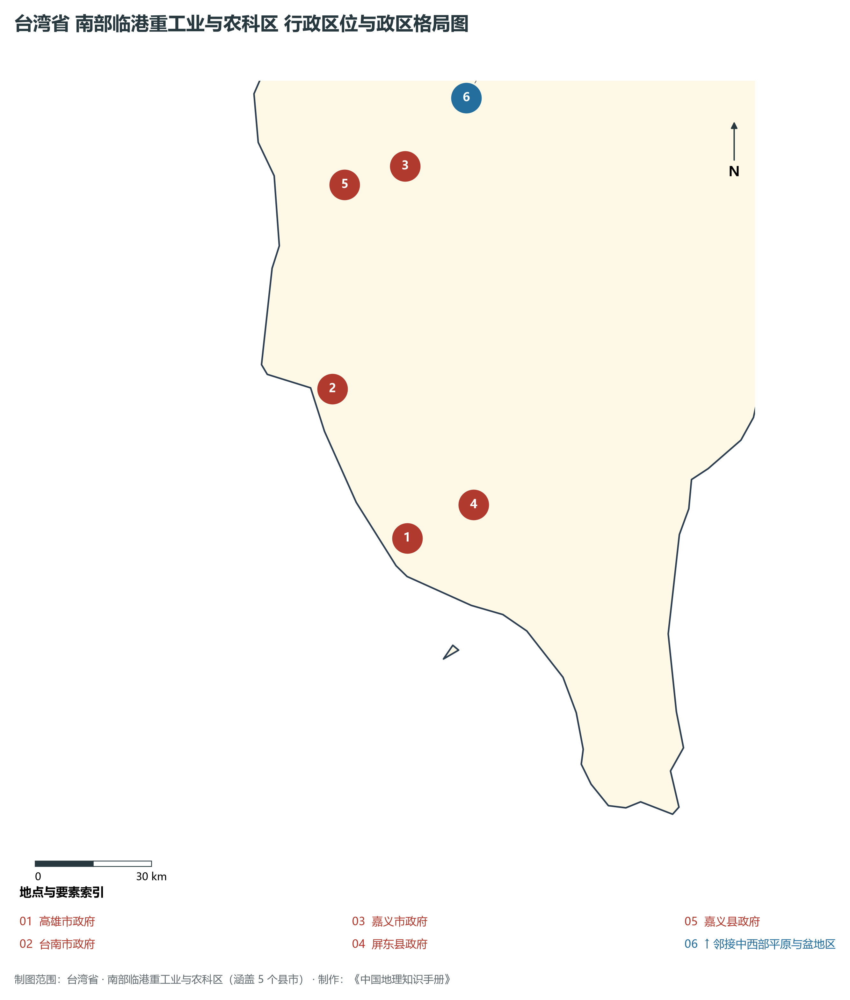
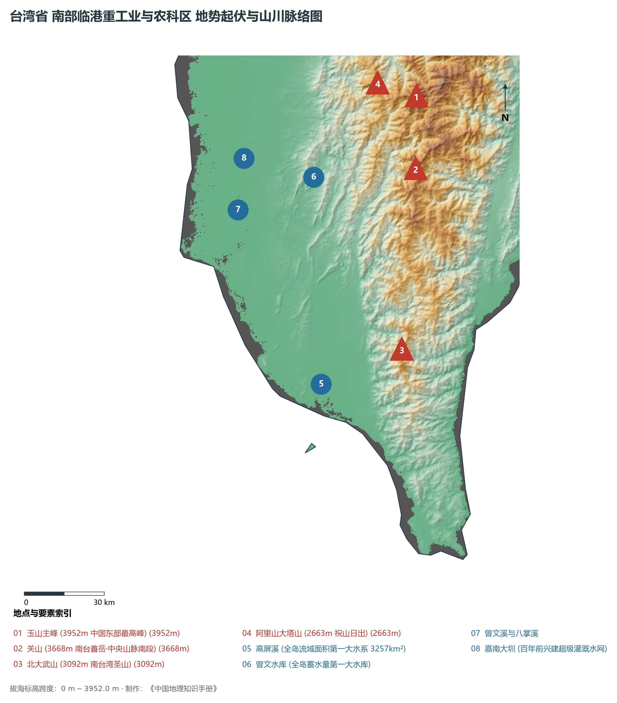
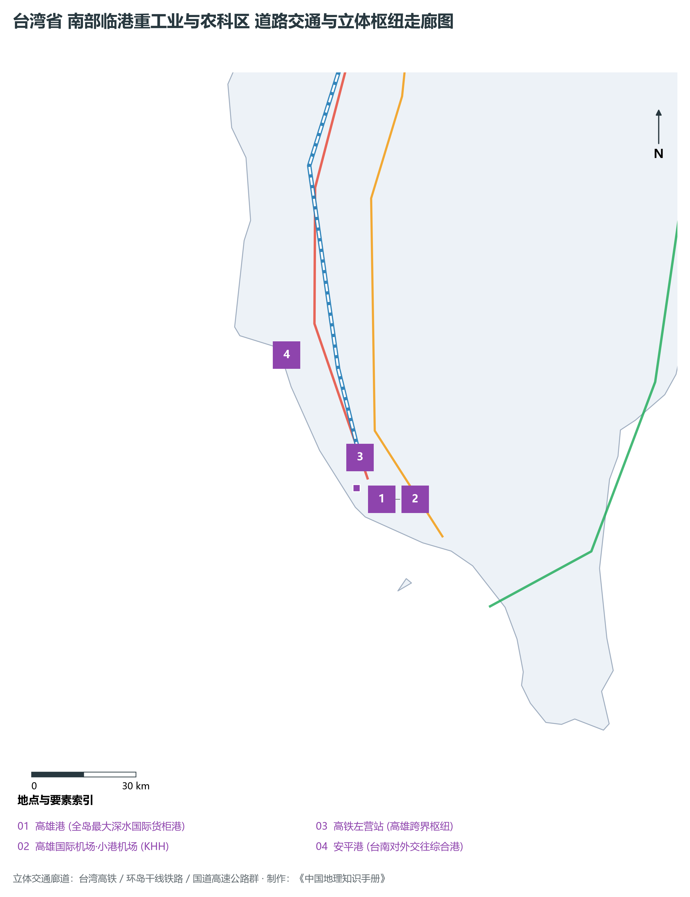
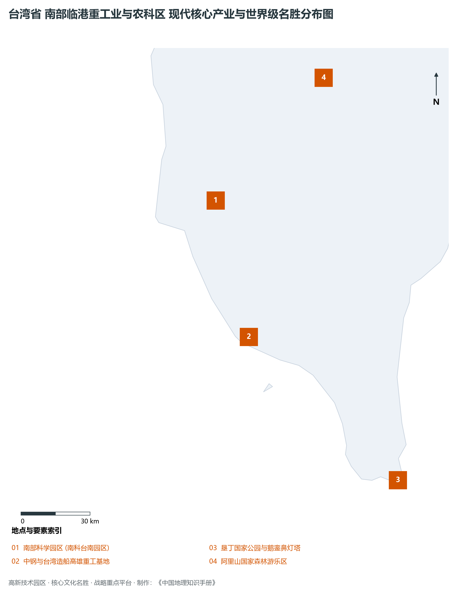

# 26.3 南部临港重工业与农科区

本节按地理功能划分分析板块，板块不作为独立的地区生产总值统计单元。

## 一、自然地理底盘、空间范围与生态格局

南部临港重工业与农科区地处台湾省国际深水集装箱巨港 / 先进晶圆制程南翼 / 嘉南平原大粮仓与临港重工，涵盖县市包括：嘉义市、嘉义县、台南市、高雄市、屏东县。全域陆地总面积达 **11,400.0 km²**。

辖区内各层级重点行政中心、都会极核及战略功能节点布局如下：

- **高雄市政府 (苓雅区·四维特区)**（东经 120.312°，北纬 22.62°）：南部第一大都会与海洋首都；
- **台南市政府 (安平区永华市政中心)**（东经 120.185°，北纬 22.992°）：千年古都与高科技半导体南核；
- **嘉义市政府 (嘉义市东区)**（东经 120.45°，北纬 23.48°）：阿里山入口门户与文创森林之都；
- **屏东县政府 (屏东市)**（东经 120.488°，北纬 22.673°）：热带农业与大健康海洋产业重镇；
- **嘉义县政府 (太保市)**（东经 120.293°，北纬 23.459°）：嘉南平原腹地与嘉义高科园区；

辖区地势格局呈现出独特的起伏演化特征，高程极值范围在 **0 m ～ 3952.0 m** 之间，全域最大相对高差达 **3952.0 m**：

辖区重点山脉峰峦与控制性地理高程节点如下：

- **玉山主峰 (3952m 中国东部最高峰)**（海拔标高 **3952.0 m**，坐标：东经 120.957°、北纬 23.47°）：辖区标志性高程控制点；
- **关山 (3668m 南台首岳·中央山脉南段)**（海拔标高 **3668.0 m**，坐标：东经 120.912°、北纬 23.227°）：辖区标志性高程控制点；
- **北大武山 (3092m 南台湾圣山)**（海拔标高 **3092.0 m**，坐标：东经 120.758°、北纬 22.628°）：辖区标志性高程控制点；
- **阿里山大塔山 (2663m 祝山日出)**（海拔标高 **2663.0 m**，坐标：东经 120.825°、北纬 23.535°）：辖区标志性高程控制点；

骨干水系海域脉络与关键控制地标：

- **高屏溪 (全岛流域面积第一大水系 3257km²)**（东经 120.45°，北纬 22.55°）：辖区核心景观与水文通道；
- **曾文水库 (全岛蓄水量第一大水库)**（东经 120.54°，北纬 23.25°）：辖区核心景观与水文通道；
- **曾文溪与八掌溪**（东经 120.25°，北纬 23.18°）：辖区核心景观与水文通道；
- **嘉南大圳 (百年前兴建超级灌溉水网)**（东经 120.3°，北纬 23.35°）：辖区核心景观与水文通道；

独特的自然地理底盘塑造了辖区“山峦巍峨、江河奔流、山海相依”的绝美景观生态本底。全区严格保护高山森林、自然水源保护区与滨海湿地公园，展现了高度发达现代化大都市、高端先进制造园区与自然生态和谐共生的典型范式。

---

## 二、综合立体交通网络与区位优势

作为台湾省综合交通网络与经济带中的关键承载板块，南部临港重工业与农科区区位优势得天独厚、内联外通网络日臻完备。近年来，辖区全方位强化环岛铁路、高快速公路大网络与现代化海空港口集群联动，客货综合保障能级实现历史性跨越：

骨干交通基础设施与重要立体物流枢纽节点包括：

- **高雄港 (全岛最大深水国际货柜港)**（东经 120.285°，北纬 22.61°）：22.61；
- **高雄国际机场·小港机场 (KHH)**（东经 120.35°，北纬 22.57°）：22.57；
- **高铁左营站 (高雄跨界枢纽)**（东经 120.308°，北纬 22.687°）：22.687；
- **安平港 (台南对外交往综合港)**（东经 120.15°，北纬 22.98°）：22.98；

通过高度发达的高铁走廊、台铁环岛干线、国道高速公路网与捷运轨道交通，南部临港重工业与农科区高效串接全省各主要经济板块，并依托国际机场与深水良港直接通达全球大市场。

---

## 三、特色优势产业集群、重点园区与现代经济版图

辖区核心产业平台、重大战略工程与重点开发区展示如下：

- **南部科学园区 (南科台南园区)**（东经 120.28°，北纬 23.1°）：全球 3nm/5nm 先进制程极核基地；
- **中钢与台湾造船高雄重工基地**（东经 120.33°，北纬 22.55°）：全岛钢铁与大型海工制造中枢；
- **垦丁国家公园与鹅銮鼻灯塔**（东经 120.85°，北纬 21.9°）：恒春半岛热带海滨珊瑚礁地貌；
- **阿里山国家森林游乐区**（东经 120.81°，北纬 23.51°）：千年红桧神木与高山云海日出；

在现代化产业布局与高能级平台建设中，辖区因地制宜打造特色优势产业生态圈：

1. **世界级高科技与先进制程产业群**：以科学园区为依托，构建集集成电路研发、先进制程代工、高端封测、新材料与人工智能装备于一体的全产业链生态；
2. **精密制造与高端装备产业聚落**：做优做强数控机床、工业机器人、关键零部件与半导体配套设备，擦亮全球隐形冠军制造名片；
3. **现代服务业、外向商贸与现代农业**：深耕国际金融、数字创意、总部经济与现代化精致农业，推动一二三产融合发展。

---

## 四、历史文化胜迹、世界级地标与文旅名胜

南部临港重工业与农科区历史文脉深厚，多元人文汇聚交融，壮丽山川与现代城市风貌交相辉映，是享誉海内外的文旅胜地：

- **文博场馆与历史古迹**：拥有享誉世界的国家级文博机构、明清古建筑群、历史老街与多元文化遗址，生动展现了中华文脉在宝岛台湾的传承与演进；
- **自然奇观与国家级风景区**：大自然造化赐予辖区高山云海、深切峡谷、火山地热、碧蓝湖泊与优美海湾，是全球户外徒步与生态旅游的热门胜地；
- **非物质文化遗产与民俗民风**：传统庙会、元宵灯节、原住民族丰年节庆以及名扬四海的风味夜市美食，展现了兼收并蓄、生机盎然的独特地域人文魅力。

---
