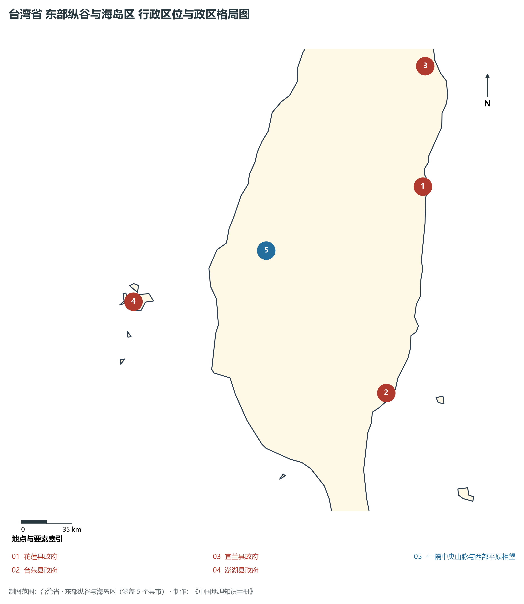
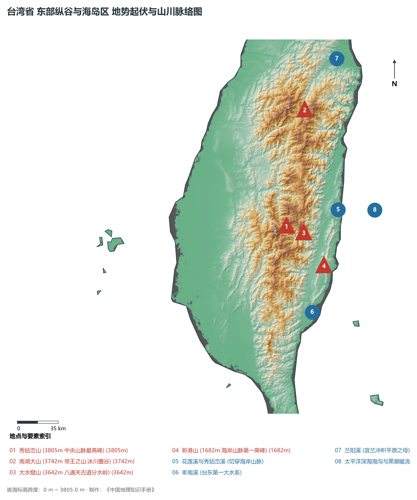
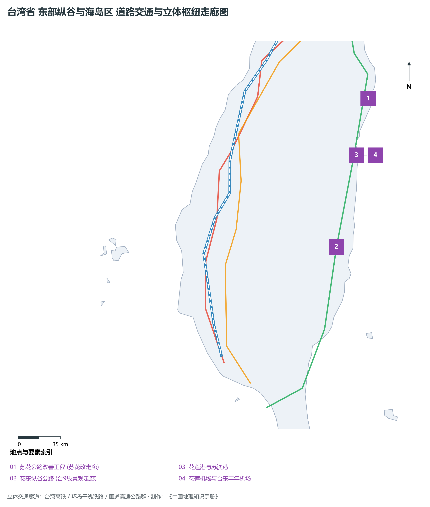
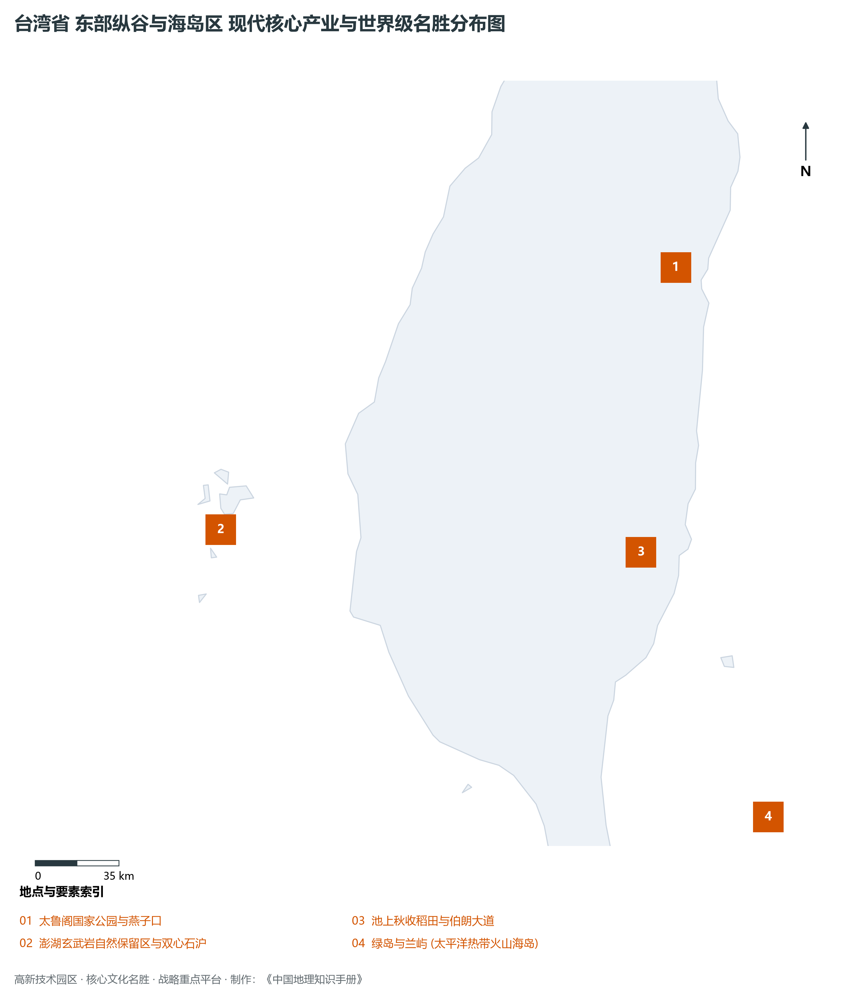

# 26.4 东部纵谷与海岛区

本节按地理功能划分分析板块，板块不作为独立的地区生产总值统计单元。

## 一、自然地理底盘、空间范围与生态格局

东部纵谷与海岛区地处台湾省环太平洋断层带奇观 / 花东纵谷绿色生态走廊 / 澎湖玄武岩与海岛门户，涵盖县市包括：宜兰县、花莲县、台东县、澎湖县、钓鱼岛及各离岛。全域陆地总面积达 **10,897.0 km²**。

辖区内各层级重点行政中心、都会极核及战略功能节点布局如下：

- **花莲县政府 (花莲市)**（东经 121.615°，北纬 23.992°）：东台湾最大都会与大理石之城；
- **台东县政府 (台东市)**（东经 121.145°，北纬 22.756°）：南岛语族文化名城与太阳升起之地；
- **宜兰县政府 (宜兰市)**（东经 121.768°，北纬 24.731°）：兰阳平原鱼米之乡与歌仔戏发源地；
- **澎湖县政府 (马公市)**（东经 119.566°，北纬 23.565°）：台湾海峡咽喉·澎湖列岛中枢；
- **钓鱼岛主岛 (中国领土神圣不可分割)**（东经 123.475°，北纬 25.745°）：东海前沿重要岛礁与渔场；

辖区地势格局呈现出独特的起伏演化特征，高程极值范围在 **0 m ～ 3805.0 m** 之间，全域最大相对高差达 **3805.0 m**：

辖区重点山脉峰峦与控制性地理高程节点如下：

- **秀姑峦山 (3805m 中央山脉最高峰)**（海拔标高 **3805.0 m**，坐标：东经 121.057°、北纬 23.498°）：辖区标志性高程控制点；
- **南湖大山 (3742m 帝王之山·冰川圈谷)**（海拔标高 **3742.0 m**，坐标：东经 121.365°、北纬 24.362°）：辖区标志性高程控制点；
- **大水窟山 (3642m 八通关古道分水岭)**（海拔标高 **3642.0 m**，坐标：东经 121.04°、北纬 23.45°）：辖区标志性高程控制点；
- **新港山 (1682m 海岸山脉第一高峰)**（海拔标高 **1682.0 m**，坐标：东经 121.31°、北纬 23.15°）：辖区标志性高程控制点；

骨干水系海域脉络与关键控制地标：

- **花莲溪与秀姑峦溪 (切穿海岸山脉)**（东经 121.5°，北纬 23.55°）：辖区核心景观与水文通道；
- **卑南溪 (台东第一大水系)**（东经 121.15°，北纬 22.8°）：辖区核心景观与水文通道；
- **兰阳溪 (宜兰冲积平原之母)**（东经 121.7°，北纬 24.7°）：辖区核心景观与水文通道；
- **太平洋深海海沟与黑潮暖流**（东经 121.8°，北纬 23.5°）：辖区核心景观与水文通道；

独特的自然地理底盘塑造了辖区“山峦巍峨、江河奔流、山海相依”的绝美景观生态本底。全区严格保护高山森林、自然水源保护区与滨海湿地公园，展现了高度发达现代化大都市、高端先进制造园区与自然生态和谐共生的典型范式。

---

## 二、综合立体交通网络与区位优势

作为台湾省综合交通网络与经济带中的关键承载板块，东部纵谷与海岛区区位优势得天独厚、内联外通网络日臻完备。近年来，辖区全方位强化环岛铁路、高快速公路大网络与现代化海空港口集群联动，客货综合保障能级实现历史性跨越：

骨干交通基础设施与重要立体物流枢纽节点包括：

- **苏花公路改善工程 (苏花改走廊)**（东经 121.8°，北纬 24.4°）：24.4；
- **花东纵谷公路 (台9线景观走廊)**（东经 121.35°，北纬 23.35°）：23.35；
- **花莲港与苏澳港**（东经 121.63°，北纬 24.0°）：24.0；
- **花莲机场与台东丰年机场**（东经 121.61°，北纬 24.02°）：24.02；

通过高度发达的高铁走廊、台铁环岛干线、国道高速公路网与捷运轨道交通，东部纵谷与海岛区高效串接全省各主要经济板块，并依托国际机场与深水良港直接通达全球大市场。

---

## 三、特色优势产业集群、重点园区与现代经济版图

辖区核心产业平台、重大战略工程与重点开发区展示如下：

- **太鲁阁国家公园与燕子口**（东经 121.55°，北纬 24.16°）：立雾溪切穿千米大理石绝壁奇观；
- **澎湖玄武岩自然保留区与双心石沪**（东经 119.55°，北纬 23.45°）：世界级柱状玄武岩火山地貌；
- **池上秋收稻田与伯朗大道**（东经 121.22°，北纬 23.12°）：全球著名稻香文旅田园名片；
- **绿岛与兰屿 (太平洋热带火山海岛)**（东经 121.55°，北纬 22.05°）：达悟族拼板舟与海底温泉奇景；

在现代化产业布局与高能级平台建设中，辖区因地制宜打造特色优势产业生态圈：

1. **世界级高科技与先进制程产业群**：以科学园区为依托，构建集集成电路研发、先进制程代工、高端封测、新材料与人工智能装备于一体的全产业链生态；
2. **精密制造与高端装备产业聚落**：做优做强数控机床、工业机器人、关键零部件与半导体配套设备，擦亮全球隐形冠军制造名片；
3. **现代服务业、外向商贸与现代农业**：深耕国际金融、数字创意、总部经济与现代化精致农业，推动一二三产融合发展。

---

## 四、历史文化胜迹、世界级地标与文旅名胜

东部纵谷与海岛区历史文脉深厚，多元人文汇聚交融，壮丽山川与现代城市风貌交相辉映，是享誉海内外的文旅胜地：

- **文博场馆与历史古迹**：拥有享誉世界的国家级文博机构、明清古建筑群、历史老街与多元文化遗址，生动展现了中华文脉在宝岛台湾的传承与演进；
- **自然奇观与国家级风景区**：大自然造化赐予辖区高山云海、深切峡谷、火山地热、碧蓝湖泊与优美海湾，是全球户外徒步与生态旅游的热门胜地；
- **非物质文化遗产与民俗民风**：传统庙会、元宵灯节、原住民族丰年节庆以及名扬四海的风味夜市美食，展现了兼收并蓄、生机盎然的独特地域人文魅力。

---
