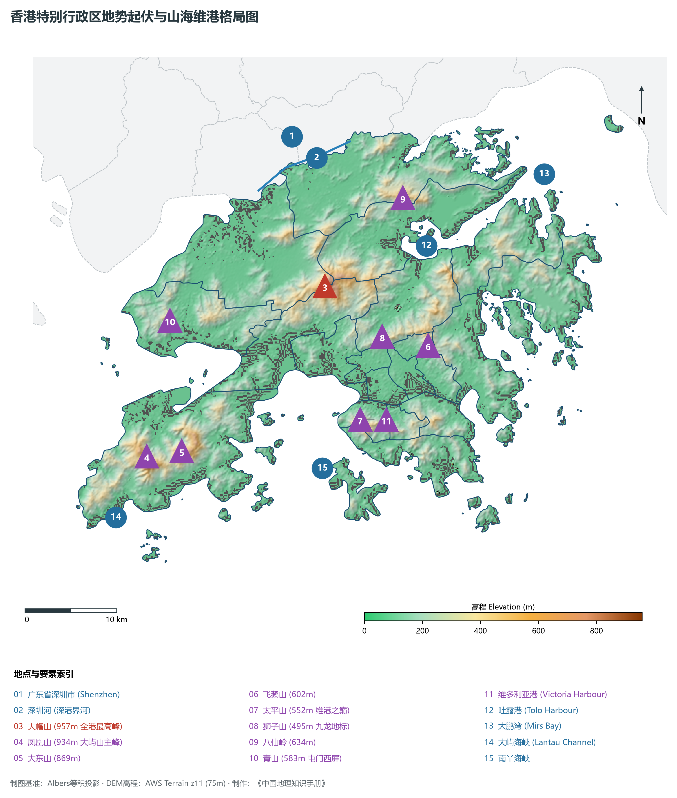
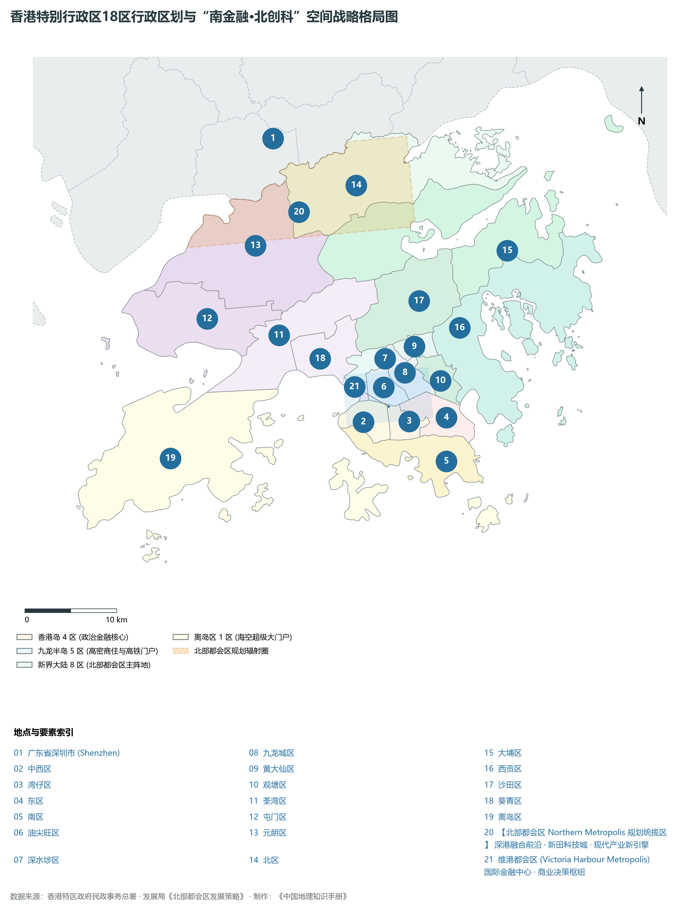
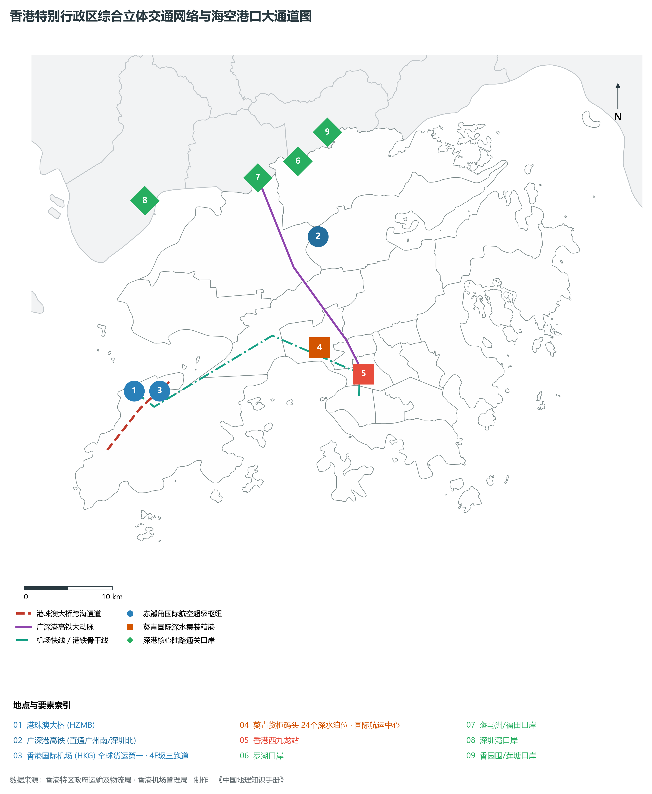
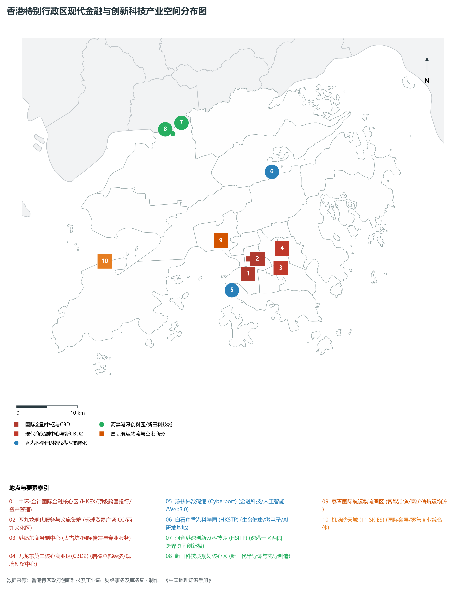
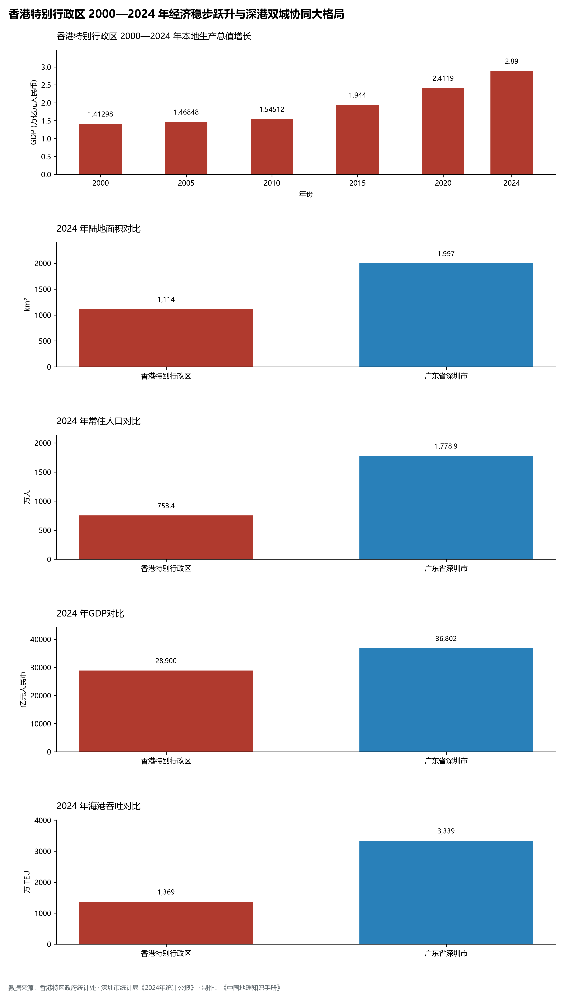

# 27.0 香港特别行政区地理统揽

香港特别行政区（Hong Kong Special Administrative Region，简称“港”或“HK”），地处中国华南沿海、珠江口东侧，南临浩瀚南海，北隔深圳河与广东省深圳市毗邻，介于东经 113° 49' ～ 114° 31'、北纬 22° 08' ～ 22° 35' 之间。全特区由香港岛、九龙半岛、新界大陆以及 263 个岛屿（其中最大岛屿为大屿山，面积 147.51 km²）共同组成，陆地总面积达 **1,114.0 km²**（包含历年填海造地约 70 km²），海域面积约 **1,648.7 km²**。

截至 2024 年末，香港特别行政区常住人口达 **753.4 万人**，常住人口城镇化率为 **100.0%**，人口密度达每平方公里 6,763 人，是全球人口密度最高、经济要素最集约的超大型国际大都会之一。2024 年，香港本地生产总值（GDP）跨越 **31,770 亿港元**（按当年平均汇率折合人民币约 **28,900 亿元**），人均本地生产总值跃升至 **42.2 万港元**（折合人民币约 **38.36 万元**）；三次产业结构呈现极端成熟的后工业化特征，结构比为 **0.1 : 6.1 : 93.8**。香港下辖 18 个区（香港岛 4 区、九龙 5 区、新界 9 区），在“一国两制”方针下享有高度自治权，是全球著名的国际金融中心、国际航运中心、国际贸易中心与国际航空枢纽，在国家推进粤港澳大湾区建设和高质量共建“一带一路”重大战略中承担着“背靠祖国、联通世界”的独一无二战略桥梁作用。

---

## 一、华南古陆断陷、花岗岩岛礁与“山海相拥·深水良港”自然地理底盘

香港地处华南褶皱系东南缘，地质历史时期经历了强烈的燕山期岩浆侵入与侏罗纪火山喷发，形成了以抗风化能力较强的火山岩（新界东部及大屿山）与花岗岩（维港两岸及九龙半岛）为骨架的低山丘陵岛屿地貌：

1. **“山多平地少”与海岸曲折侵蚀**：
   - 全港约 75% 的土地为起伏不平的山峦和陡坡，平地仅占陆域总面积的约四分之一，多分布于新界西北部（元朗平原）及漫长历史中人工围海造地的滨海狭长地带；
   - 海岸线长达 **1,173 km**，海湾岬角深锁、水深港阔，造就了无可比拟的深水岸线资源；
2. **三山相向与高程极值控制体系**：
   - **最高峰**：新界中部的**大帽山（拔海标高 957.0 m）**，峰顶常年云雾缭绕，山麓发育出城门水塘与林村河；
   - **第二高峰**：大屿山南部的**凤凰山（934.0 m）**，山体挺拔陡峭，为全港最负盛名的日出观景圣地；
   - **第三高峰**：大屿山**大东山（869.0 m）**，金黄芒草与烂头营石屋构筑独特的亚热带高山草甸风貌；
   - **维港地标峰**：香港岛**太平山（炉峰峡，552.0 m）**与九龙**狮子山（495.0 m）**隔维多利亚港南北相峙，构成世界著名的“天际线山水画框”；
   - **全港垂直高差**：由大帽山极顶 957.0 m 直降至维多利亚港水面 0.0 m，极小的平面距离孕育了极剧烈的微地貌坡度。

**香港特别行政区“新界大帽山—九龙狮子山—维多利亚港—太平山”立体大断面剖面图**

| 大帽山 957m | 狮子山 495m | 维港水面 0m (水深>12m) | 太平山 552m | 浅水湾/深水湾 0m |
| --- | --- | --- | --- | --- |
| 全港屋脊·城门水塘；荃湾新市镇/新界绿肺 | 九龙塘/油尖旺高密；启德跑道旧址/ICC | 万吨巨轮通航·天星小轮；维港不夜城·天际线封面 | 中环金融CBD·IFC摩天；半山豪宅·山顶缆车 | 港岛南区豪宅与海滩；海洋公园/数码港 |

新界大帽山主脊 · → 九龙狮子山脉 · → 维多利亚港深水主航道 · → 港岛太平山顶 · → 港岛南区深水湾

---

## 二、“南金融·北创科”双核驱动与“北部都会区”宏观空间战略

为突破土地空间约束、深度融入国家发展大局，特区政府确立了“南金融、北创科”的宏观空间重组大战略：

1. **维港都会区（南部成熟金融服务核心）**：
   - 涵盖中西区、湾仔区、东区、油尖旺区及九龙城、观塘沿岸，是香港传统经济心脏与全球顶级金融机构集聚地；
   - 中环、金钟金融核心与西九龙文化艺术区隔海联动，九龙东启德与观塘作为“第二核心商业区（CBD2）”持续扩容；
2. **北部都会区（北部深港深度融合创新高地）**：
   - 包括元朗区和北区全部以及屯门、大埔部分区域，总面积达 **300 km²**（占全港陆地面积约三分之一）；
   - 依托落马洲河套区港深创新及科技园、新田科技城、古洞北新发展区，打造“国际创新科技新中心”；
   - 与深圳罗湖、福田、南山无缝咬合，形成“双城三圈”（深圳湾优质发展圈、港深紧密互动圈、大鹏湾/印洲塘生态康乐旅游圈）深港大协同格局；
3. **大屿山双门户与机场城战略**：
   - 依托赤鱲角国际机场与港珠澳大桥香港口岸人工岛，构建连接全球与粤港澳大湾区西岸的现代化国际物流、会展及航空经济总部带。

---

## 三、综合立体交通网络：全球海空枢纽与深港一小时高铁通达网

香港凭借四通八达的现代化海陆空立体交通体系，雄踞全球供应链物流与人员流动枢纽前列：

1. **赤鱲角香港国际机场（4F 级）**：
   - 拥有“三跑道系统”，五小时飞行圈覆盖全球逾半数人口，连续多年蝉联全球货运吞吐量第一大机场（年货运量逾 430 万吨），年旅客保障能力提升至 1.2 亿人次；
2. **葵青货柜码头与维港航运中心**：
   - 拥有 24 个大型深水集装箱泊位，可全天候接卸全球最大型超巴拿马型集装箱货轮，年集装箱吞吐量达 1,369 万标准箱（TEU），航运物流航线通达全球 500 多个港口；
3. **广深港高速铁路与陆路口岸群**：
   - **香港西九龙站**：地下四层特大型高铁枢纽，全面实行“一地两检”，14 分钟直达深圳福田、48 分钟通达广州南站，融入国家八横八纵高铁骨干网；
   - 罗湖、落马洲/福田、皇岗、深圳湾、香园围/莲塘、文锦渡六大综合陆路口岸，日均通关旅客数十万人次；
4. **港珠澳大桥超级工程**：
   - 全长 55 公里，自香港口岸直抵珠海和澳门，将香港至珠江西岸行车时间由数小时骤缩至 45 分钟，重塑粤港澳大湾区空间时空压缩效应；
5. **极度发达的绿色公共交通体系**：
   - 港铁（MTR）拥有观塘线、荃湾线、港岛线、东铁线、屯马线、机场快线等 10 余条骨干铁路线，公共交通分担率超过 **90%**，位居世界大都市之巅。

---

## 四、现代产业体系：四大传统支柱与八大中心建设

香港经济呈现高能级、全开放、外向型的鲜明特征，围绕国家“十四五”规划明确的“八大中心”定位加速转型跃迁：

1. **国际金融中心（全球第三大金融中心）**：
   - 股票市场总市值超过 30 万亿港元，全球最大离岸人民币业务枢纽，汇聚了全球百强银行中的逾四分之三机构；
2. **国际贸易与专业服务枢纽**：
   - 依托自由港地位、零关税政策与与国际接轨的普通法系，法律、会计、仲裁、建筑设计等高端专业服务享誉全球；
3. **国际创新科技中心加速崛起**：
   - 拥有白石角**香港科学园**与薄扶林**数码港**两大科创旗舰园区，汇聚上千家人工智能、微电子、生物医药高新企业；香港大学、香港中文大学、香港科技大学、香港理工大学、香港城市大学等 5 所高校跻身世界大学排名前 100 强；
4. **中外文化艺术交流中心与世界旅游目的地**：
   - 西九文化区香港故宫文化博物馆、M+当代艺术博物馆成为全球文化新灯塔；香港迪士尼乐园、海洋公园、太平山顶、维港夜景每年吸引数千万海内外游客。

---

## 五、2000—2024年经济跨越演进与深港协同大格局

历史数据表明，香港经济在经历亚洲金融危机、非典疫情与全球外部环境冲击后展现出极强的韧性：

- 2000 年香港本地生产总值为 13,330 亿港元，2010 年增至 17,760 亿港元，2024 年跃上 **31,770 亿港元**新台阶；
- 与深圳对比：1980 年深圳 GDP 仅为香港的不足百分之一；2018 年深圳经济总量首次赶超香港；2024 年深圳 GDP 达到 36,802 亿元人民币，香港达到 28,900 亿元人民币。深港两地已从昔日的“前店后厂”成功升华演变为“前研后产、双向奔赴、协同腾飞”的全球超级双子城！

---

## 六、香港特别行政区 4 大整合分析单元概览

| 单元代码 | 单元名称 | 涵盖行政区 | 面积 (km²) | 常住人口 (万人) | 2024 GDP (亿元) | 发展定位与核心功能 |
| :---: | :---: | :---: | :---: | :---: | :---: | :--- |
| **27-01** | **香港岛** | 中西区、湾仔区、东区、南区 | 80.7 | 119.5 | 10,500.0 | 全港政治金融中枢 / 维港南岸核心商贸区 / 国际大都会封面 |
| **27-02** | **九龙半岛** | 油尖旺、深水埗、九龙城、黄大仙、观塘 | 46.9 | 224.5 | 8,200.0 | 全港人口商住极核 / 文化艺术殿堂 / 高铁陆路枢纽门户 |
| **27-03** | **新界大陆** | 荃湾、葵青、屯门、元朗、北区、大埔、沙田、西贡 | 747.2 | 386.2 | 8,600.0 | 北部都会区战略腹地 / 深港协同创科走廊 / 国际航运物流基地 |
| **27-04** | **离岛与大屿山** | 离岛区（大屿山、赤鱲角、南丫岛、长洲等） | 178.2 | 18.5 | 1,600.0 | 双门户国际空港大通道 / 跨海超级大桥桥头堡 / 生态文旅度假胜地 |
| **合计** | **香港特别行政区** | **全港 18 区** | **1,114.0** | **753.4** | **28,900.0** | **国际金融、航运、贸易中心与国际航空枢纽** |
