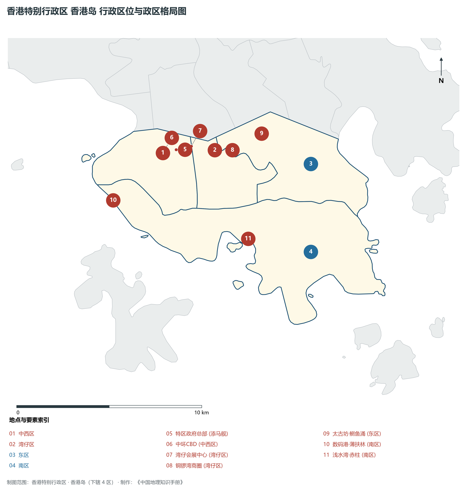
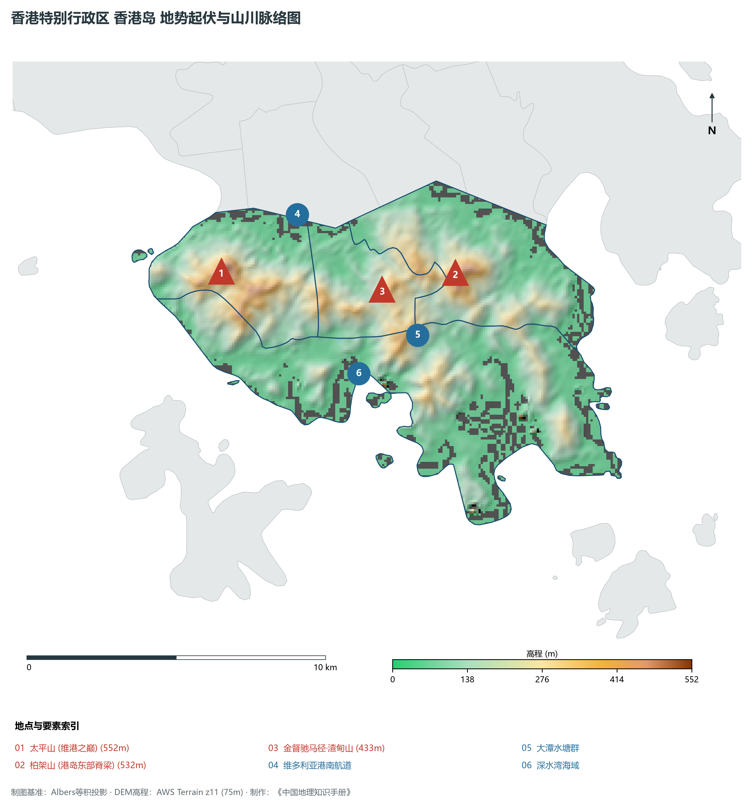
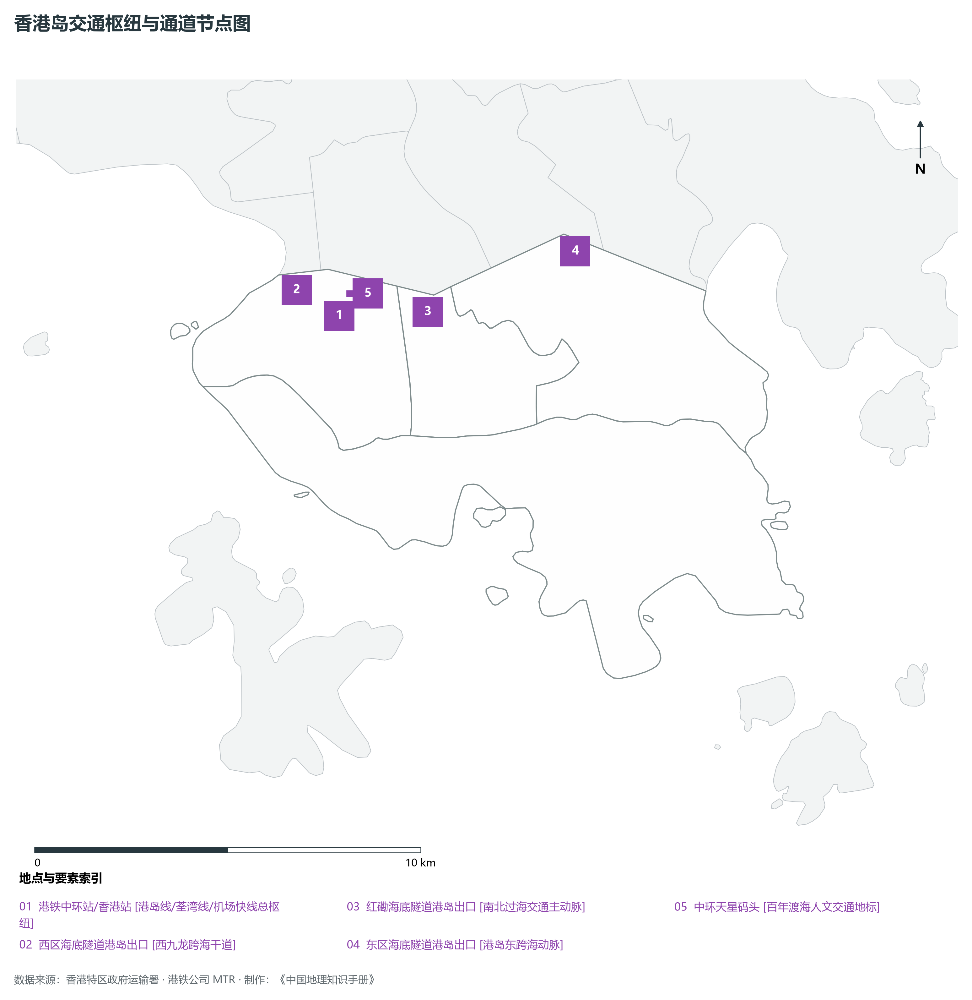
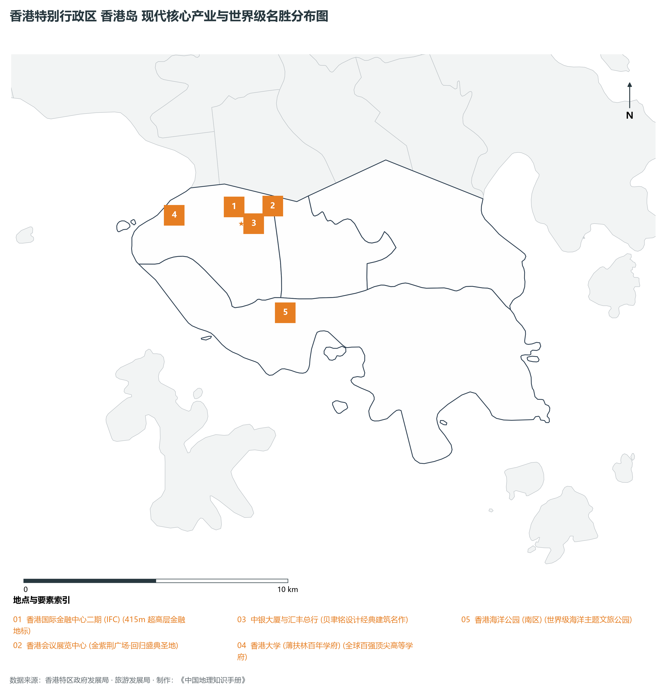

# 27.1 香港岛

本节按地理功能划分分析板块，板块不作为独立的地区生产总值统计单元。

## 一、自然地理底盘、空间范围与生态格局

香港岛地处香港特别行政区全港政治金融中枢 / 维港南岸核心商贸区 / 国际大都会封面，全域陆地总面积达 **80.7 km²**。

辖区内各层级重点行政极核、区级中心及战略功能节点布局如下：

- **特区政府总部 (添马舰)**：坐标 (114.165°E, 22.282°N)，功能定位：特区最高行政中枢；
- **中环CBD (中西区)**：坐标 (114.158°E, 22.281°N)，功能定位：国际金融中枢·顶级写字楼集聚区；
- **湾仔会展中心 (湾仔区)**：坐标 (114.173°E, 22.283°N)，功能定位：国际会议展览之都·维港标志；
- **铜锣湾商圈 (湾仔区)**：坐标 (114.185°E, 22.28°N)，功能定位：世界顶级商业零售与潮流中心；
- **太古坊·鲗鱼涌 (东区)**：坐标 (114.21°E, 22.286°N)，功能定位：港岛东现代商务副中心；
- **数码港·薄扶林 (南区)**：坐标 (114.13°E, 22.26°N)，功能定位：数字科技与金融创新基地；
- **浅水湾·赤柱 (南区)**：坐标 (114.198°E, 22.235°N)，功能定位：世界级滨海休闲与高端居住区；

辖区地势格局呈现出独特的起伏演化特征，高程极值范围在 **0 m ～ 552.0 m** 之间，全域最大相对高差达 **552.0 m**：

辖区重点山脉峰峦与控制性地理高程节点如下：

- **太平山 (维港之巅)**：海拔标高 **552.0 m**，空间坐标 (114.144°E, 22.275°N)；
- **柏架山 (港岛东部脊梁)**：海拔标高 **532.0 m**，空间坐标 (114.219°E, 22.268°N)；
- **金督驰马径·渣甸山**：海拔标高 **433.0 m**，空间坐标 (114.195°E, 22.265°N)；

骨干水系海域脉络与关键控制地标：

- **维多利亚港南航道**：标定坐标 (114.17°E, 22.29°N)；
- **大潭水塘群**：标定坐标 (114.205°E, 22.25°N)；
- **深水湾海域**：标定坐标 (114.185°E, 22.24°N)；

独特的自然地理底盘塑造了辖区“山海相依、城景交融”的绝美景观生态本底。辖区严格保护郊野公园与海岸公园，绿化覆盖率高，展现了高密度现代化大都市与自然生态和谐共生的典范格局。

---

## 二、综合立体交通网络与区位优势

作为香港特别行政区乃至粤港澳大湾区综合交通网络中的关键承载板块，香港岛区位优势得天独厚、内联外通网络日臻完备。近年来，辖区全方位抢抓高质量共建“一带一路”、广深港高铁大贯通与港珠澳大桥超级走廊机遇，客货综合保障能级实现历史性跨越：

骨干交通基础设施与重要立体物流枢纽节点包括：

- **港铁中环站/香港站**：空间标定 (114.158°E, 22.282°N)，设施类型：港岛线/荃湾线/机场快线总枢纽；
- **西区海底隧道港岛出口**：空间标定 (114.148°E, 22.289°N)，设施类型：西九龙跨海干道；
- **红磡海底隧道港岛出口**：空间标定 (114.18°E, 22.281°N)，设施类型：南北过海交通主动脉；
- **东区海底隧道港岛出口**：空间标定 (114.218°E, 22.292°N)，设施类型：港岛东跨海动脉；
- **中环天星码头**：空间标定 (114.161°E, 22.287°N)，设施类型：百年渡海人文交通地标；

通过发达的城市轨道交通网络（港铁系统）、现代化跨海大桥与海底隧道群、高快速公路网络，香港岛全面融入全港“半小时通勤圈”与深港“一小时生活圈”，高效联通全球大市场。

---

## 三、特色优势产业集群、重点园区与现代经济版图

辖区核心产业平台、重大战略工程与重点开发区展示如下：

- **香港国际金融中心二期 (IFC)**：空间坐标 (114.159°E, 22.285°N)，核心功能：415m 超高层金融地标；
- **香港会议展览中心**：空间坐标 (114.173°E, 22.284°N)，核心功能：金紫荆广场·回归盛典圣地；
- **中银大厦与汇丰总行**：空间坐标 (114.161°E, 22.279°N)，核心功能：贝聿铭设计经典建筑名作；
- **香港大学 (薄扶林百年学府)**：空间坐标 (114.137°E, 22.284°N)，核心功能：全球百强顶尖高等学府；
- **香港海洋公园 (南区)**：空间坐标 (114.174°E, 22.247°N)，核心功能：世界级海洋主题文旅公园；

在现代化产业布局与高能级平台建设中，辖区因地制宜打造特色优势产业生态圈：

1. **高端现代服务业与金融总部经济**：汇聚跨国金融机构、财富管理总部、法律与专业服务机构，打造国际一流的营商环境；
2. **前沿创新科技与数字产业孵化**：聚焦人工智能、生物医药、金融科技与新能源，加速科技成果从实验室走向市场；
3. **世界级文旅消费与国际贸易会展**：深耕国际会展、潮流零售、主题文旅与免税商贸，打造国际消费中心城市核心引擎。

---

## 四、历史文化胜迹、世界级地标与文旅名胜

香港岛历史文脉深厚，中西文化碰撞交融，壮阔海天与摩天大楼交相辉映，是享誉全球的国际文旅胜地：

- **历史建筑与法定古迹**：拥有享誉中外的法定古迹、历史建筑群与文博场馆，完好记录了香港从昔日小渔村走向现代化国际金融大都会的壮阔变迁；
- **自然奇观与休闲度假胜地**：大自然造化赐予辖区碧海银沙、苍翠山峦、海蚀地貌与优质郊野步道，是全球城市探险家与自然爱好者的打卡胜地；
- **非物质文化遗产与国际文化盛事**：传统民俗节庆与国际艺术展会常年举办，展现了兼收并蓄、多元包容的城市文化魅力。

---
