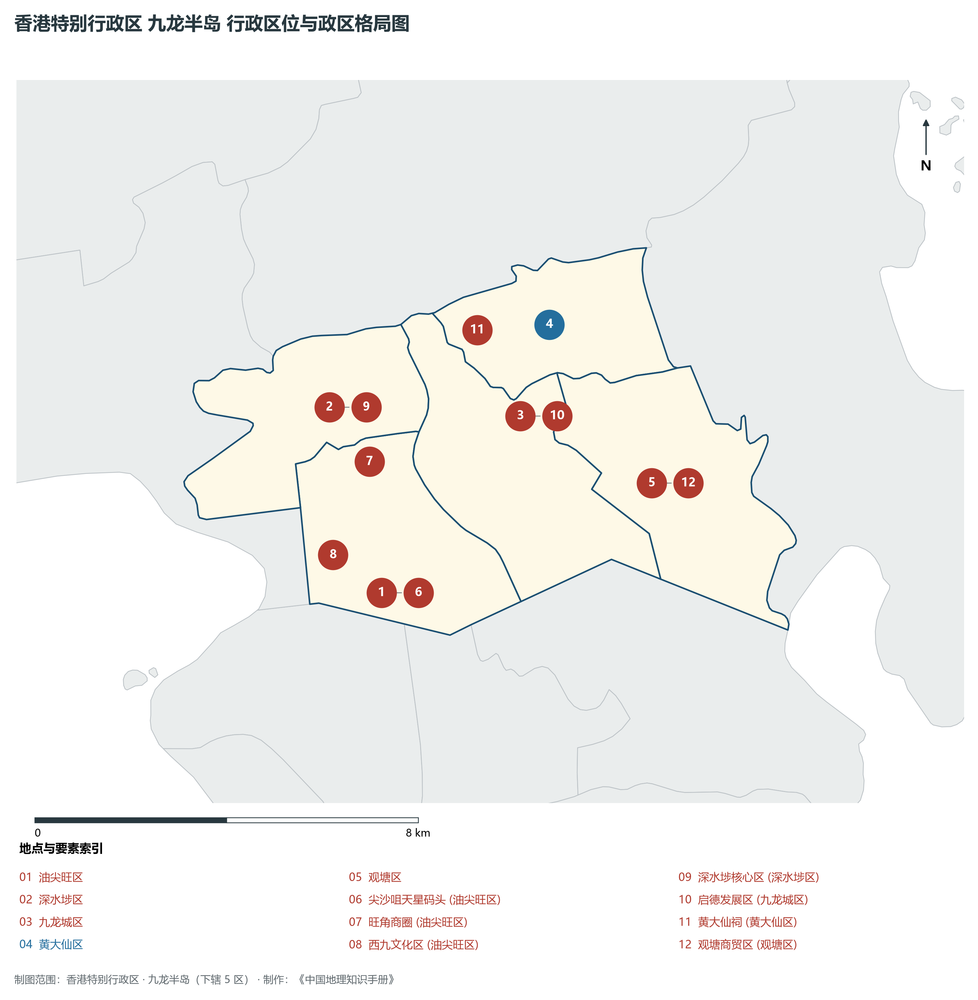
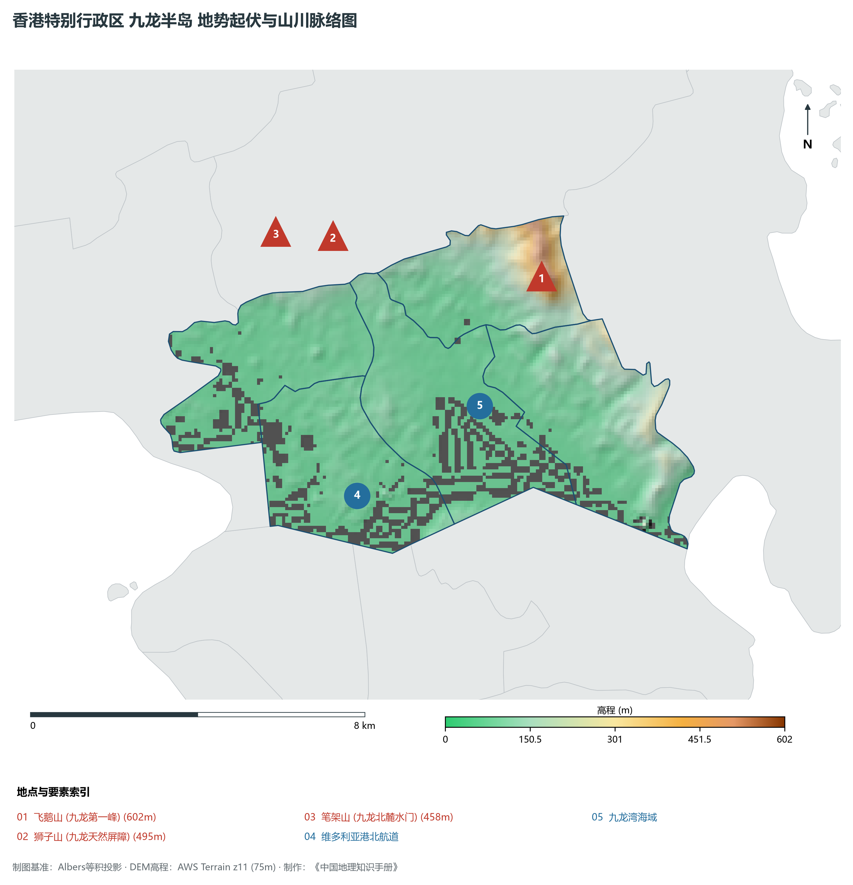
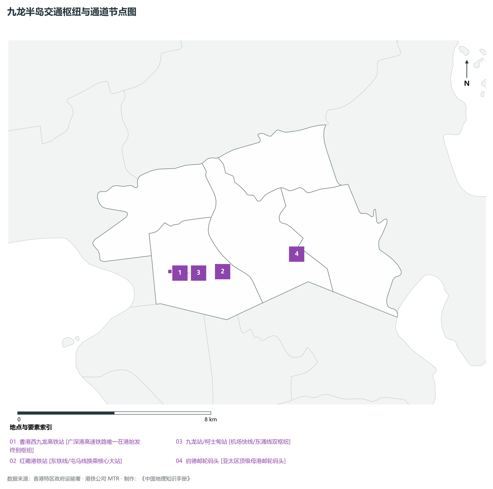
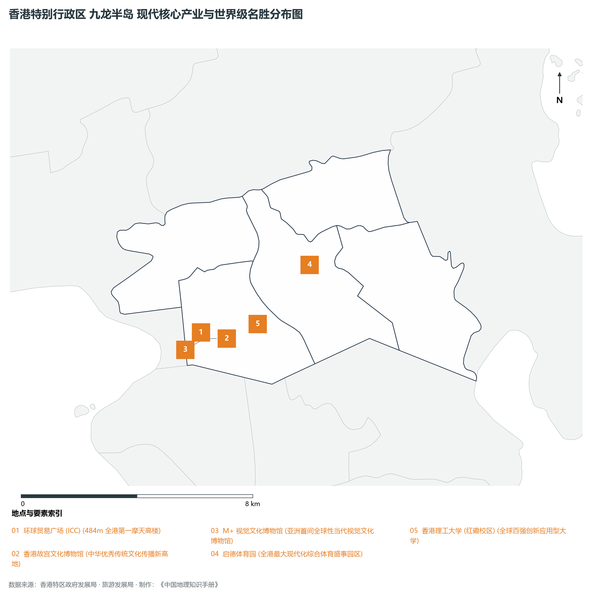

# 27.2 九龙半岛

本节按地理功能划分分析板块，板块不作为独立的地区生产总值统计单元。

## 一、自然地理底盘、空间范围与生态格局

九龙半岛地处香港特别行政区全港商住人口极核 / 西九文化艺术区 / 高铁陆路门户，全域陆地总面积达 **46.9 km²**。

辖区内各层级重点行政极核、区级中心及战略功能节点布局如下：

- **尖沙咀天星码头 (油尖旺区)**：坐标 (114.169°E, 22.294°N)，功能定位：九龙最南端·维港观景极核；
- **旺角商圈 (油尖旺区)**：坐标 (114.169°E, 22.319°N)，功能定位：全球人流密度最高商圈之一；
- **西九文化区 (油尖旺区)**：坐标 (114.16°E, 22.302°N)，功能定位：世界级文化艺术创新区；
- **深水埗核心区 (深水埗区)**：坐标 (114.162°E, 22.33°N)，功能定位：传统市井文化与电子商贸街区；
- **启德发展区 (九龙城区)**：坐标 (114.2°E, 22.325°N)，功能定位：千亿级新核心商业与体育园区；
- **黄大仙祠 (黄大仙区)**：坐标 (114.193°E, 22.342°N)，功能定位：著名道教宗教文化圣地；
- **观塘商贸区 (观塘区)**：坐标 (114.225°E, 22.31°N)，功能定位：九龙东第二核心商业区(CBD2)；

辖区地势格局呈现出独特的起伏演化特征，高程极值范围在 **0 m ～ 602.0 m** 之间，全域最大相对高差达 **602.0 m**：

辖区重点山脉峰峦与控制性地理高程节点如下：

- **飞鹅山 (九龙第一峰)**：海拔标高 **602.0 m**，空间坐标 (114.222°E, 22.342°N)；
- **狮子山 (九龙天然屏障)**：海拔标高 **495.0 m**，空间坐标 (114.175°E, 22.355°N)；
- **笔架山 (九龙北麓水门)**：海拔标高 **458.0 m**，空间坐标 (114.162°E, 22.357°N)；

骨干水系海域脉络与关键控制地标：

- **维多利亚港北航道**：标定坐标 (114.175°E, 22.298°N)；
- **九龙湾海域**：标定坐标 (114.205°E, 22.315°N)；

独特的自然地理底盘塑造了辖区“山海相依、城景交融”的绝美景观生态本底。辖区严格保护郊野公园与海岸公园，绿化覆盖率高，展现了高密度现代化大都市与自然生态和谐共生的典范格局。

---

## 二、综合立体交通网络与区位优势

作为香港特别行政区乃至粤港澳大湾区综合交通网络中的关键承载板块，九龙半岛区位优势得天独厚、内联外通网络日臻完备。近年来，辖区全方位抢抓高质量共建“一带一路”、广深港高铁大贯通与港珠澳大桥超级走廊机遇，客货综合保障能级实现历史性跨越：

骨干交通基础设施与重要立体物流枢纽节点包括：

- **香港西九龙高铁站**：空间标定 (114.165°E, 22.304°N)，设施类型：广深港高速铁路唯一在港始发终到枢纽；
- **红磡港铁站**：空间标定 (114.182°E, 22.303°N)，设施类型：东铁线/屯马线换乘核心大站；
- **九龙站/柯士甸站**：空间标定 (114.161°E, 22.305°N)，设施类型：机场快线/东涌线双枢纽；
- **启德邮轮码头**：空间标定 (114.212°E, 22.307°N)，设施类型：亚太区顶级母港邮轮码头；

通过发达的城市轨道交通网络（港铁系统）、现代化跨海大桥与海底隧道群、高快速公路网络，九龙半岛全面融入全港“半小时通勤圈”与深港“一小时生活圈”，高效联通全球大市场。

---

## 三、特色优势产业集群、重点园区与现代经济版图

辖区核心产业平台、重大战略工程与重点开发区展示如下：

- **环球贸易广场 (ICC)**：空间坐标 (114.16°E, 22.303°N)，核心功能：484m 全港第一摩天高楼；
- **香港故宫文化博物馆**：空间坐标 (114.159°E, 22.301°N)，核心功能：中华优秀传统文化传播新高地；
- **M+ 视觉文化博物馆**：空间坐标 (114.161°E, 22.301°N)，核心功能：亚洲首间全球性当代视觉文化博物馆；
- **启德体育园**：空间坐标 (114.198°E, 22.321°N)，核心功能：全港最大现代化综合体育盛事园区；
- **香港理工大学 (红磡校区)**：空间坐标 (114.179°E, 22.304°N)，核心功能：全球百强创新应用型大学；

在现代化产业布局与高能级平台建设中，辖区因地制宜打造特色优势产业生态圈：

1. **高端现代服务业与金融总部经济**：汇聚跨国金融机构、财富管理总部、法律与专业服务机构，打造国际一流的营商环境；
2. **前沿创新科技与数字产业孵化**：聚焦人工智能、生物医药、金融科技与新能源，加速科技成果从实验室走向市场；
3. **世界级文旅消费与国际贸易会展**：深耕国际会展、潮流零售、主题文旅与免税商贸，打造国际消费中心城市核心引擎。

---

## 四、历史文化胜迹、世界级地标与文旅名胜

九龙半岛历史文脉深厚，中西文化碰撞交融，壮阔海天与摩天大楼交相辉映，是享誉全球的国际文旅胜地：

- **历史建筑与法定古迹**：拥有享誉中外的法定古迹、历史建筑群与文博场馆，完好记录了香港从昔日小渔村走向现代化国际金融大都会的壮阔变迁；
- **自然奇观与休闲度假胜地**：大自然造化赐予辖区碧海银沙、苍翠山峦、海蚀地貌与优质郊野步道，是全球城市探险家与自然爱好者的打卡胜地；
- **非物质文化遗产与国际文化盛事**：传统民俗节庆与国际艺术展会常年举办，展现了兼收并蓄、多元包容的城市文化魅力。

---
