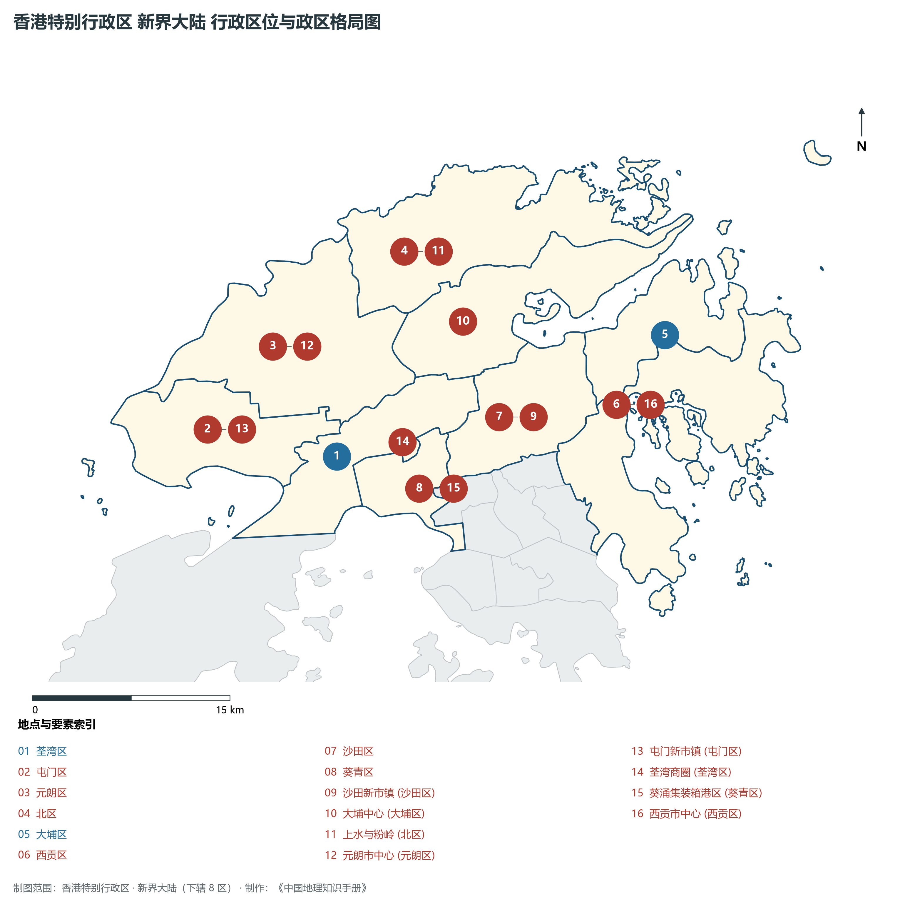
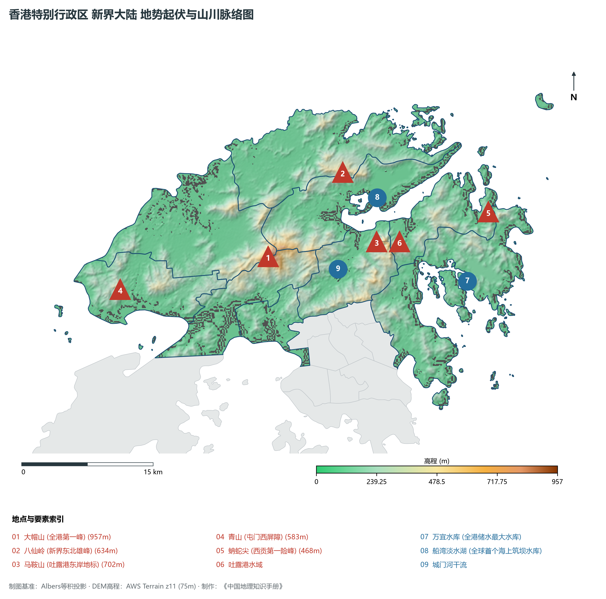
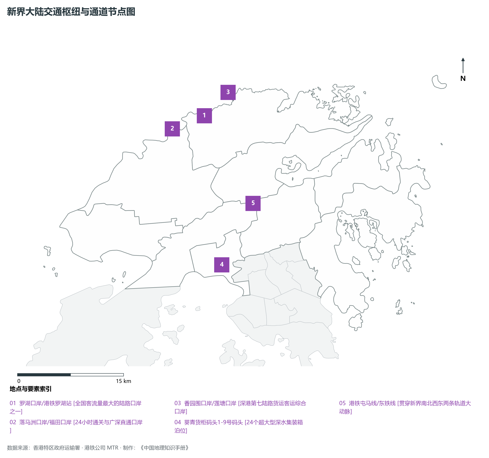
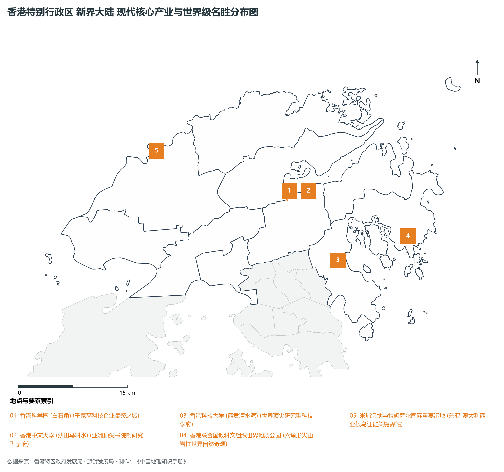

# 27.3 新界大陆

本节按地理功能划分分析板块，板块不作为独立的地区生产总值统计单元。

## 一、自然地理底盘、空间范围与生态格局

新界大陆地处香港特别行政区北部都会区战略腹地 / 深港创科协同走廊 / 全球航运枢纽，全域陆地总面积达 **747.2 km²**。

辖区内各层级重点行政极核、区级中心及战略功能节点布局如下：

- **沙田新市镇 (沙田区)**：坐标 (114.188°E, 22.382°N)，功能定位：全港首批最成熟现代化新市镇；
- **大埔中心 (大埔区)**：坐标 (114.168°E, 22.45°N)，功能定位：林村河畔科技生态宜居城；
- **上水与粉岭 (北区)**：坐标 (114.13°E, 22.502°N)，功能定位：连接深圳罗湖与福田重要口岸门户；
- **元朗市中心 (元朗区)**：坐标 (114.028°E, 22.445°N)，功能定位：新界西北商贸生活极核；
- **屯门新市镇 (屯门区)**：坐标 (113.975°E, 22.392°N)，功能定位：屯门河畔滨海新城与西部门户；
- **荃湾商圈 (荃湾区)**：坐标 (114.116°E, 22.371°N)，功能定位：新界西传统工业转型商业枢纽；
- **葵涌集装箱港区 (葵青区)**：坐标 (114.125°E, 22.338°N)，功能定位：全球核心深水货柜物流走廊；
- **西贡市中心 (西贡区)**：坐标 (114.274°E, 22.383°N)，功能定位：香港后花园·国家地质公园门户；

辖区地势格局呈现出独特的起伏演化特征，高程极值范围在 **0 m ～ 957.0 m** 之间，全域最大相对高差达 **957.0 m**：

辖区重点山脉峰峦与控制性地理高程节点如下：

- **大帽山 (全港第一峰)**：海拔标高 **957.0 m**，空间坐标 (114.12°E, 22.41°N)；
- **八仙岭 (新界东北雄峰)**：海拔标高 **634.0 m**，空间坐标 (114.21°E, 22.49°N)；
- **马鞍山 (吐露港东岸地标)**：海拔标高 **702.0 m**，空间坐标 (114.24°E, 22.415°N)；
- **青山 (屯门西屏障)**：海拔标高 **583.0 m**，空间坐标 (113.955°E, 22.39°N)；
- **蚺蛇尖 (西贡第一险峰)**：海拔标高 **468.0 m**，空间坐标 (114.365°E, 22.435°N)；

骨干水系海域脉络与关键控制地标：

- **吐露港水域**：标定坐标 (114.22°E, 22.44°N)；
- **万宜水库 (全港储水最大水库)**：标定坐标 (114.335°E, 22.365°N)；
- **船湾淡水湖 (全球首个海上筑坝水库)**：标定坐标 (114.245°E, 22.46°N)；
- **城门河干流**：标定坐标 (114.195°E, 22.39°N)；

独特的自然地理底盘塑造了辖区“山海相依、城景交融”的绝美景观生态本底。辖区严格保护郊野公园与海岸公园，绿化覆盖率高，展现了高密度现代化大都市与自然生态和谐共生的典范格局。

---

## 二、综合立体交通网络与区位优势

作为香港特别行政区乃至粤港澳大湾区综合交通网络中的关键承载板块，新界大陆区位优势得天独厚、内联外通网络日臻完备。近年来，辖区全方位抢抓高质量共建“一带一路”、广深港高铁大贯通与港珠澳大桥超级走廊机遇，客货综合保障能级实现历史性跨越：

骨干交通基础设施与重要立体物流枢纽节点包括：

- **罗湖口岸/港铁罗湖站**：空间标定 (114.115°E, 22.528°N)，设施类型：全国客流量最大的陆路口岸之一；
- **落马洲口岸/福田口岸**：空间标定 (114.07°E, 22.515°N)，设施类型：24小时通关与广深直通口岸；
- **香园围口岸/莲塘口岸**：空间标定 (114.15°E, 22.555°N)，设施类型：深港第七陆路货运客运综合口岸；
- **葵青货柜码头1-9号码头**：空间标定 (114.12°E, 22.335°N)，设施类型：24个超大型深水集装箱泊位；
- **港铁屯马线/东铁线**：空间标定 (114.17°E, 22.41°N)，设施类型：贯穿新界南北西东两条轨道大动脉；

通过发达的城市轨道交通网络（港铁系统）、现代化跨海大桥与海底隧道群、高快速公路网络，新界大陆全面融入全港“半小时通勤圈”与深港“一小时生活圈”，高效联通全球大市场。

---

## 三、特色优势产业集群、重点园区与现代经济版图

辖区核心产业平台、重大战略工程与重点开发区展示如下：

- **香港科学园 (白石角)**：空间坐标 (114.21°E, 22.43°N)，核心功能：千家高科技企业集聚之城；
- **香港中文大学 (沙田马料水)**：空间坐标 (114.205°E, 22.42°N)，核心功能：亚洲顶尖书院制研究型学府；
- **香港科技大学 (西贡清水湾)**：空间坐标 (114.265°E, 22.338°N)，核心功能：世界顶尖研究型科技学府；
- **香港联合国教科文组织世界地质公园**：空间坐标 (114.36°E, 22.36°N)，核心功能：六角形火山岩柱世界自然奇观；
- **米埔湿地与拉姆萨尔国际重要湿地**：空间坐标 (114.04°E, 22.495°N)，核心功能：东亚-澳大利西亚候鸟迁徙关键驿站；

在现代化产业布局与高能级平台建设中，辖区因地制宜打造特色优势产业生态圈：

1. **高端现代服务业与金融总部经济**：汇聚跨国金融机构、财富管理总部、法律与专业服务机构，打造国际一流的营商环境；
2. **前沿创新科技与数字产业孵化**：聚焦人工智能、生物医药、金融科技与新能源，加速科技成果从实验室走向市场；
3. **世界级文旅消费与国际贸易会展**：深耕国际会展、潮流零售、主题文旅与免税商贸，打造国际消费中心城市核心引擎。

---

## 四、历史文化胜迹、世界级地标与文旅名胜

新界大陆历史文脉深厚，中西文化碰撞交融，壮阔海天与摩天大楼交相辉映，是享誉全球的国际文旅胜地：

- **历史建筑与法定古迹**：拥有享誉中外的法定古迹、历史建筑群与文博场馆，完好记录了香港从昔日小渔村走向现代化国际金融大都会的壮阔变迁；
- **自然奇观与休闲度假胜地**：大自然造化赐予辖区碧海银沙、苍翠山峦、海蚀地貌与优质郊野步道，是全球城市探险家与自然爱好者的打卡胜地；
- **非物质文化遗产与国际文化盛事**：传统民俗节庆与国际艺术展会常年举办，展现了兼收并蓄、多元包容的城市文化魅力。

---
