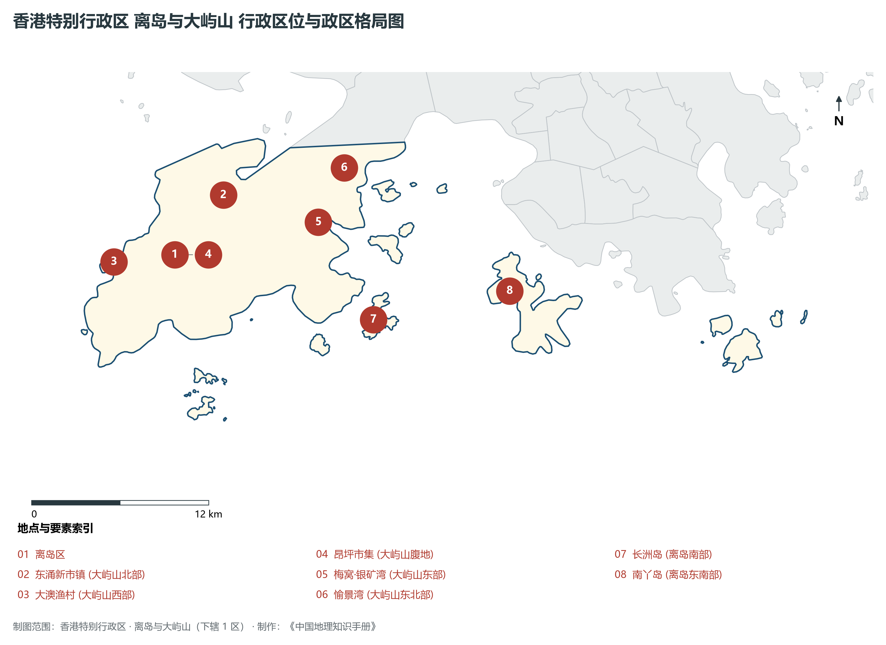
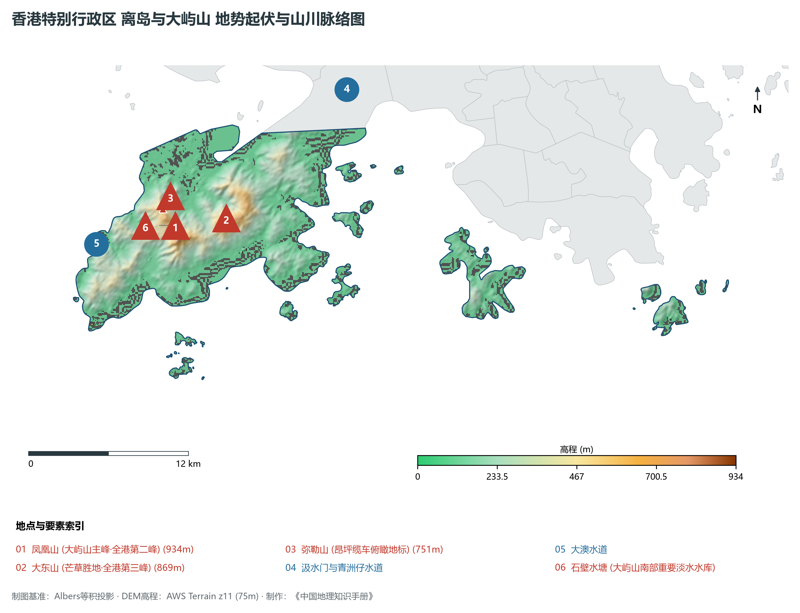
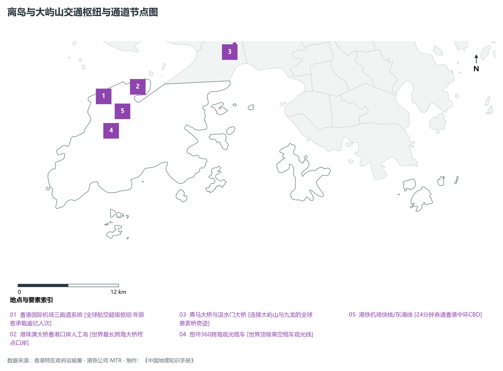
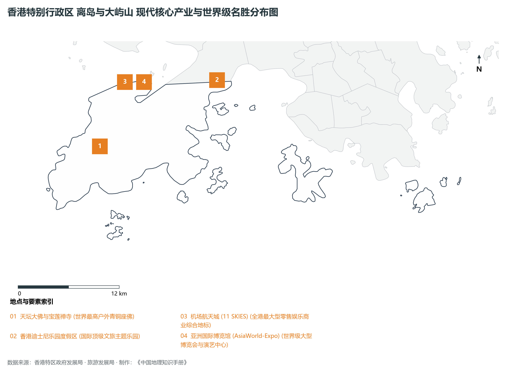

# 27.4 离岛与大屿山

本节按地理功能划分分析板块，板块不作为独立的地区生产总值统计单元。

## 一、自然地理底盘、空间范围与生态格局

离岛与大屿山地处香港特别行政区双门户国际空港大通道 / 跨海大桥桥头堡 / 生态文旅度假胜地，全域陆地总面积达 **178.2 km²**。

辖区内各层级重点行政极核、区级中心及战略功能节点布局如下：

- **东涌新市镇 (大屿山北部)**：坐标 (113.94°E, 22.29°N)，功能定位：大屿山核心居住与商贸新城；
- **大澳渔村 (大屿山西部)**：坐标 (113.865°E, 22.255°N)，功能定位：东方威尼斯·水上棚屋人文胜地；
- **昂坪市集 (大屿山腹地)**：坐标 (113.905°E, 22.256°N)，功能定位：天坛大佛与宝莲禅寺朝圣地；
- **梅窝·银矿湾 (大屿山东部)**：坐标 (114.0°E, 22.268°N)，功能定位：大屿山传统渡轮客运港口；
- **愉景湾 (大屿山东北部)**：坐标 (114.02°E, 22.3°N)，功能定位：国际化低密度海滨度假社区；
- **长洲岛 (离岛南部)**：坐标 (114.03°E, 22.205°N)，功能定位：太平清醮包山节文化名岛；
- **南丫岛 (离岛东南部)**：坐标 (114.12°E, 22.215°N)，功能定位：榕树湾与索罟湾生态海鲜名岛；

辖区地势格局呈现出独特的起伏演化特征，高程极值范围在 **0 m ～ 934.0 m** 之间，全域最大相对高差达 **934.0 m**：

辖区重点山脉峰峦与控制性地理高程节点如下：

- **凤凰山 (大屿山主峰·全港第二峰)**：海拔标高 **934.0 m**，空间坐标 (113.918°E, 22.258°N)；
- **大东山 (芒草胜地·全港第三峰)**：海拔标高 **869.0 m**，空间坐标 (113.955°E, 22.26°N)；
- **弥勒山 (昂坪缆车俯瞰地标)**：海拔标高 **751.0 m**，空间坐标 (113.91°E, 22.27°N)；

骨干水系海域脉络与关键控制地标：

- **汲水门与青洲仔水道**：标定坐标 (114.05°E, 22.34°N)；
- **大澳水道**：标定坐标 (113.86°E, 22.25°N)；
- **石壁水塘 (大屿山南部重要淡水水库)**：标定坐标 (113.895°E, 22.235°N)；

独特的自然地理底盘塑造了辖区“山海相依、城景交融”的绝美景观生态本底。辖区严格保护郊野公园与海岸公园，绿化覆盖率高，展现了高密度现代化大都市与自然生态和谐共生的典范格局。

---

## 二、综合立体交通网络与区位优势

作为香港特别行政区乃至粤港澳大湾区综合交通网络中的关键承载板块，离岛与大屿山区位优势得天独厚、内联外通网络日臻完备。近年来，辖区全方位抢抓高质量共建“一带一路”、广深港高铁大贯通与港珠澳大桥超级走廊机遇，客货综合保障能级实现历史性跨越：

骨干交通基础设施与重要立体物流枢纽节点包括：

- **香港国际机场三跑道系统**：空间标定 (113.915°E, 22.308°N)，设施类型：全球航空超级枢纽·年旅客承载逾亿人次；
- **港珠澳大桥香港口岸人工岛**：空间标定 (113.955°E, 22.315°N)，设施类型：世界最长跨海大桥终点口岸；
- **青马大桥与汲水门大桥**：空间标定 (114.07°E, 22.352°N)，设施类型：连接大屿山与九龙的全球悬索桥奇迹；
- **昂坪360跨海观光缆车**：空间标定 (113.92°E, 22.27°N)，设施类型：世界顶级高空缆车观光线；
- **港铁机场快线/东涌线**：空间标定 (113.935°E, 22.29°N)，设施类型：24分钟直通香港中环CBD；

通过发达的城市轨道交通网络（港铁系统）、现代化跨海大桥与海底隧道群、高快速公路网络，离岛与大屿山全面融入全港“半小时通勤圈”与深港“一小时生活圈”，高效联通全球大市场。

---

## 三、特色优势产业集群、重点园区与现代经济版图

辖区核心产业平台、重大战略工程与重点开发区展示如下：

- **天坛大佛与宝莲禅寺**：空间坐标 (113.905°E, 22.255°N)，核心功能：世界最高户外青铜座佛；
- **香港迪士尼乐园度假区**：空间坐标 (114.045°E, 22.315°N)，核心功能：国际顶级文旅主题乐园；
- **机场航天城 (11 SKIES)**：空间坐标 (113.935°E, 22.32°N)，核心功能：全港最大型零售娱乐商业综合地标；
- **亚洲国际博览馆 (AsiaWorld-Expo)**：空间坐标 (113.94°E, 22.322°N)，核心功能：世界级大型博览会与演艺中心；

在现代化产业布局与高能级平台建设中，辖区因地制宜打造特色优势产业生态圈：

1. **高端现代服务业与金融总部经济**：汇聚跨国金融机构、财富管理总部、法律与专业服务机构，打造国际一流的营商环境；
2. **前沿创新科技与数字产业孵化**：聚焦人工智能、生物医药、金融科技与新能源，加速科技成果从实验室走向市场；
3. **世界级文旅消费与国际贸易会展**：深耕国际会展、潮流零售、主题文旅与免税商贸，打造国际消费中心城市核心引擎。

---

## 四、历史文化胜迹、世界级地标与文旅名胜

离岛与大屿山历史文脉深厚，中西文化碰撞交融，壮阔海天与摩天大楼交相辉映，是享誉全球的国际文旅胜地：

- **历史建筑与法定古迹**：拥有享誉中外的法定古迹、历史建筑群与文博场馆，完好记录了香港从昔日小渔村走向现代化国际金融大都会的壮阔变迁；
- **自然奇观与休闲度假胜地**：大自然造化赐予辖区碧海银沙、苍翠山峦、海蚀地貌与优质郊野步道，是全球城市探险家与自然爱好者的打卡胜地；
- **非物质文化遗产与国际文化盛事**：传统民俗节庆与国际艺术展会常年举办，展现了兼收并蓄、多元包容的城市文化魅力。

---
