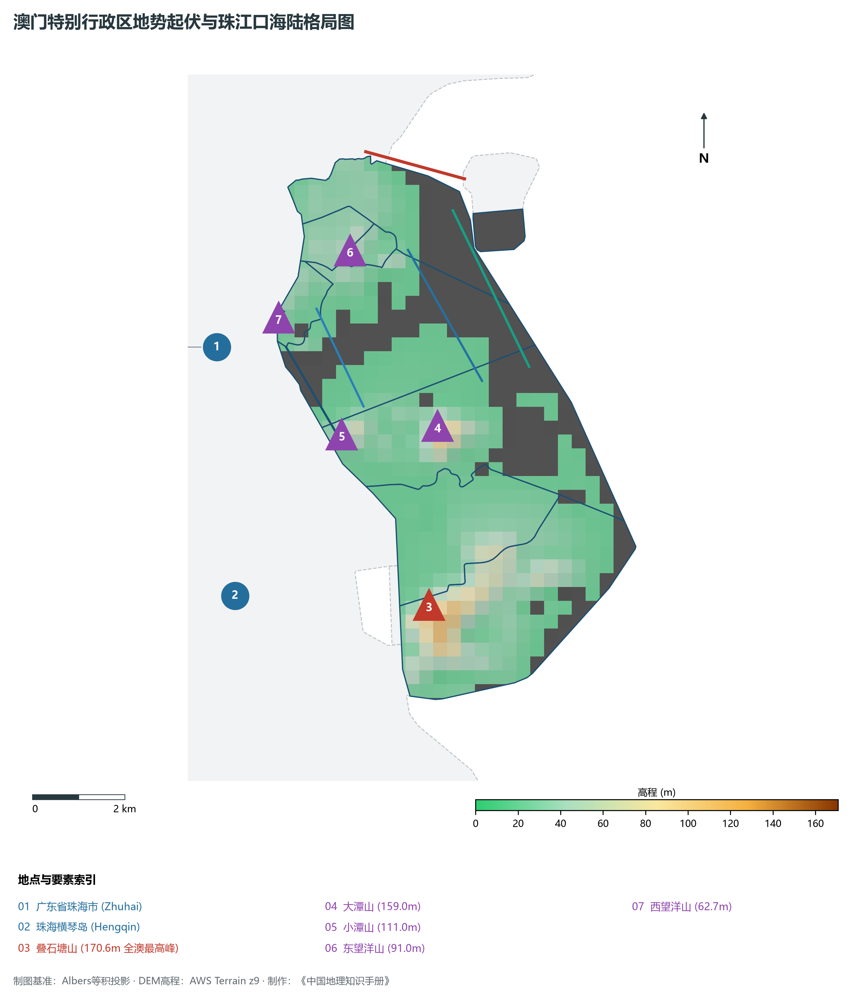
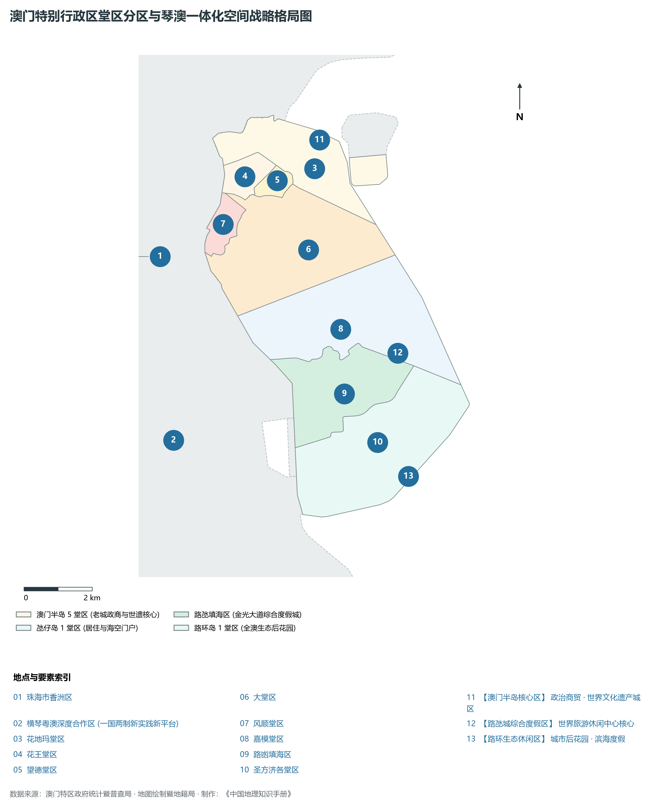
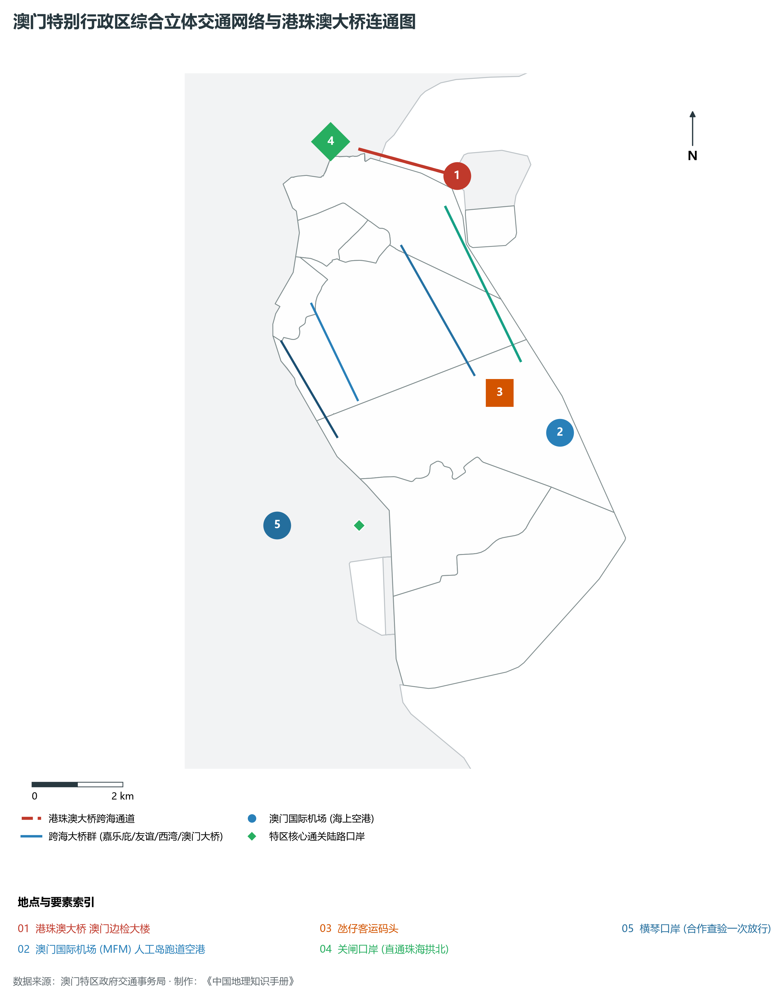
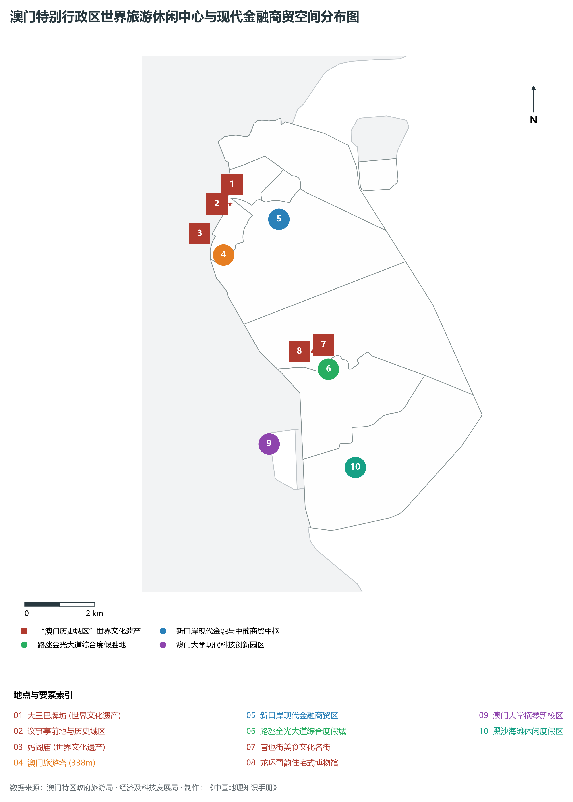
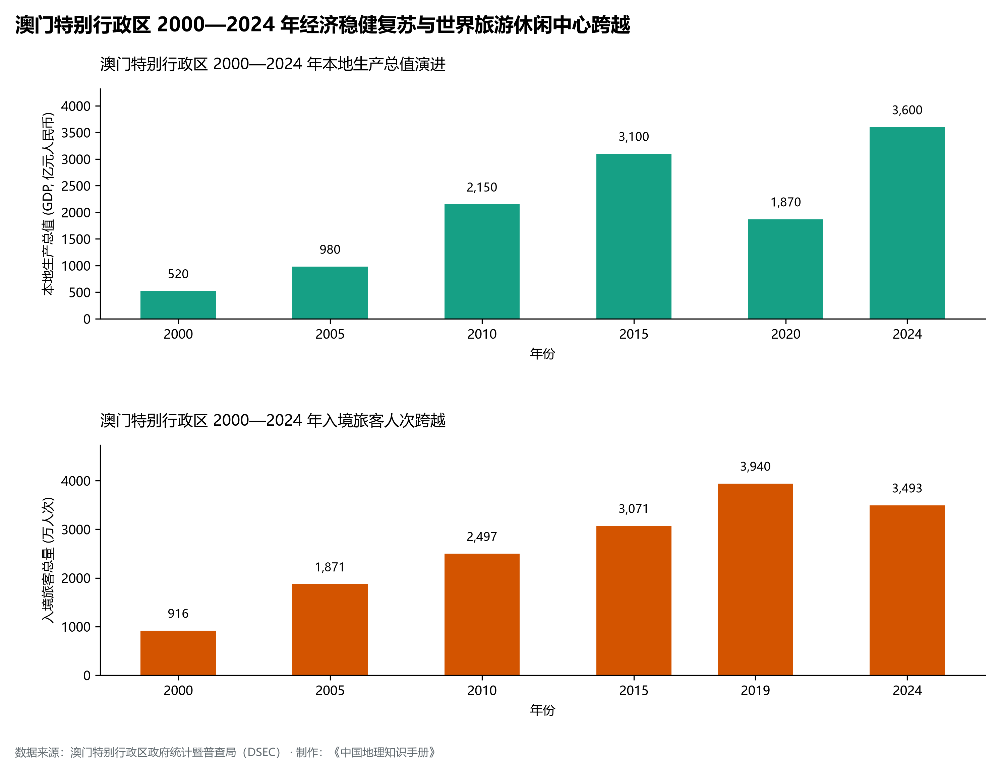

# 28.0 澳门特别行政区地理统揽

澳门特别行政区（Macao Special Administrative Region，简称“澳”或“MO”），位于中国南部沿海、珠江口西岸，介于东经 113° 31' ～ 113° 36'、北纬 22° 06' ～ 22° 13' 之间。全特区北面与广东省珠海市拱北陆路相连，东隔伶仃洋与香港特别行政区相距约 60 公里，西与珠海市横琴岛隔十字门水道和马骾门相望，南临浩瀚的南海。全特区由澳门半岛、氹仔岛、路环岛以及路氹填海区、新城填海区共同组成，陆地总面积达 **33.3 km²**，海域管辖面积达 **85 km²**。

截至 2024 年末，澳门特别行政区常住人口达 **68.7 万人**，城镇化率为 **100.0%**，平均人口密度超每平方公里 2.06 万人，其中澳门半岛北部花地玛堂区更达每平方公里 6 万人以上，是全球人口密度最高、土地利用极度集约的微型国际都市。2024 年，澳门本地生产总值（GDP）跃升至 **4,033 亿澳门元**（按当年平均汇率折合人民币约 **3,600 亿元**），人均本地生产总值达 **58.7 万澳门元**（折合人民币约 **52.4 万元**），位居全球及亚洲最前列；三次产业结构比呈现极端的第三产业独大特征，结构比为 **0.0 : 6.8 : 93.2**。在“一国两制”方针下，澳门享有高度自治权，国家赋予澳门建设“世界旅游休闲中心”、“中国与葡语国家商贸合作服务平台”以及“以中华文化为主流、多元文化共存的交流合作基地”（“一中心、一平台、一基地”）的重要战略定位，是粤港澳大湾区四大中心城市之一和极点之一。

---

## 一、珠江口西岸、沧海桑田百年填海演进与低山丘陵岛屿地貌底盘

澳门地处华南褶皱系东南缘的华南沿海丘陵台地带，地质基础主要由燕山期花岗岩岩体侵入构成，第四纪以来海侵与海退交替沉积：

1. **沧海桑田的填海造陆史诗**：
   - 1912 年澳门陆地面积仅为 **10.28 km²**（澳门半岛 3.4 km²、氹仔 2.3 km²、路环 4.58 km²）；
   - 经过一个多世纪持续不断的填海造陆，至 2024 年全特区陆地面积扩大至 **33.3 km²**，扩张超过 3 倍；
   - 填海造就了新口岸皇朝区、南湾湖与西湾湖景观带、黑沙环沿海新居住区、澳门国际机场海上人工跑道、连接氹仔与路环的“路氹城（Cotai）”以及港珠澳大桥澳门落脚点人工岛与新城 A、B、C、D、E 区；
2. **“三岛一体”地势骨架与高程极值控制体系**：
   - **最高峰**：路环岛中部的**叠石塘山（塔石塘山，拔海标高 170.6 m）**，峰顶立有汉白玉妈祖雕像，山麓环抱石排湾郊野公园，为全澳最高屋脊；
   - **第二高峰**：氹仔岛中部的**大潭山（159.0 m）**，建有大潭山郊野公园，可俯瞰整个路氹城金光大道；
   - **氹仔西峰**：**小潭山（111.0 m）**，俯瞰澳氹三桥与澳门半岛天际线；
   - **澳门半岛之巅**：**东望洋山（松山，拔海 91.0 m）**，顶峰建有东望洋灯塔与东望洋炮台；
   - **历史原点**：**西望洋山（主教山，62.7 m）**与**大炮台山（57.0 m）**，俯瞰内港水道与南湾，构成澳门城市发源的地理屏障；
   - **最低高程**：外海与珠江口水面（**0.0 m**）。

**澳门特别行政区“澳门半岛松山—外海水道—氹仔大潭山—路氹城—路环叠石塘山”立体剖面图**

| 松山 91m | 水面 0m | 大潭山 159m | 填海陆面 3-5m | 叠石塘山 170.6m |
| --- | --- | --- | --- | --- |
| 东望洋灯塔·老城中心；世界遗产·大三巴牌坊 | 澳氹跨海大桥群；澳门大桥·西湾大桥 | 远眺澳门机场人工跑道；氹仔大学城·官也街 | 威尼斯人·金光大道；综合文旅度假新极核 | 全澳最高峰·妈祖圣像；石排湾郊野公园·黑沙湾 |

澳门半岛东望洋山 · → 澳氹外海主航道 · → 氹仔大潭山主脊 · → 路氹城综合度假区 · → 路环叠石塘山全澳之巅

---

## 二、堂区分区架构与“琴澳一体化”深合区战略宏观版图

澳门特别行政区下辖 7 个传统堂区及路氹填海区，在空间上自然归并为 3 大战略功能板块：

1. **澳门半岛（老城核心与行政金融中枢）**：
   - 涵盖花地玛堂区（青洲、台山、黑沙环、关闸）、花王堂区（大三巴、沙梨头）、望德堂区、大堂区（新马路、南湾、新口岸）、风顺堂区（妈阁、下环）；
   - 面积 9.3 km²，常住人口逾 51 万人，是全特区行政、商业、文化及历史遗产集聚地；
2. **氹仔岛与路氹填海区（世界旅游休闲度假核心与现代海空门户）**：
   - 涵盖嘉模堂区及路氹填海区，面积 16.4 km²；
   - 汇聚澳门国际机场、氹仔客运码头、澳门轻轨氹仔线，布局金光大道数十家超大型国际综合度假村；
3. **路环岛与横琴协同区（全澳生态绿肺与琴澳一体化创新极核）**：
   - 涵盖圣方济各堂区，面积 7.6 km²，森林覆被率高，拥有黑沙海滩、竹湾海滩与郊野公园；
   - 西侧紧邻**横琴粤澳深度合作区**（总面积 106 km²）与**澳门大学横琴新校区**（1.09 km²），实行分线管理创新政策，成为特区经济适度多元发展的最主要广阔战略腹地。

---

## 三、海陆空综合立体交通枢纽与跨海通道超级走廊

澳门依托粤港澳大湾区现代综合交通走廊，构筑海陆空一体高效通达的枢纽体系：

1. **港珠澳大桥澳门落脚点**：
   - 港珠澳大桥珠澳人工岛矗立于珠江口前沿，澳门边检大楼实行“合作查验、一次放行”高效通关模式，经港珠澳大桥 45 分钟直抵香港赤鱲角国际机场，彻底激活大湾区西岸时空网络；
2. **“五桥连两岛”跨海大通道体系**：
   - **嘉乐庇总督大桥（澳氹大桥）**：1974 年通车，全长 2,570 米，澳门首座跨海大桥，造型如长虹卧波；
   - **友谊大桥（第二跨海大桥）**：全长 4,414 米，连接澳门半岛外港与氹仔北安；
   - **西湾大桥（第三跨海大桥）**：全长 2,200 米，双层双向斜拉桥，下层在台风暴雨恶劣天气下仍能维持正常全封闭通车；
   - **澳门大桥（第四座跨海大桥）**：2024 年正式通车，起自港珠澳大桥人工岛，跨海直通氹仔北安客运码头与新城 E 区；
   - **莲花大桥**：连接路氹城与横琴岛的第一条跨界公路通道；
3. **澳门国际机场（海上人工跑道空港）**：
   - 跑道长 3,360 米，完全在海中填海筑岛而成，年旅客保障能力超 1,000 万人次，航线直通内地主要干线机场与东亚、东南亚重点都会；
4. **城市轻轨系统与口岸集群**：
   - **澳门轻轨氹仔线**：已投入商业运营，贯通妈阁站、氹仔客运码头、澳门机场与路氹城；延伸横琴线与石排湾线持续加密；
   - **陆路口岸**：关闸口岸（日均通关超 30 万人次）、青茂口岸（24小时无障碍通关）、横琴口岸（通关量节节攀升），构建起全球最便捷的双城口岸走廊。

---

## 四、世界旅游休闲中心与现代金融商贸空间分布

特区政府全力推进“1+4”适度多元发展策略，做优做精综合旅游休闲业，大力培育现代金融、高新技术、大健康、会展商贸和文化体育四大新兴产业：

1. **世界文化遗产“澳门历史城区”**：
   - 2005 年列入联合国教科文组织《世界遗产名录》，串联大三巴牌坊、妈阁庙、东望洋炮台、议事亭前地、岗顶剧院等 22 处历史建筑与 8 块前地，中西合璧、万象融通；
2. **路氹城世界级综合文旅度假集群**：
   - 汇聚威尼斯人、伦敦人、巴黎人、银河、美狮美高梅等超大规模度假城，集成顶级国际会展中心、室内大型演艺场馆、全球米其林美食与奢华零售空间，年接待境内外旅客逾 3,400 万人次；
3. **现代金融商贸与中国—葡语国家金融服务平台**：
   - 依托中葡论坛常设秘书处，大力发展中葡跨境金融、离岸金融、绿色债券与财富管理，中华（澳门）金融资产交易股份有限公司（MOX）债券发行规模持续跨越。

---

## 五、经济飞跃历程与琴澳深度合作区时空跨越

回归祖国以来，澳门谱写了具有澳门特色的“一国两制”成功实践华彩篇章：

1. **经济总量与财政储备实现历史性跨越**：
   - 2000 年澳门特区成立之初，GDP 仅为 520 亿元人民币；至 2024 年跃升至 3,600 亿元人民币，累计增长近 7 倍；
   - 特区财政储备充裕，居民享有完善的社会保障、15 年免费教育与全民现金分享计划，民生福祉大幅跃升；
2. **入境旅客由区域客流跃升为全球客源**：
   - 入境旅客从 2000 年的 916 万人次攀升至 2019 年历史顶峰的 3,940 万人次，2024 年快速回升至 3,493 万人次，国际旅客比例稳步扩大；
3. **琴澳一体化战略落地开花**：
   - 2021 年中共中央、国务院印发《横琴粤澳深度合作区建设总体方案》，开启琴澳深度一体化新纪元；
   - 横琴“一线放开、二线管住”分线管理顺利封关运行，现代中药、集成电路、跨境电商等新兴业态快速萌发，为澳门“一国两制”事业增添全新活力。
