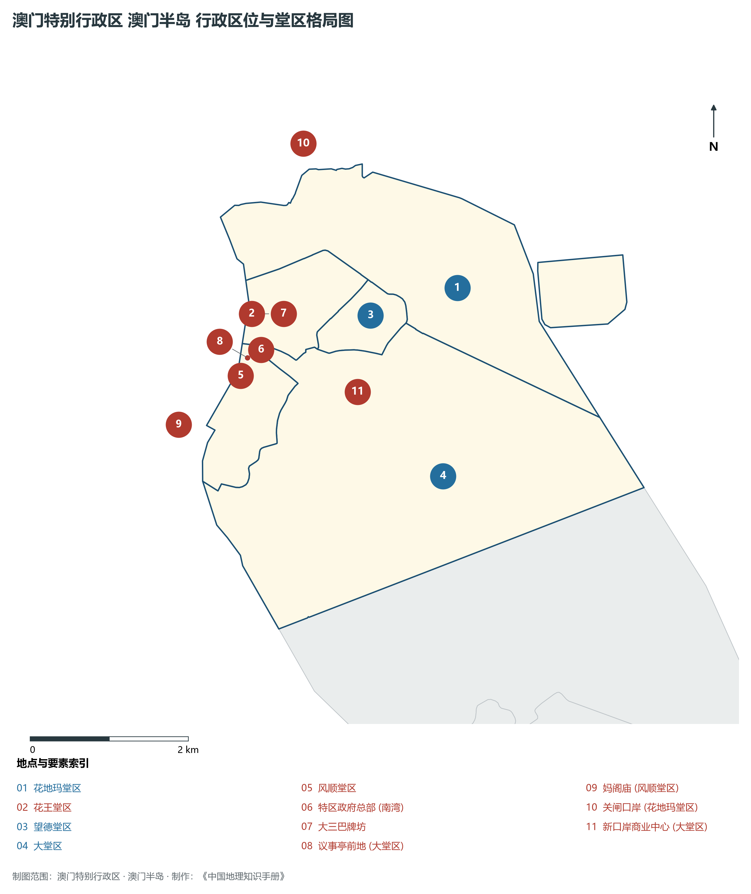
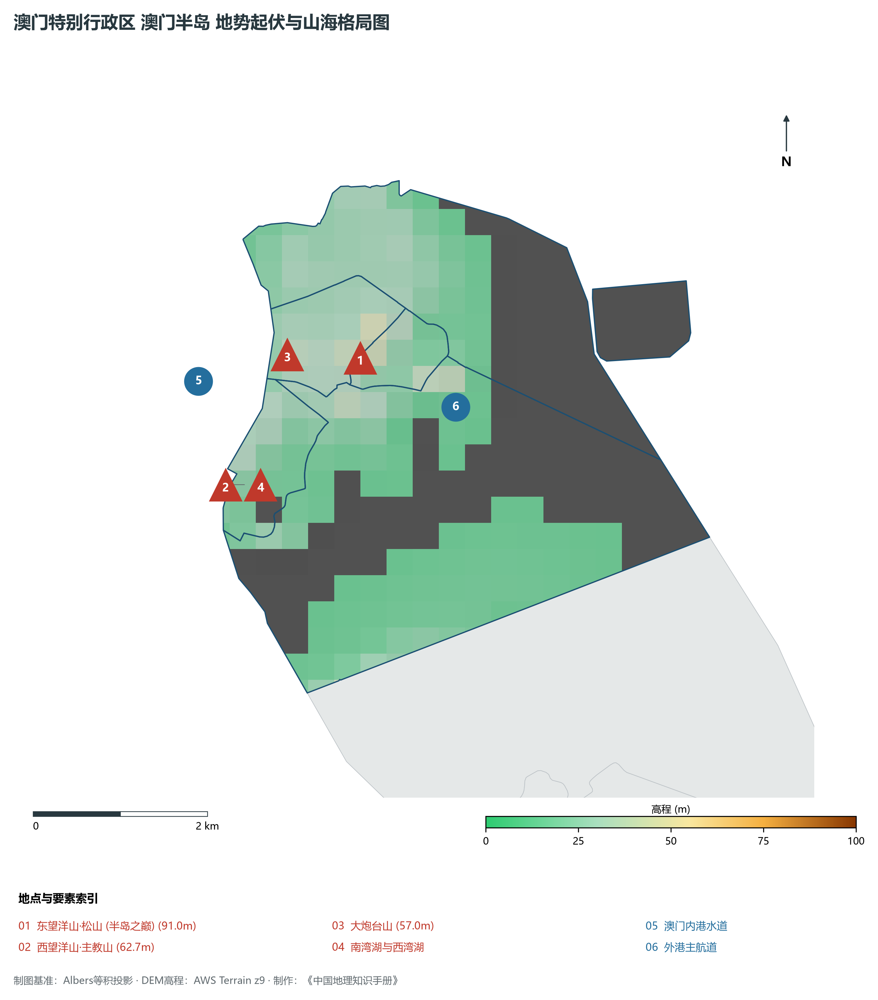
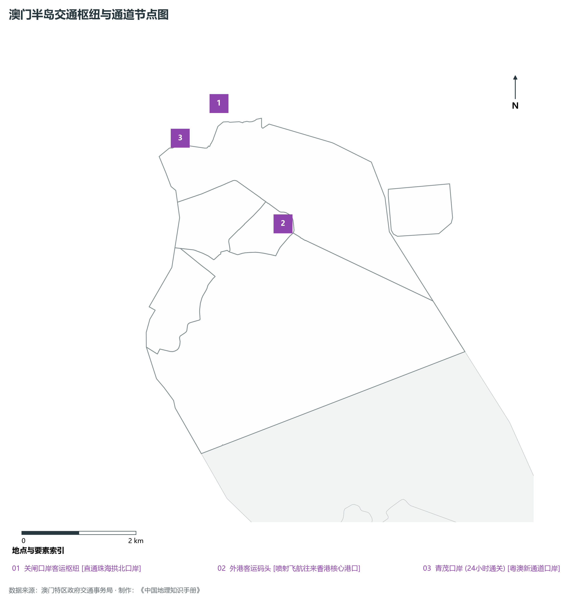
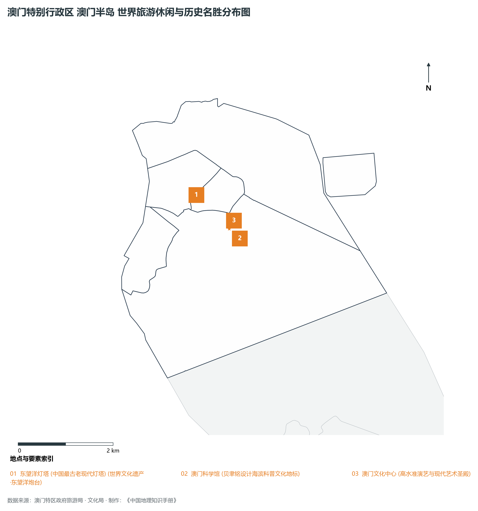

# 28.1 澳门半岛

本节按地理功能划分分析板块，板块不作为独立的地区生产总值统计单元。

## 一、自然地理底盘、空间范围与生态格局

澳门半岛地处澳门特别行政区世界文化遗产核心区 / 特区行政商贸中枢 / 百年沧桑老城，全域陆地总面积达 **9.3 km²**。

辖区内各层级重点行政极核、堂区中心及战略功能节点布局如下：

- **特区政府总部 (南湾)**（东经 113.539°，北纬 22.191°）：特区最高行政办公中枢；
- **大三巴牌坊**（东经 113.541°，北纬 22.198°）：世界文化遗产标志·中西融合丰碑；
- **议事亭前地 (大堂区)**（东经 113.54°，北纬 22.193°）：澳门半岛城市公共文化核心广场；
- **妈阁庙 (风顺堂区)**（东经 113.531°，北纬 22.186°）：澳门历史起源·妈祖文化名刹；
- **关闸口岸 (花地玛堂区)**（东经 113.549°，北纬 22.217°）：连接珠海拱北第一大陆路通关口岸；
- **新口岸商业中心 (大堂区)**（东经 113.553°，北纬 22.188°）：现代金融与国际商务总部基地；

辖区地势格局呈现出独特的起伏演化特征，高程极值范围在 **0 m ～ 91.0 m** 之间，全域最大相对高差达 **91.0 m**：

辖区重点山脉峰峦与控制性地理高程节点如下：

- **东望洋山·松山 (半岛之巅)**（海拔标高 **91.0 m**，坐标：东经 113.55°、北纬 22.196°）：辖区标志性高程控制点；
- **西望洋山·主教山**（海拔标高 **62.7 m**，坐标：东经 113.534°、北纬 22.184°）：辖区标志性高程控制点；
- **大炮台山**（海拔标高 **57.0 m**，坐标：东经 113.542°、北纬 22.197°）：辖区标志性高程控制点；

骨干水系海域脉络与关键控制地标：

- **南湾湖与西湾湖**（东经 113.538°，北纬 22.184°）：辖区核心景观与水文通道；
- **澳门内港水道**（东经 113.532°，北纬 22.195°）：辖区核心景观与水文通道；
- **外港主航道**（东经 113.56°，北纬 22.19°）：辖区核心景观与水文通道；

独特的自然地理底盘塑造了辖区“山海相依、城景交融”的独特景观生态本底。全区严格保护城市绿肺山林与海岸湿地，绿化覆盖度保持高水准，展现了极高密度城市空间与自然山海和谐共生的典范格局。

---

## 二、综合立体交通网络与区位优势

作为澳门特别行政区乃至粤港澳大湾区综合交通网络中的关键承载板块，澳门半岛区位优势得天独厚、内联外通网络日臻完备。近年来，辖区全方位抢抓高质量共建“一带一路”、港珠澳大桥全线贯通与琴澳一体化发展机遇，客货综合保障能级实现历史性跨越：

骨干交通基础设施与重要立体物流枢纽节点包括：

- **关闸口岸客运枢纽**（东经 113.549°，北纬 22.217°）：22.217；
- **外港客运码头**（东经 113.558°，北纬 22.197°）：22.197；
- **青茂口岸 (24小时通关)**（东经 113.542°，北纬 22.212°）：22.212；

通过高度集约的公共巴士线网、轻轨系统、跨海大桥与现代化口岸通道，澳门半岛全面融入澳门全特区“15分钟生活圈”与珠澳“半小时双城通勤圈”，高效联通全球大市场。

---

## 三、特色优势产业集群、重点园区与现代经济版图

辖区核心产业平台、重大战略工程与重点开发区展示如下：

- **东望洋灯塔 (中国最古老现代灯塔)**（东经 113.55°，北纬 22.196°）：世界文化遗产·东望洋炮台；
- **澳门科学馆**（东经 113.558°，北纬 22.187°）：贝聿铭设计海滨科普文化地标；
- **澳门文化中心**（东经 113.556°，北纬 22.189°）：高水准演艺与现代艺术圣殿；

在现代化产业布局与高能级平台建设中，辖区因地制宜打造特色优势产业生态圈：

1. **世界级综合旅游休闲度假业**：整合历史遗迹、星级酒店、高端演艺与舌尖美食，打造高品质世界旅游休闲中心；
2. **现代商贸会展与文化创意产业**：做强以展带会、以会促展，培育具有国际影响力的品牌展会，激发文创产业潜能；
3. **科技创新与高等教育赋能**：依托高水平大学与国家重点实验室，推动微电子、中医药健康、太空科学等前沿领域产学研协同转化。

---

## 四、历史文化胜迹、世界级地标与文旅名胜

澳门半岛历史文脉深厚，中葡文化碰撞交融，百年沧桑与现代繁华交相辉映，是享誉全球的国际文旅圣地：

- **历史城区与世界文化遗产**：拥有享誉中外的联合国教科文组织世界文化遗产建筑群、古炮台、百年教堂与妈祖庙宇，完好记录了澳门自明清开埠以来的壮阔中西交融史；
- **滨海风光与生态休闲胜地**：大自然造化赐予辖区葱郁山体、天然海滩、海蚀崖壁与优质环山步道，是居民和游客亲近自然的绝佳场所；
- **非物质文化遗产与多元节庆盛典**：土生葡人美食烹饪技艺、妈祖信俗、澳门格兰披治大赛车、国际烟花比赛汇演常年举办，展现了兼收并蓄、生机勃勃的多元文化魅力。

---
