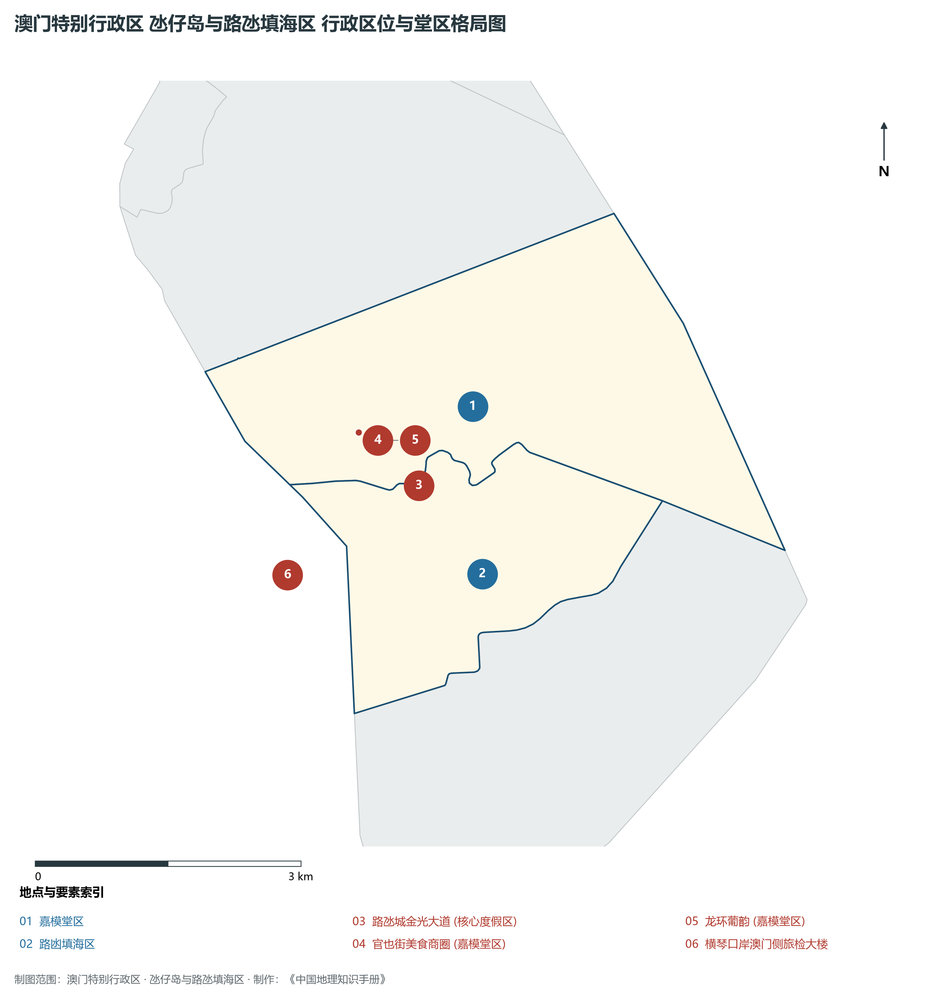
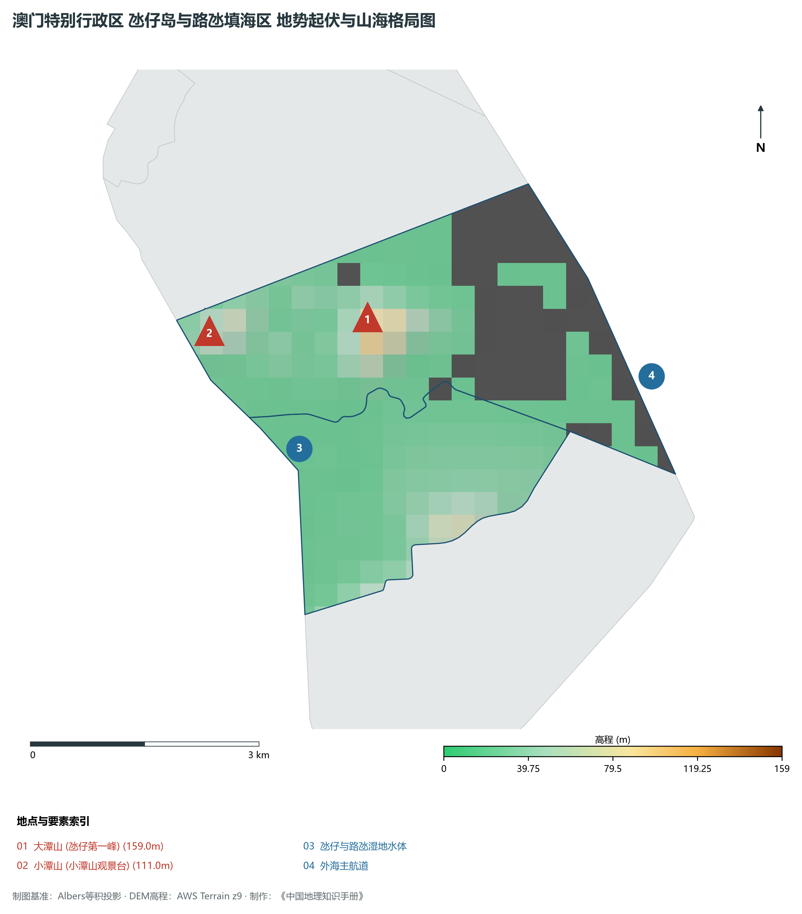
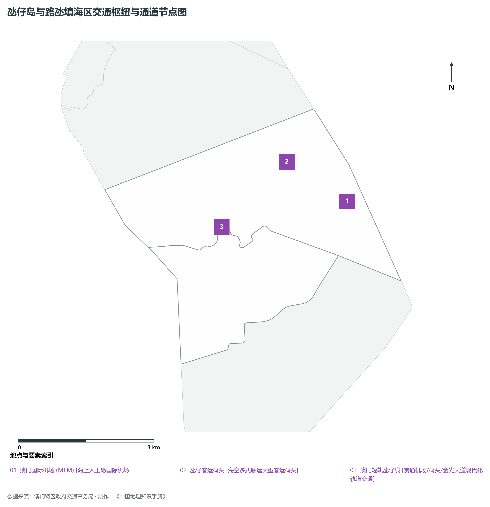
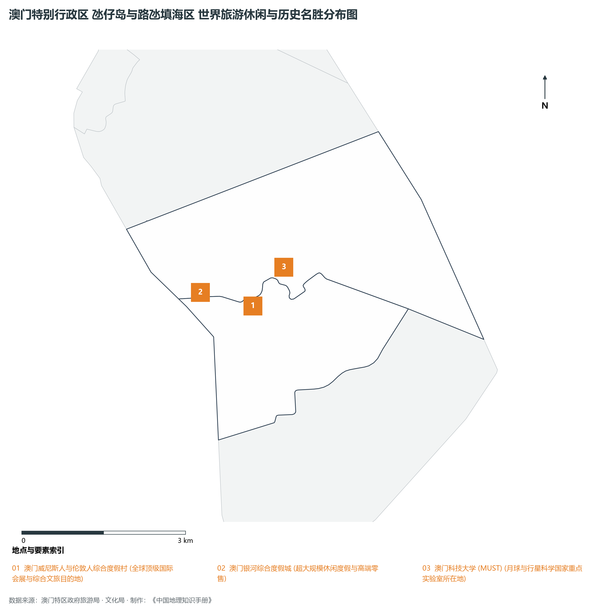

# 28.2 氹仔岛与路氹填海区

本节按地理功能划分分析板块，板块不作为独立的地区生产总值统计单元。

## 一、自然地理底盘、空间范围与生态格局

氹仔岛与路氹填海区地处澳门特别行政区世界旅游休闲中心核心载体 / 国际综合度假城 / 海空立体门户，全域陆地总面积达 **16.4 km²**。

辖区内各层级重点行政极核、堂区中心及战略功能节点布局如下：

- **路氹城金光大道 (核心度假区)**（东经 113.563°，北纬 22.148°）：全球超大型综合度假与会展集群；
- **官也街美食商圈 (嘉模堂区)**（东经 113.557°，北纬 22.154°）：著名历史老街与特色葡式美食胜地；
- **龙环葡韵 (嘉模堂区)**（东经 113.559°，北纬 22.153°）：葡式住宅博物馆与湿地生态公园；
- **横琴口岸澳门侧旅检大楼**（东经 113.548°，北纬 22.14°）：琴澳无缝通关“合作查验一次放行”大门户；

辖区地势格局呈现出独特的起伏演化特征，高程极值范围在 **0 m ～ 159.0 m** 之间，全域最大相对高差达 **159.0 m**：

辖区重点山脉峰峦与控制性地理高程节点如下：

- **大潭山 (氹仔第一峰)**（海拔标高 **159.0 m**，坐标：东经 113.565°、北纬 22.16°）：辖区标志性高程控制点；
- **小潭山 (小潭山观景台)**（海拔标高 **111.0 m**，坐标：东经 113.545°、北纬 22.16°）：辖区标志性高程控制点；

骨干水系海域脉络与关键控制地标：

- **氹仔与路氹湿地水体**（东经 113.555°，北纬 22.145°）：辖区核心景观与水文通道；
- **外海主航道**（东经 113.6°，北纬 22.15°）：辖区核心景观与水文通道；

独特的自然地理底盘塑造了辖区“山海相依、城景交融”的独特景观生态本底。全区严格保护城市绿肺山林与海岸湿地，绿化覆盖度保持高水准，展现了极高密度城市空间与自然山海和谐共生的典范格局。

---

## 二、综合立体交通网络与区位优势

作为澳门特别行政区乃至粤港澳大湾区综合交通网络中的关键承载板块，氹仔岛与路氹填海区区位优势得天独厚、内联外通网络日臻完备。近年来，辖区全方位抢抓高质量共建“一带一路”、港珠澳大桥全线贯通与琴澳一体化发展机遇，客货综合保障能级实现历史性跨越：

骨干交通基础设施与重要立体物流枢纽节点包括：

- **澳门国际机场 (MFM)**（东经 113.592°，北纬 22.155°）：22.155；
- **氹仔客运码头**（东经 113.58°，北纬 22.164°）：22.164；
- **澳门轻轨氹仔线**（东经 113.565°，北纬 22.152°）：22.152；

通过高度集约的公共巴士线网、轻轨系统、跨海大桥与现代化口岸通道，氹仔岛与路氹填海区全面融入澳门全特区“15分钟生活圈”与珠澳“半小时双城通勤圈”，高效联通全球大市场。

---

## 三、特色优势产业集群、重点园区与现代经济版图

辖区核心产业平台、重大战略工程与重点开发区展示如下：

- **澳门威尼斯人与伦敦人综合度假村**（东经 113.562°，北纬 22.147°）：全球顶级国际会展与综合文旅目的地；
- **澳门银河综合度假城**（东经 113.553°，北纬 22.15°）：超大规模休闲度假与高端零售；
- **澳门科技大学 (MUST)**（东经 113.568°，北纬 22.153°）：月球与行星科学国家重点实验室所在地；

在现代化产业布局与高能级平台建设中，辖区因地制宜打造特色优势产业生态圈：

1. **世界级综合旅游休闲度假业**：整合历史遗迹、星级酒店、高端演艺与舌尖美食，打造高品质世界旅游休闲中心；
2. **现代商贸会展与文化创意产业**：做强以展带会、以会促展，培育具有国际影响力的品牌展会，激发文创产业潜能；
3. **科技创新与高等教育赋能**：依托高水平大学与国家重点实验室，推动微电子、中医药健康、太空科学等前沿领域产学研协同转化。

---

## 四、历史文化胜迹、世界级地标与文旅名胜

氹仔岛与路氹填海区历史文脉深厚，中葡文化碰撞交融，百年沧桑与现代繁华交相辉映，是享誉全球的国际文旅圣地：

- **历史城区与世界文化遗产**：拥有享誉中外的联合国教科文组织世界文化遗产建筑群、古炮台、百年教堂与妈祖庙宇，完好记录了澳门自明清开埠以来的壮阔中西交融史；
- **滨海风光与生态休闲胜地**：大自然造化赐予辖区葱郁山体、天然海滩、海蚀崖壁与优质环山步道，是居民和游客亲近自然的绝佳场所；
- **非物质文化遗产与多元节庆盛典**：土生葡人美食烹饪技艺、妈祖信俗、澳门格兰披治大赛车、国际烟花比赛汇演常年举办，展现了兼收并蓄、生机勃勃的多元文化魅力。

---
