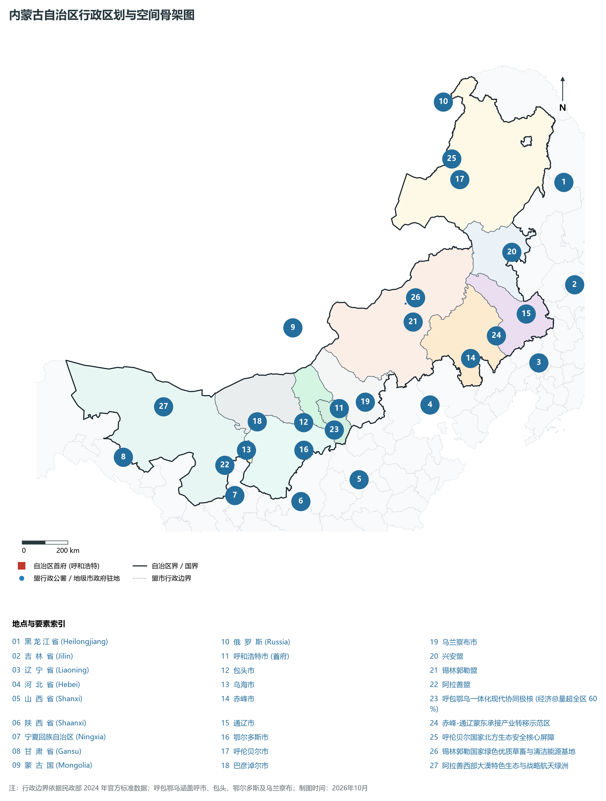
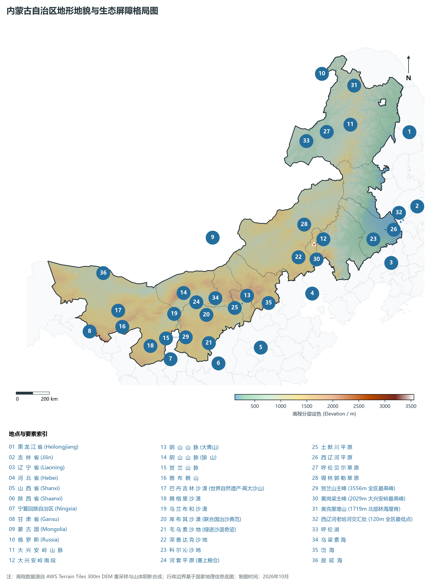
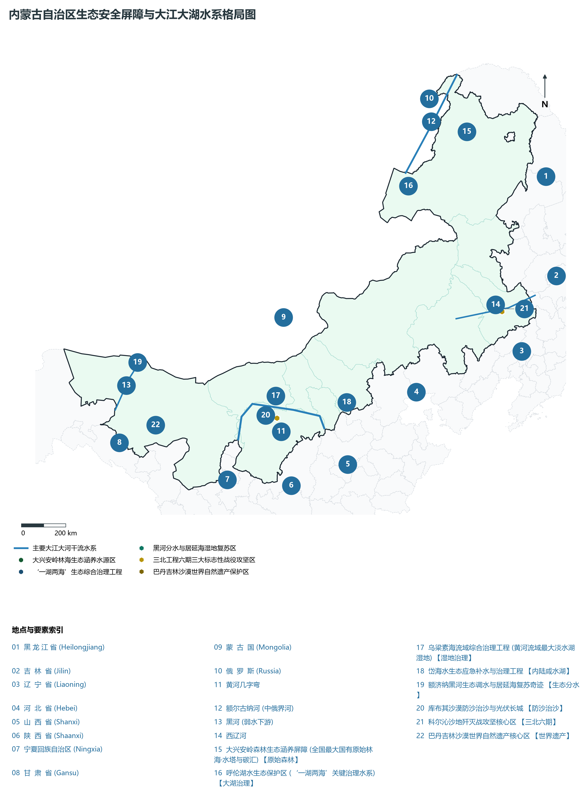
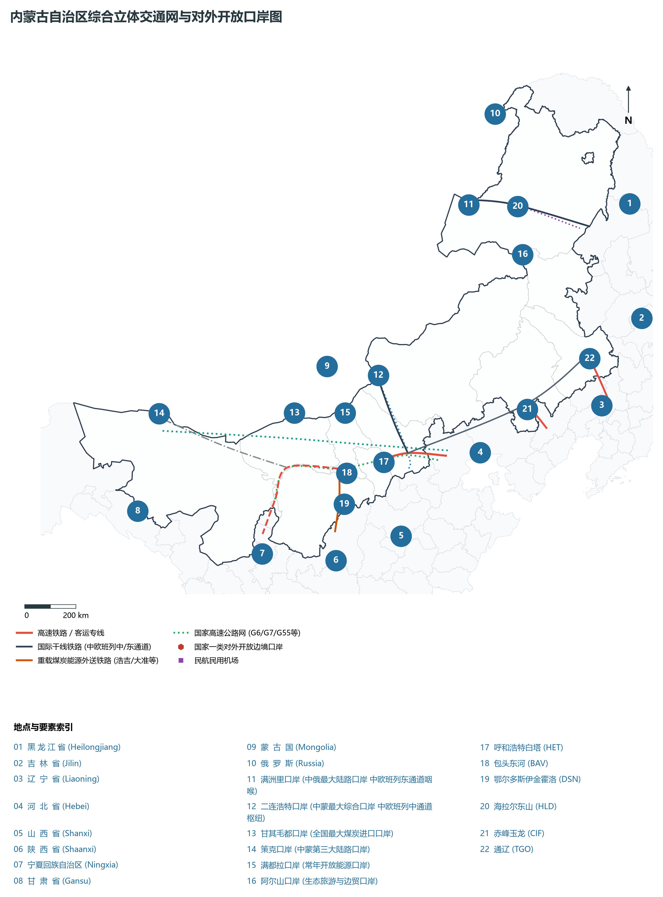
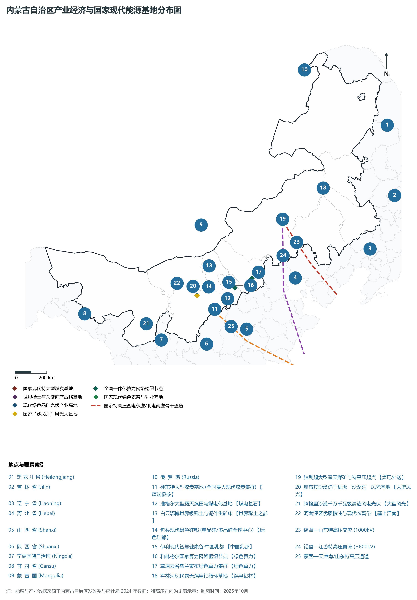

# 第二十九章 内蒙古自治区地理统揽与祖国北疆绿色长城

内蒙古自治区，简称“蒙”，首府呼和浩特市，是中华人民共和国成立的最早的省级少数民族自治区（1947 年 5 月 1 日成立，比新中国早两年零五个月）。全区横跨东北、华北、西北三大区域，北同蒙古国和俄罗斯联邦接壤，国界线长达 **4 221 km**（中蒙段 3 193 km，中俄段 1 028 km），东、南、西三面分别与黑龙江、吉林、辽宁、河北、山西、陕西、宁夏、甘肃 8 省区毗邻，是全国接邻省区最多的省区之一（与陕西并列首位）。地理坐标介于东经 97°12′—126°04′、北纬 37°24′—53°23′ 之间，东西直线距离约 **2 400 km**，南北跨度逾 **1 700 km**，全区土地总面积 **118.3 万平方公里**，占全国国土总面积的 **12.3%**，位居全国第三位。

“天苍苍，野茫茫，风吹草低见牛羊。”自古以来，内蒙古高原作为欧亚大陆干草原与森林过渡带的东亚枢纽，是游牧文明与农耕文明碰撞、交融与共生的壮阔大舞台。从红山文化的中华第一玉龙、大兴安岭嘎仙洞拓跋鲜卑祖庙石刻，到赵武灵王胡服骑射筑赵长城、秦蒙恬北逐匈奴筑秦直道；从北魏平城崛起、大辽帝国五京并立，到一代天骄成吉思汗统一蒙古诸部、忽必烈营建元上都“会通天下”；近代以来，走西口与闯关东两大人流移民浪潮重塑了阴山南北与蒙东平原的人口文化图景；抗日战争时期，大青山抗日游击根据地与乌兰夫同志领导的民族解放运动，谱写了各民族休戚与共的壮丽诗篇。

当代内蒙古，作为我国重要的能源和战略资源基地、农畜产品生产基地与我国向北开放的重要桥头堡，下辖 9 个地级市、3 个盟，共 103 个旗县市区，常住人口超 **2 390 万人**，2024 年地区生产总值（GDP）跨越 **2.62 万亿元**。全区外送电量超 3 000 亿千瓦时，连续 19 年位居全国第一；煤炭产量超 12 亿吨，外调煤炭超 9 亿吨，为保障全国超三分之二省份的能源安全做出了无可替代的战略贡献；牛奶、羊肉、牛肉、羊绒产量稳居全国第一位，被称为国家名副其实的“粮仓、肉库、奶罐与动力源泉”。

在全面建设社会主义现代化国家新征程中，内蒙古紧紧围绕习近平总书记赋予的“五大任务”与“模范自治区”两件大事，牢牢把握在全国发展大局中的战略定位，全方位构筑“我国北方重要生态安全屏障”与“祖国北疆安全稳定屏障”，高标准建设呼包鄂乌一体化核心圈与蒙东协同发展带，加快打好三北工程三大标志性战役，推进现代能源经济向“风光氢储车”全产业链转型跨越，展现出新时代“草原明珠”守望相助、绿色崛起、奔腾向前的高质量发展崭新气象。

---

## 一、区情速览与全区基础指标

内蒙古地形狭长、东西跨度居全国之冠，自然地带自东向西呈现“森林—草甸草原—典型草原—荒漠草原—荒漠戈壁”极其完整的干旱半干旱地带性演替序列。

| 核心指标 | 全区数值与空间分布 | 全国/战略定位 |
|:---|:---|:---|
| **行政区划面积** | 1 183 000 km² (占全国 12.3%) | 全国第 3 位，横跨经度 29°，跨越时区近 2 个小时，“东西跨万里” |
| **常住人口** | 2 390.5 万人 (2024 年末)；七普 2 404.9 万人 | 赤峰 (393 万)、呼市 (360 万)、通辽 (280 万)、包头 (276 万) 人口最密 |
| **常住人口城镇化率** | 69.8% (2024 年) | 乌海市超 96.1% 领跑，包头 (87.5%)、阿拉善 (83.5%)、呼市 (81.2%) 高度集聚 |
| **人口密度** | 20.2 人/km² | 呼包盆地与西辽河平原达 150—300 人/km²，阿拉善荒漠区仅 0.99 人/km² |
| **地区生产总值 (GDP)** | 26 250.0 亿元 (2024 年，现价) | 鄂尔多斯 (6 363 亿) 稳居首位，包头 (4 575 亿)、呼市 (4 107 亿) 构成经济三强 |
| **人均 GDP** | 约 10.98 万元人民币 (全国第 5 位) | 鄂尔多斯突破 28.6 万元，高居全国地级市榜首；包头突破 16.5 万元 |
| **产业三次结构** | 10.8 : 48.6 : 40.6 | 能源原材料、绿色农畜加工、现代高端装备与先进晶硅光伏加速成势 |
| **行政架构** | 9 个地级市、3 个盟 | 103 个县级行政区 (23 市辖区、11 县级市、17 县、49 旗、3 自治旗) |
| **边境与口岸** | 边境线 4 221 km；20 个对外开放口岸 | 满洲里 (中俄最大)、二连浩特 (中蒙最大中通道)、甘其毛都 (煤炭进口第一) |
| **战略核心定位** | “两个屏障、两个基地、一个桥头堡” | 北方生态安全屏障、北疆稳定屏障、能源资源基地、农畜基地、向北开放桥头堡 |

**图 29-00-2 内蒙古自治区行政区划与空间骨架图**：图上编号与地点、要素索引对应。

---

## 二、自然地理基底：内蒙古高原、山脉合围与干湿阶梯

内蒙古的地貌骨架宏大辽阔，主体属于中国三大高原之**内蒙古高原**，高原面开阔平坦，平均海拔在 1 000—1 400 m 之间，地表起伏和缓。高原周围分布着巍峨的大兴安岭、阴山和贺兰山脉，构成了阻挡西伯利亚寒流与拦截太平洋东南季风的天然屏障。

### 1. 三大山脉骨架与空间格局

1. **大兴安岭山脉**：
   - 纵贯内蒙古东北部，呈北东—南西走向，长达 1 200 余公里，宽 200—300 公里，是内蒙古高原与松辽平原的天然分界线，也是我国重要的地理分界线（400 mm 等降水量线、季风区与非季风区分界）。主峰索岳尔济山海拔 1 687 m，最高峰黄岗梁（位于克什克腾旗）海拔 2 029 m。大兴安岭林区森林覆盖率超 78%，蓄积森林活立木近 10 亿立方米，涵养了嫩江、额尔古纳河水系，被誉为“北方绿色水塔”；
2. **阴山山脉**：
   - 横亘于内蒙古中部，呈近东西走向，绵延 1 200 余公里，自西向东由狼山、乌拉山、色尔腾山、大青山、灰腾梁等组成。主峰为狼山呼和巴什格（海拔 2 364 m），呼市北侧大青山主峰海拔 2 338 m。阴山南坡陡峭、断崖林立，落差达千米，山前断陷下沉形成肥沃的河套平原与土默川平原；北坡和缓，逐渐过渡为干旱剥蚀高原；
3. **贺兰山脉**：
   - 耸立于内蒙古西南部与宁夏交界处，南北走向，全长 200 余公里，主峰主脊海拔 **3 556 m**（亦为内蒙古全区最高点）。贺兰山如同一道巨大的天然冷暖分界与挡沙屏障，阻挡了腾格里沙漠的东侵，截留水分，庇护了银川平原与阿拉善绿洲。

**图 29-00-1 内蒙古自治区地形地貌与生态屏障格局图**：图上编号与地点、要素索引对应。

### 2. 三大地带性自然植被与水热过渡带
内蒙古受太平洋暖湿季风深入程度影响，年降水量自东南部的 450—500 mm 向西北部递减至 50 mm 以下，地表自然带呈现教科书级的水平三向分异：

- **森林向草甸草原带（呼伦贝尔东部、兴安盟）**：年降水 400—500 mm，兴安落叶松、樟子松林海连绵，牧草丰茂，土层深厚富含有机质；
- **典型温带草原带（锡林郭勒盟、呼伦贝尔西部、赤峰通辽北部）**：年降水 250—350 mm，羊草、大针茅为主，是我国保存最完好、最具代表性的温带草甸草原；
- **荒漠草原与荒漠带（乌兰察布北部、巴彦淖尔北部、阿拉善盟全域）**：年降水低于 200 mm，荒漠化戈壁连绵，分布着巴丹吉林、腾格里、乌兰布和三大沙漠，耐旱梭梭、柠条、白刺为主要建群种。

---

## 三、水系汇聚与生态工程：“一湖两海”、黄河几字弯与三北攻坚

内蒙古横跨黄河、额尔古纳河（黑龙江水系）、嫩江（松花江水系）、西辽河与内陆干旱内流区五大水系流域，水资源分布呈极其显著的“东多西少”格局。

**图 29-00-5 内蒙古自治区生态安全屏障与大江大湖水系格局图**：图上编号与地点、要素索引对应。

1. **黄河“几字弯”在内蒙古的壮丽流淌**：
   - 黄河自宁夏石嘴山进入内蒙古乌海市，沿阴山南麓向东奔流，经巴彦淖尔、包头、呼和浩特，在托克托县转向南折入晋陕大峡谷，流经全长 **843 km**。两千余年来，依傍黄河形成的“河套灌区”造就了八百里塞上江南，水面开阔，灌溉渠道纵横，是我国设计灌溉面积最大的灌区（超 1 100 万亩）；
2. **“一湖两海”水生态综合治理工程**：
   - **呼伦湖（达赉湖）**：面积逾 2 000 km²，北方第一大淡水湖，经过持续引河补水与湿地保护，蓄水量稳定在 135 亿立方米以上；
   - **乌梁素海**：黄河流域最大的淡水湖泊湿地，面积约 293 km²，是黄河几字弯生态调节器，综合治理后水质由劣Ⅴ类提升至整体Ⅳ类；
   - **岱海**：内蒙古第三大内陆咸水湖，实施“引黄济岱”水利应急补水工程后，水面萎缩势头得到根本性扭转；
3. **三北工程攻坚战主战场**：
   - 内蒙古是三北工程建设的重中之重，承担着全国六成以上的防沙治沙任务。全区全力打好“三大标志性战役”：
     - **黄河“几字弯”攻坚战**：以库布其沙漠、毛乌素沙地、腾格里沙漠为重点，阻断沙源入黄河；
     - **科尔沁、浑善达克两大沙地歼灭战**：加快沙化土地锁边与退化林分修复；
     - **河西走廊—塔克拉玛干沙漠边缘阻击战**：阿拉善盟绿洲锁边与梭梭林屏障带建设。

---

## 四、现代综合立体交通与对外开放桥头堡

内蒙古立足“向北开放重要桥头堡”战略定位，建成了横贯东西、沟通俄蒙、联通京津冀与沿海出海口的现代综合交通运输大网络。

**图 29-00-3 内蒙古自治区综合立体交通网与对外开放口岸图**：图上编号与地点、要素索引对应。

1. **高铁与高速客运大通道**：
   - 京包客运专线（呼张客专）使首府呼和浩特与包头、乌兰察布快速融入北京“2小时经济圈”；包银高铁加快打通黄河几字弯快速客运走廊；赤喀高铁与新通高铁分别使蒙东赤峰、通辽接入京沈高铁网，融入东北与环渤海高铁生活圈；
2. **重载能源大干线**：
   - 包西铁路、大准铁路、准池铁路、浩吉铁路（北煤南运战略大动脉）、通霍铁路、集通铁路形成连通各大能源煤田与沿海港口、中原腹地的世界级运力网络；
3. **中欧班列中通道与东通道双翼齐飞**：
   - **满洲里口岸**：我国最大的陆路口岸，中欧班列东通道唯一出境口岸，承担了全国近三分之一的中欧班列出入境重任；
   - **二连浩特口岸**：我国对蒙最大陆路综合口岸，中欧班列中通道唯一出入境节点，通达欧洲数十个国家；
   - **甘其毛都与策克口岸**：全国进口煤炭与铜精矿的第一大和第三大陆路公路口岸。

---

## 五、现代能源经济与产业高质量发展矩阵

内蒙古立足“全国重要能源和战略资源基地”战略使命，加快从“传统能源大区”向“新型清洁能源强区”历史性跨越。

**图 29-00-4 内蒙古自治区产业经济与国家现代能源基地分布图**：图上编号与地点、要素索引对应。

1. **国家能源安全“顶梁柱”与绿色能源跃升**：
   - 煤炭保供稳居全国前列，累计形成特大型智能煤矿百余处；
   - 新能源装机规模历史性超越火电，风电与光伏装机突破 1.1 亿千瓦，建成库布其沙漠、腾格里沙漠等国家大型风光基地；特高压外送交直流线路构建起“蒙电外送”高速公路；
2. **“两个稀有”世界级先进制造**：
   - **稀土产业**：包头白云鄂博稀土储量居世界第一，构建从稀土采选、治炼分离到稀土永磁、储氢、催化合金的全产业链，被命名为“世界稀土之都”；
   - **晶硅光伏**：包头打造“世界绿色硅都”，高纯晶硅与单晶拉棒产能占全国超四成；
3. **中国乳都与现代绿色农畜基地**：
   - 呼和浩特集聚伊利、蒙牛两大全球乳业巨头，建设伊利现代智慧健康谷与中国乳业产业创新中心；锡林郭勒羊肉、科尔沁肉牛、兴安盟大米、天赋河套农产品驰名中外；
4. **数字经济与全国一体化算力网络节点**：
   - 充分利用内蒙古气候冷凉、绿电充沛的天然优势，呼和浩特和林格尔新区与乌兰察布“草原云谷”成为全国一体化算力网络八大枢纽节点之一，绿色算力规模跻身全国前列。
