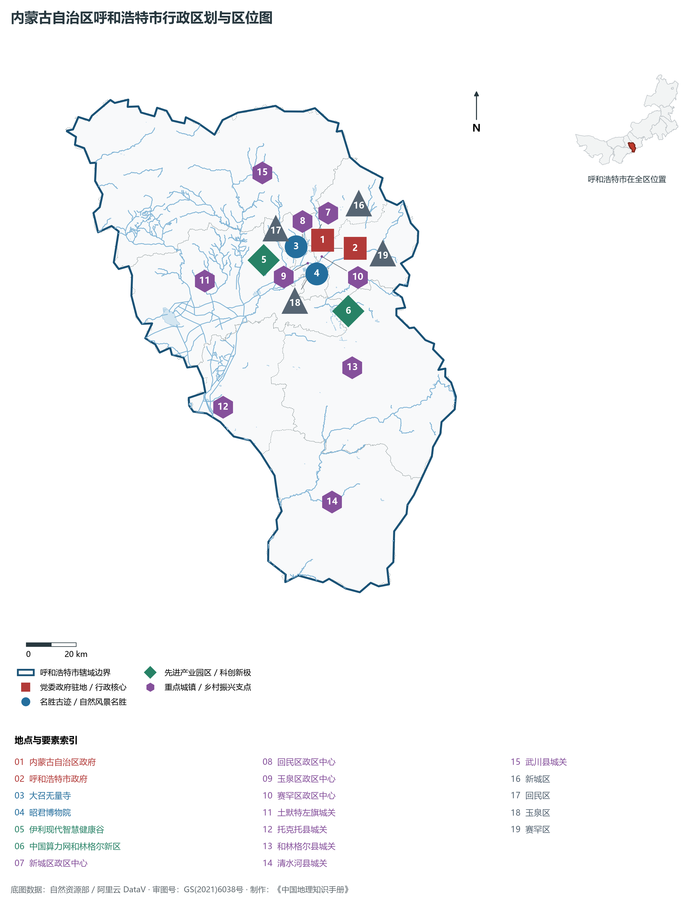
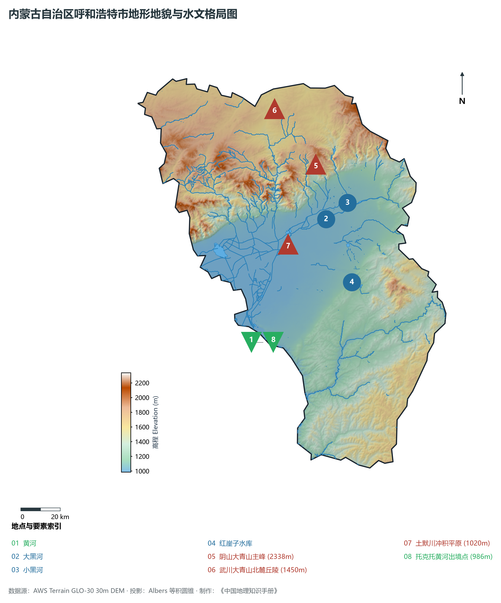
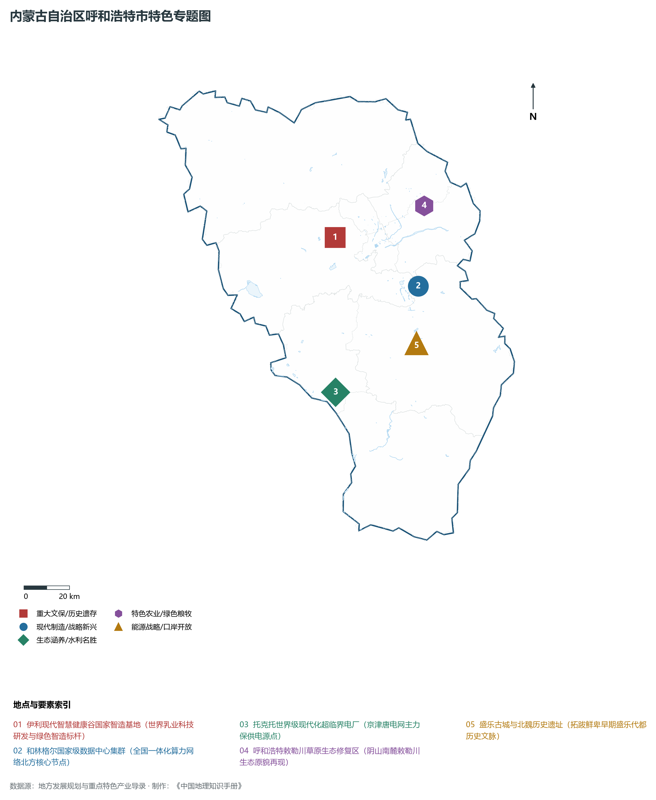
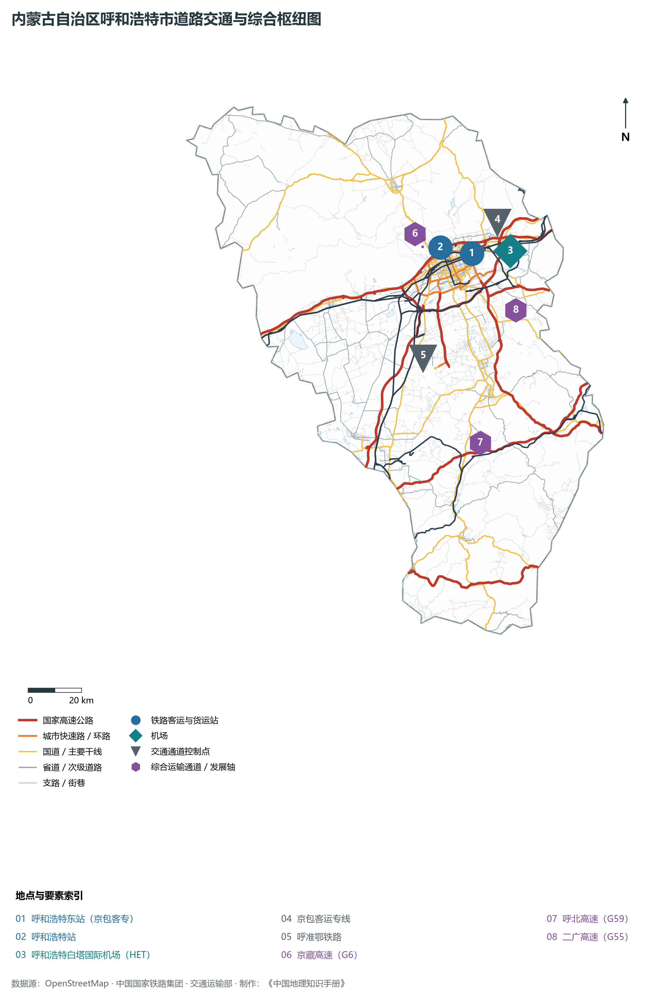
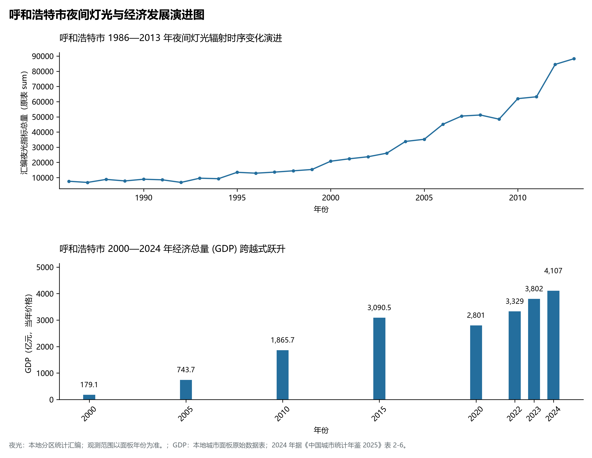

# 29.1 呼和浩特市

呼和浩特，蒙古语意为“青色的城”，故简称“青城”，是内蒙古自治区首府，全区政治、经济、文化、科教和金融中心，国务院批复确定的中国北方沿边地区重要的中心城市、呼包鄂乌城市群核心城市、国家历史文化名城与全国唯一的“中国乳都”。地处内蒙古高原中南部、阴山山脉大青山南麓、土默川平原东北端，地理坐标介于东经 110°46′—112°10′、北纬 40°51′—41°8′ 之间。北跨巍峨大青山与武川高原相望，南临滔滔黄河与鄂尔多斯准格尔旗隔水对峙，东连乌兰察布察哈尔草原，西接包头土默特右旗。2024 年常住人口 **364 万人**，常住人口城镇化率 **81.91%**，地区生产总值 **4,107 亿元**（当年价格），人均地区生产总值 **113,455 元**，三次产业构成为 **4.22 : 31.27 : 64.51**。

呼和浩特是一座拥有深厚历史积淀与多元文化交汇的塞外名城。战国时期赵武灵王在此设云中郡，筑赵长城，推行“胡服骑射”；西汉时期汉匈和亲，王昭君远嫁匈奴单于，留下“独留青冢向黄昏”的历史佳话与民族交融象征；北魏拓跋鲜卑在此建盛乐代都，孕育了统一北方的磅礴力量；明万历九年（1581 年），蒙古土默特部首领阿拉坦汗与夫人三娘子在此营建“库库和屯”（呼和浩特旧城），因青砖筑城被称为“三娘子城”或“青城”，大召无量寺、席力图召等藏传佛教寺庙相继落成；清康熙年间设归化城，雍正十三年另建绥远新城，后合称“归绥”；近代以来，归绥成为平绥铁路终点与塞外商贸皮毛集散中心；1954 年恢复“呼和浩特”原名并确定为内蒙古自治区首府；进入新时代，呼和浩特实现由传统塞上重镇向现代乳业之都、国家算力网络枢纽与现代化首府都市的历史性跨越。

---

## 一、市情速览

呼和浩特是全区高新技术产业与现代科教极核，集空港、高铁、高速路网与现代物流于一体。

| 核心指标 | 全市数值与空间分布 | 全国/全区定位 |
|:---|:---|:---|
| **行政区划面积** | 17 224 km² | 山地丘陵占 50% 以上，冲积平原占 40%，微向西南倾斜 |
| **常住人口** | 364 万人 | 2024 年，全市；年鉴公布口径 |
| **常住人口城镇化率** | 81.91% | 2024 年，全市；年鉴公布口径 |
| **人口密度** | 209 人/km² | 市辖中心城区高达 2 500—4 500 人/km²，北部武川县低于 30 人/km² |
| **地区生产总值 (GDP)** | 4,107 亿元 | 2024 年，全市；年鉴公布口径 |
| **人均 GDP** | 113,455 元/人 | 2024 年，全市；年鉴公布口径 |
| **产业三次结构** | 3.8 : 34.6 : 61.6 | 现代服务业占主导，“中国乳都”核心高地与算力新质生产力爆发 |
| **行政架构** | 辖 4 区、4 县、1 旗 | 4 城区 (新城、回民、玉泉、赛罕)，土默特左旗，托克托、和林格尔、清水河、武川 4 县 |
| **战略核心定位** | 自治区首府极核与绿色算力高地 | 中国乳都核心基地、全国一体化算力网络北方核心节点、呼包鄂乌协同龙头 |

**图 29-01-1 内蒙古自治区呼和浩特市行政区划与区位图**：图上编号与地点、要素索引对应。

---

## 二、自然地理：阴山大青山南麓、土默川平原与大黑河水系

呼和浩特地势由**东北向西南缓缓倾斜**，横跨阴山山脉与内蒙古高原南部沉降盆地两大截然不同的地貌单元。

### 1. 地形地貌：北枕巍巍大青山，南纳平川沃野
全境地貌主要分为北部中山区、山前洪积倾斜平原和南部冲积平原三大板块：

- **北部阴山大青山中山区**：横亘于市区北部，山势险峻陡峭，主脊海拔普遍在 **1 500—2 200 m** 之间。全境最高峰位于市区西北部大青山腹地的**大青山主峰**，海拔高达 **2 338.0 m**。山体主要由前寒武纪变质杂岩与古生代花岗岩构成，南坡受断裂切割形成高差达千米的壮观大断崖，沟壑深邃，是市区天然的气候屏障与水源补给涵养地；
- **中部山前倾斜平原与土默川平原**：由山前洪积扇群连缀而成，海拔在 **1 000—1 050 m** 之间，向西南逐渐过渡为平坦广阔的土默川黄河冲积平原。平原土层深厚，水源充足，自古有“敕勒川，阴山下”之称，为呼市农耕沃土与现代城市承载空间；
- **南部丘陵与黄河沿岸低平带**：清水河县与和林格尔南部属于黄土高原丘陵沟壑区向内蒙古高原过渡带，黄土侵蚀剧烈；西南端托克托县黄河出境处海拔仅 **986.0 m**，为呼和浩特市全境最低点。

**图 29-01-2 内蒙古自治区呼和浩特市地形地貌与水文格局图**：图上编号与地点、要素索引对应。

### 2. 气候特征：温带大陆性半干旱季风气候
呼和浩特四季分明，气候干燥，日照充沛，冬长严寒，夏短温热：

- **气温与光照**：年平均气温在 **6.5—7.5 ℃** 之间，1 月平均气温 -11.5 ℃，极端最低温可达 -30 ℃ 以下；7 月平均气温 22.3 ℃，夏季凉爽，是理想的北方避暑胜地；年日照时数长达 2 800—3 100 小时，光能资源极其丰富；
- **降水时空分异**：年降水量约 **380—420 mm**，自北向南逐渐减少，大青山迎风坡降水相对偏多（达 450 mm 以上）。降水 75% 以上集中在 6—8 月，夏季常出现局地暴雨引发的山洪灾害；年蒸发量高达 1 800—2 000 mm，属典型资源型缺水地区。

### 3. 河流水系：母亲河大黑河与引黄灌溉
呼和浩特属于黄河流域：

- **黄河过境与大黑河水系**：黄河自市区西南缘流过，在托克托县流长约 37.5 km；大黑河是黄河在内蒙古境内的主要支流，发源于卓资县，自东北向西南横穿市区南郊与土默川平原，全长 236 km，为全境骨干排洪与生态水系；小黑河绕城而过汇入大黑河，经过综合整治筑起十里滨水景观绿带；
- **红崖子水库与引黄供水工程**：黄河托克托取水口与红崖子水库等水利工程，为现代煤电工业与城市生态提供了坚实水源保障。

---

## 三、建置沿革与文化根脉

呼和浩特是游牧文明与中原农耕文明深层交融的历史见证地。

### 1. 从云中郡、盛乐代都到明清归绥

- **战国云中与北魏盛乐**：赵武灵王在此设云中郡，赵长城遗址至今蜿蜒于大青山南麓；公元 386 年，拓跋珪在和林格尔建立北魏前身“盛乐代都”，境内发掘的和林格尔汉墓壁画被誉为汉代社会历史生活的百科全书；
- **青城奠基与归绥合璧**：明万历九年阿拉坦汗建城，赐名“归化”；清代筑“绥远城”驻扎八旗军防守北疆；两城相距约五里，后合并统称归绥，形成“前街买卖、后街王府、召庙棋布”的独特塞外双城格局；
- **昭君出塞与民族大融合**：南郊大黑河畔耸立着高逾三十余米的**昭君墓（青冢）**，两千余年来被奉为民族和睦团结的历史丰碑。

### 2. 塞外召庙之冠：大召寺与席力图召
呼和浩特历史上召庙云集，有“七大召、八小召、七十二个免名召”之誉：

- **大召无量寺**：建于明万历七年（1579 年），是呼和浩特最早兴建的藏传佛教格鲁派寺院。寺内保存着罕见的“大召三绝”——明代银铸释迦牟尼佛像、高达十米的蟠龙泥塑金柱以及绘于经堂墙壁上的明代壁画，工艺精绝；
- **席力图召与五塔寺**：五塔寺金刚座舍利宝塔后墙嵌刻的蒙文字母《天文图》石刻，是世界上唯一现存用蒙古文字标注的古代天文图石刻珍品。

**图 29-01-4 内蒙古自治区呼和浩特市特色专题图**：图上编号与地点、要素索引对应。

---

## 四、经济地理：“中国乳都”、现代硅能与全国绿色算力网

呼和浩特牢牢把握首府优势，构建起以绿色农畜产品加工（乳业为王）、先进半导体与光伏材料、生物医药、绿色算力为支柱的高质量产业集群。

### 1. “中国乳都”与全球乳业研发创新极核

- **双雄并立引跑全球**：呼和浩特培育了伊利集团与蒙牛集团两大世界乳业五强企业。全市奶牛存栏超 35 万头，规模化牧场集约化养殖率达 100%；
- **伊利现代智慧健康谷**：总投资达数百亿元，打造集全球领先工业 4.0 样板智慧工厂、国家乳业技术创新中心于一体的产城融合超大型创新园区，实现全球最先进日产奶数千吨无人智能化灌装。

### 2. 全国一体化算力网络北方核心节点（“中国算力看和林格尔”）

- **内蒙古和林格尔新区算力集群**：作为国家“东数西算”战略八大枢纽和十大集群之一，利用高寒气候节电优势与充沛低价风光绿电，集聚了中国移动、中国电信、中国联通三大运营商超大型数据中心，以及金融保险、华为、阿里等头部算力中心，总服务器装机能力达数百万台，成为全国最大的算力网络北方基石。

### 3. 先进光伏与半导体材料基地

- **中环产业城“硅极”崛起**：金川工业园区集聚了 TCL 中环等行业领军龙头，建成了全球最大的单晶硅切片研发与智能制造基地，高纯半导体级晶体材料市场份额位居全国首位。

---

## 五、综合立体交通走廊

呼和浩特是内蒙古连接首都京津冀与辐射大西北、向北通往蒙古国的核心陆空枢纽。

**图 29-01-3 内蒙古自治区呼和浩特市道路交通与综合枢纽图**：图上编号与地点、要素索引对应。

1. **高速铁路客运大通道**：
   - 京包客运专线（呼张客专）使呼和浩特东站至北京清河站最快仅需 2 小时 9 分钟，彻底打破空间隔阂；呼包客专连通包头，呼准鄂铁路快速通达鄂尔多斯，构筑“呼包鄂 1 小时通勤圈”；
2. **高速公路网与国道枢纽**：
   - G6 京藏高速与 G7 京新高速在大青山南麓并行横贯市区，G59 呼北高速向南直抵中原，构成通江达海的公路运输骨架；
3. **“一市两场”现代空港**：
   - 现役呼和浩特白塔国际机场年旅客吞吐量突破 1 300 万人次；新建呼和浩特盛乐国际机场定位为国家“一带一路”向北开放门户复合型国际枢纽机场，设计年客运吞吐能力达 2 800 万人次。

---

## 六、旗县区空间分区与极值矩阵

**图 29-01-5 呼和浩特市夜间灯光与经济发展演进图**：各面板按标注的观测年份、指标和单位列示。

| 旗县区 | 面积 (km²) | 常住人口 (万人) | 2024年GDP (亿元) | 城镇化率 (%) | 核心功能定位与主要地理地标 |
|:---|:---|:---|:---|:---|:---|
| **新城区** | 700 | 70.2 | 805.0 | 95.8% | 自治区党政机关所在地、敕勒川草原、大青山生态红线保护区 |
| **回民区** | 175 | 43.6 | 495.0 | 98.2% | 乌素图杏花谷、中山西路百年商圈、伊斯兰特色风情历史建筑群 |
| **玉泉区** | 258 | 53.8 | 582.0 | 94.6% | 呼市历史文脉发祥地、大召无量寺、席力图召、南湖湿地公园 |
| **赛罕区** | 1 025 | 89.5 | 1 125.0 | 91.5% | 全市人口与经济第一大区、市政府驻地、白塔机场、东站高铁极核 |
| **土默特左旗** | 2 712 | 26.5 | 325.0 | 48.2% | 伊利现代智慧健康谷、敕勒川国家现代农业示范区、土默川平原腹心 |
| **托克托县** | 1 413 | 16.8 | 312.0 | 56.4% | 黄河沿岸工业强县、大唐托克托世界级火电厂、神舟生物医药基地 |
| **和林格尔县** | 3 436 | 17.5 | 298.0 | 54.2% | 和林格尔国家级数据中心集群、盛乐国际机场新址、蒙牛现代产业基地 |
| **清水河县** | 2 859 | 7.8 | 125.0 | 51.5% | 晋蒙峡谷长城交汇处、老牛湾黄河地质奇观、宏河山地杂粮基地 |
| **武川县** | 4 646 | 11.2 | 118.0 | 45.8% | 阴山大青山后山高原生态屏障、中国燕麦之乡、武川莜面地理标志 |

2024 年统计来源：《中国城市统计年鉴 2025》表 2-1、2-6、2-7（2024 年，全市）。其他年份 GDP 据本地城市面板“原始数据”表，单位为亿元、当年价格。
