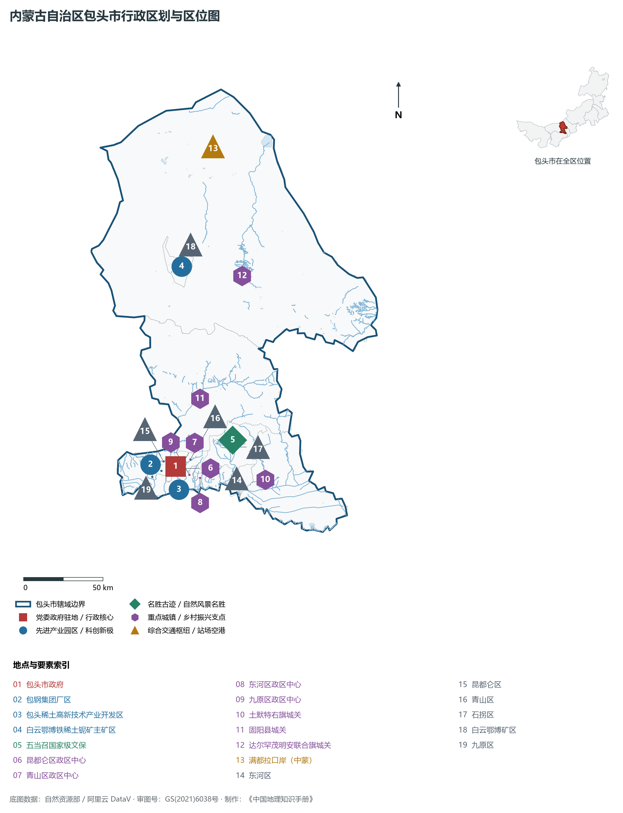
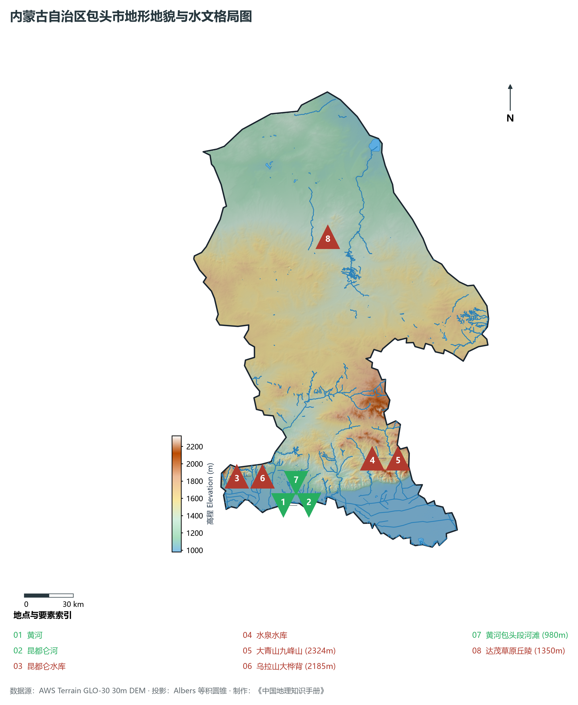
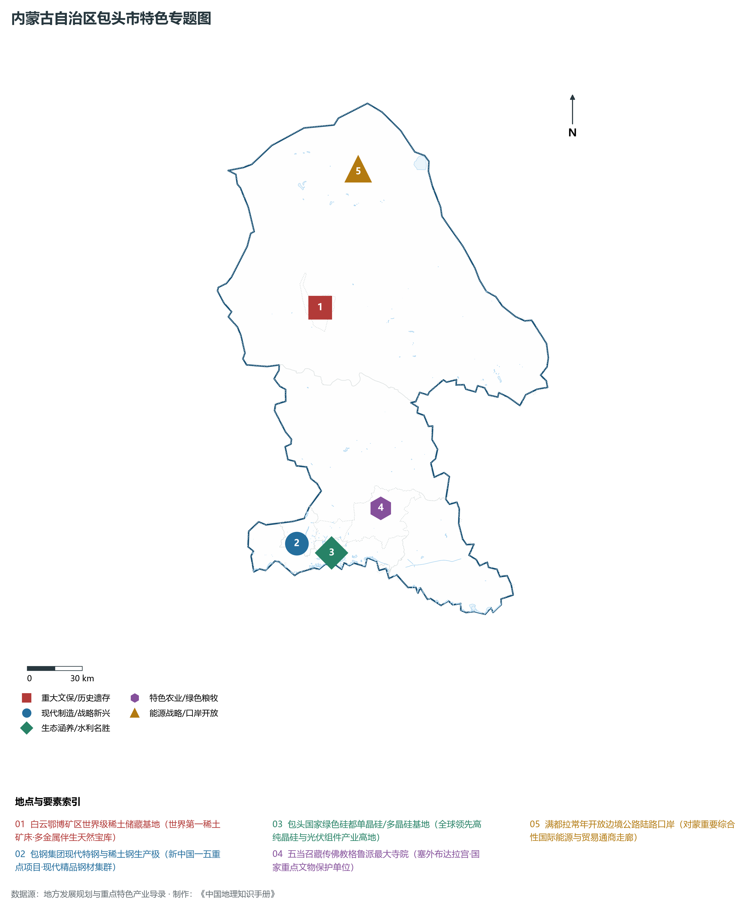
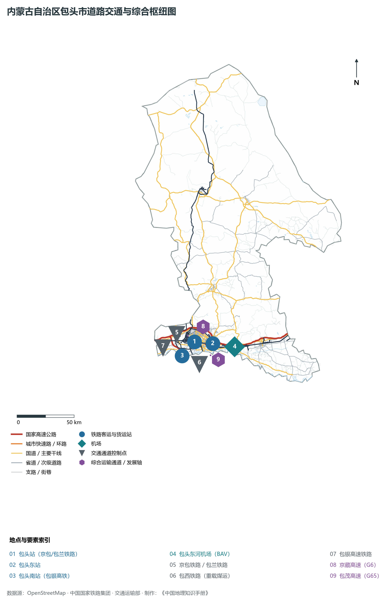
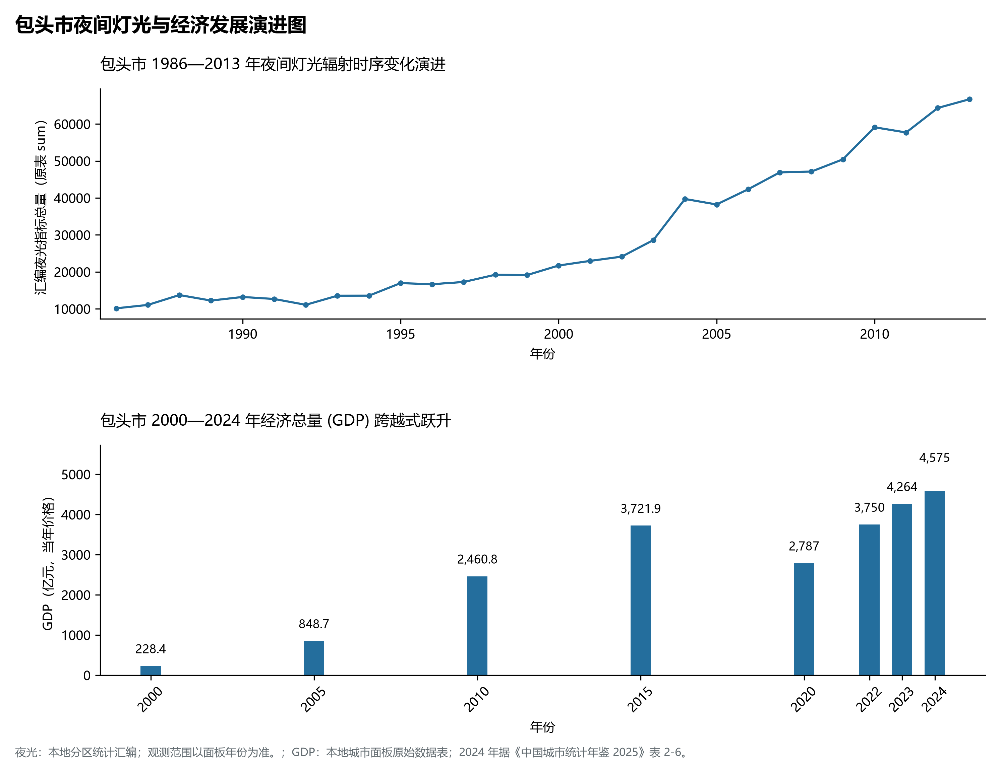

# 29.2 包头市

包头市。2024 年常住人口 **277 万人**，常住人口城镇化率 **88.52%**，地区生产总值 **4,575 亿元**（当年价格），人均地区生产总值 **165,463 元**，三次产业构成为 **3.14 : 46.9 : 49.96**。

包头是一座承载着国家战略使命与深厚历史人文交相辉映的工业巨擘。早在新石器时代，黄河沿岸与大青山下就已有人类繁衍生息；战国赵武灵王在此设九原郡，秦代设九原郡并修筑著名的“秦直道”，直通秦都咸阳；汉置五原郡，吕布生于斯长于斯；清乾隆年间，由于水运便利与商贾云集，包头发展为“水旱码头”，皮毛肉粮汇聚，“西通西陲，东接平津”；新中国成立初期，包头被列为全国首批重点建设的 8 个工业城市之一，全国“一五”时期 156 个国家重点工程中有 6 个落子包头（包括著名的包头钢铁公司、内蒙古第一机械厂、第二机械厂等），“齐心协力建包钢”成为新中国民族团结与工业建设的巍峨历史丰碑；进入新时代，包头依托举世无双的白云鄂博矿山与绿电优势，实现由传统“草原钢城”向“世界稀土之都”和“全球绿色硅都”的历史性产业跃迁。

---

## 一、市情速览

包头是全区重工业与先进制造业的核心支撑极，集特钢、重型装备、稀土新材料、绿色晶硅与陆港口岸于一体。

| 核心指标 | 全市数值与空间分布 | 全国/全区定位 |
|:---|:---|:---|
| **行政区划面积** | 27 768 km² | 阴山山系横亘中部，将全市自然分为山南平原与山北高原草原 |
| **常住人口** | 277 万人 | 2024 年，全市；年鉴公布口径 |
| **常住人口城镇化率** | 88.52% | 2024 年，全市；年鉴公布口径 |
| **人口密度** | 99.6 人/km² | 昆区与青山区高达 2 800—4 000 人/km²，北部达茂旗低于 8 人/km² |
| **地区生产总值 (GDP)** | 4,575 亿元 | 2024 年，全市；年鉴公布口径 |
| **人均 GDP** | 165,463 元/人 | 2024 年，全市；年鉴公布口径 |
| **产业三次结构** | 2.3 : 64.8 : 32.9 | 第二产业比重近三分之二，全国罕见高比重现代工业重镇 |
| **行政架构** | 辖 6 区、1 县、2 旗 | 昆都仑、青山、东河、九原、石拐、白云鄂博矿区 6 区，固阳县，土右旗、达茂旗 |
| **边境与口岸** | 边境线 65.5 km；满都拉常年开放口岸 | 对蒙重要能源与大宗物资进出口陆路国际走廊 |
| **战略核心定位** | “世界稀土之都”与“现代绿色硅都” | 国家重要战略资源基地、先进制造业高地、呼包鄂协同发展极 |

**图 29-02-1 内蒙古自治区包头市行政区划与区位图**：图上编号与地点、要素索引对应。

---

## 二、自然地理：阴山横贯、山南平川与山北高原

包头地形以**阴山山脉为天然脊梁**，地势呈**南北高、中部平川低陷**的鲜明二元地貌构造。

### 1. 地形地貌：山南敕勒川与山北达茂高原

- **阴山山脉横亘中段**：大青山与乌拉山呈近东西走向横切包头腹地，海拔在 **1 500—2 300 m** 之间。最高峰位于土默特右旗北部大青山脉的**九峰山**，主峰海拔 **2 324.0 m**；乌拉山主峰大桦背海拔 2 185 m。两山之间峡谷断裂发育，昆都仑河横切山脉形成连接山南山北的昆都仑峡谷古道（古代九原通塞外的天然咽喉）；
- **山南黄河冲积平原（土默川平原西段）**：北依大青山，南临黄河，东西狭长，地势由海拔 1 040 m 向黄河河滩缓缓降至 **980.0 m**（全境最低点）。这里地势平坦，土层深厚，引黄灌溉便利，是包头城市核心区、现代制造业园区与农业基本盘的承载基石；
- **山北内蒙古高原草原（固阳盆地与达茂高原）**：阴山以北地势开阔平缓，平均海拔在 **1 200—1 500 m** 之间，属于内蒙古波状高原南缘，草原与丘陵交错，分布着著名的白云鄂博铁矿山与达茂旗天然草场。

**图 29-02-2 内蒙古自治区包头市地形地貌与水文格局图**：图上编号与地点、要素索引对应。

### 2. 气候特征：温带大陆性半干旱季风气候

- **气温与风能**：年平均气温在 **7.2—8.5 ℃** 之间，山北达茂旗受蒙古冷气团直接侵袭，年均温仅 4.5 ℃ 左右。年降水量在 **300—380 mm** 之间，山南降水略多于山北；全市年日照时数逾 3 000 小时，山北达茂高原风速常年稳定，是全国首屈一指的千万千瓦级风电光伏资源富集区。

### 3. 河流水系：黄河过境与昆都仑河

- **黄河包头段**：黄河自西向东流经包头市境长达 **214 km**，是包头市工业用水与生态灌溉的命脉；
- **昆都仑河与水库工程**：昆都仑河发源于固阳县，切穿大青山南注入黄河，全长 143 km；建有总库容 7 860 万 m³ 的**昆都仑水库**，发挥着防洪蓄水与回补地下水的枢纽功能。

---

## 三、建置沿革与文化根脉

### 1. 从秦汉九原到“齐心协力建包钢”

- **九原郡与吕布故里**：秦始皇筑长城、开直道，以九原为北疆军事枢纽；汉武帝在此设立五原郡，抗击匈奴名将卫青、霍去病由此出征；
- **五当召藏传佛教名刹**：位于石拐区吉忽伦图山深处的**五当召**（蒙古语意为“柳树房”），建于清乾隆十四年（1749 年），依山而建，层叠起伏，全庙无梁无柱，白墙藏式平顶，是我国现存最完整的藏传佛教格鲁派三大古寺之一，被誉为“塞外布达拉宫”；
- **包钢精神与工业先锋**：1954 年包钢破土动工，全国各省市源源不断调拨物资、输送上万名技术工人支援包头，“齐心协力建包钢”成为新中国民族团结与工业报国的经典史诗。

**图 29-02-4 内蒙古自治区包头市特色专题图**：图上编号与地点、要素索引对应。

---

## 四、经济地理：“世界稀土之都”与“全球绿色硅都”

包头坚定实施创新驱动，构建起“稀土新材料、先进钢铁、绿色晶硅、重型装备制造”四大千亿级产业支柱。

### 1. 白云鄂博与“世界稀土之都”

- **全球无可比拟的稀土宝库**：白云鄂博矿山累计探明稀土资源储量占全国 80% 以上、占世界近 40%，伴生铌、钍等数十种战略稀贵金属；
- **全链条稀土现代产业集群**：以包头稀土高新技术产业开发区为载体，形成了从稀土采选、冶炼分离到稀土永磁材料、储氢合金、抛光材料、稀土催化剂的完整现代化工业体系，稀土永磁材料产量位居全国前列。

### 2. “现代绿色硅都”：晶硅光伏全球重镇

- **全球晶硅生产极核**：引进通威、特变电工、弘元、双良等行业领军龙头，形成多晶硅产能超 85 万吨、单晶拉棒产能超 100GW 的超大规模集群，高纯晶硅产量占全球近三分之一，被全球绿色能源理事会正式授予“世界绿色硅都”称号。

### 3. 先进钢铁与大国重器基地

- **包钢集团现代特钢与高铁钢轨**：全国三大钢轨生产基地之一，京沪、京广等国家干线高铁建设所用钢轨近三分之一产自包钢；
- **北重集团与一机集团**：中国最大的轮式装甲车辆、特种重型装备与大口径无缝厚壁钢管制造中心。

---

## 五、综合立体交通与对外口岸

**图 29-02-3 内蒙古自治区包头市道路交通与综合枢纽图**：图上编号与地点、要素索引对应。

1. **铁路枢纽大节点**：
   - 包头站与包头东站为京包、包兰、包西、包白铁路四大干线交汇的大型枢纽客货编组站；包西铁路是国家北煤南运重载大通道；在建包银高铁将使包头直达银川与兰州；
2. **对外口岸陆港满都拉**：
   - 满都拉口岸为常年开放的中蒙国际边境陆路口岸，建有现代化集装箱与煤炭散货快速换装线，年货运通关能力突破千万吨；
3. **民用航空空港**：
   - 包头东河机场（BAV）为内蒙古重要的干线机场，开通直飞国内数十个重点城市的空中航线。

---

## 六、旗县区空间分区与极值矩阵

**图 29-02-5 包头市夜间灯光与经济发展演进图**：各面板按标注的观测年份、指标和单位列示。

| 旗县区 | 面积 (km²) | 常住人口 (万人) | 2024年GDP (亿元) | 城镇化率 (%) | 核心功能定位与主要地理地标 |
|:---|:---|:---|:---|:---|:---|
| **昆都仑区** | 301 | 80.2 | 1 350.0 | 99.1% | 全市经济第一强区、包钢集团所在地、钢铁不锈钢工业极核 |
| **青山区** | 280 | 48.5 | 785.0 | 98.6% | 中国一机、北重集团所在地、现代重型高端装备与晶硅制造主城 |
| **东河区** | 423 | 52.8 | 495.0 | 92.5% | 包头老商业水旱码头文脉、包头东河机场、铝业及现代商贸物流 |
| **九原区** | 734 | 26.2 | 680.0 | 85.2% | 市政府所在地、现代煤化工产业基地、包头绿色硅都主阵地 |
| **石拐区** | 761 | 2.5 | 48.0 | 82.5% | 老矿区生态转型样板、五当召国家级风景名胜区、通用航空小镇 |
| **白云鄂博矿区** | 328 | 2.2 | 35.0 | 96.5% | 铁稀土铌矿主产区、世界稀土之都资源策源地、绿色数字矿山 |
| **土默特右旗** | 2 368 | 23.5 | 320.0 | 52.4% | 大青山九峰山自然保护区、美岱召明代古堡、河套现代农业示范区 |
| **固阳县** | 4 970 | 12.8 | 158.0 | 46.5% | 秦长城国家文化公园、固阳黄芪地理标志、山北百万千瓦风光基地 |
| **达茂联合旗** | 18 177 | 7.9 | 184.0 | 58.2% | 边境大旗、满都拉中蒙口岸、达茂草原风情、千万千瓦风光能源基地 |

2024 年统计来源：《中国城市统计年鉴 2025》表 2-1、2-6、2-7（2024 年，全市）。其他年份 GDP 据本地城市面板“原始数据”表，单位为亿元、当年价格。
