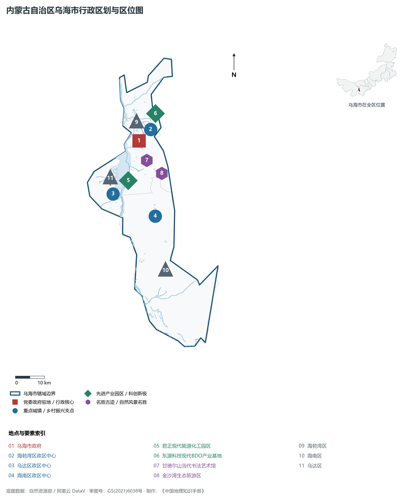
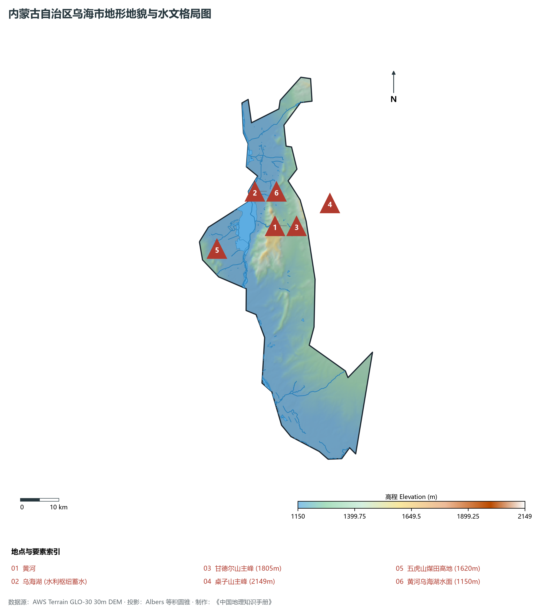
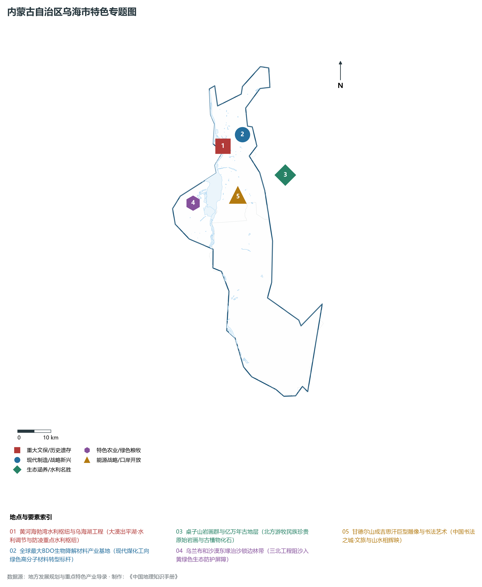
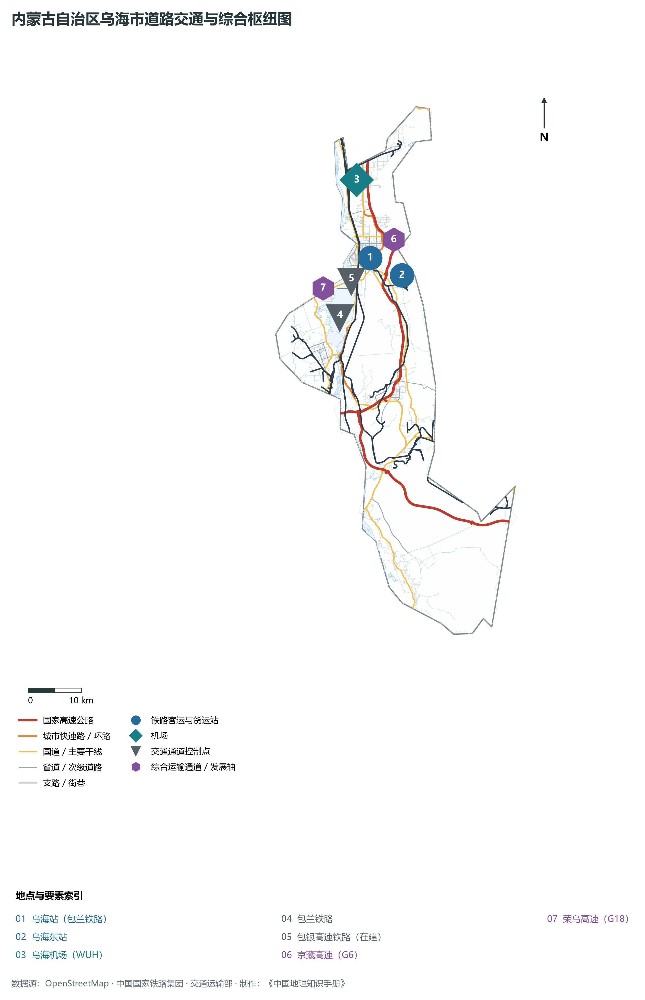
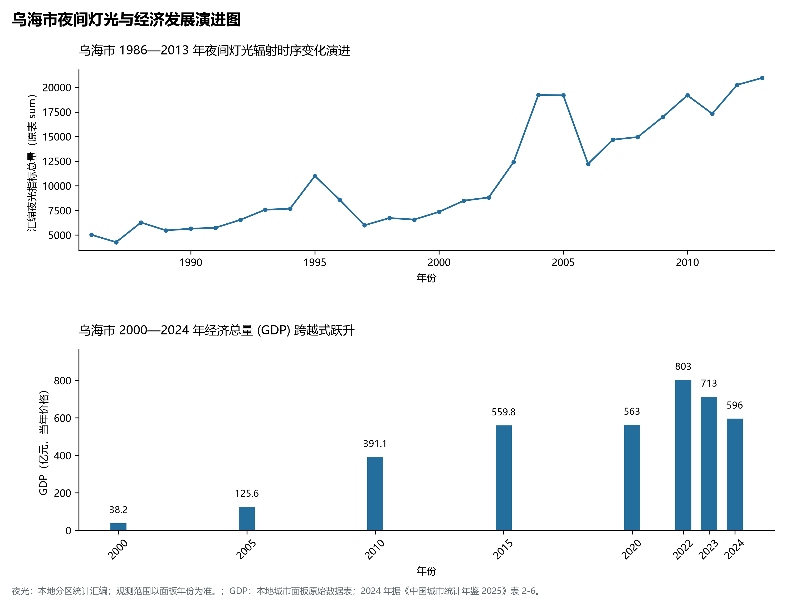

# 29.3 乌海市

乌海，因“乌金之海”而得名，是内蒙古自治区西部的重要工业城市，呼包鄂乌城市群西部门户，国务院批复确定的黄河几字弯区域重要能源化工基地、国家循环经济示范城市与国家级“中国书法之城”。地处内蒙古高原西南部、乌兰布和沙漠东缘、贺兰山北端余脉桌子山西麓，黄河穿城而过，地理坐标介于东经 106°36′—107°05′、北纬 39°15′—39°52′ 之间。东枕巍巍桌子山与鄂尔多斯市鄂托克旗相连，南跨都思兔河与宁夏石嘴山市毗邻，西跨黄河与阿拉善盟阿拉善左旗乌兰布和沙漠接壤，北连巴彦淖尔市磴口县。2024 年常住人口 **56 万人**，常住人口城镇化率 **96.88%**，地区生产总值 **596 亿元**（当年价格），人均地区生产总值 **106,352 元**，三次产业构成为 **1.4 : 50.01 : 48.59**。

乌海是一座由煤而生、因水而兴、向绿而行的黄河明珠城市。20 世纪 50 年代以前，这里还是一片黄沙漫漫、荒凉沉寂的大漠戈壁；1958 年，国家勘探发现这里蕴藏着储量极其巨大的优质焦煤与无烟煤，来自全国各地的数万名建设者挺进戈壁，先后建立海勃湾市和乌达市；1976 年，经国务院批准，合并海勃湾与乌达两市，各取首字命名设立地级“乌海市”；2014 年，黄河海勃湾水利枢纽工程胜利下闸蓄水，在乌兰布和沙漠与桌子山之间造就了一座水面达 **118 平方公里**的巨型人工湖泊——**乌海湖**，创造了“大漠出平湖、沙海连长天”的世界级地理奇观；进入新时代，乌海大力推进“科技兴蒙”，摆脱传统高耗能依赖，崛起为全球产能规模最大的 BDO（1,4-丁二醇）生物降解新材料现代产业基地。

---

## 一、市情速览

乌海是内蒙古工业化与城市化起步最早、城镇化率最高的沿黄工矿绿洲城市。

| 核心指标 | 全市数值与空间分布 | 全国/全区定位 |
|:---|:---|:---|
| **行政区划面积** | 1 754 km² | 全区面积最小地级市，“山城沙水”立体环抱空间 |
| **常住人口** | 56 万人 | 2024 年，全市；年鉴公布口径 |
| **常住人口城镇化率** | 96.88% | 2024 年，全市；年鉴公布口径 |
| **人口密度** | 317 人/km² | 全区人口密度最高的地级市，海勃湾区超 800 人/km² |
| **地区生产总值 (GDP)** | 596 亿元 | 2024 年，全市；年鉴公布口径 |
| **人均 GDP** | 106,352 元/人 | 2024 年，全市；年鉴公布口径 |
| **产业三次结构** | 0.8 : 66.5 : 32.7 | 典型工业主导型城市，第二产业占据三分之二经济体量 |
| **行政架构** | 辖 3 区 | 海勃湾区（市委市政府驻地）、乌达区、海南区 |
| **生态奇迹** | 乌海湖面积达 118 km² (相当于杭州西湖20倍) | “沙、海、山、城”四位一体绝美生态绿洲景观 |
| **战略核心定位** | 全球可降解生物材料之都 | 国家重要现代煤化工示范基地、中国书法之城、蒙西宁北协同极 |

**图 29-03-1 内蒙古自治区乌海市行政区划与区位图**：图上编号与地点、要素索引对应。

---

## 二、自然地理：三山两谷、一水中流与大漠平湖

乌海自然地理空间格局高度浓缩，呈现典型的“**三山环抱、一水中流、沙水交融**”的峡谷绿洲盆地特征。

### 1. 地形地貌：桌子山、五虎山夹峙与黄河裂谷

- **东部桌子山山脉**：属于贺兰山北段褶皱断块山，呈南北走向纵贯市区东侧，主峰海拔 **2 149.0 m**（为全境最高点）。山势陡峭险峻，基岩裸露，富含石炭二叠纪煤系地层与熔灰岩，山体表层发育珍贵的早古生代三叶虫化石与原始岩画；
- **中部甘德尔山与南部岗德尔山**：突兀矗立于黄河东岸，主峰海拔 1 805 m，山顶建有巨型成吉思汗青铜雕像；
- **西部五虎山山脉**：横亘于乌达区西侧，海拔在 1 400—1 650 m 之间，紧邻浩瀚的乌兰布和沙漠；
- **黄河穿城走廊与盆地低平区**：黄河自西南向东北横穿全境达 105 km，将全市自然分为河东（海勃湾、海南）与河西（乌达）两大板块；黄河河谷海拔在 1 150—1 160 m 之间，海勃湾水库大坝出境处海拔为 **1 150.0 m**（全境最低点）。

**图 29-03-2 内蒙古自治区乌海市地形地貌与水文格局图**：图上编号与地点、要素索引对应。

### 2. 气候特征：干旱荒漠大陆性季风气候

- **日照强与极度干旱**：乌海年平均气温在 **9.8—10.2 ℃** 之间，年日照时数长达 3 150—3 250 小时，光热资源丰沛；年降水量仅 **150—165 mm**，而年蒸发量高达 **3 200 mm** 以上（蒸发量为降水量的近 20 倍），属于典型的极度干旱内陆荒漠气候。

### 3. 水系格局：黄河穿城与乌海湖人工奇迹

- **黄河海勃湾水利枢纽**：建于市区北端黄河干流之上，是黄河内蒙古段唯一的控制性骨干水利工程，发挥着防凌、防洪、水资源调节与生态改善的多重功能；
- **乌海湖生态蓄水**：大坝蓄水后形成长达几十公里的宽阔水库，回水深入乌兰布和沙漠边缘，不仅彻底改善了城市的微气候环境（市区年相对湿度增加 10% 以上），更吸引了遗鸥、白鹭等数十种珍稀鸟类在此栖息繁衍。

---

## 三、建置沿革与文化根脉

### 1. 远古岩画与桌子山文化

- **桌子山召烧沟岩画**：在桌子山陡峭崖壁与黑色岩面之上，散布着距今三千至五千年前新石器时代晚期北方游牧民族凿刻的数百幅人面岩画，线条古拙雄浑，被称为“古代游牧民族社会历史的天然石刻画廊”。

### 2. 中国书法之城与现代移民精神

- **书法之城名扬海内**：乌海全市习练书法风气极盛，拥有全国唯一的当代中国书法艺术馆；
- **戈壁工矿移民家国情怀**：建市以来，来自全国 20 多个省份的建设者与知识青年在此艰苦创业、战天斗地，铸就了“艰苦奋斗、开拓创新、开放包容”的乌海城市精神。

**图 29-03-4 内蒙古自治区乌海市特色专题图**：图上编号与地点、要素索引对应。

---

## 四、经济地理：全球可降解新材料“BDO之都”

乌海坚持向绿而行，推动煤化工产业链向高端化、多元化、低碳化深度延伸。

### 1. 全球最大绿色生物降解材料基地

- **BDO产业全球霸主**：依托丰富的电石与甲醇资源，乌海引进东源科技、君正集团等龙头企业，全力打造可降解材料全产业链；全市规划建设 BDO（1,4-丁二醇）年产能超 250 万吨，占全球总产能的三分之一以上；
- **下游PBAT/PBS可降解塑料深加工**：推动 BDO 原料向生物降解农膜、可降解购物袋、高档氨纶纤维延伸，实现传统“乌金”向“绿金”的高质量裂变。

### 2. 现代循环经济与精细化工

- **煤基废弃物吃干榨尽**：乌海焦炉煤气制氢、工业固废粉煤灰制造现代新型绿色建材，形成全国知名的工矿循环经济链条。

---

## 五、综合交通走廊

**图 29-03-3 内蒙古自治区乌海市道路交通与综合枢纽图**：图上编号与地点、要素索引对应。

1. **高铁与干线铁路**：包兰铁路纵贯全境；新建包头至银川高速铁路（包银高铁）在乌海设立高铁站点，通车后乌海至银川仅需 40 分钟，至包头仅需 1 小时；
2. **高速公路网与黄河大桥**：G6 京藏高速沿黄河东岸穿城，G18 荣乌高速自乌海向东直通胶东半岛；建有海勃湾黄河大桥、乌海黄河特大桥等多座现代化越河桥梁；
3. **民航空港**：乌海机场为 4C 级支线机场，开通直达北京、上海、广州、西安、呼和浩特的干线航班。

---

## 六、旗县区空间分区与极值矩阵

**图 29-03-5 乌海市夜间灯光与经济发展演进图**：各面板按标注的观测年份、指标和单位列示。

| 旗县区 | 面积 (km²) | 常住人口 (万人) | 2024年GDP (亿元) | 城镇化率 (%) | 核心功能定位与主要地理地标 |
|:---|:---|:---|:---|:---|:---|
| **海勃湾区** | 529 | 32.2 | 295.0 | 98.5% | 市委市政府所在地、全市政经文化金融中心、乌海湖主景区 |
| **乌达区** | 220 | 12.5 | 148.0 | 97.2% | 河西现代工业极核、君正现代化工产业园、乌兰布和沙漠东缘屏障 |
| **海南区** | 1 005 | 10.9 | 153.0 | 90.8% | 全市面积最大区、现代新能源新材料基地、桌子山岩画文保核心区 |

2024 年统计来源：《中国城市统计年鉴 2025》表 2-1、2-6、2-7（2024 年，全市）。其他年份 GDP 据本地城市面板“原始数据”表，单位为亿元、当年价格。
