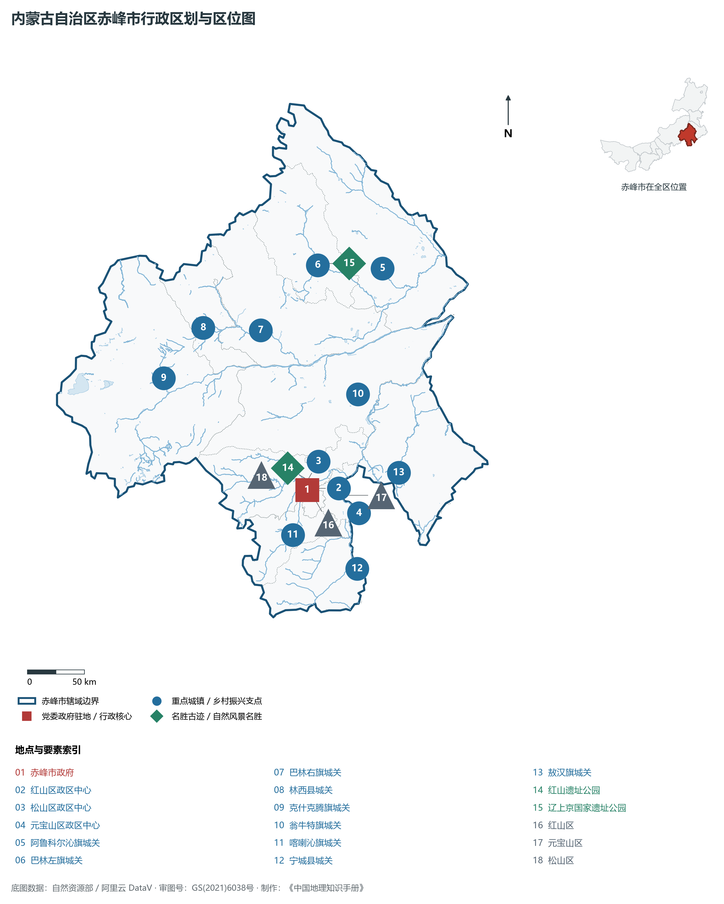
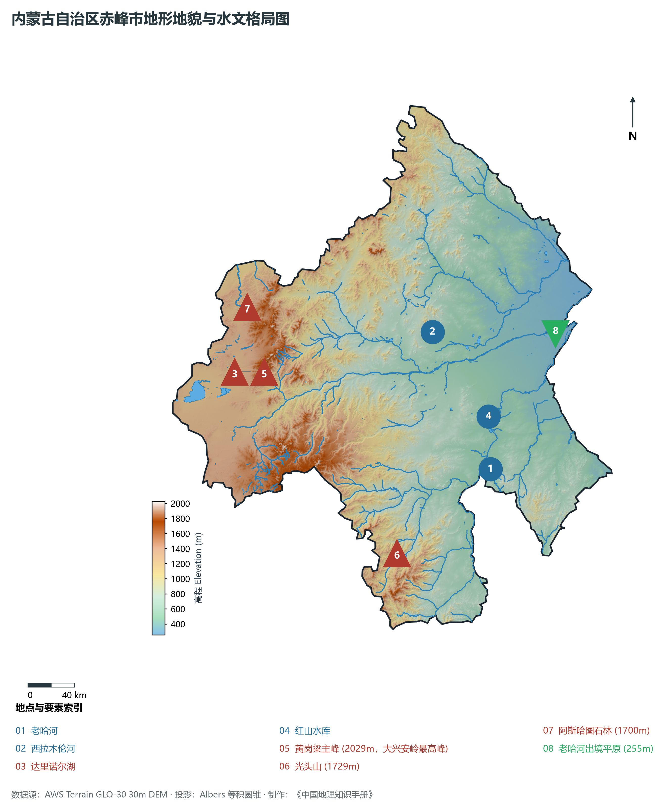
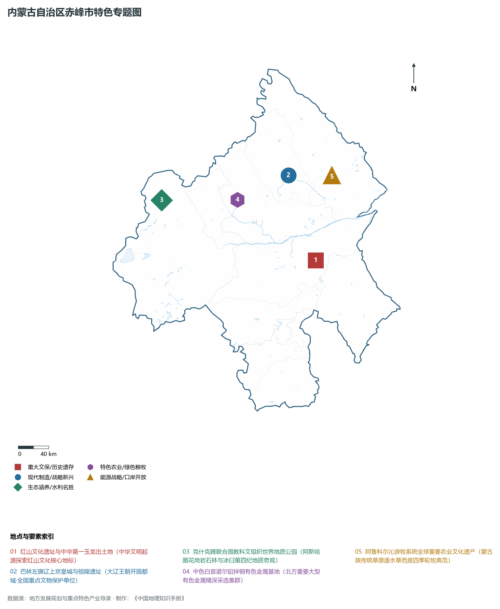
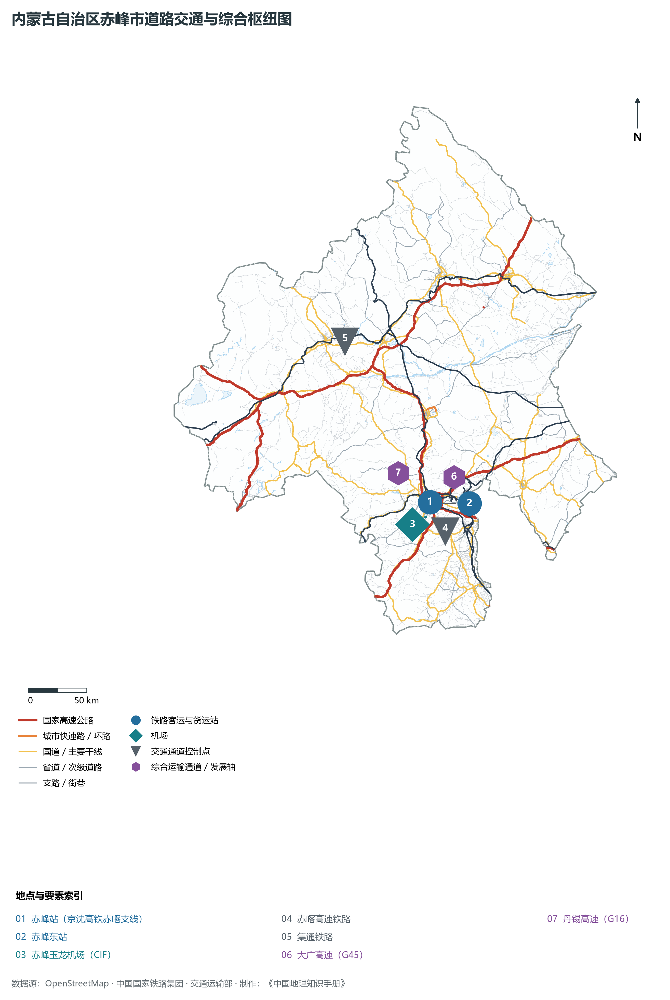
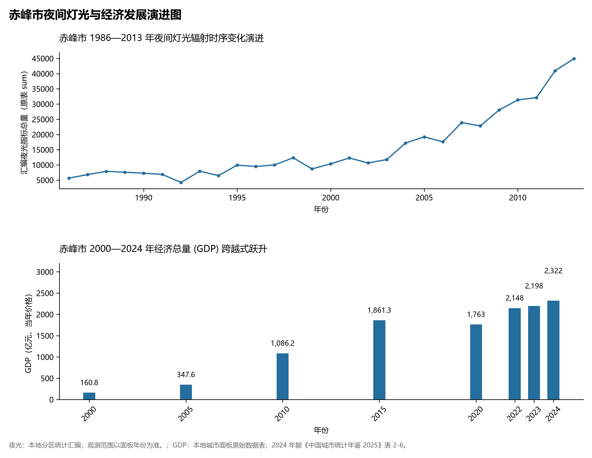

# 29.4 赤峰市

赤峰，因城区东北角一座赭红色花岗岩山峰（蒙古语称“乌兰哈达”）而得名，古称昭乌达盟，是内蒙古自治区东部的重要中心城市、蒙东承接产业转移示范区核心城市、国家历史文化名城与全国著名的“有色金属之乡”。地处内蒙古高原东南部、大兴安岭南段与燕山山脉北麓交汇地带、西辽河上游老哈河与西拉木伦河流域，地理坐标介于东经 116°21′—120°58′、北纬 41°17′—45°24′ 之间。南邻辽宁省朝阳市与河北省承德市，东接通辽市，西北与锡林郭勒盟毗连。2024 年常住人口 **393 万人**，常住人口城镇化率 **56.67%**，地区生产总值 **2,322 亿元**（当年价格），人均地区生产总值 **58,787 元**，三次产业构成为 **20.67 : 26.36 : 52.97**。

赤峰是一座浸润着深厚历史文脉与文明曙光璀璨升起的千年古都名城。早在八千年前，先民就在兴隆洼点燃了农耕定居文明之火，被考古界誉为“华夏第一村”；距今五千年前的**红山文化**在赤峰翁牛特旗三星他拉遗址出土了闻名遐迩的“中华第一玉龙”（C型玉雕龙），将中华五千年文明史实证推向前源；战国燕长城横贯南部，秦汉时期为东胡、乌桓、鲜卑故地；公元 10 世纪，契丹族首领耶律阿保机在此建立大辽王朝，营建**辽上京**皇城（今巴林左旗林东镇）与辽祖陵，开创了两百余年契丹帝国繁盛风华；清代康熙年间设昭乌达盟；1983 年撤盟设立地级赤峰市；进入新时代，赤峰高标准推进赤喀高铁接入全国高铁网，红山文化遗址群申报世界文化遗产取得历史性突破，崛起为蒙东绿色发展与有色金属新材料现代化强市。

---

## 一、市情速览

赤峰是内蒙古人口第一大市、农业畜牧业大市与北方重要的有色金属采选冶炼基地。

| 核心指标 | 全市数值与空间分布 | 全国/全区定位 |
|:---|:---|:---|
| **行政区划面积** | 90 021 km² | 占全区 7.6%，跨越燕山山地、大兴安岭与西辽河平原 |
| **常住人口** | 393 万人 | 2024 年，全市；年鉴公布口径 |
| **常住人口城镇化率** | 56.67% | 2024 年，全市；年鉴公布口径 |
| **人口密度** | 43.7 人/km² | 西辽河河谷农耕平原达 100 人/km²，西北牧区低于 15 人/km² |
| **地区生产总值 (GDP)** | 2,322 亿元 | 2024 年，全市；年鉴公布口径 |
| **人均 GDP** | 58,787 元/人 | 2024 年，全市；年鉴公布口径 |
| **产业三次结构** | 19.8 : 35.2 : 45.0 | 农业与畜牧业基础雄厚，现代文旅与商贸物流发展迅猛 |
| **行政架构** | 辖 3 区、7 旗、2 县 | 红山、松山、元宝山 3 区，阿旗、左旗、右旗、克旗、翁旗、喀旗、敖汉 7 旗，林西、宁城 2 县 |
| **战略核心定位** | 红山文化圣地与蒙东有色硅谷 | 中华文明探源工程核心区、国家级承接产业转移示范区、绿色农畜基地 |

**图 29-04-1 内蒙古自治区赤峰市行政区划与区位图**：图上编号与地点、要素索引对应。

---

## 二、自然地理：两山交汇、大兴安岭脊梁与两河纵横

赤峰地形西高东低、南陡北和缓，自然地理呈现**山地、高原草原与冲积平原三大板块交错**的复杂构造。

### 1. 地形地貌：大兴安岭南段屋脊与老哈河平川

- **西北部大兴安岭南段中山区**：横亘于克什克腾旗与林西县境内，为大兴安岭山脉的最南段。全境及大兴安岭全线最高峰为**黄岗梁主峰**，海拔高达 **2 029.0 m**。山体主要由燕山期花岗岩构成，山顶发育第四纪冰川冰臼群与阿斯哈图石林奇观，林木苍翠，是西辽河水系的关键水源涵养水塔；
- **西南部燕山北麓低山丘陵区**：分布于宁城县、喀喇沁旗境内，七老图山、光头山（1 729 m）等山峦起伏，沟谷切割深邃；
- **东部与东北部西辽河冲积平原**：由老哈河、西拉木伦河长期冲积淤塞形成，海拔由 500 m 降至阿鲁科尔沁旗老哈河出境处 **255.0 m**（全境最低点）。平原开阔，土壤肥沃，自古为北方干旱旱作农耕与放牧沃土；
- **中部浑善达克与科尔沁沙地过渡带**：翁牛特旗与敖汉旗分布有固定与半固定沙丘。

**图 29-04-2 内蒙古自治区赤峰市地形地貌与水文格局图**：图上编号与地点、要素索引对应。

### 2. 气候特征：温带半干旱大陆性季风气候

- **日照充足与雨热同期**：赤峰年平均气温在 **5.5—7.5 ℃** 之间，西北高寒山区（克旗）年均温仅 2—3 ℃；年日照时数长达 2 800—3 000 小时；年均降水量约 **350—450 mm**，70% 集中在夏季 6—8 月，春夏交替干旱多风，秋季天高气爽。

### 3. 河流水系：西辽河两大源流交汇
赤峰全境主要属于辽河流域西辽河水系：

- **老哈河（西辽河南源）**：发源于河北平泉，由南向北纵贯赤峰中南部，流经宁城、喀喇沁、元宝山、敖汉、翁牛特等旗县，全长 426 km，沿途建有库容超 8 亿 m³ 的**红山水库**；
- **西拉木伦河（西辽河北源）**：发源于克什克腾旗白岔山，向东横贯林西、翁牛特、巴林右旗、阿鲁科尔沁旗，全长 380 km，被两岸人民尊称为“母亲河”；
- **达里诺尔湖**：位于克什克腾旗西北部，面积约 238 km²，为内蒙古第二大内陆咸水湖，盛产著名的达里湖华子鱼，是候鸟迁徙关键驿站。

---

## 三、建置沿革与文化根脉

### 1. 红山文化与“中华第一玉龙”

- **红山文化命名地**：1954 年在赤峰红山遗址发现史前文化遗存并正式命名；1971 年在翁牛特旗三星他拉村出土碧玉雕琢的墨绿色“C型玉龙”，造型神骏古朴，被尊为中华民族“玉龙之乡”；
- **敖汉兴隆洼与小米发源地**：敖汉旗发掘的兴隆洼文化碳化粟（小米）遗存距今约八千年，实证了中华旱作农耕文明起源。

### 2. 大辽五京之首：辽上京皇城遗址

- **契丹建都发祥地**：巴林左旗林东镇的辽上京遗址，由皇城与汉城组成，规制庞大，是辽代最早营建的政治统治中枢；辽祖陵藏于幽深峡谷山峦之中，辽代壁画与契丹大字石碑记录了多民族交融历史。

**图 29-04-4 内蒙古自治区赤峰市特色专题图**：图上编号与地点、要素索引对应。

---

## 四、经济地理：有色金属基地、现代能源与优质农畜

赤峰推动“生态优先、绿色转型”，构建起现代有色金属采选冶炼深加工、绿色农畜食品加工、清洁能源风光基地三足鼎立格局。

### 1. 中国“有色金属之乡”与稀贵金属深加工

- **铅锌铜钼储量丰沛**：巴林左旗中色白音诺尔铅锌矿为全国大型现代化数字矿山，克旗、林西集聚了多处大型多金属矿山；
- **东山工业园冶炼加工高地**：赤峰高新技术园区铜铅锌深加工产能超百万吨，形成了涵盖黄金、白银、高纯阴极铜、超细高纯金属粉末的现代冶金产业链。

### 2. 现代农畜与“赤峰味道”全国大粮仓

- **设施农业领跑北方**：宁城县、喀喇沁旗日光温室蔬菜产业规模巨大，反季节番茄、黄瓜畅销京津冀与东北；敖汉小米被评为国家地理标志与中国名牌农产品；全市牛羊肉与生猪出栏量位居自治区前列。

### 3. 千万千瓦级新能源大基地

- **大兴安岭南麓绿电走廊**：利用克旗、阿旗高山与荒漠风光资源，建设超千万千瓦大型陆上风电基地，绿电通过特高压外送京津冀与华北电网。

---

## 五、综合立体交通走廊

**图 29-04-3 内蒙古自治区赤峰市道路交通与综合枢纽图**：图上编号与地点、要素索引对应。

1. **高速铁路跨越**：赤喀高铁（赤峰至喀左）建成通车，使赤峰站直连京沈高铁，赤峰至北京缩短至 2 小时 15 分钟，至沈阳仅需 2 小时，全面融入环渤海高铁生活圈；
2. **高速公路网十字骨架**：G45 大广高速（大庆至广州）南北贯通市区，G16 丹锡高速（丹东至锡林浩特）东西横跨，连通锦州港出海通道；
3. **民航空港**：赤峰玉龙机场（CIF）年旅客吞吐量突破 150 万人次，为蒙东重要的航空枢纽。

---

## 六、旗县区空间分区与极值矩阵

**图 29-04-5 赤峰市夜间灯光与经济发展演进图**：各面板按标注的观测年份、指标和单位列示。

| 旗县区 | 面积 (km²) | 常住人口 (万人) | 2024年GDP (亿元) | 城镇化率 (%) | 核心功能定位与主要地理地标 |
|:---|:---|:---|:---|:---|:---|
| **红山区** | 206 | 46.5 | 398.0 | 97.2% | 市中心核心老商圈、红山文化遗址公园、现代金融与先进物流 |
| **松山区** | 5 629 | 78.5 | 512.0 | 72.5% | 市政府所在地、赤峰高铁站枢纽、松山现代商贸与信息科技新城 |
| **元宝山区** | 887 | 28.5 | 295.0 | 78.6% | 现代煤化工与能源基地、平庄矿区、国能元宝山大型电厂 |
| **阿鲁科尔沁旗** | 14 277 | 27.2 | 165.0 | 45.2% | 全球重要农业文化遗产游牧系统、中国草都、优质苜蓿草产业基地 |
| **巴林左旗** | 6 644 | 30.5 | 168.0 | 48.5% | 辽上京契丹故都、中色白音诺尔铅锌矿山、现代有色采选基地 |
| **巴林右旗** | 10 256 | 16.8 | 125.0 | 49.2% | 巴林石雕之乡、大板铁路交通枢纽、赛罕乌拉国家级自然保护区 |
| **林西县** | 3 933 | 19.5 | 138.0 | 52.8% | 铜都林西、有色金属冶炼深加工、西拉木伦河上游生态涵养屏障 |
| **克什克腾旗** | 20 673 | 21.2 | 185.0 | 46.8% | 黄岗梁大兴安岭最高峰、阿斯哈图石林、达里诺尔湖、国际地质公园 |
| **翁牛特旗** | 11 889 | 41.5 | 172.0 | 46.2% | 玉龙故里中华第一龙出土地、红山水库、科尔沁沙地综合治理示范区 |
| **喀喇沁旗** | 3 050 | 25.8 | 142.0 | 51.2% | 美林谷高山滑雪度假区、喀喇沁亲王府国家文保、冷凉蔬菜基地 |
| **宁城县** | 4 305 | 50.2 | 218.0 | 48.8% | 全市人口第一大县、黑里河国家级自然保护区、日光温室蔬菜基地 |
| **敖汉旗** | 8 300 | 50.0 | 225.0 | 45.5% | 全球重要农业文化遗产旱作农业系统、敖汉小米地标、人工造林全国模范 |

2024 年统计来源：《中国城市统计年鉴 2025》表 2-1、2-6、2-7（2024 年，全市）。其他年份 GDP 据本地城市面板“原始数据”表，单位为亿元、当年价格。
