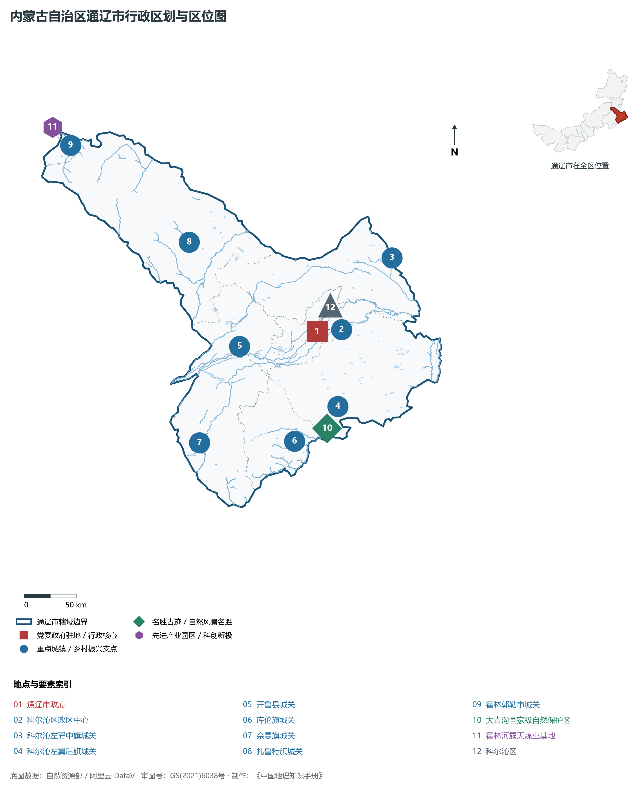
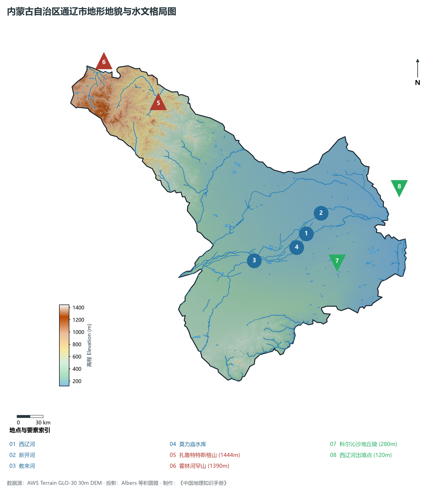
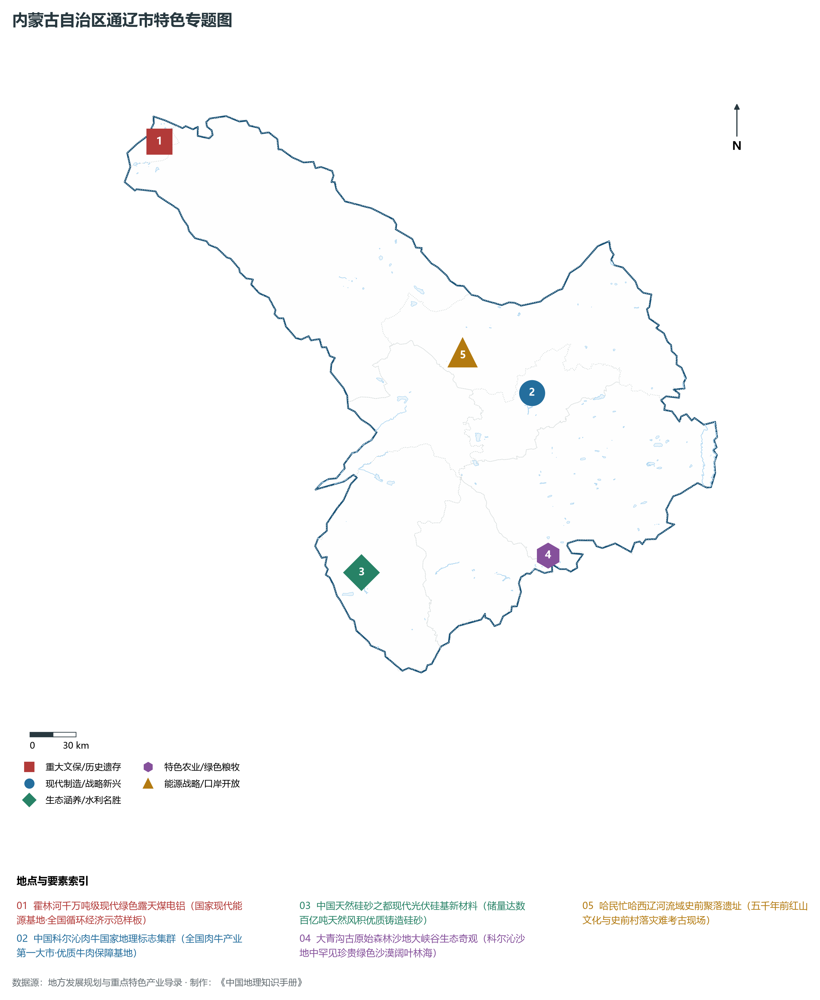
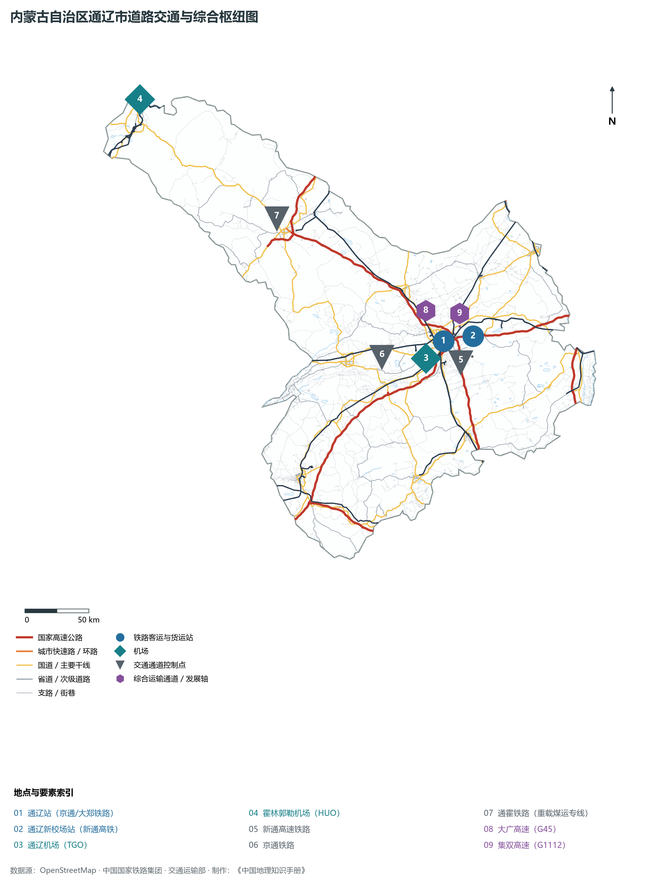
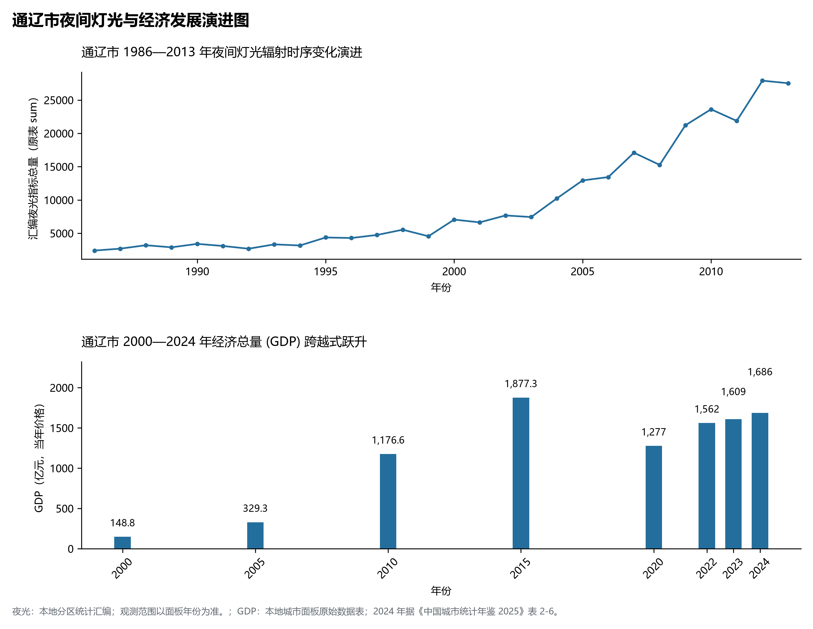

# 29.5 通辽市

通辽，原名哲里木盟，蒙古语意为“马鞍带”，是内蒙古自治区东部的重要交通枢纽城市、蒙东承接产业转移示范区重要承载地、国家现代农业示范区与全国最大的“中国肉牛产业第一重镇”，素有“科尔沁明珠”与“中国天然硅砂之都”之美誉。地处内蒙古高原东部边缘向松辽平原过渡地带、西辽河冲积平原腹心、科尔沁沙地主体区域，地理坐标介于东经 119°14′—123°43′、北纬 42°15′—45°41′ 之间。南邻辽宁省铁岭市、阜新市与沈阳市，东界吉林省四平市、白城市与松原市，西连赤峰市与锡林郭勒盟，北接兴安盟。2024 年常住人口 **278 万人**，常住人口城镇化率 **52.91%**，地区生产总值 **1,686 亿元**（当年价格），人均地区生产总值 **60,329 元**，三次产业构成为 **25.57 : 30.11 : 44.32**。

通辽是一座根植于科尔沁草原文明沃土、汇聚关东移民创业活力的塞外商贸名城。早在新石器时代，哈民忙哈先民在此建起规整的史前聚落，出土了大量精美玉器与骨角器，揭开了五千年前西辽河流域辉煌文明的面纱；清崇德元年（1636 年）设哲里木盟，科尔沁部孝庄文皇后、僧格林沁在此诞生走向中原政治舞台核心；清末民初，伴随“开荒辟草”与闯关东潮水般涌入，大批汉族农耕移民与蒙古族牧民在此依水拓荒，奠定了西辽河两岸半农半牧与现代农耕大平原的繁华格局；近代平齐、大郑铁路修筑交汇于通辽，促使昔日板石井小驿站以惊人速度成长为东北内陆最重要的铁路枢纽编组大站；进入新时代，通辽做足“农、砂、铝、绿”四篇大文章，构建起以霍林河现代煤电铝循环经济、科尔沁肉牛全国超级产业集群与天然硅基新材料为支柱的现代化工业强市。

---

## 一、市情速览

通辽是内蒙古连接东北三省的陆路东大门与现代农业畜牧业基地。

| 核心指标 | 全市数值与空间分布 | 全国/全区定位 |
|:---|:---|:---|
| **行政区划面积** | 59 535 km² | 地跨大兴安岭南段余脉、科尔沁沙地与西辽河冲积平原 |
| **常住人口** | 278 万人 | 2024 年，全市；年鉴公布口径 |
| **常住人口城镇化率** | 52.91% | 2024 年，全市；年鉴公布口径 |
| **人口密度** | 47.0 人/km² | 西辽河河谷灌溉农耕区达 80—120 人/km²，北部山区较低 |
| **地区生产总值 (GDP)** | 1,686 亿元 | 2024 年，全市；年鉴公布口径 |
| **人均 GDP** | 60,329 元/人 | 2024 年，全市；年鉴公布口径 |
| **产业三次结构** | 25.1 : 32.4 : 42.5 | 第一产业比重达四分之一，全国首屈一指的商品粮与肉牛基地 |
| **行政架构** | 辖 1 区、1 县级市、1 县、5 旗 | 科尔沁区，霍林郭勒市，开鲁县，科左中旗、科左后旗、库伦旗、奈曼旗、扎鲁特旗 |
| **战略核心定位** | 全国肉牛第一重镇与中国天然硅砂之都 | 国家重要现代农业基地、煤电铝现代循环经济高地、东北陆港大枢纽 |

**图 29-05-1 内蒙古自治区通辽市行政区划与区位图**：图上编号与地点、要素索引对应。

---

## 二、自然地理：松辽过渡带、西辽河沃野与科尔沁沙地

通辽地势呈现**西北向东南倾斜**的鲜明地貌倾斜面，横跨大兴安岭低山丘陵、西辽河冲积平原与科尔沁沙地三大自然区。

### 1. 地形地貌：北部罕山屏障与西辽河平原展开

- **北部大兴安岭余脉低山丘陵区**：分布于扎鲁特旗北部与霍林郭勒市境内，海拔在 **800—1 400 m** 之间。全境最高峰为扎鲁特旗西北部罕山山脉的**特斯格山**，主峰海拔 **1 444.0 m**。山体多由古生代变质岩与花岗岩构成，山顶平坦，植被茂密，构筑了阻挡冷空气的北疆天然绿色屏障；
- **中部与东南部西辽河冲积平原**：由西辽河及其支流新开河、教来河长期泥沙冲积而成，海拔由 250 m 降至科尔沁左翼中旗西辽河出境处 **120.0 m**（全境最低点，亦为内蒙古全区最低平原低点）。平原地势坦荡，视野辽阔，土层深厚，是全国举足轻重的黄金玉米带与商品粮基地；
- **中部科尔沁沙地腹心地带**：分布于奈曼旗、库伦旗、科左后旗境内，沙丘起伏连绵，分布着大面积风成天然高纯石英砂矿床。

**图 29-05-2 内蒙古自治区通辽市地形地貌与水文格局图**：图上编号与地点、要素索引对应。

### 2. 气候特征：温带半干旱大陆性季风气候

- **气候干寒多风与光热丰富**：通辽年平均气温在 **5.8—7.0 ℃** 之间，年日照时数长达 2 900—3 100 小时；年均降水量约 **350—420 mm**，自西北向东南递增；春秋干旱多大风，夏季温热多雨，光热水同季，极其适宜玉米、高粱与优质牧草的快速光合积聚。

### 3. 河流水系：母亲河西辽河与大青沟奇观

- **西辽河干流汇聚**：西拉木伦河与老哈河在通辽西部交汇后始称“西辽河”，自西向东横穿开鲁县、科尔沁区与科左中旗，全长 449 km；近年来通过实施全流域生态水量统一调度，西辽河干流实现全线断续恢复过水；
- **大青沟沙地森林地质奇观**：位于科左后旗境内，是一条深切于科尔沁沙地内部、深达数十米、长达 24 km 的奇异冲沟大峡谷。地下泉水常年涌流，谷底生长着数百种北方珍稀阔叶原生森林，宛如茫茫沙海中镶嵌的一条翡翠巨龙，被誉为“沙漠绿洲奇迹”。

---

## 三、建置沿革与文化根脉

### 1. 史前哈民文化与西辽河文明

- **哈民忙哈史前聚落遗址**：科左中旗发掘的哈民忙哈遗址距今约 5 500 年，发现了成排完整的房址与数百具因史前突发瘟疫灾难遇难的骨骸遗存，是新石器时代北方聚落考古的重大突破，实证了西辽河流域中华文明“满天星斗”的灿烂起源。

### 2. 孝庄故里与科尔沁版图

- **科尔沁草原博大包容**：科左中旗达尔罕王府孕育了辅佐清顺治、康熙两代帝王的孝庄文皇后；科尔沁叙事长调民歌、乌力格尔（蒙古说书）入选国家级非物质文化遗产。

**图 29-05-4 内蒙古自治区通辽市特色专题图**：图上编号与地点、要素索引对应。

---

## 四、经济地理：“中国肉牛第一重镇”、霍林河铝业与硅基新材料

通辽推进产业绿色高质量发展，形成肉牛全产业链、现代煤电铝材、天然硅砂新材料三大支柱。

### 1. 全球瞩目：“中国肉牛第一重镇”

- **全国最大肉牛产业全链集群**：通辽肉牛存栏超 380 万头，年出栏优质肉牛突破 120 万头，良种繁育率达 100%，“科尔沁肉牛”品牌价值达数百亿元；
- **现代精深加工领跑**：建设集活牛交易、标准化屠宰、排酸冷链、熟食深加工于一体的超级产业园区，牛肉产品直供京津冀、长三角与大湾区高端市场。

### 2. 霍林河千万吨级“煤电铝”现代循环经济标杆

- **国家大型综合能源基地**：霍林河煤田累计探明褐煤储量超百亿吨，建成多处千万吨级现代露天智能煤矿；
- **局域绿电微电网铝业闭环**：通过配置大规模风电光伏，首创国内领先的“火风光多能互补”局域绿色离网/并网供电系统，年产电解铝与高强度铝合金型材超 260 万吨，成为全国绿电铝标杆城市。

### 3. “中国天然硅砂之都”：数百亿吨风积高纯硅基材料

- **优质天然硅砂资源富集**：奈曼旗科尔沁沙地风积石英硅砂储量超 300 亿吨，二氧化硅含量高、粒度均匀；
- **由粗放采砂向高端光伏玻璃与铸造材料跃升**：引进国内建材巨头，建设超白太阳能光伏玻璃、精密铸造用覆膜砂现代产业园。

---

## 五、综合立体交通走廊

**图 29-05-3 内蒙古自治区通辽市道路交通与综合枢纽图**：图上编号与地点、要素索引对应。

1. **新通高铁直达东北经济核心圈**：新通高铁（通辽至新民北）使通辽站直通沈阳仅需 1 小时 20 分钟，接入京沈高铁直达北京仅需 3 小时 30 分钟；
2. **通霍铁路重载煤运专线**：自霍林河煤田至通辽铁路枢纽，年货运吞吐能力达上亿吨，是蒙东煤炭外运东北老工业基地的保供大动脉；
3. **高速公路网**：G45 大广高速与 G2511 新鲁高速交汇；通辽机场与霍林郭勒机场构成“一南一北”双民航支撑。

---

## 六、旗县区空间分区与极值矩阵

**图 29-05-5 通辽市夜间灯光与经济发展演进图**：各面板按标注的观测年份、指标和单位列示。

| 旗县区 | 面积 (km²) | 常住人口 (万人) | 2024年GDP (亿元) | 城镇化率 (%) | 核心功能定位与主要地理地标 |
|:---|:---|:---|:---|:---|:---|
| **科尔沁区** | 2 821 | 89.2 | 450.0 | 79.5% | 市委市政府所在地、全市政经文化商贸中心、通辽高铁大枢纽 |
| **霍林郭勒市** | 585 | 13.8 | 265.0 | 96.2% | 煤电铝循环经济重镇、霍林河大型露天煤矿、可汗山草原文化景区 |
| **开鲁县** | 4 488 | 34.5 | 185.0 | 45.2% | 中国红干椒之都、西辽河商品粮基地、玉米生物医药科技产业园 |
| **科左中旗** | 9 811 | 42.6 | 192.0 | 42.8% | 孝庄故里、哈民忙哈史前遗址、全区第一肉牛养殖大旗、粮食基地 |
| **科左后旗** | 11 500 | 33.8 | 175.0 | 41.5% | 大青沟沙地森林大峡谷、僧格林沁故里、黄牛标准化养殖强旗 |
| **库伦旗** | 4 650 | 14.8 | 78.0 | 45.6% | 库伦三大寺宗教文化、中国荞麦之乡、银沙湾大漠生态旅游区 |
| **奈曼旗** | 8 138 | 36.5 | 182.0 | 46.8% | 中国天然硅砂之都、宝古图沙漠公园、优质铸造砂与硅基新材料基地 |
| **扎鲁特旗** | 17 542 | 24.9 | 159.0 | 48.2% | 特斯格山全境最高峰、山地草原自然保护区、绿色畜牧与罕山林区 |

2024 年统计来源：《中国城市统计年鉴 2025》表 2-1、2-6、2-7（2024 年，全市）。其他年份 GDP 据本地城市面板“原始数据”表，单位为亿元、当年价格。
