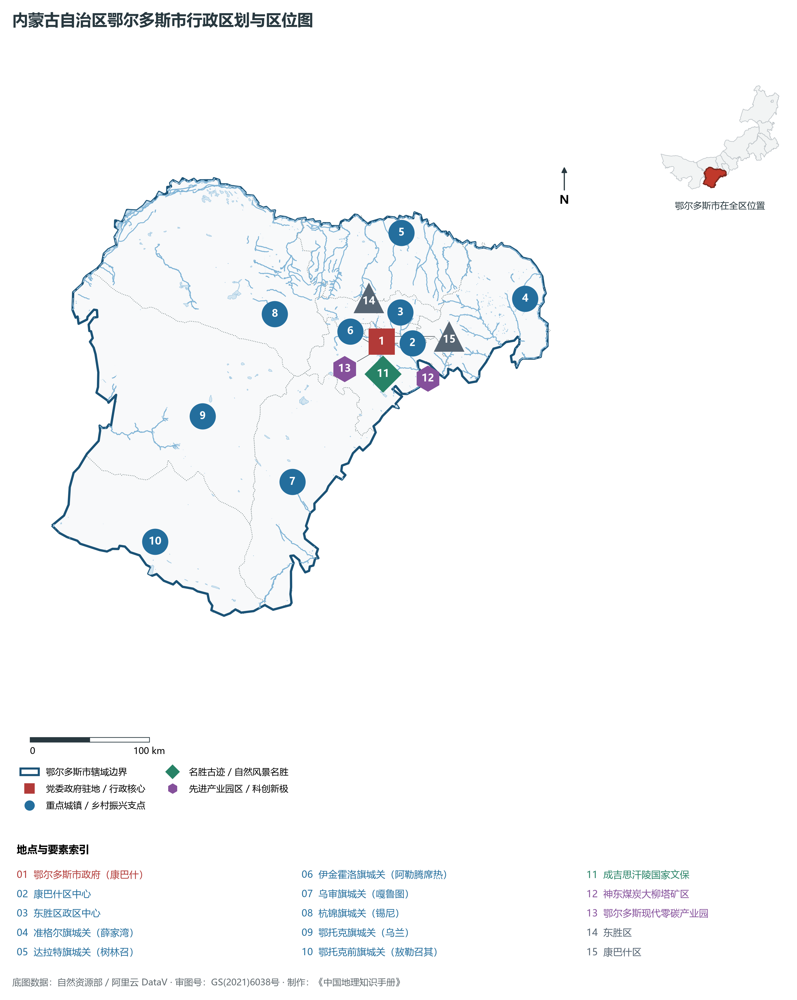
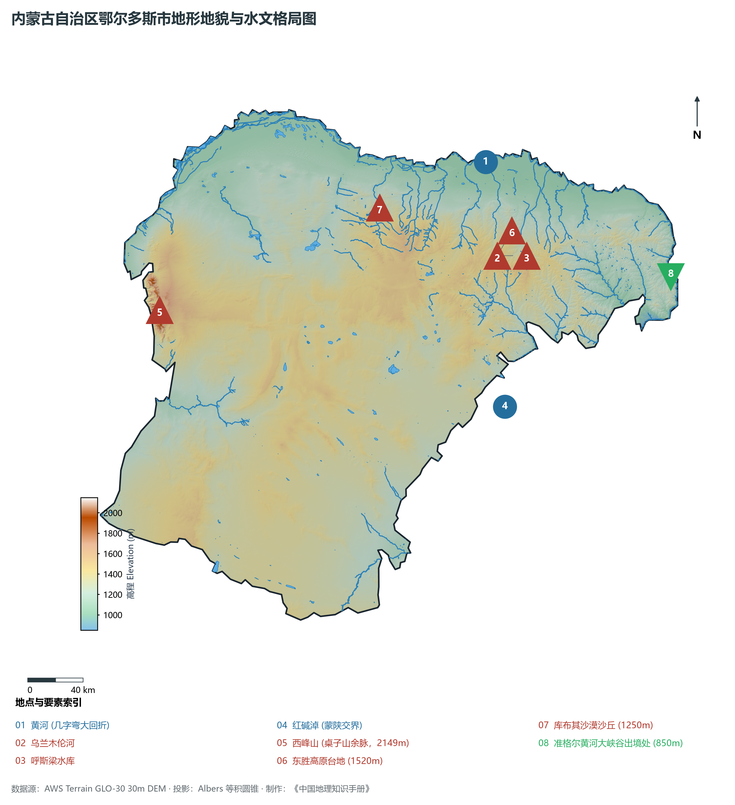
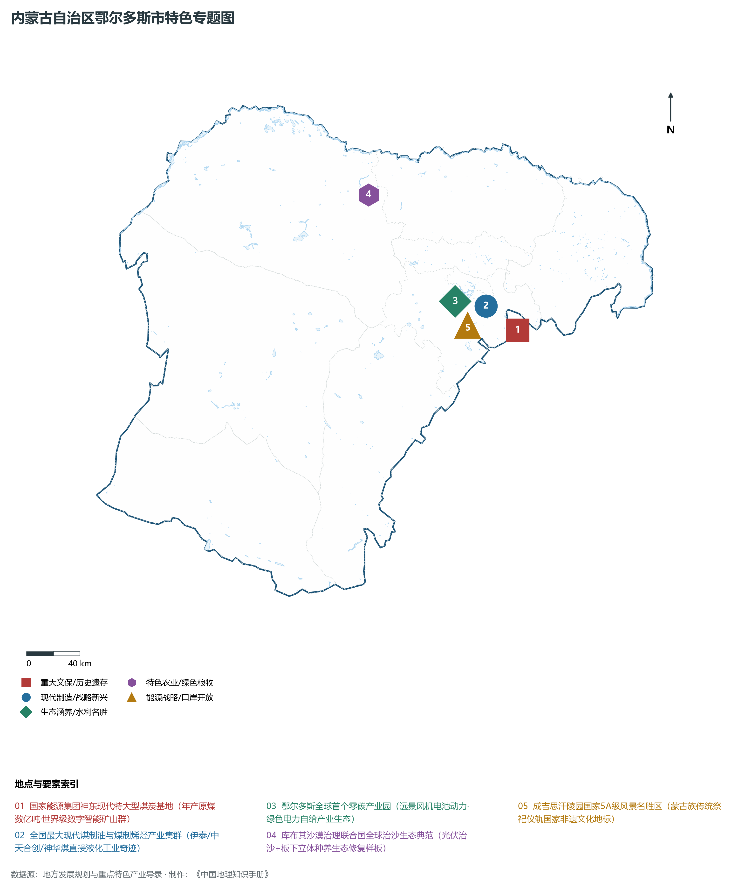
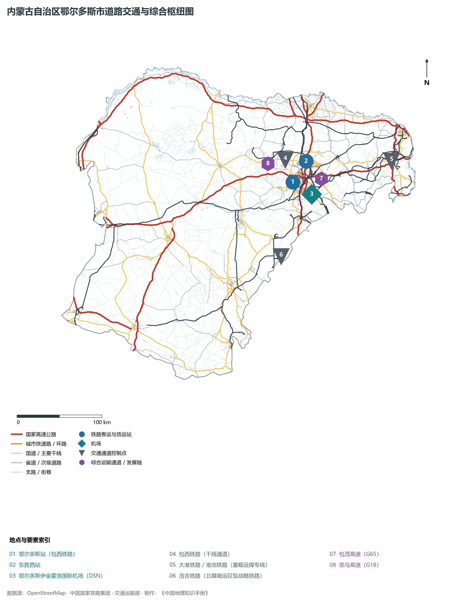
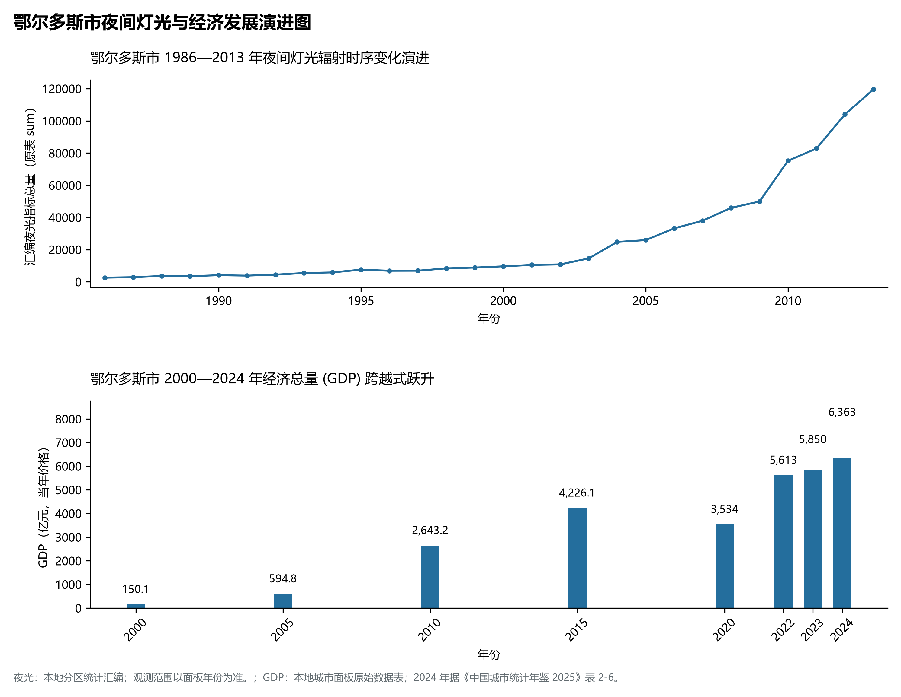

# 29.6 鄂尔多斯市

鄂尔多斯，蒙古语意为“众多的宫殿”，是一座享誉全国的“暖城”（温暖全世界），内蒙古自治区经济总量第一大市、国家重要的现代综合能源基地与现代煤化工示范基地、呼包鄂乌城市群核心增长极，享有“中国新能源风光氢储之都”之美誉。地处内蒙古高原南缘、黄河“几字弯”环抱的腹心地带，地理坐标介于东经 106°42′—111°28′、北纬 37°35′—40°51′ 之间。西、北、东三面环绕奔腾万里的大河黄河，与乌海、巴彦淖尔、包头、呼和浩特隔河相望，南临古长城与陕西省榆林市神木、府谷接壤，西南毗连宁夏吴忠市。2024 年常住人口 **224 万人**，常住人口城镇化率 **80.4%**，地区生产总值 **6,363 亿元**（当年价格），人均地区生产总值 **285,338 元**，三次产业构成为 **3.42 : 70.07 : 26.52**。

鄂尔多斯是一座深嵌着中华民族共同体记忆与创造世界治沙工业奇迹的传奇沃土。早在数万年前，“河套人”就在萨拉乌苏河畔繁衍生息，点燃了旧石器时代晚期的文明篝火；战国秦汉时期，秦筑直道穿越其境，蒙恬北逐匈奴屯垦戍边；宋元时期，一代天骄成吉思汗转战北疆，其灵榇长眠于伊金霍洛草原，八百年来达尔扈特人世代守护的成吉思汗祭祀大典被列为国家级非物质文化遗产第一项；改革开放初期，凭借“温暖全世界”的鄂尔多斯羊绒衫，这里名扬四海；20 世纪 90 年代以来，凭借全国首屈一指的巨型煤田开发，鄂尔多斯以惊人的速度崛起为国家能源保供的核心中枢；新时代以来，鄂尔多斯彻底摆脱单一资源路径，在茫茫库布其沙漠创造了联合国盛赞的“绿进沙退”全球生态治理奇迹，建成了全球首个零碳产业园，崛起为全国现代能源革命与新型工业化高质量发展的排头兵。

---

## 一、市情速览

鄂尔多斯是保障国家能源安全的“定海神针”，全区经济总量第一大市与全国人均第一极。

| 核心指标 | 全市数值与空间分布 | 全国/全区定位 |
|:---|:---|:---|
| **行政区划面积** | 86 752 km² | 黄河三面环绕“几字弯”腹心，库布其沙漠与毛乌素沙地横亘其间 |
| **常住人口** | 224 万人 | 2024 年，全市；年鉴公布口径 |
| **常住人口城镇化率** | 80.4% | 2024 年，全市；年鉴公布口径 |
| **人口密度** | 25.6 人/km² | 东胜与康巴什达 200—500 人/km²，西部鄂托克前旗低于 10 人/km² |
| **地区生产总值 (GDP)** | 6,363 亿元 | 2024 年，全市；年鉴公布口径 |
| **人均 GDP** | 285,338 元/人 | 2024 年，全市；年鉴公布口径 |
| **产业三次结构** | 2.1 : 65.2 : 32.7 | 工业底盘极其硬核，现代煤炭、煤化工、新能源制造三足鼎立 |
| **行政架构** | 辖 2 区、7 旗 | 康巴什区（市政府所在地）、东胜区，准格尔、达拉特、伊金霍洛、乌审、杭锦、鄂托克、鄂托克前 7 旗 |
| **能源硬核输出** | 年产原煤超 8.5 亿吨；天然气超 300 亿 m³ | 全国最大煤炭与天然气生产市，输送全国 25 个省区市 |
| **战略核心定位** | 国家现代能源经济示范区 | 全国综合能源保供核心、全球首个零碳产业园、国家可持续发展议程创新示范区 |

**图 29-06-1 内蒙古自治区鄂尔多斯市行政区划与区位图**：图上编号与地点、要素索引对应。

---

## 二、自然地理：黄河三面环抱、高原台地与两大沙漠

鄂尔多斯地形主要属于**鄂尔多斯高原**，地势呈**西高东低、南北隆起、中部低陷**的平缓高原地貌构造。

### 1. 地形地貌：东胜隆起台地与沙海浩瀚

- **东胜隆起波状高原**：位于全市中东部，海拔在 **1 300—1 600 m** 之间，地表起伏和缓，由白垩系砂岩与古近系红层构成，是全境主要煤炭资源富集埋藏带；
- **西部山地丘陵带**：分布于鄂托克旗西缘，属于贺兰山与桌子山南段余脉，全境最高峰为西部的**西峰山**，主峰海拔 **2 149.0 m**；
- **黄河沿岸低平原与大峡谷出境点**：沿黄北部为达拉特旗河滩平原（海拔 1 000 m），东部准格尔旗黄河穿行于壮丽的晋陕大峡谷中，龙口至万家寨出山口水面海拔仅 **850.0 m**（全境最低点）；
- **两大沙漠沙地横亘其间**：
  - **库布其沙漠**：位于北部黄河几字弯南岸，东西长 400 公里，宽 50 公里，面积达 1.4 万平方公里，是我国第七大沙漠，也是距北京最近的沙源地；
  - **毛乌素沙地**：位于南部蒙陕交界地带，面积约 3.2 万平方公里。

**图 29-06-2 内蒙古自治区鄂尔多斯市地形地貌与水文格局图**：图上编号与地点、要素索引对应。

### 2. 气候特征：温带半干旱大陆性高原气候

- **干燥多风与日照强**：年平均气温在 **6.2—8.8 ℃** 之间，年日照时数长达 2 900—3 200 小时；年均降水量自东向西由 **400 mm**（准格尔旗）递减至 **150 mm**（鄂托克前旗），年蒸发量高达 2 000—2 500 mm，冬春季干燥寒冷，大风日数多。

### 3. 水系格局：黄河几字弯环抱与高原内流区

- **黄河沿边流长 728 km**：黄河自市境西南入境，环抱西、北、东三面流淌，孕育了达拉特沿黄水稻粮油平原；
- **高原内流湖泊红碱淖**：位于伊金霍洛旗与陕西神木交界处，为全国最大沙漠淡水湖，是珍稀濒危鸟类遗鸥全球最大的繁殖栖息地。

---

## 三、建置沿革与文化根脉

### 1. 从萨拉乌苏“河套人”到秦汉烽燧

- **三万年前河套文明发祥**：乌审旗萨拉乌苏河大峡谷出土了距今 3 万至 5 万年前的“河套人”头骨与古哺乳动物化石，被确立为中国乃至东亚旧石器晚期考古的关键里程碑；
- **秦直道南通关中**：秦始皇命蒙恬监造的秦直道纵贯鄂尔多斯中南部，直通咸阳，至今遗址路基宽厚，烽燧相望。

### 2. 成吉思汗陵与达尔扈特千年祭祀

- **一代天骄长眠福地**：坐落于伊金霍洛旗的**成吉思汗陵**，气势恢宏，三座蒙古包式穹庐宫殿金顶辉煌。自元代以来，守陵人“达尔扈特”（意为担负神圣使命者）世袭相承，将古老的祭天、祭祖仪式薪火相传八百余载，成为中华多民族文化交融的文化圣地。

**图 29-06-4 内蒙古自治区鄂尔多斯市特色专题图**：图上编号与地点、要素索引对应。

---

## 四、经济地理：国家能源压舱石与全球首个零碳产业园

鄂尔多斯以全国 1/6 的煤炭、1/3 的天然气保供全国，更以全球领先的新能源技术抢占世界产业制高点。

### 1. 国家能源安全“头号功臣”

- **神东世界级煤炭基地**：拥有神东大柳塔、补连塔等年产超千万吨级的全球顶级智能化特大型矿井，全员劳动生产率稳居世界第一；
- **全国最大现代煤化工集群**：建成全球首条百万吨级煤直接液化示范线（神华煤制油）、全球单体最大煤制烯烃（中天合创）项目，现代煤制油、煤制气、煤制烯烃产能占全国半壁江山。

### 2. 远景零碳产业园：全球绿色工业新范式

- **全球首个零碳产业园**：位于伊金霍洛旗蒙苏经济开发区，由当地政府携手远景科技集团打造。园区 100% 采用高比例风电、光伏与储能绿电直供，集聚了动力电池、氢能重卡、光伏组件产业链，打造出“绿色电力+零碳制造+国际绿证”的新型产业闭环，模式已被输出至欧美多国。

### 3. 库布其治沙世界奇迹与“光伏长城”

- **联合国“全球治沙样本”**：亿利资源集团等扎根库布其沙漠三十余载，创造了“治沙+发电+种植+养殖”的板上发电、板下种植、板间养殖立体生态治沙模式；
- **千万千瓦级沙戈荒风光大基地**：沿库布其沙漠北缘黄河南岸规划建设总长数百公里的“光伏长城”，防沙固沙的同时年发绿电达数百亿千瓦时。

---

## 五、综合立体交通走廊

**图 29-06-3 内蒙古自治区鄂尔多斯市道路交通与综合枢纽图**：图上编号与地点、要素索引对应。

1. **浩吉铁路北煤南运大动脉**：浩吉铁路（浩勒报吉至吉安）自鄂尔多斯乌审旗始发，纵贯内蒙古、陕西、山西、河南、湖北、湖南、江西 7 省区，全长 1 813 km，是世界上一次性建成并开通运营里程最长的重载铁路；
2. **高速铁路与客运干线**：包西铁路电气化开通动车组，呼准鄂城际铁路快速通达呼和浩特；
3. **民航空港枢纽**：鄂尔多斯伊金霍洛国际机场（DSN）为华北地区重要的支线干线机场，年旅客吞吐量突破 250 万人次。

---

## 六、旗县区空间分区与极值矩阵

**图 29-06-5 鄂尔多斯市夜间灯光与经济发展演进图**：各面板按标注的观测年份、指标和单位列示。

| 旗县区 | 面积 (km²) | 常住人口 (万人) | 2024年GDP (亿元) | 城镇化率 (%) | 核心功能定位与主要地理地标 |
|:---|:---|:---|:---|:---|:---|
| **康巴什区** | 352 | 12.5 | 165.0 | 99.2% | 市委市政府所在地、全国首个以城市核心区申报成功的4A级景区 |
| **东胜区** | 2 160 | 58.2 | 1 120.0 | 98.4% | 全市人口第一大区、传统商贸与先进制造业基地、羊绒产业之都 |
| **准格尔旗** | 7 692 | 36.8 | 1 450.0 | 78.5% | 全区经济第一强旗、大准铁路、黑岱沟世界级露天煤矿、黄河大峡谷 |
| **达拉特旗** | 8 188 | 32.5 | 565.0 | 68.2% | 沿黄塞上粮仓、库布其沙漠生态治理、响沙湾国家5A级旅游景区 |
| **伊金霍洛旗** | 5 600 | 25.6 | 1 380.0 | 82.5% | 成吉思汗陵圣地、神东煤炭总部、远景全球首个零碳产业园 |
| **乌审旗** | 11 645 | 14.8 | 725.0 | 66.5% | 毛乌素沙地治理腹心、浩吉铁路起点、苏里格世界级大气田主产区 |
| **杭锦旗** | 18 903 | 11.2 | 260.0 | 60.2% | 库布其沙漠穿沙公路发源地、夜鸣沙旅游区、沿黄绿色生态屏障 |
| **鄂托克旗** | 20 064 | 16.5 | 598.0 | 72.8% | 鄂尔多斯白绒山羊原产地、阿尔巴斯优质羊绒、棋盘井现代工业园 |
| **鄂托克前旗** | 12 180 | 13.9 | 240.0 | 64.5% | 蒙陕宁交界枢纽、城川红色革命教育基地、现代风光储氢一体化基地 |

2024 年统计来源：《中国城市统计年鉴 2025》表 2-1、2-6、2-7（2024 年，全市）。其他年份 GDP 据本地城市面板“原始数据”表，单位为亿元、当年价格。
