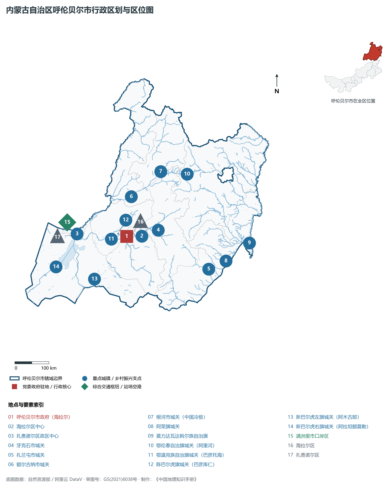
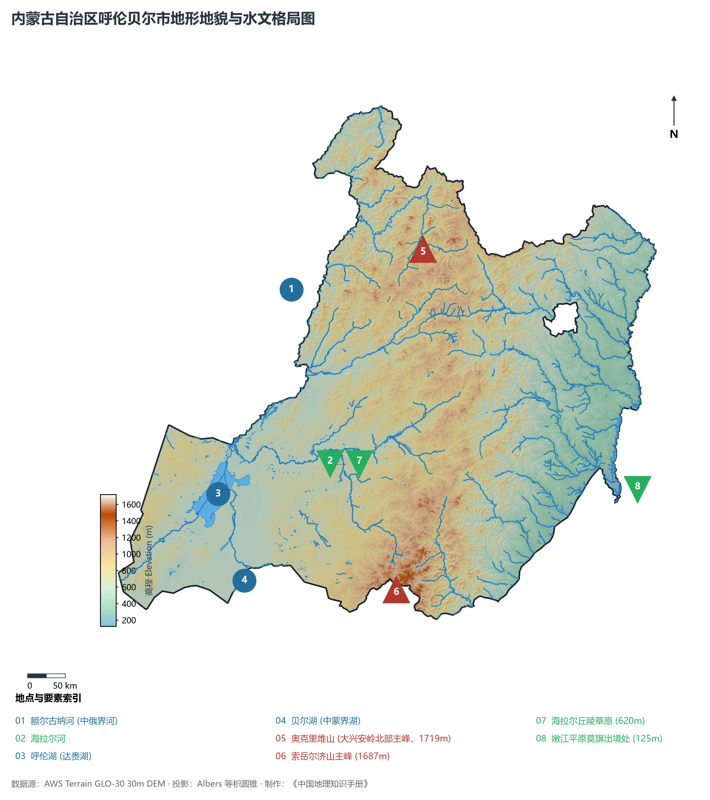
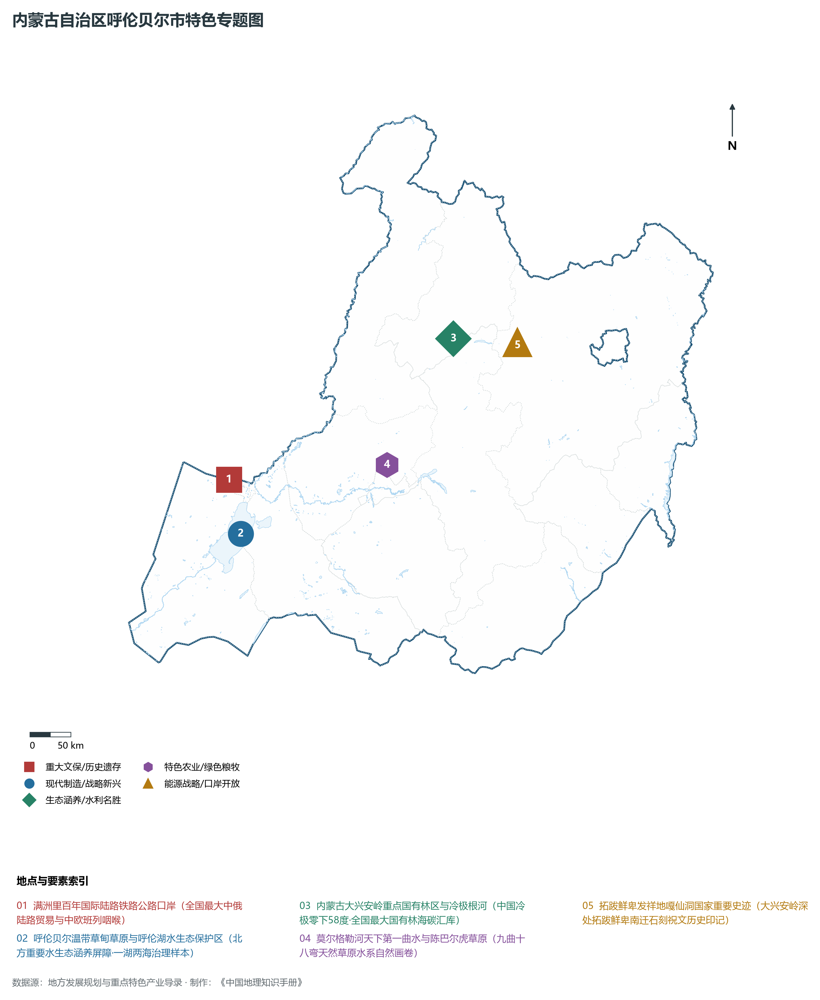
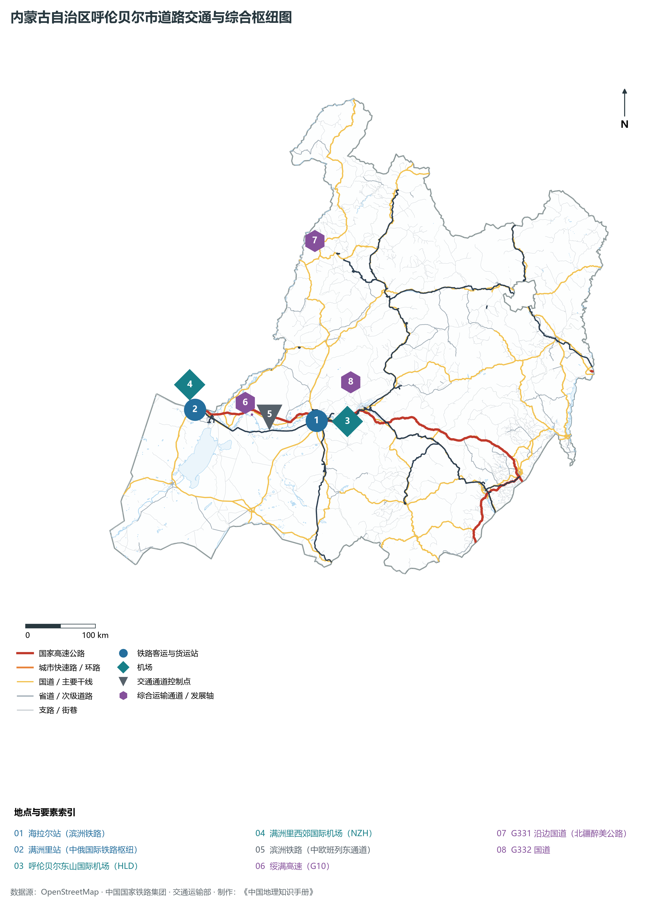
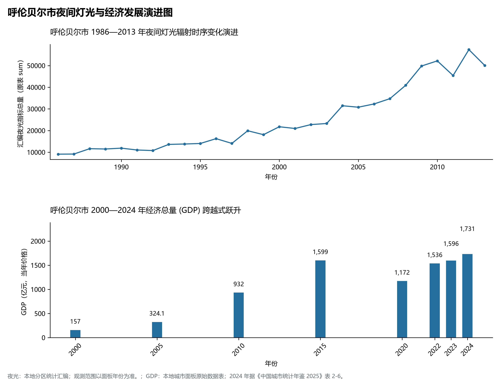

# 29.7 呼伦贝尔市

呼伦贝尔市。2024 年常住人口 **214 万人**，常住人口城镇化率 **76.79%**，地区生产总值 **1,731 亿元**（当年价格），人均地区生产总值 **80,310 元**，三次产业构成为 **23.32 : 31.45 : 45.24**。

呼伦贝尔是一座熔铸着北方古代少数民族起源史诗与中俄蒙三邦商贸传奇的历史名城。早在旧石器时代，扎赉诺尔人在此打制石器、繁衍生息；大兴安岭密林深处的**嘎仙洞**石刻祝文，实证了这里是北魏拓跋鲜卑拓荒南迁的发祥摇篮；一代天骄成吉思汗在呼伦贝尔草原统一蒙古乞颜部，奠定了大元帝国的恢弘根基；中俄界河额尔古纳河蜿蜒北去，记录了 1689 年《尼布楚条约》划定中俄边界的历史风云；清末中东铁路筑就，在边境线设立中东铁路第一站“满洲里”，由此开启了百年满洲里通商兴邦的国际陆港辉煌；进入新时代，呼伦贝尔严格践行“生态优先、绿色发展”，坚决守护好大兴安岭原始林海与呼伦湖水生态，构建起以满洲里中欧班列东通道、绿色草畜有机食品、生态文旅和极寒测试产业为特色的现代高质量发展体系。

---

## 一、市情速览

呼伦贝尔是全国面积最大的地级市之一、北方最重要的生态安全水塔与向北开放沿边重镇。

| 核心指标 | 全市数值与空间分布 | 全国/全区定位 |
|:---|:---|:---|
| **行政区划面积** | 252 777 km² (占全区 21.4%) | 全国面积最大的地级市之一，大兴安岭林海与大草原横跨东西 |
| **常住人口** | 214 万人 | 2024 年，全市；年鉴公布口径 |
| **常住人口城镇化率** | 76.79% | 2024 年，全市；年鉴公布口径 |
| **人口密度** | 8.5 人/km² | 典型地广人稀，北部根河、额尔古纳林海林区每平方公里不足 3 人 |
| **地区生产总值 (GDP)** | 1,731 亿元 | 2024 年，全市；年鉴公布口径 |
| **人均 GDP** | 80,310 元/人 | 2024 年，全市；年鉴公布口径 |
| **产业三次结构** | 23.5 : 29.8 : 46.7 | 现代生态农牧业与商贸旅游服务业双翼齐飞 |
| **行政架构** | 辖 2 区、5 县级市、4 旗、3 自治旗 | 海拉尔、扎赉诺尔 2 区；满洲里、牙克石、扎兰屯、额尔古纳、根河 5 市；4 旗及 3 少数民族自治旗 |
| **边境与口岸** | 边境线长 1 733 km；拥满洲里等多个口岸 | 满洲里为全国最大的陆路口岸，中欧班列东通道咽喉 |
| **战略核心定位** | 北方重要生态安全屏障首要阵地 | 全国最大草原与国有林区、向北开放前沿阵地、“一湖两海”核心水塔 |

**图 29-07-1 内蒙古自治区呼伦贝尔市行政区划与区位图**：图上编号与地点、要素索引对应。

---

## 二、自然地理：大兴安岭脊梁、呼伦贝尔大草原与额尔古纳水系

呼伦贝尔地形以**大兴安岭主脊为分水岭**，地势呈**中部山岭纵贯、西麓高原平缓、东麓平原低陷**的宏伟格局。

### 1. 地形地貌：北国林海与呼伦贝尔高原平川

- **中部大兴安岭中山山地**：纵贯全境南北，山体宽厚，海拔多在 **800—1 400 m** 之间。全境最高峰位于根河市北部大兴安岭深处的**奥克里堆山**，主峰海拔高达 **1 719.0 m**。山地覆盖着数千万公顷密不透风的寒温带针叶原始林海（落叶松、白桦、樟子松），保存有大面积多年连续冻土与泥炭湿地；
- **西侧呼伦贝尔高原与草甸草原**：大兴安岭西麓向蒙古高原平缓过渡，海拔在 **550—800 m** 之间，起伏极为和缓，地表覆盖着世界顶级优质草甸草原与冲积河谷草场；
- **东麓嫩江冲积平原低平带**：大兴安岭东坡地势急剧跌落至嫩江流域（扎兰屯、阿荣旗、莫力达瓦旗），海拔缓缓降至莫力达瓦达斡尔族自治旗尼尔基水库出境处的 **125.0 m**（全境最低点）。这里是著名的东北黑土地沃土与高产大豆玉米基地；
- **水系低洼地与两大湖盆**：西南部陷落形成呼伦湖与贝尔湖盆地。

**图 29-07-2 内蒙古自治区呼伦贝尔市地形地貌与水文格局图**：图上编号与地点、要素索引对应。

### 2. 气候特征：寒温带大陆性季风气候与“中国冷极”

- **冬长严寒与“极寒世界”**：全域无霜期仅 80—120 天，冬季长达 7 个月；根河市金河镇极端最低气温曾测得 **-58.0 ℃**，被国家气象部门正式确认为“中国冷极”；
- **降水与湿润度**：年平均气温在 **-4.0—2.5 ℃** 之间，大兴安岭林区年降水量可达 **500—600 mm**，而西部新巴尔虎右旗降水量降至 250 mm 左右；气候湿润冷凉，蒸发较弱，造就了全国最为广袤的原始沼泽湿地系统。

### 3. 河流水系：北方第一大湖呼伦湖与额尔古纳界河
呼伦贝尔是黑龙江水系上游极其重要的水源地：

- **呼伦湖（达赉湖）**：水域面积逾 **2 040 km²**，最大水深约 8 m，是内蒙古第一大湖、中国北方干旱半干旱区最大的陆地淡水湖泊，维系着呼伦贝尔乃至东北亚地区的生态平衡；
- **额尔古纳河水系**：海拉尔河自东向西横穿海拉尔区，与克鲁伦河相汇后北折形成中俄界河额尔古纳河，全长 970 km，两岸发育有天下第一曲水莫尔格勒河与亚洲最大的额尔古纳湿地（根河湿地）。

---

## 三、建置沿革与文化根脉

### 1. 拓跋鲜卑发祥地嘎仙洞

- **大兴安岭深处的民族寻根碑**：鄂伦春自治旗阿里河镇西部的**嘎仙洞**，洞壁上刻有北魏太平真君四年（443 年）魏太武帝拓跋焘派遣大臣祭祖所刻的 201 字石刻祝文，与《魏书》记载完全吻合，无可辩驳地确立了呼伦贝尔作为鲜卑民族起源祖居地的崇高历史地位。

### 2. 满洲里百年通商与红色秘密交通线

- **百年国门见证沧桑**：1901 年中东铁路修筑设站，俄语称“满洲里亚”，成为中国向北通向欧亚大陆的陆桥起点；大革命时期与抗日战争时期，中共在此建立绝密的满洲里地下交通线，护送李大钊、瞿秋白、周恩来等党的重要领导人前往莫斯科共产国际。

**图 29-07-4 内蒙古自治区呼伦贝尔市特色专题图**：图上编号与地点、要素索引对应。

---

## 四、经济地理：向北开放枢纽、绿色草畜与极寒测试高地

呼伦贝尔坚持“生态产业化、产业生态化”，推动绿色农畜、沿边外贸、冰雪文旅、耐寒测试高质量融合发展。

### 1. 满洲里全国最大沿边陆港与中欧班列东通道

- **口岸综合通关能力领先**：满洲里铁路口岸拥有宽准轨双轨专用换装场，年货运通关能力突破 4 000 万吨；
- **中欧班列东通道主力枢纽**：经满洲里口岸出入境的中欧班列线路达 57 条，通达欧洲 13 个国家，年开行量突破 5 000 列，大宗木材、原油、天然气、煤炭与机电产品进出口规模巨大。

### 2. 全国纯天然有机绿色草畜乳肉基地

- **呼伦贝尔大草原天然绿色基因**：全市天然草场面积达 1.5 亿亩，拥有三河牛、三河马、呼伦贝尔羊等国家优良品种；呼伦贝尔牛奶、呼伦贝尔羊肉入选国家农业品牌精品培育计划，有机食品认证数量高居全国前列。

### 3. “中国冷极”催生千亿级极寒耐低温测试产业

- **冷资源变成热产业**：依托根河、海拉尔、牙克石长达数月的零下 30—50 ℃ 极端超低温气候，建设了全国规模最大、试验场景最全的冬季汽车耐寒综合测试基地、航空极寒性能测试场，吸引国内外数十家知名车企常驻测试。

---

## 五、综合立体交通走廊

**图 29-07-3 内蒙古自治区呼伦贝尔市道路交通与综合枢纽图**：图上编号与地点、要素索引对应。

1. **滨洲铁路百年国际大动脉**：滨洲铁路（哈尔滨至满洲里）全线完成复线电气化改造，客货列车风驰电掣，构筑起中俄国际联运的钢铁巨龙；
2. **高速路网与沿边国道**：G10 绥满高速横贯东西直抵国门；G331 国道沿额尔古纳河蜿蜒穿行，被誉为中国北疆最美的自驾生态公路；
3. **“一市多场”民用航空体系**：拥有海拉尔东山国际机场（4D）与满洲里西郊国际机场（4D）两座大型空港，并在根河、扎兰屯、莫旗建有多处支线与通用机场。

---

## 六、旗县区空间分区与极值矩阵

**图 29-07-5 呼伦贝尔市夜间灯光与经济发展演进图**：各面板按标注的观测年份、指标和单位列示。

| 旗县市区 | 面积 (km²) | 常住人口 (万人) | 2024年GDP (亿元) | 城镇化率 (%) | 核心功能定位与主要地理地标 |
|:---|:---|:---|:---|:---|:---|
| **海拉尔区** | 1 319 | 36.8 | 425.0 | 96.2% | 市委市政府所在地、全区综合商贸文教中心、东山国际机场 |
| **满洲里市** | 734 | 15.2 | 215.0 | 99.1% | 全国最大陆路口岸、百年国门、中俄互市贸易区、综合保税区 |
| **扎赉诺尔区** | 311 | 9.8 | 68.0 | 98.4% | 扎赉诺尔人遗址、百年露天煤矿遗址公园、呼伦湖北岸湿地 |
| **牙克石市** | 27 590 | 25.5 | 228.0 | 85.2% | 大兴安岭林业管理局驻地、中国冰雪汽车测试基地、绿色林工转型 |
| **扎兰屯市** | 16 926 | 32.5 | 245.0 | 58.5% | 塞外苏杭、黑土地大粮仓、扎兰屯吊桥公园、国家级风景名胜区 |
| **额尔古纳市** | 28 958 | 6.5 | 88.0 | 82.5% | 亚洲第一湿地、室韦俄罗斯民族乡、额尔古纳界河风情旅游带 |
| **根河市** | 20 012 | 10.2 | 72.0 | 89.2% | 中国冷极零下58度、敖鲁古雅使鹿鄂温克部落、大兴安岭国家湿地 |
| **阿荣旗** | 12 063 | 24.2 | 148.0 | 45.2% | 全国商品粮大县、内蒙古大豆肉牛生产大旗、阿伦河冲积沃土 |
| **莫旗** | 10 500 | 22.8 | 135.0 | 44.8% | 莫力达瓦达斡尔族自治旗、中国曲棍球之乡、尼尔基巨型水利枢纽 |
| **鄂伦春自治旗** | 59 880 | 18.5 | 115.0 | 62.5% | 全市面积最大旗、嘎仙洞拓跋鲜卑祖庙、大兴安岭原始森林保护区 |
| **鄂温克自治旗** | 18 656 | 13.5 | 168.0 | 72.2% | 红花尔基樟子松母树林自然保护区、伊敏大型露天煤电化基地 |
| **陈巴尔虎旗** | 21 192 | 12.8 | 125.0 | 68.5% | 莫尔格勒河天下第一曲水、呼伦贝尔典型草原游牧牧场腹心 |
| **新巴尔虎左旗**| 22 227 | 3.8 | 48.0 | 65.2% | 诺门罕战争遗址、乌布尔宝力格苏木、阿尔山水源生态涵养区 |
| **新巴尔虎右旗**| 25 102 | 3.2 | 45.0 | 66.8% | 呼伦湖主水域保护区、黄金草原、巴尔虎蒙古族民俗非遗文化区 |

2024 年统计来源：《中国城市统计年鉴 2025》表 2-1、2-6、2-7（2024 年，全市）。其他年份 GDP 据本地城市面板“原始数据”表，单位为亿元、当年价格。
