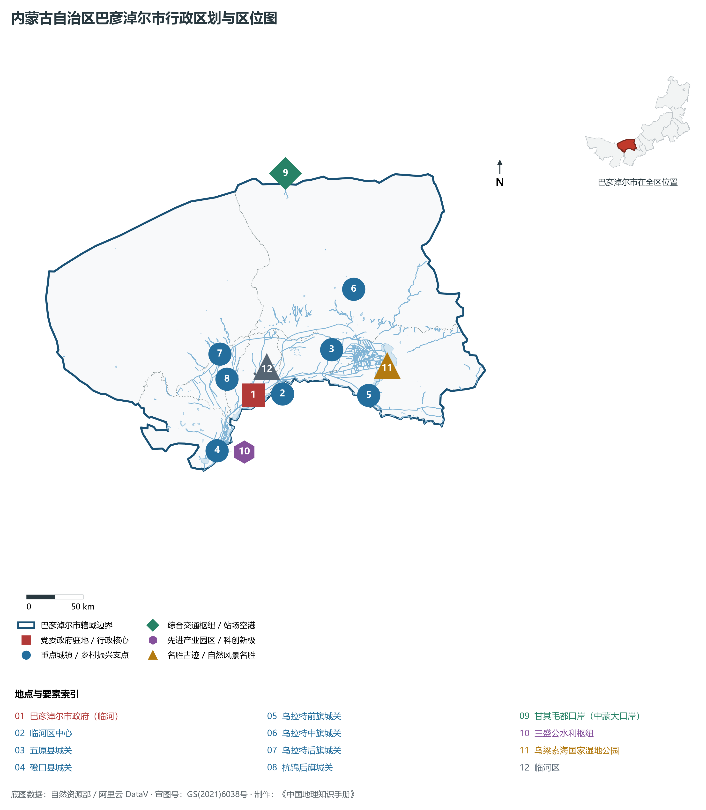
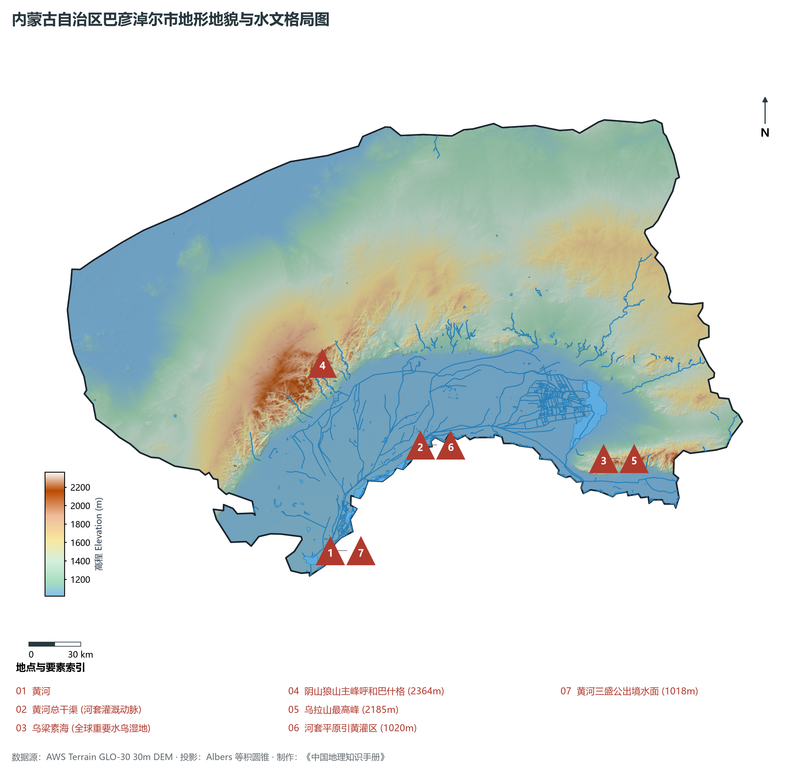
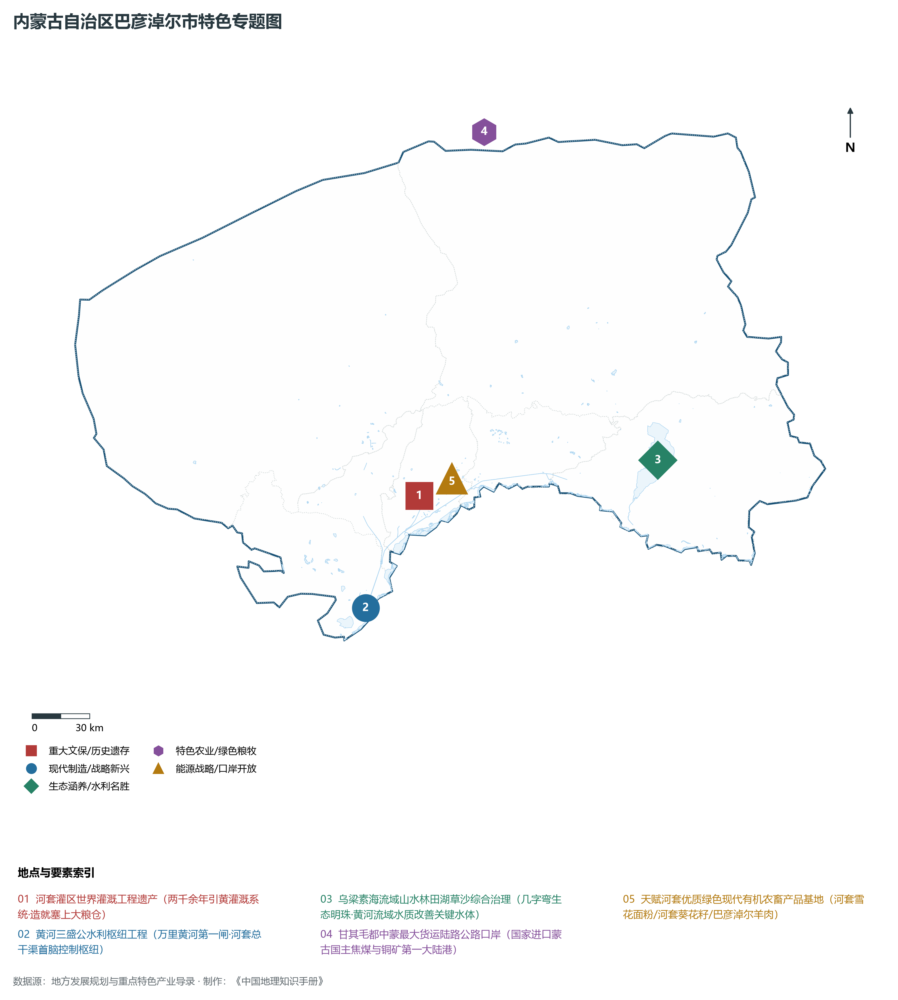
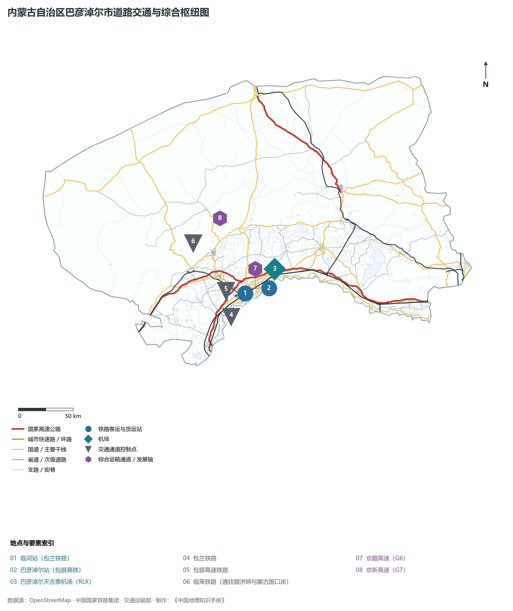
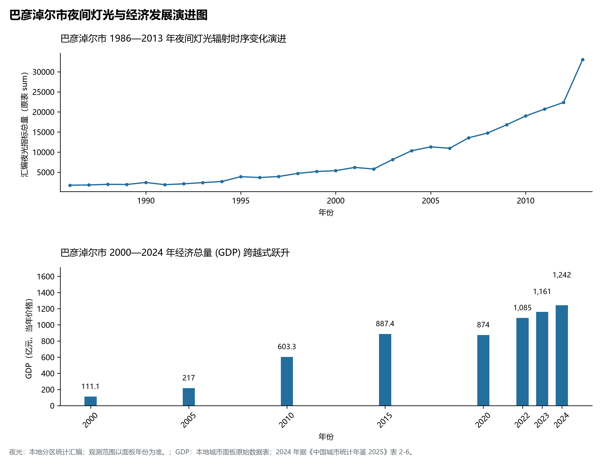

# 29.8 巴彦淖尔市

巴彦淖尔市。2024 年常住人口 **149 万人**，常住人口城镇化率 **62.74%**，地区生产总值 **1,242 亿元**（当年价格），人均地区生产总值 **83,099 元**，三次产业构成为 **26.45 : 29.17 : 44.38**。

巴彦淖尔是一座承载着两千余年引黄灌溉治水文明与边塞传奇的富庶沃土。早在战国赵武灵王在此设九原郡西界，秦始皇遣蒙恬收复河南地后置九原、北地郡，汉武帝元朔二年（前 127 年）在此设朔方郡，募民十万屯垦戍边，修筑汉长城与引黄干渠，“筑朔方以扼匈奴”；西汉名将卫青、霍去病由此北击匈奴开辟漠北战功；北魏与唐代在此设立丰州、安北都护府；清光绪年间，王同春等民间水利先驱开凿义和渠、民生渠等八大干渠，引黄灌溉八百里河套平原，奠定了“天下黄河、唯富一套”的塞上粮仓根基；新中国成立初期，国家在此兴建“万里黄河第一闸”——黄河三盛公水利枢纽工程，一举建成了全国最大的自流引水灌区；2019 年，**河套灌区**成功入选世界灌溉工程遗产名录；进入新时代，巴彦淖尔坚决扛起“一泓清水入黄河”与生态治理使命，甘其毛都口岸成长为中蒙最大货运陆港，“天赋河套”绿色农畜品牌响誉全国。

---

## 一、市情速览

巴彦淖尔是全区现代农业现代化程度最高、水利水网最发达、粮食产量名列前茅的生态沃土。

| 核心指标 | 全市数值与空间分布 | 全国/全区定位 |
|:---|:---|:---|
| **行政区划面积** | 65 788 km² | 阴山山系将全境分为山前河套平原与山后乌拉特荒漠草原 |
| **常住人口** | 149 万人 | 2024 年，全市；年鉴公布口径 |
| **常住人口城镇化率** | 62.74% | 2024 年，全市；年鉴公布口径 |
| **人口密度** | 22.8 人/km² | 平原灌区高达 120—200 人/km²，北部乌拉特荒漠区低于 5 人/km² |
| **地区生产总值 (GDP)** | 1,242 亿元 | 2024 年，全市；年鉴公布口径 |
| **人均 GDP** | 83,099 元/人 | 2024 年，全市；年鉴公布口径 |
| **产业三次结构** | 24.2 : 36.5 : 39.3 | 第一产业比重近四分之一，全国首屈一指的优质商品粮油基地 |
| **行政架构** | 辖 1 区、2 县、4 旗 | 临河区（市委市政府驻地），五原、磴口 2 县，乌拉特前旗、乌拉特中旗、乌拉特后旗、杭锦后旗 4 旗 |
| **边境与口岸** | 边境线长 369 km；甘其毛都口岸 | 甘其毛都口岸为全国最大蒙古国主焦煤与铜精矿进口陆港 |
| **战略核心定位** | 河套世界灌溉工程遗产与现代生态粮仓 | 国家重要的现代农业示范区、向北开放能源资源战略进口枢纽 |

**图 29-08-1 内蒙古自治区巴彦淖尔市行政区划与区位图**：图上编号与地点、要素索引对应。

---

## 二、自然地理：阴山狼山横亘、河套平川展开与乌梁素海

巴彦淖尔地貌呈现**北山南川、两山夹峙、黄河自流**的地貌骨架特征。

### 1. 地形地貌：狼山主脊与八百里塞上平川

- **阴山山脉狼山中高山区**：自西南向东北横亘全境中部，山势峻峭，峰峦叠嶂，长达 300 余公里。全境及阴山全线最高峰为乌拉特后旗境内的**呼和巴什格**，主峰海拔高达 **2 364.0 m**。狼山北坡地形和缓，逐渐过渡为乌拉特剥蚀荒漠高原；南坡受断裂陷落剧烈抬升，形成高差达千米的裸露断崖；
- **山前黄河冲积断陷平原（河套平原腹心）**：位于狼山、乌拉山以南与黄河之间，东西长约 180 km，南北宽 40—80 km，海拔在 **1 018—1 050 m** 之间。地势微向东南平缓倾斜，坡度仅万分之一左右。黄河在此天然形成微高出两岸农田的“地上悬河”，地势自西向东顺畅自流，构成得天独厚的自流引水灌溉系统；
- **黄河出境最低点**：乌拉特前旗东部乌梁素海排水出境处黄河水面海拔 **1 018.0 m**，为巴彦淖尔全境最低点。

**图 29-08-2 内蒙古自治区巴彦淖尔市地形地貌与水文格局图**：图上编号与地点、要素索引对应。

### 2. 气候特征：干旱少雨、光照极丰与昼夜温差大

- **黄金农业气候光热带**：年平均气温在 **7.5—8.8 ℃** 之间，年日照时数长达 **3 200—3 400 小时**（居全国地级市前列）；年均降水量仅 **130—220 mm**，而年蒸发量高达 2 100—2 400 mm；昼夜温差常年达 13—18 ℃。极大的昼夜温差与强烈的紫外线辐射，使得河套小麦、向日葵、番茄、蜜瓜干物质和糖分积累居全国之巅。

### 3. 水系格局：世界灌溉遗产与乌梁素海

- **黄河三盛公水利枢纽与总干渠**：位于磴口县境内的黄河干流上，1961 年落成，是黄河上唯一的特大型引水自流闸坝。**黄河总干渠**全长 180 km，如同一条人工天河横贯平原北部，设计引水流量达 565 m³/s，通过十三级大引水渠和数万条排灌支渠浇灌着千万亩良田；
- **乌梁素海（黄河流域最大淡水湖）**：水域面积约 293 km²，是河套灌区水利的“总承泄区”与水质天然生物净化器。经过全面治理，乌梁素海水质由劣Ⅴ类提升为Ⅳ类，每年为黄河补给生态水量数亿立方米。

---

## 三、建置沿革与文化根脉

### 1. 汉武帝筑朔方郡与阴山岩画

- **朔方古城与汉匈烽燧**：磴口与临河境内保存有完整的西汉朔方古郡故城与高阙塞遗址，赵国、秦代、汉代古长城在狼山峡谷交汇；
- **阴山岩画珍品宝库**：乌拉特中旗与后旗狼山峡谷深处，分布着万余幅上古人类原始岩画，猎鹿、放牧、祭祀场景栩栩如生，被誉为“北方游牧民族千里历史画卷”。

### 2. 世界灌溉工程遗产与河套水利精神

- **两千年治水水利奇迹**：河套灌区“总干排、分干渠、七级自流”体系，凝结了历代各族人民治理黄河、利用黄河的生态工程智慧。

**图 29-08-4 内蒙古自治区巴彦淖尔市特色专题图**：图上编号与地点、要素索引对应。

---

## 四、经济地理：“天赋河套”大粮仓与甘其毛都能源大口岸

巴彦淖尔做大做强“绿色农畜产业+口岸开放经济”双轮驱动引擎。

### 1. “天赋河套”国家优质绿色现代粮油肉奶基地

- **塞外粮仓硬核输出**：全市粮食年产量连续突破 55 亿斤，是全国重要的小麦大县与食用油籽基地；河套雪花面粉因面筋质高、口感筋道享誉全球；
- **向日葵与脱水蔬菜全球供应链**：全国最大的食用向日葵种植和加工基地，种植面积超 400 万亩，葵花籽出口占全国半壁江山；番茄酱、番茄红素远销欧美数十个国家；
- **巴彦淖尔羊肉地理标志**：肉羊年出栏超 1 200 万只，形成了现代集约化繁育养殖全产业链。

### 2. 甘其毛都中蒙最大煤炭矿产进口陆港

- **全国最大能源进出口大通道**：位于乌拉特中旗中蒙边境的甘其毛都口岸，常年开通跨境重载公路与 AGV 无人驾驶跨境运输线，年通关过货量突破 **4 000 万吨**，承担了全国进口蒙古国优质主焦煤与铜精矿的半数以上份额，是保障国家钢铁能源战略物资的重要陆路口岸。

---

## 五、综合立体交通走廊

**图 29-08-3 内蒙古自治区巴彦淖尔市道路交通与综合枢纽图**：图上编号与地点、要素索引对应。

1. **包银高铁连接大西北**：包兰铁路横穿平原；新建包银高铁在临河区设立现代化高铁站，通车后巴彦淖尔直达包头仅需 40 分钟，直达北京仅需 4 小时；
2. **临策铁路穿越大漠直通口岸**：自临河始发，横穿戈壁大漠直通额济纳旗策克口岸；
3. **京新高速（G7）穿越奇迹**：G7 京新高速横贯巴彦淖尔北部狼山大戈壁，构筑起北京通往乌鲁木齐最快捷的陆路通道。

---

## 六、旗县区空间分区与极值矩阵

**图 29-08-5 巴彦淖尔市夜间灯光与经济发展演进图**：各面板按标注的观测年份、指标和单位列示。

| 旗县区 | 面积 (km²) | 常住人口 (万人) | 2024年GDP (亿元) | 城镇化率 (%) | 核心功能定位与主要地理地标 |
|:---|:---|:---|:---|:---|:---|
| **临河区** | 2 333 | 54.2 | 412.0 | 81.5% | 市委市政府所在地、全市政经文化商贸核心、高新技术产业园 |
| **五原县** | 2 492 | 22.5 | 158.0 | 52.8% | 冯玉祥五原誓师历史名城、中国葵花之乡、河套农耕文化博览苑 |
| **磴口县** | 4 167 | 11.2 | 82.0 | 56.4% | 黄河三盛公水利枢纽、万泉针织、乌兰布和沙漠东缘绿色防沙屏障 |
| **乌拉特前旗** | 7 465 | 29.5 | 248.0 | 58.2% | 乌梁素海国家级自然保护区、乌拉山国家森林公园、铁矿采选冶炼 |
| **乌拉特中旗** | 23 096 | 13.8 | 195.0 | 54.5% | 甘其毛都中蒙最大货运公路口岸、阴山岩画宝库、风光清洁能源基地 |
| **乌拉特后旗** | 25 254 | 5.2 | 85.0 | 62.8% | 全市面积最大旗、阴山最高峰呼和巴什格、潮格温都尔戈壁牧区 |
| **杭锦后旗** | 1 767 | 13.8 | 62.0 | 51.5% | 陕坝老字号肉干、河套平原精耕细作示范区、高标准农田标杆旗 |

2024 年统计来源：《中国城市统计年鉴 2025》表 2-1、2-6、2-7（2024 年，全市）。其他年份 GDP 据本地城市面板“原始数据”表，单位为亿元、当年价格。
