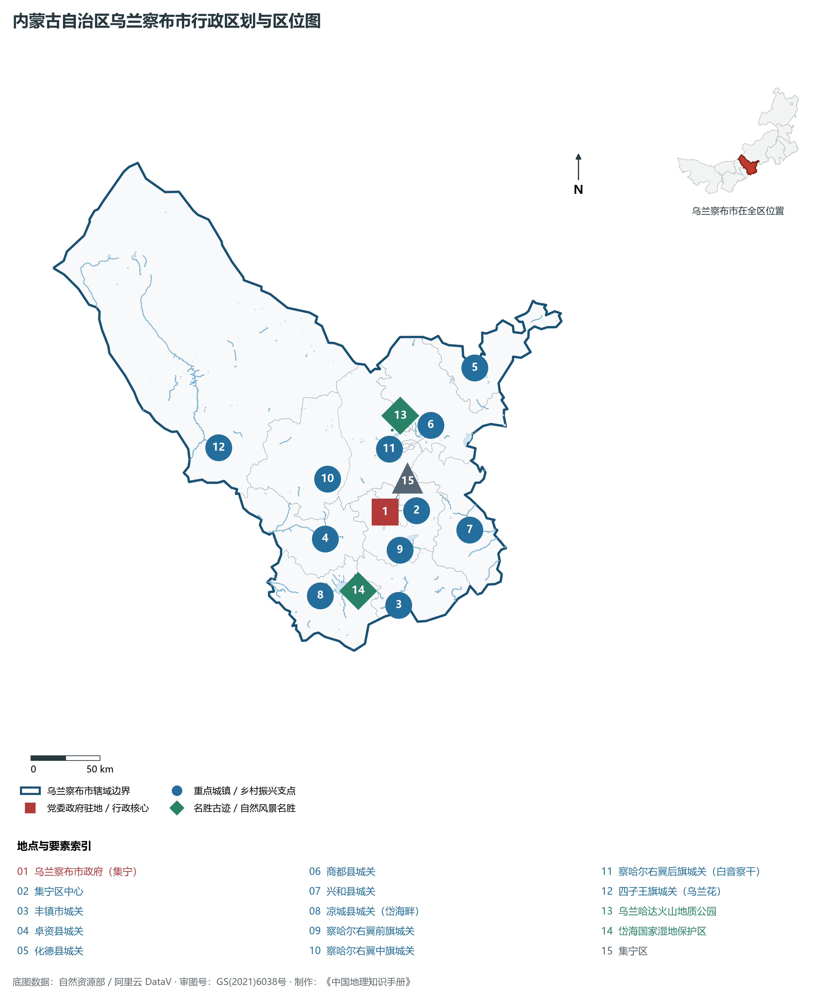
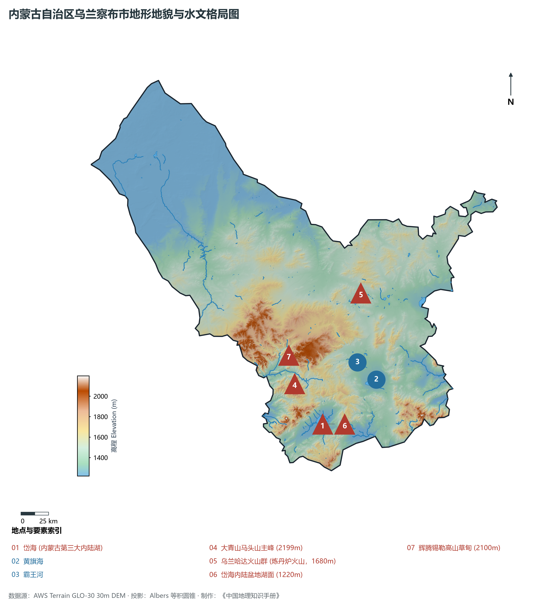
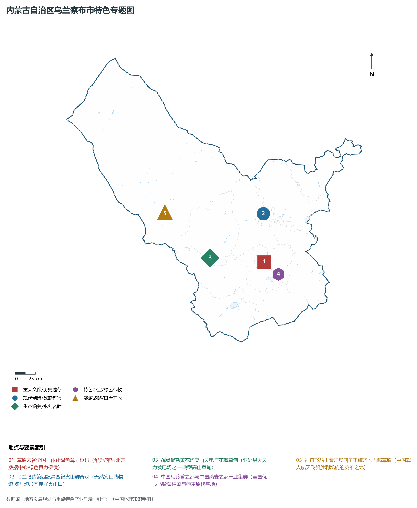
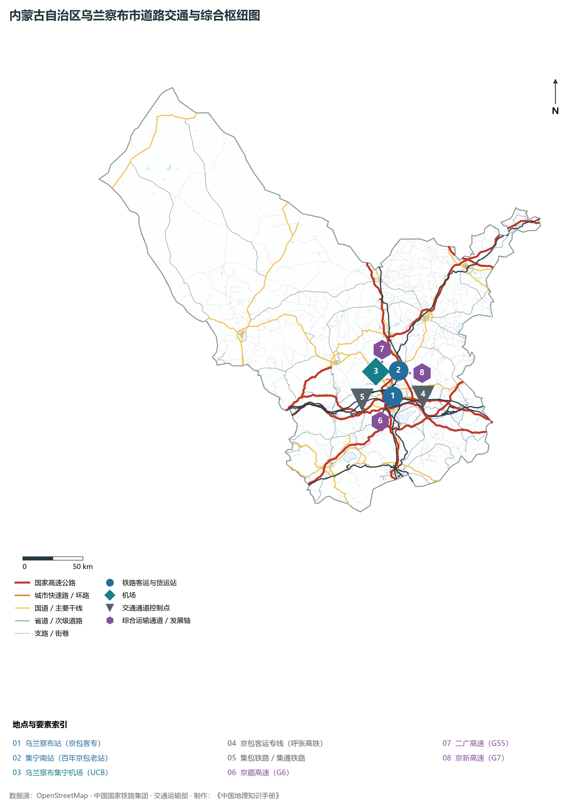
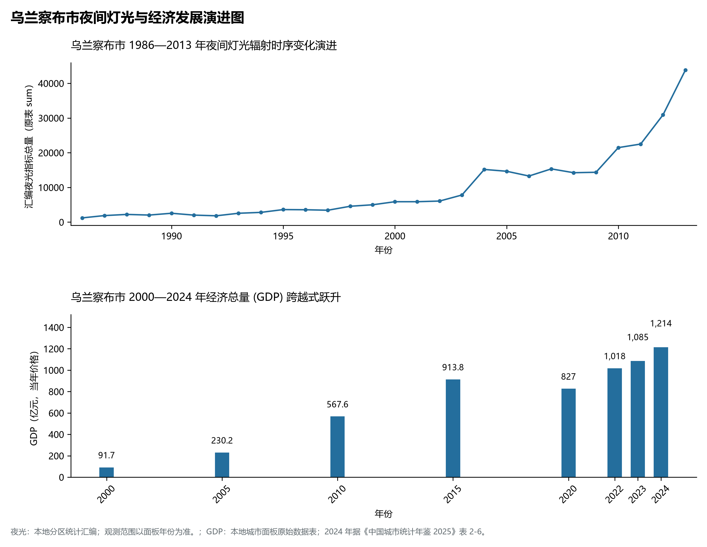

# 29.9 乌兰察布市

乌兰察布，蒙古语意为“红色的崖口”，是内蒙古自治区距离首都北京最近的地级市、京津冀协同发展的重要辐射协作区、呼包鄂乌城市群东部门户，享有“北京后花园”“中国草原云谷”“中国薯都”“中国燕麦之都”与“国家风电之都”之盛誉。地处内蒙古高原中部、阴山山脉大青山与灰腾梁之间，地理坐标介于东经 110°43′—114°49′、北纬 39°37′—43°28′ 之间。南邻山西省大同市与朔州市，东南与河北省张家口市接壤，西接自治区首府呼和浩特，北与蒙古国毗连，国界线长达 **104 km**。2024 年常住人口 **158 万人**，常住人口城镇化率 **63.06%**，地区生产总值 **1,214 亿元**（当年价格），人均地区生产总值 **76,364 元**，三次产业构成为 **16.06 : 33.14 : 50.8**。

乌兰察布是一座见证了万里茶道繁华商贸与新中国航天辉煌的传奇名城。早在先秦时期，这里就是游牧民族逐水草而居的塞外乐土；汉置雁门、代郡北境；明清时期，乌兰察布集宁地处欧亚陆路商道“万里茶道”的重要节点，张库大道（张家口至库伦）横穿其境，驼队马帮铃声回荡；近代以来，詹天佑主持修筑的京张铁路延伸至集宁（京包铁路），使集宁迅速崛起为连接华北、大西北与通往蒙古、俄罗斯的北方铁路交通大十字枢纽；解放战争时期，集宁战役谱写了革命军队英勇浴血的历史篇章；新中国成立后，乌兰察布四子王旗阿木古郎草原成为神舟系列飞船的主着陆场，神舟一号至神舟十一号载人飞船、嫦娥五号探月返回舱在此成功着陆，赢得了“神舟家园”的世界级美誉；进入新时代，依托京包客专高铁融入北京 1 小时经济圈，乌兰察布大力发展绿色算力，“南贵北乌”数据中心集群享誉全国，打造出面向未来的“草原云谷”。

---

## 一、市情速览

乌兰察布是内蒙古最具区位交通优势的门户城市、绿色算力与清洁能源示范基地。

| 核心指标 | 全市数值与空间分布 | 全国/全区定位 |
|:---|:---|:---|
| **行政区划面积** | 54 491 km² | 占全区 4.6%，阴山山脉与内蒙古高原中段过渡带 |
| **常住人口** | 158 万人 | 2024 年，全市；年鉴公布口径 |
| **常住人口城镇化率** | 63.06% | 2024 年，全市；年鉴公布口径 |
| **人口密度** | 29.7 人/km² | 南部集宁、丰镇、察右前旗较高，北部四子王旗荒漠草原低于 5 人/km² |
| **地区生产总值 (GDP)** | 1,214 亿元 | 2024 年，全市；年鉴公布口径 |
| **人均 GDP** | 76,364 元/人 | 2024 年，全市；年鉴公布口径 |
| **产业三次结构** | 18.5 : 37.2 : 44.3 | 现代特色农牧与数字新质生产力双轮驱动 |
| **行政架构** | 辖 1 区、1 县级市、5 县、4 旗 | 集宁区，丰镇市，卓资、化德、商都、兴和、凉城 5 县，察右前、察右中、察右后、四子王 4 旗 |
| **边境与口岸** | 边境线 104 km；邻近二连浩特口岸 | 通往蒙古国和俄罗斯的重要陆路后方集疏运基地 |
| **战略核心定位** | “草原云谷”与北京绿色能源菜篮子基地 | 国家算力网络北方核心集群、京津冀协同发展生态屏障、中国薯都 |

**图 29-09-1 内蒙古自治区乌兰察布市行政区划与区位图**：图上编号与地点、要素索引对应。

---

## 二、自然地理：阴山余脉、高山草甸与第四纪火山群

乌兰察布地势由**东北向西南缓缓倾斜**，横跨阴山山脉大青山、灰腾梁高山草甸与内蒙古波状高原三大单元。

### 1. 地形地貌：山岭纵横、熔岩台地与内陆湖盆

- **大青山山脉与马头山主峰**：横亘于市区西部与西南部（卓资县、凉城县），海拔在 **1 400—2 200 m** 之间。全境最高峰为卓资县境内大青山脉的**马头山**，主峰海拔 **2 199.0 m**。山地林木茂密，落差明显；
- **辉腾锡勒高山草甸与熔岩台地**：位于察右中旗南部，海拔在 **2 000—2 100 m** 之间，是一片保存完整的典型亚高山草甸草原，鲜花盛开，风力资源极佳；
- **乌兰哈达第四纪火山群地质奇观**：位于察右后旗白音察干以北，在辽阔的大草原上突兀耸立着 30 余座形态极为完美的第四纪更新世与全新世火山锥（著名的炼丹炉火山群）。火山渣、玄武岩熔岩流与草甸交融，被称为“天然火山地质博物馆”；
- **岱海内陆陷落盆地与最低点**：凉城县境内的岱海湖盆四周环山，湖面海拔 **1 220.0 m**，为全境最低水面地势低点。

**图 29-09-2 内蒙古自治区乌兰察布市地形地貌与水文格局图**：图上编号与地点、要素索引对应。

### 2. 气候特征：温带大陆性季风半干旱高原气候

- **冷凉气候与“天然大空调”**：年平均气温在 **4.2—5.5 ℃** 之间，7 月平均气温仅 18.8 ℃，夏季凉爽舒适；年日照时数长达 2 900—3 100 小时；全市年均降水量约 **300—380 mm**，大青山南麓雨量略丰，北部四子王旗荒漠化明显；
- **风电资源得天独厚**：年有效风时达 7 000 小时以上，平均风速达 6—8 m/s，是全国风能资源最丰富的“黄金风场”之一。

### 3. 水系格局：内陆湖泊岱海与黄旗海

- **岱海生态综合保护**：水域面积约 40 余平方公里，是内蒙古第三大内陆湖，经过国家“引黄济岱”水利工程补水与农业节水休耕，岱海湖面萎缩趋势得到决定性扭转，生态水质逐步向好；
- **黄旗海与霸王河**：黄旗海位于察右前旗境内；霸王河穿集宁城区而过，经过综合治理筑起百里生态水系公园。

---

## 三、建置沿革与文化根脉

### 1. 从万里茶道到神舟飞船凯旋福地

- **百年集宁铁路开埠**：平绥铁路通车后，集宁成为塞外货物转运第一枢纽，商号云集；
- **神舟家园阿木古郎**：四子王旗阿木古郎草原（蒙古语意为“平安吉祥的地方”），地形平坦开阔、坡度极小、视野无阻，圆满完成了神舟一号至十一号飞船返回舱的搜救回收任务，铭刻了中国载人航天走向星辰大海的无上光荣。

**图 29-09-4 内蒙古自治区乌兰察布市特色专题图**：图上编号与地点、要素索引对应。

---

## 四、经济地理：“草原云谷”、国家清洁能源与中国薯都

乌兰察布牢牢抓住“数字经济+绿色能源+现代农业”三张王牌，新质生产力全面崛起。

### 1. “草原云谷”：全国一体化算力网络北方基地

- **超大型数据中心集群**：紧紧依托毗邻北京（高铁 1 小时）、年均温 4.3℃ 自然冷却节能与低价绿电优势，成功吸引华为北方云数据中心、苹果中国北方数据中心、阿里巴巴、优刻得、快手等行业巨头入驻，签约服务器规模突破数百万台，“南有贵安、北有乌兰察布”品牌确立。

### 2. “中国薯都”与“中国燕麦之乡”

- **全国最大的马铃薯种植加工基地**：马铃薯种植面积超 300 万亩，年产量超 400 万吨，形成了从脱毒种薯培育、全粉加工到鲜薯直供全国的百亿级产业链；
- **阴山优麦与健康杂粮**：察右中旗、商都县高寒冷凉，孕育出富含β-葡聚糖的优质裸燕麦（莜麦），“阴山优麦”成为全国知名品牌。

### 3. 全国风电之都与新能源基地

- **新能源装机突破千万千瓦**：辉腾锡勒高山风电场风机迎风飞旋，察右前旗、四子王旗布局有国家大型风电光伏大基地，绿电通过特高压直供京津冀。

---

## 五、综合立体交通走廊

**图 29-09-3 内蒙古自治区乌兰察布市道路交通与综合枢纽图**：图上编号与地点、要素索引对应。

1. **京包客专高铁融入首都 1 小时圈**：乌兰察布站至北京清河站高铁最快仅需 1 小时 12 分钟，使乌兰察布成为内蒙古融入京津冀最前沿的高铁新城；
2. **铁路交通大十字枢纽**：京包线与集二线（二连浩特国际中欧班列中通道主干线）、集通线在此四向交汇，集宁南站与七苏木中欧班列集结中心年货运量庞大；
3. **高速公路网**：G6 京藏、G7 京新、G55 二广三大国家高速主干线在此交汇贯通。

---

## 六、旗县区空间分区与极值矩阵

**图 29-09-5 乌兰察布市夜间灯光与经济发展演进图**：各面板按标注的观测年份、指标和单位列示。

| 旗县市区 | 面积 (km²) | 常住人口 (万人) | 2024年GDP (亿元) | 城镇化率 (%) | 核心功能定位与主要地理地标 |
|:---|:---|:---|:---|:---|:---|
| **集宁区** | 382 | 43.5 | 315.0 | 86.8% | 市委市政府所在地、全市政经文化商贸核心、乌兰察布高铁站枢纽 |
| **丰镇市** | 2 703 | 24.2 | 195.0 | 58.5% | 蒙晋交界工业门户、新材料与铁合金基地、丰镇月饼非遗美食之乡 |
| **卓资县** | 3 119 | 14.5 | 98.0 | 52.4% | 马头山全境最高峰、卓资山熏鸡国家地理标志、大青山水源涵养屏障 |
| **化德县** | 2 527 | 10.8 | 65.0 | 48.6% | 中国服装羊绒絮片之乡、百万千瓦风光储一体化清洁能源示范基地 |
| **商都县** | 4 353 | 19.8 | 115.0 | 49.5% | 中国燕麦之乡核心区、现代冷凉蔬菜种植基地、大型陆上风电走廊 |
| **兴和县** | 3 518 | 18.2 | 125.0 | 51.2% | 察尔湖国家湿地公园、石墨烯高纯新材料、连通京津冀东大门 |
| **凉城县** | 3 451 | 15.6 | 105.0 | 52.8% | 岱海内陆湿地生态保护区、岱海国际滑雪场、生态绿色温泉康养小镇 |
| **察右前旗** | 2 466 | 16.5 | 138.0 | 56.4% | 草原云谷大数据产业园、黄旗海生态修复、乌兰察布集宁机场所在地 |
| **察右中旗** | 4 191 | 8.5 | 68.0 | 48.2% | 辉腾锡勒黄花沟国家4A级高山草甸、亚洲最大风电场、马铃薯育种基地 |
| **察右后旗** | 3 910 | 11.2 | 82.0 | 54.8% | 乌兰哈达第四纪火山地质公园、察哈尔察汗白音火山岩、现代绿色建材 |
| **四子王旗** | 25 541 | 16.2 | 135.0 | 48.5% | 全市面积最大旗、神舟飞船主着陆场阿木古郎草原、格根塔拉草原景区 |

2024 年统计来源：《中国城市统计年鉴 2025》表 2-1、2-6、2-7（2024 年，全市）。其他年份 GDP 据本地城市面板“原始数据”表，单位为亿元、当年价格。
