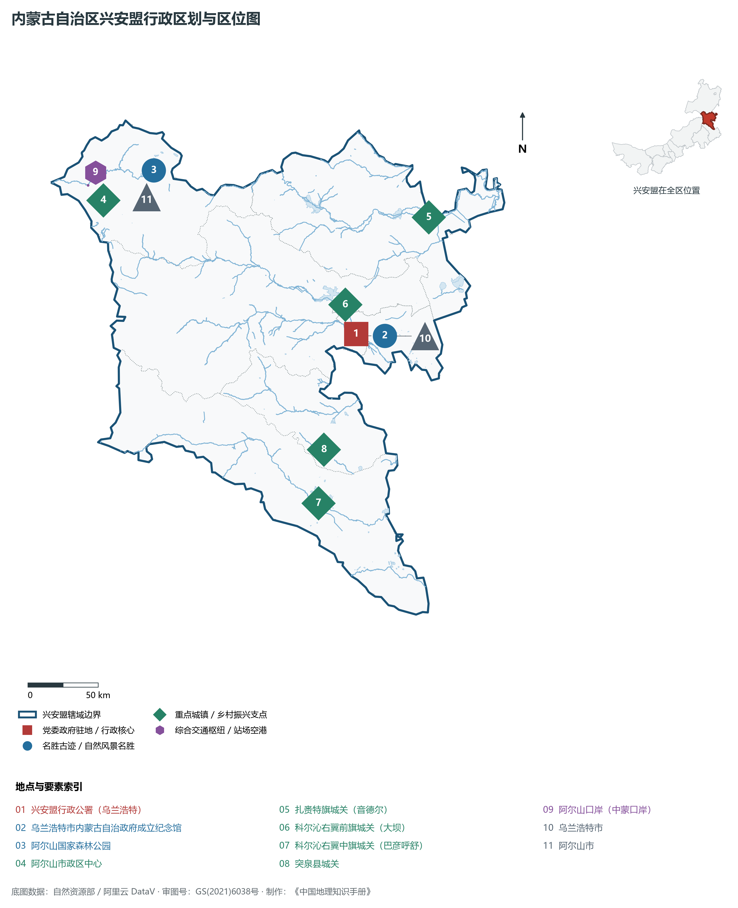
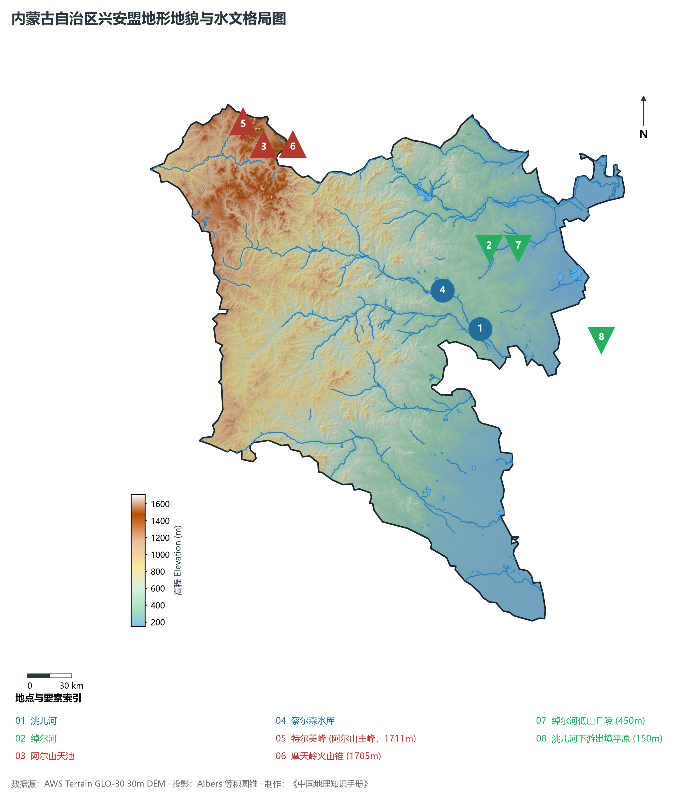
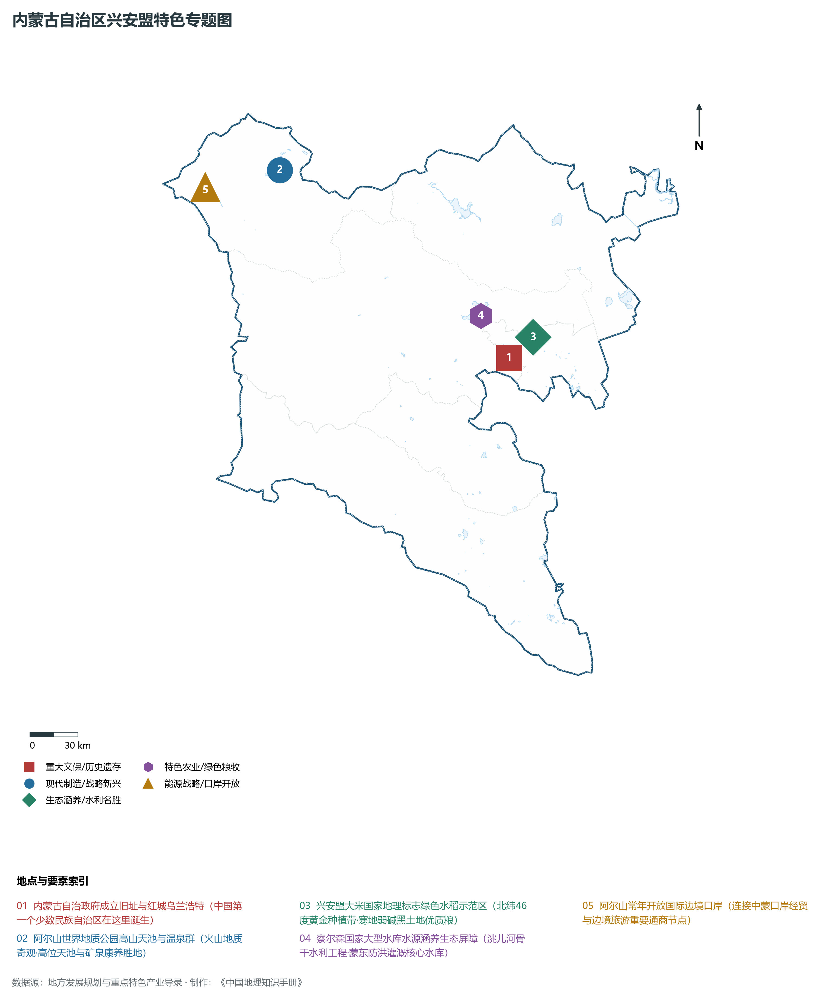
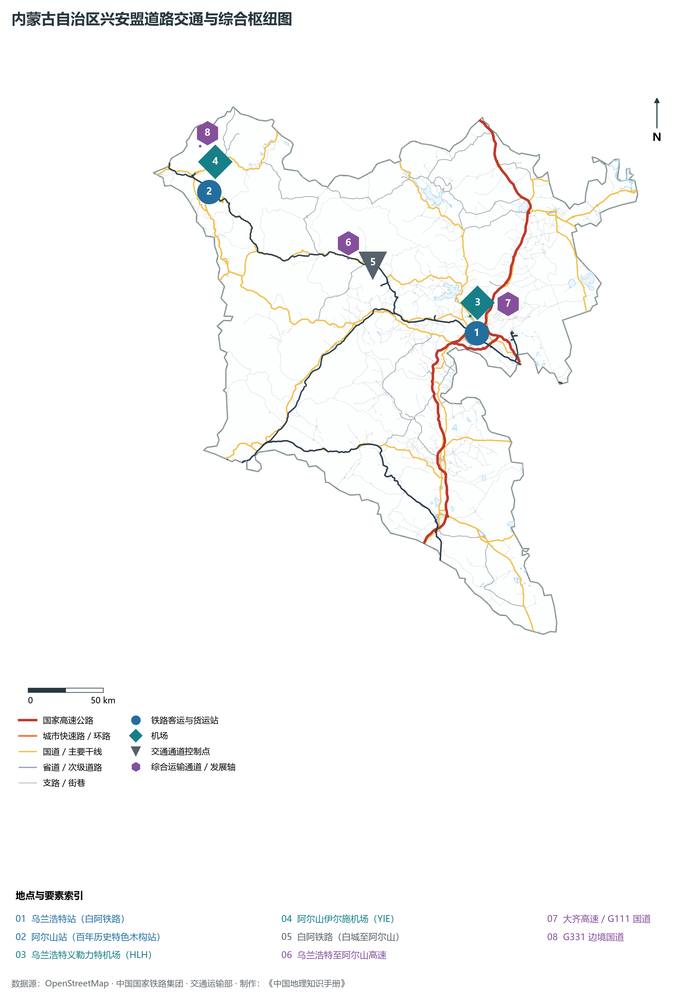
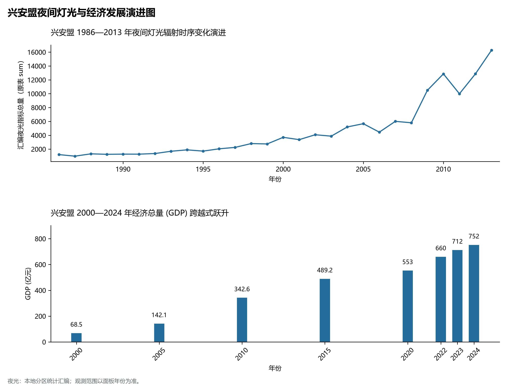

# 29.10 兴安盟

兴安盟，因地处大兴安岭中段东麓而得名（“兴安”系满语，意为“丘陵、白色的山梁”），是内蒙古自治区的“红城”摇篮、国家生态文明建设示范盟、东北森林带与草原生态屏障的核心组成部分。地理坐标介于东经 119°50′—123°38′、北纬 44°14′—47°39′ 之间，东林西草、南挽科尔沁、北抱大兴安岭。东北与黑龙江省齐齐哈尔市接壤，东南与吉林省白城市毗邻，南接通辽市，西邻锡林郭勒盟，西北连呼伦贝尔市，西北部与蒙古国接壤，国界线长达 **126 km**。全盟土地总面积 **59 806 km²**，常住人口达 **137.5 万人**，2024 年地区生产总值（GDP）达到 **752.0 亿元**。

兴安盟是一片流淌着崇高红色血脉与壮丽生态诗篇的沃土。1947 年 5 月 1 日，内蒙古自治政府在王爷庙（今乌兰浩特市）宣告正式成立，开创了中国共产党领导的民族区域自治之先河，乌兰浩特由此成为铭刻光荣历史的“红城”（蒙古语“乌兰浩特”即为“红色的城市”）。这里自然资源得天独厚，西北部横亘着大兴安岭苍茫林海与阿尔山世界地质公园，拥有高位天池、火山熔岩地貌与神奇冷热矿泉群；东南部延伸出洮儿河与绰尔河冲积沃野，地处世界公认的“北纬 46 度黄金水稻种植带”，孕育出享誉全国的“兴安盟大米”国家地理标志保护品牌；西南部科右中旗则是蒙古族人口比例最高、民族传统文化极其醇厚的“中国赛马之乡”。走进新时代，兴安盟坚持“生态立盟、绿色发展”，将阿尔山火山温泉、红城初心记忆与绿色农畜产品深度融合，打造出生态高颜值与发展高质量协同并进的北疆绿色明珠。

---

## 一、盟情速览

兴安盟是内蒙古自治政府的发祥地、国家生态文明建设示范盟与北疆优质绿色农畜产品主产区。

| 核心指标 | 全盟数值与空间分布 | 全国/全区定位 |
|:---|:---|:---|
| **行政区划面积** | 59 806 km² | 占全区 5.1%，大兴安岭中段向松嫩平原过渡带 |
| **常住人口** | 137.5 万人 (2024 年末)；七普 141.69 万人 | 乌兰浩特市与科右前旗人口集聚度最高 |
| **常住人口城镇化率** | 55.6% (2024 年) | 乌兰浩特中心城区城镇化率超过 82% |
| **人口密度** | 23.0 人/km² | 东南部河谷平原较高，西北部大兴安岭林区不足 5 人/km² |
| **地区生产总值 (GDP)** | 752.0 亿元 (2024 年，现价) | 农林牧渔业增加值占比高，绿色农畜与生态文旅快速增长 |
| **人均 GDP** | 约 5.47 万元人民币 | 稳步增长，优质水稻、现代肉牛与新能源附加值提升 |
| **产业三次结构** | 34.2 : 21.5 : 44.3 | 典型的一三产业驱动型生态绿色经济结构 |
| **行政架构** | 辖 2 县级市、1 县、3 旗 | 乌兰浩特市、阿尔山市；突泉县；科右前旗、科右中旗、扎赉特旗 |
| **边境与口岸** | 边境线 126 km；阿尔山国际陆路口岸 | 中蒙重要双边季节性开放公路口岸 |
| **战略核心定位** | “红城”发祥地与国家级现代农业示范区 | 内蒙古民族区域自治摇篮、全国优质粮食基地、“兴安盟大米”品牌 |

**图 29-10-1 内蒙古自治区兴安盟行政区划与区位图**：图上编号与地点、要素索引对应。

---

## 二、自然地理：大兴安岭中段脊梁、火山地质与洮儿河水系

兴安盟地势**西北高而东南低**，横跨大兴安岭山地、低山丘陵与松辽平原西缘三大地貌阶梯。

### 1. 地形地貌：高山熔岩、台地峡谷与河谷平原

- **特尔美峰与摩天岭火山群**：全境最高点位于西北部大兴安岭主脊的**特尔美峰**，海拔 **1 711.0 m**；阿尔山火山群是我国火山地质遗迹保存最完整、类型最丰富的区域之一，摩天岭火山锥（海拔 1 705 m）、达尔滨湖、石塘林第四纪玄武岩熔岩流如翻滚黑浪，蔚为壮观；
- **阿尔山高山天池群**：分布有阿尔山天池、驼峰岭天池等多个极为罕见的典型高山火山口湖（玛珥湖），水质澄澈，久旱不涸，四周林海环抱；
- **中部低山丘陵台地**：扎赉特旗、科右前旗中西部以剥蚀低山丘陵为主，海拔在 400—800 m 之间，森林向草原逐步过渡；
- **东南部洮儿河冲积平原**：全境最低地势位于洮儿河下游出境处的吉尔嘎朗一带，海拔仅 **150.0 m**。地势平缓坦荡，土壤肥沃，为万顷水稻与玉米主产区。

**图 29-10-2 内蒙古自治区兴安盟地形地貌与水文格局图**：图上编号与地点、要素索引对应。

### 2. 气候特征：温带大陆性季风气候与山地微气候

- **垂直气候分异显著**：西北部阿尔山属于寒温带湿润高寒气候，年均温仅 -3.0 ℃ 至 0 ℃，无霜期仅 90 天左右，冬季漫长寒冷，积雪期长达 7 个月，是著名的天然“冰雪世界”；
- **东南部温暖农区**：乌兰浩特及平原旗县年均温在 4.5—6.0 ℃ 之间，无霜期 135—145 天，雨热同季；
- **降水梯度由西向东递减**：大兴安岭西坡迎风带降水丰沛，年均降水量达 450—550 mm；东南部丘陵平原降水量为 380—450 mm。

### 3. 水系格局：嫩江水系西侧重要水源涵养地

- **洮儿河干流与察尔森水库**：洮儿河发源于阿尔山高山密林，全长 553 km，穿流全盟汇入嫩江；位于科右前旗境内的**察尔森水库**总库容达 12.5 亿 m³，是内蒙古大型骨干防洪蓄水枢纽，兼具生态灌溉与水源涵养重任；
- **绰尔河与绰勒水库**：发源于大兴安岭，流经扎赉特旗，绰勒水利枢纽保障下游数百万亩优质灌区水源；
- **阿尔山神泉群**：阿尔山拥有 48 眼天然矿泉，涵盖冷泉、温泉、热泉、高热泉四种类型，富含锶、锂、硒等多种有益微量元素，享有“中国温泉之乡”世界级赞誉。

---

## 三、建置沿革与文化根脉

### 1. 民族区域自治“红城”发祥地

- **内蒙古自治政府成立（1947年5月1日）**：乌兰浩特原名王爷庙，1947 年 4 月 23 日至 5 月 1 日，内蒙古人民代表会议在此隆重召开，乌兰夫同志当选为自治政府主席，宣告我国第一个少数民族自治政权诞生，史称“五一大会”；
- **五一会址与乌兰夫办公旧址**：至今保存完好，被列为全国重点文物保护单位、全国爱国主义教育示范基地，是北疆各族人民铸牢中华民族共同体意识的精神家园。

**图 29-10-4 内蒙古自治区兴安盟特色专题图**：图上编号与地点、要素索引对应。

### 2. 游牧与农耕交汇的多彩民俗

- **科尔沁草原文化**：科右中旗素有“马镇”美称，保留着蒙古族赛马、博克摔跤、潮尔道（蒙古族复音唱法）等人类非物质文化遗产；
- **成吉思汗庙**：坐落于乌兰浩特罕山之巅，依山而筑，融蒙、汉、藏建筑风格于一体，是全国唯一的成吉思汗祭祀庙宇。

---

## 四、经济地理：“兴安盟大米”、现代农牧与阿尔山文旅度假区

兴安盟立足大生态优势，走出了一条“红绿交织、以农促牧、以旅兴业”的高质量发展新路。

### 1. “兴安盟大米”：北纬 46 度的金色名片

- **寒地黑土与纯净山泉灌溉**：扎赉特旗、科右前旗地处世界黄金水稻种植带，水稻种植面积稳定在 130 万亩以上，年产优质水稻突破 70 万吨；
- **全产业链品牌建设**：“兴安盟大米”入选国家农产品区域公用品牌，荣获中国国际粮油博览会金奖，实现从“卖稻谷”向“卖品牌、卖生态”的历史性跨越。

### 2. 现代畜牧业与“源骏”肉牛之乡

- **百亿级肉牛全产业链**：全盟肉牛存栏量超过 150 万头，科右前旗、科右中旗建有现代化大型标准化养殖示范场与大型屠宰加工基地，打造“中国草原肉牛之都”；
- **绿色乳业与有机杂粮**：蒙牛乌兰浩特高端乳制品基地快速推进，突泉县优质小米、杂粮杂豆畅销华北与东北大市场。

### 3. 阿尔山国家级旅游度假区与四季文旅

- **“冰雪+温泉”双轮驱动**：阿尔山获批国家级旅游度假区、联合国“最佳旅游乡村”，夏季避暑休闲（均温 22℃），冬季林海雪原银装素裹，开发火山温泉康养、冰雪节与极寒穿越，实现“冰天雪地也是金山银山”。

---

## 五、综合立体交通与边境口岸

**图 29-10-3 内蒙古自治区兴安盟道路交通与综合枢纽图**：图上编号与地点、要素索引对应。

1. **铁路骨架网络**：
   - **白阿铁路**：连接吉林白城与阿尔山，是兴安盟最重要的客货运输干道；阿尔山火车站建于 1937 年，为全木结构日式东洋风格小楼，被誉为“中国最美火车站之一”；
   - **长白乌铁路复线电气化开通动车组**：乌兰浩特至白城、长春开行动车，乌兰浩特迈入东北动车组高速生活圈。
2. **高等级公路网**：
   - **G5511 集阿高速**：纵贯全境，北抵阿尔山，南接通辽与乌兰察布；
   - **G111 国道与 G331 沿边走廊**：串联东北平原与大兴安岭森林生态红线。
3. **“一盟两场”民航枢纽**：
   - **乌兰浩特义勒力特机场（HLH）**：4C 级支线机场，通达北京、呼和浩特、哈尔滨、大连、沈阳等主要城市；
   - **阿尔山伊尔施机场（YIE）**：直通重点旅游客源地，构成“林海航空双翼”。
4. **阿尔山口岸中蒙边贸通道**：
   - 阿尔山口岸隔松贝尔河与蒙古国东方省相望，设有常年客运、季节性货运海关通道，是拓展向北开放的重要前沿哨所。

---

## 六、旗县区空间分区与极值矩阵

**图 29-10-5 兴安盟夜间灯光与经济发展演进图**：各面板按标注的观测年份、指标和单位列示。

| 旗县市区 | 面积 (km²) | 常住人口 (万人) | 2024年GDP (亿元) | 城镇化率 (%) | 核心功能定位与主要地理地标 |
|:---|:---|:---|:---|:---|:---|
| **乌兰浩特市** | 865 | 33.8 | 245.0 | 82.5% | 盟委行署所在地、内蒙古自治政府成立旧址（五一会址）、成吉思汗庙、乌兰浩特机场 |
| **阿尔山市** | 7 408 | 4.8 | 32.0 | 74.2% | 阿尔山世界地质公园、高位天池群、石塘林、阿尔山国家温泉度假区、阿尔山口岸 |
| **科右前旗** | 16 963 | 33.5 | 162.0 | 50.8% | 察尔森大型水库、洮儿河湿地、兴安盟大米核心育种区、全盟现代工业聚集区 |
| **科右中旗** | 15 613 | 22.6 | 115.0 | 44.5% | 蒙古族聚居比例全区最高旗县（>86%）、全国赛马之乡、中宣部定点帮扶示范区、翰嘎利湖 |
| **扎赉特旗** | 11 837 | 31.2 | 132.0 | 46.2% | “中国大米之乡”、绰勒水利枢纽、神山国家森林公园、多布库尔自然保护区 |
| **突泉县** | 4 800 | 19.6 | 86.0 | 45.8% | 全盟唯一“县”建制、全国粮食生产先进县、春州古城遗址、现代农畜产业大县 |
