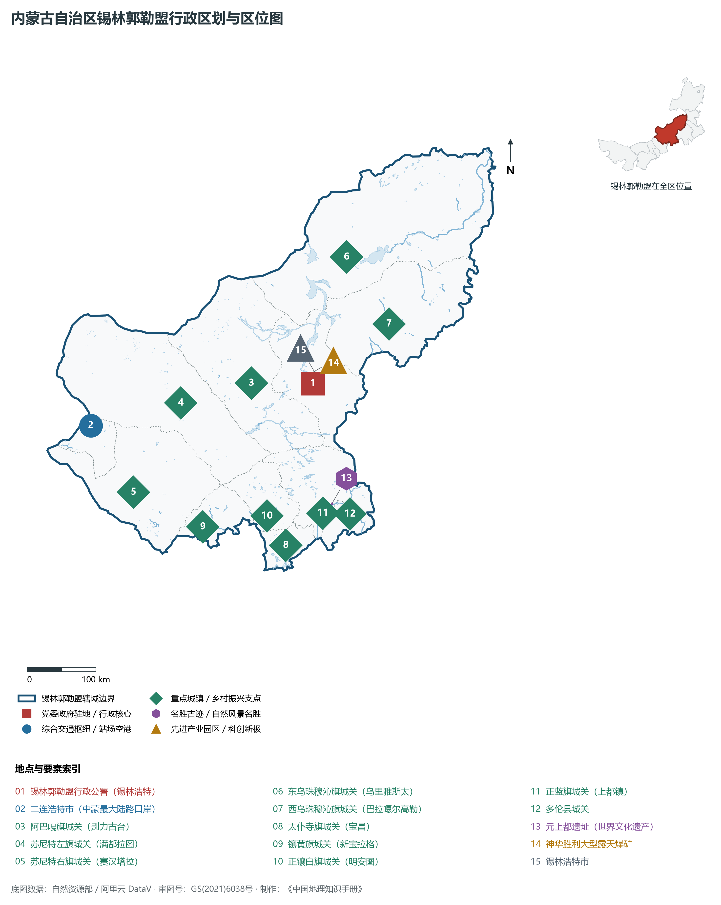
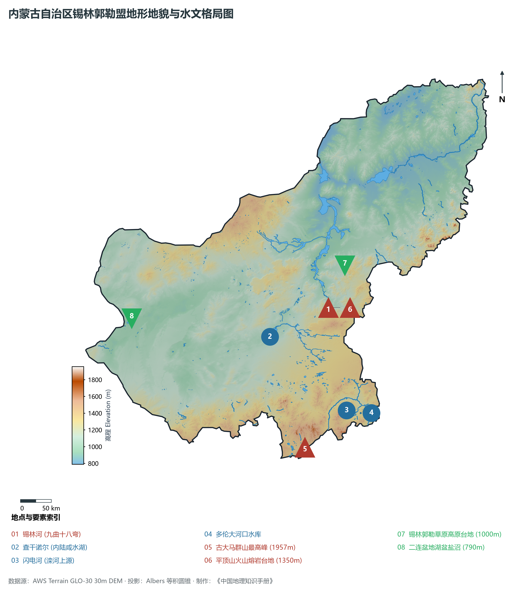
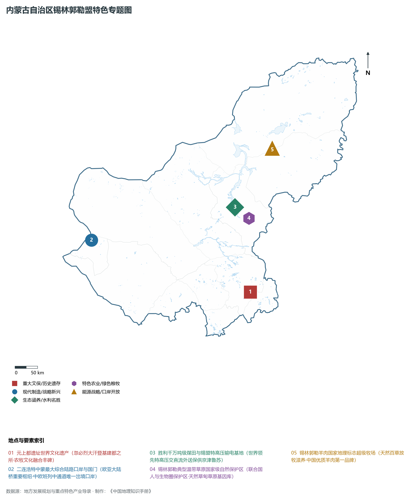
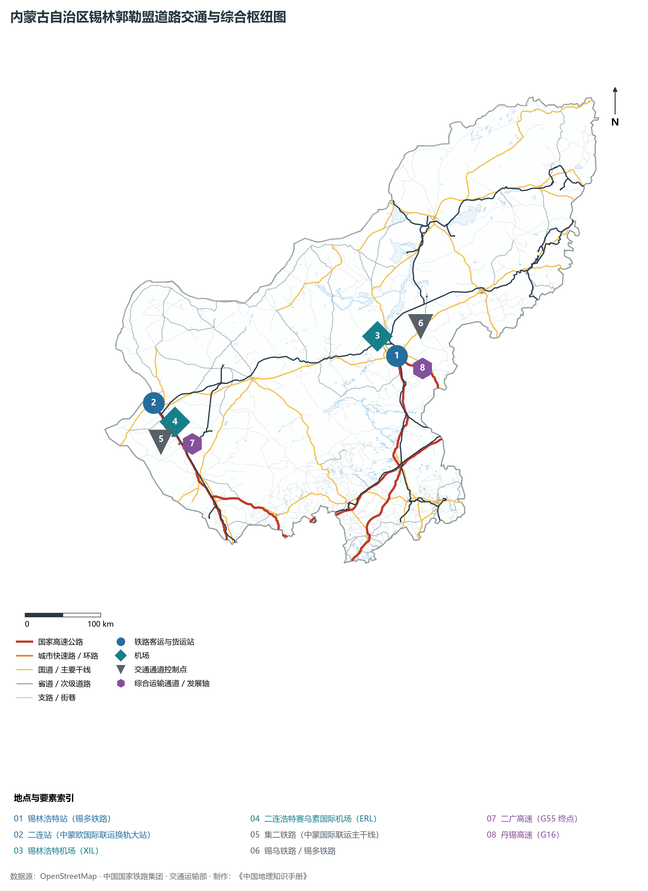
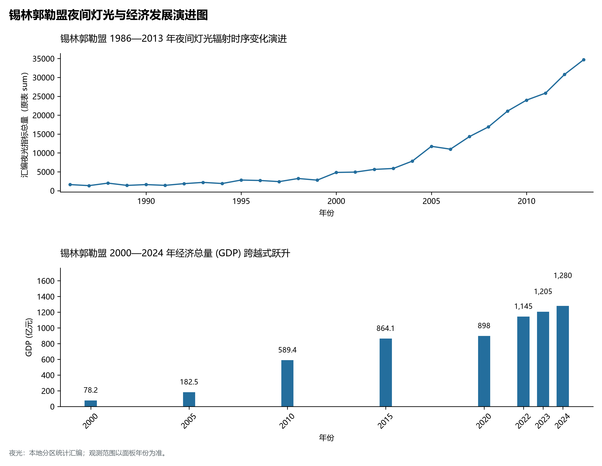

# 29.11 锡林郭勒盟

锡林郭勒，蒙古语意为“高原上的河流”（“锡林”意为高原，“郭勒”意为河流），是内蒙古自治区最具代表性的绿色生态宝库、世界公认的四大天然草原之一、国家大型能源重化工与特高压清洁电能输出基地、我国向北开放的重要陆路大通道前沿。地理坐标介于东经 111°59′—120°00′、北纬 41°35′—46°46′ 之间，地处内蒙古自治区中部偏东。南与河北省张家口市、承德市接壤，西与乌兰察布市交界，东与赤峰市、通辽市、兴安盟毗连，北与蒙古国接壤，国界线长达 **1 103 km**。全盟土地总面积 **202 580 km²**，常住人口达 **111.9 万人**，2024 年地区生产总值（GDP）达到 **1 280.0 亿元**，人均 GDP 突破 **11.4 万元**。

锡林郭勒草原是游牧文明与华夏文明交流融汇的金色圣殿。早在上古时期，东胡、匈奴、鲜卑等北方游牧民族曾在这里弯弓策马；公元 13 世纪中叶，忽必烈大汗在正蓝旗金莲川草原建立开平府，随后定为大元帝国的夏都——**元上都**。元上都见证了游牧文明与农耕文明、中华文明与欧亚世界的宏大交融，作为中国第 30 项世界文化遗产闪耀世界；1957 年，全国第一支“红色文艺轻骑兵”——**乌兰牧骑**在苏尼特右旗诞生，迎风傲雪为广大牧民送去欢歌与党的温暖，成为传扬全国的红色文化旗帜；境内的中蒙最大陆路口岸**二连浩特**，作为百年欧亚大陆桥的关键枢纽和中欧班列中通道的唯一出境口岸，每天满载货物的列车由此疾驰驶向欧亚腹地；在新时代高质量发展征程中，依托神华胜利露天煤矿与千万千瓦级风光大基地，多条“特高压”交直流大动脉源源不断向华北、华东输送绿色电能，享有“黄金草原·光明之源”之美誉。

---

## 一、盟情速览

锡林郭勒盟是内蒙古草原生态王牌、世界级草原文化圣地与全国特高压电力外送核心枢纽。

| 核心指标 | 全盟数值与空间分布 | 全国/全区定位 |
|:---|:---|:---|
| **行政区划面积** | 202,580 km² | 占全区 17.1%，全区第二大盟市，温带草甸与典型草原核心区 |
| **常住人口** | 111.9 万人 (2024 年末)；七普 110.71 万人 | 锡林浩特中心城区集聚超 35 万人口 |
| **常住人口城镇化率** | 75.2% (2024 年) | 牧区城镇化率高，人口沿主要交通轴线与矿区集聚 |
| **人口密度** | 5.5 人/km² | 地广人稀，北部边境苏尼特与东乌珠穆沁低于 2 人/km² |
| **地区生产总值 (GDP)** | 1 280.0 亿元 (2024 年，现价) | 工业与现代能源增加值贡献显著，突破千亿关口 |
| **人均 GDP** | 114 387 元人民币 | 稳居全区前列，人均现代能源与优质畜牧业增加值极高 |
| **产业三次结构** | 16.2 : 51.5 : 32.3 | 现代能源工矿与特色绿色牧业双轮驱动结构 |
| **行政架构** | 辖 2 县级市、9 旗、1 县 | 锡林浩特市、二连浩特市；东/西乌旗、苏尼特左/右旗、阿巴嘎旗、正蓝旗、太仆寺旗、镶黄旗、正镶白旗；多伦县 |
| **边境与口岸** | 边境线 1 103 km；二连浩特与珠恩嘎达布其 | 二连浩特中蒙最大综合陆路口岸、珠恩嘎达布其国际口岸 |
| **战略核心定位** | 国家绿色电力外送基地与世界草原旅游目的地 | 北疆重要生态安全屏障、特高压电力输出基地、“锡林郭勒羊”品牌 |

**图 29-11-1 内蒙古自治区锡林郭勒盟行政区划与区位图**：图上编号与地点、要素索引对应。

---

## 二、自然地理：典型温带高原草原、古火山熔岩台地与锡林河

锡林郭勒盟地势**南高北低、东高西低**，平均海拔在 **1 000 m** 左右，自南向北由丘陵山地过渡为波状高原。

### 1. 地形地貌：浑善达克沙地、火山台地与二连低洼盆地

- **南部古大马群山与燕山北麓山地**：全境最高点位于西南部太仆寺旗与正蓝旗交界的**古大马群山主峰**，海拔 **1 957.0 m**。山地林草葱郁，形成阻隔京津风沙的坚固生态堤坝；
- **中部波状高原与平顶山火山熔岩台地**：锡林浩特周边分布有平顶山等 10 余座典型平顶火山熔岩台地（海拔约 1 350 m），由更新世玄武岩熔岩溢流冷凝形成，台顶平坦如桌面，落差陡峭；
- **浑善达克沙地生态水塔**：中国十大沙漠沙地之一，东西长约 420 km，沙丘与沙地疏林景观独特，是阻挡风沙南侵京津的战略生态锁钥；
- **北部二连内陆微陷盆地**：全境最低地势位于二连浩特北部边境的盐沼低地，海拔仅 **790.0 m**。地表多戈壁、荒漠化草原。

**图 29-11-2 内蒙古自治区锡林郭勒盟地形地貌与水文格局图**：图上编号与地点、要素索引对应。

### 2. 气候特征：温带大陆性半干旱高原草原气候

- **冬冷夏凉、日照充沛**：年平均气温在 **1.5—4.5 ℃** 之间，1 月平均气温 -18 ℃ 至 -23 ℃，极端低温可跌破 -40 ℃；7 月平均气温仅 19—22 ℃，是消夏避暑的理想胜地；
- **年降水量空间梯度**：全盟降水由东向西自 **350—400 mm**（东乌旗、多伦县）递减至 **150 mm** 以下（二连浩特荒漠草原），干旱少雨，蒸发量大（1 800—2 400 mm）。

### 3. 水系格局：锡林河九曲与滦河上源

- **锡林河（九曲十八弯）**：发源于赤峰克什克腾旗西麓，纵贯锡林浩特草原，在平缓草甸间肆意蜿蜒蛇行，如银色缎带飘落碧草之间，被称为“天下第一九曲水”；
- **闪电河与多伦大河口水库**：闪电河（上都河）穿正蓝旗与多伦县入河北，为海河流域滦河上游正源；多伦大河口水库是京津唐防洪涵养与“引滦入津”关键水源地；
- **查干诺尔内陆咸水湖**：阿巴嘎旗与苏尼特左旗交界处的内陆咸水盆地，具重要地质研究与生态调蓄价值。

---

## 三、建置沿革与文化根脉

### 1. 世界文化遗产元上都遗址

- **忽必烈建都与“草原丝路”枢纽**：公元 1256 年忽必烈在此营建开平府，1260 年登基称帝，1263 年升为上都，与大都（北京）实行“两都巡幸”制度达百年之久。意大利旅行家马可·波罗曾游历此地，向欧洲盛赞上都宫殿的宏丽繁华；
- **世界文化遗产价值**：2012 年元上都遗址被列入《世界遗产名录》，城址布局兼具游牧传统与中原礼制轴线规范，是游牧文明与农耕文明融合的登峰造极之作。

**图 29-11-4 内蒙古自治区锡林郭勒盟特色专题图**：图上编号与地点、要素索引对应。

### 2. 乌兰牧骑精神与草原民俗

- **红色文艺轻骑兵乌兰牧骑**：1957 年在苏尼特右旗成立，队员一专多能、轻装简从，常年穿梭于广袤牧区“以天为幕布、以地为舞台”，被习近平总书记赞誉为“全国文艺战线的一面旗帜”；
- **蒙古族十三翼长调与马头琴**：锡林郭勒素有“摔跤健儿之乡”“中国白马之乡”（东乌旗）盛誉，每年举办的那达慕大会尽显游牧豪情。

---

## 四、经济地理：特高压能源基地、优质绿色畜牧业与二连口岸

锡林郭勒盟构筑起“地下有煤电、地上有风光、草上有牛羊、口岸通欧亚”的现代产业格局。

### 1. 胜利煤田与全国特高压电力外送核心基地

- **胜利特大型露天煤矿**：锡林浩特境内的神华胜利煤田探明储量超 200 亿吨，是我国重要的现代化露天开采褐煤基地；
- **锡盟“两交一直”特高压输电通道**：锡盟—山东 1000kV 特高压交流、锡盟—泰州 ±800kV 特高压直流工程投运，年外送清洁电量数百亿千瓦时，成为京津冀与长三角电力的核心保供者。

### 2. “中国优质羊肉第一品牌”与绿色畜牧业

- **“锡林郭勒羊肉”国家地理标志保护产品**：纯天然放牧于 18 万平方公里无污染温带草原，采食沙葱、野韭等上百种中草药牧草，肉质鲜嫩无膻，品牌价值突破百亿元；
- **草原肉牛与传统奶制品**：锡林浩特与多伦县建有现代化乳肉一体化加工基地，正蓝旗察哈尔奶豆腐、镶黄旗传统奶酪成为全国畅销地理标志美食。

### 3. 二连浩特口岸向北开放与沿边产业

- **中欧班列中通道枢纽**：二连浩特口岸进出境中欧班列线路达 70 余条，辐射欧洲十余国，铁矿石、煤炭、木材与机电产品大进大出，边民互贸与加工贸易蓬勃兴盛。

---

## 五、综合立体交通走廊

**图 29-11-3 内蒙古自治区锡林郭勒盟道路交通与综合枢纽图**：图上编号与地点、要素索引对应。

1. **铁路通道**：
   - **集二铁路（集宁至二连浩特）**：跨国铁道大动脉，二连站设有亚洲先进的宽准轨自动换轮列车库与大型集装箱换装场；
   - **锡多铁路与锡乌铁路**：贯穿锡盟东西向与南向出海货运走廊，锡林浩特站与锡林浩特北编组站承担大宗煤电重载运输。
2. **高等级公路网**：
   - **G55 二广高速**：国家纵向主干线北起二连浩特口岸，南直抵广东湛江；
   - **G16 丹锡高速**：横贯锡盟腹地直通辽宁丹东海港；
   - **G1013 海张高速**：打通锡林浩特经太仆寺旗直达张家口、北京的高速通道。
3. **“一盟两场”民航支撑**：
   - **锡林浩特机场（XIL）**：4C 级干线支线机场，开通京、呼、沪、深、沈等多条直飞航线；
   - **二连浩特赛乌素国际机场（ERL）**：中蒙边境重要的空中客运与旅游口岸。

---

## 六、旗县区空间分区与极值矩阵

**图 29-11-5 锡林郭勒盟夜间灯光与经济发展演进图**：各面板按标注的观测年份、指标和单位列示。

| 旗县市区 | 面积 (km²) | 常住人口 (万人) | 2024年GDP (亿元) | 城镇化率 (%) | 核心功能定位与主要地理地标 |
|:---|:---|:---|:---|:---|:---|
| **锡林浩特市** | 14 785 | 35.2 | 390.0 | 85.5% | 盟委行署所在地、胜利露天煤田、锡林河九曲、贝子庙、锡林浩特机场 |
| **二连浩特市** | 4 015 | 7.5 | 88.0 | 92.5% | 中蒙最大综合陆路口岸、国家级重点开发开放试验区、国门、恐龙地质公园 |
| **阿巴嘎旗** | 27 495 | 3.8 | 52.0 | 58.2% | 别力古台祭祀圣地、查干诺尔盐湖湿地、中国策格马奶之乡 |
| **苏尼特左旗** | 34 275 | 3.1 | 45.0 | 59.8% | 纯天然荒漠半荒漠草原、苏尼特羊国家地理标志、边境风能基地 |
| **苏尼特右旗** | 22 372 | 6.6 | 68.0 | 66.5% | 全国第一支乌兰牧骑诞生地、赛汉塔拉、朱日和战术训练基地北缘门户 |
| **东乌珠穆沁旗** | 47 313 | 9.5 | 168.0 | 63.8% | 全盟面积最大旗、乌珠穆沁肥尾羊、乌珠穆沁白马故乡、珠恩嘎达布其口岸 |
| **西乌珠穆沁旗** | 22 960 | 9.8 | 185.0 | 65.2% | 白音华特大型露天煤矿、百里白桦林、蒙古汗城文化景区 |
| **太仆寺旗** | 3 415 | 11.2 | 58.0 | 51.5% | 古大马群山主峰（1957m）、清代皇家御马牧场旧址、融入京津冀前哨 |
| **镶黄旗** | 5 172 | 2.8 | 32.0 | 56.4% | 中国察哈尔服饰文化之乡、内蒙古传统奶制品产业标准化生产基地 |
| **正镶白旗** | 6 229 | 4.2 | 42.0 | 52.6% | 中国科学院国家天文台明安图射电频谱日象仪基地（“明安图之眼”） |
| **正蓝旗** | 10 182 | 7.8 | 72.0 | 55.8% | 世界文化遗产元上都遗址、忽必烈夏都开平府、金莲川湿地草原 |
| **多伦县** | 3 863 | 10.4 | 80.0 | 54.2% | 全盟唯一“县”、多伦诺尔会盟旧址、大河口水库、滦河源头生态涵养区 |
