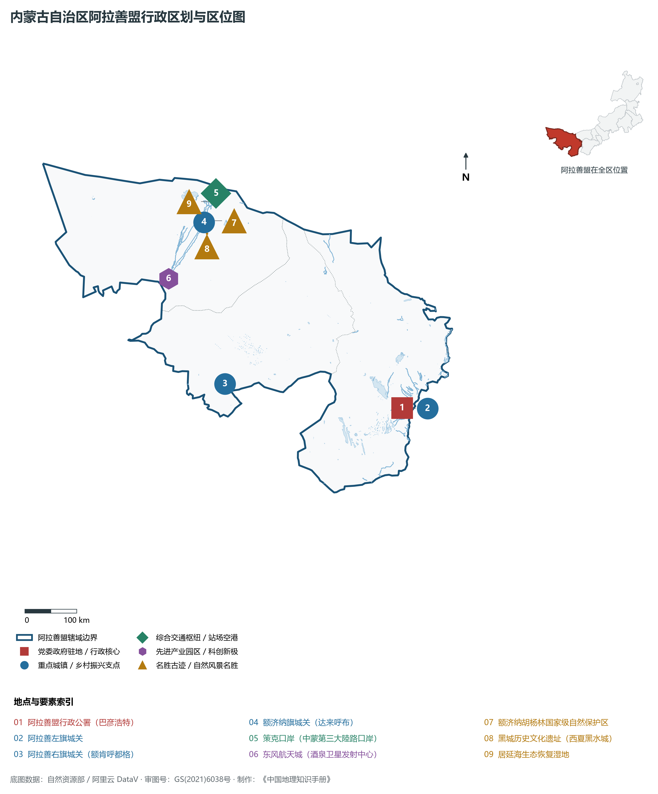
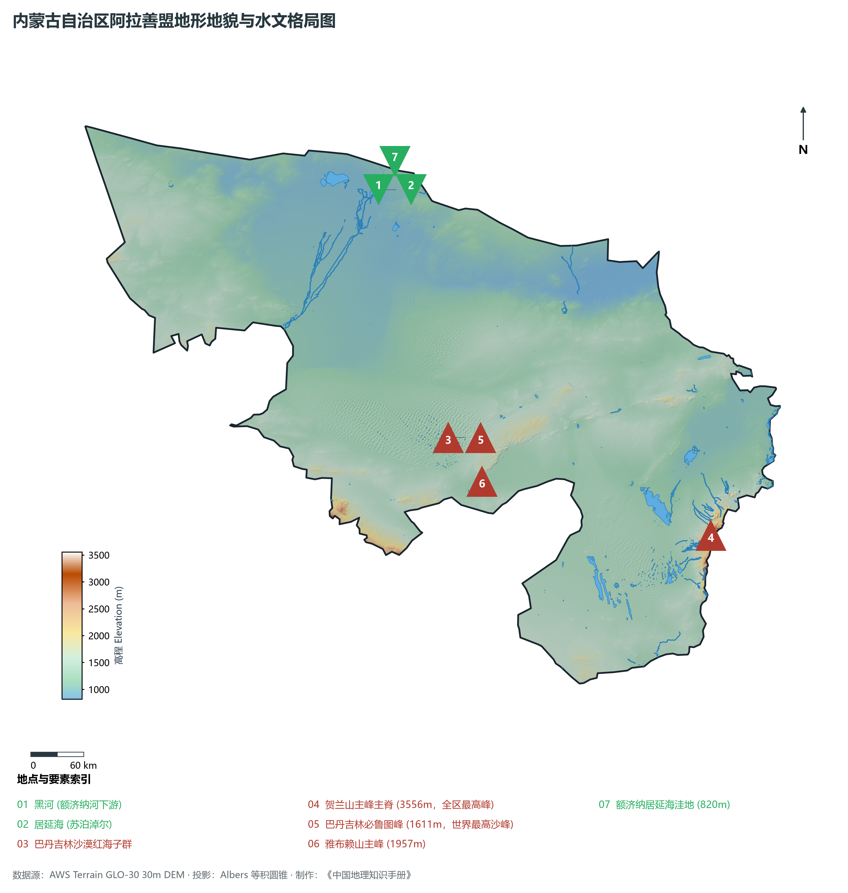
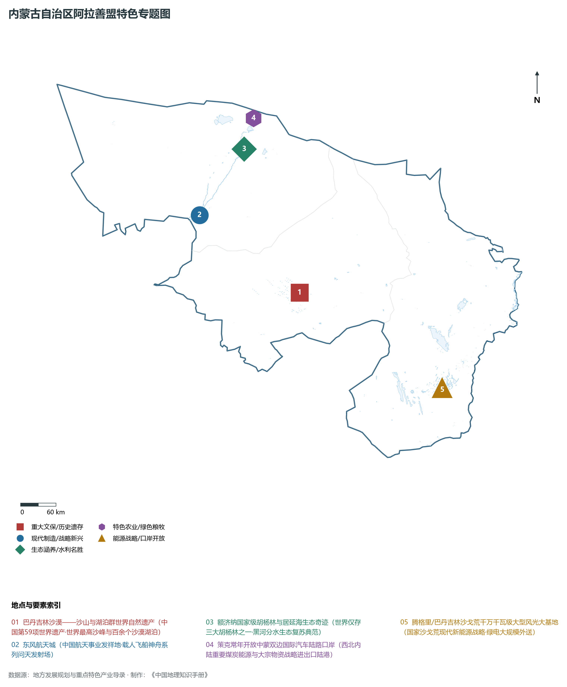
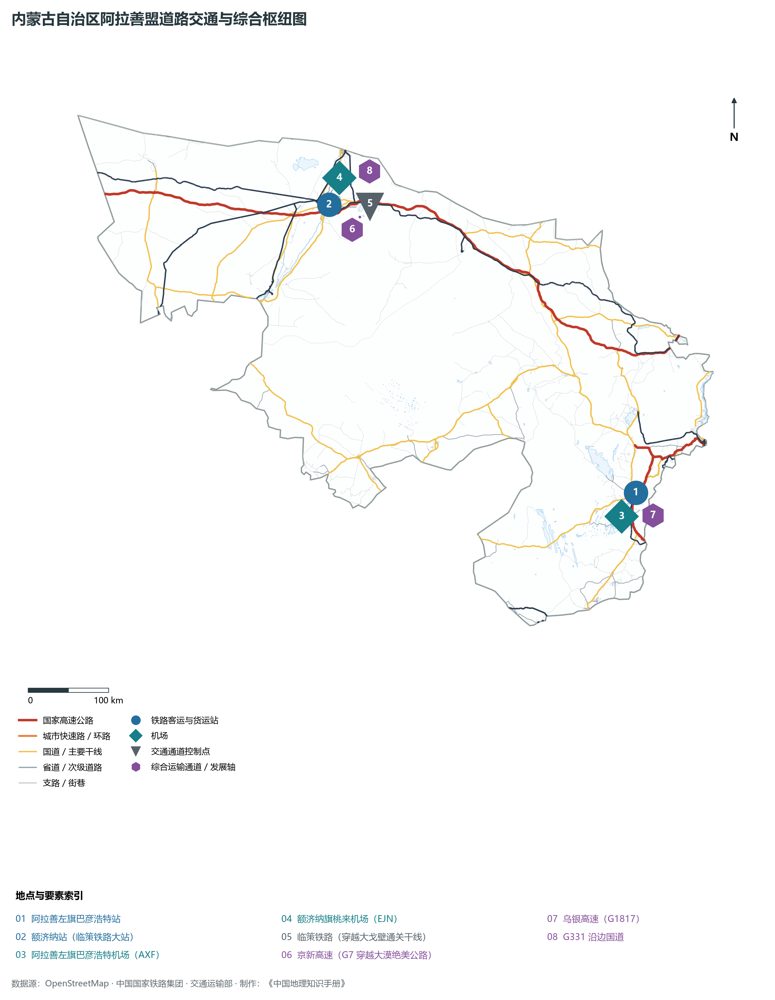
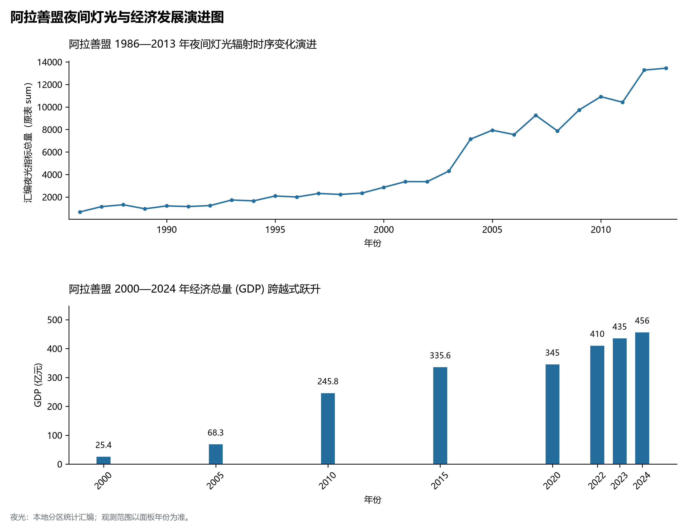

# 29.12 阿拉善盟

阿拉善，蒙古语意为“五彩斑斓的土地”，享有“苍天般的阿拉善”之崇高赞誉，是内蒙古自治区地域面积最辽阔的盟、中国乃至全球荒漠与沙漠地质遗迹的天然露天博物馆、中国载人航天事业的辉煌摇篮——**东风航天城**所在地。地理坐标介于东经 97°10′—106°53′、北纬 37°24′—42°47′ 之间，盘踞内蒙古自治区最西端。东邻乌海市、鄂尔多斯市与巴彦淖尔市，南接宁夏回族自治区石嘴山市、银川市、中卫市以及甘肃省白银市、武威市、金昌市、张掖市、酒泉市，北与蒙古国接壤，国界线长达 **735 km**。全盟土地总面积高达 **270 000 km²**（占全区总面积近四分之一，相当于英国或新西兰全国国土面积），常住人口仅 **26.8 万人**，人口密度仅 **0.99 人/km²**；2024 年地区生产总值（GDP）达到 **456.0 亿元**，人均 GDP 高达 **17.01 万元**（居全区第二，仅次于鄂尔多斯）。

阿拉善是一片充满传奇壮烈与旷世奇绝的地貌圣域。早在新石器时代，曼德拉山岩画就记录下远古游牧先民的生息繁衍；汉武帝时期“列四郡、据两关”，霍去病出酒泉大破匈奴，居延汉简记录下汉代戌边烽燧的浩瀚铁血；西夏时期，黑水城（黑城）作为古丝绸之路北线要塞商旅如织，俄国探险家科兹洛夫发掘的大量珍贵西夏文书震惊世界；1958 年，中国第一个综合导弹卫星发射场在额济纳旗荒原秘境拔地而起（**东风航天城 / 酒泉卫星发射中心**），两弹结合、东方红一号卫星升空，神舟系列载人飞船从这里问天巡穹，书写了中华民族飞天逐梦的丰碑；2024 年 7 月，“**巴丹吉林沙漠——沙山与湖泊群**”成功列入联合国教科文组织《世界自然遗产名录》（中国第 59 项世界遗产），巴丹吉林世界最高沙峰必鲁图峰与沙漠深处 140 余个彩色“海子”交相辉映；每年秋季，额济纳 40 余万亩千年胡杨林金黄如火，“大漠孤烟直，长河落日圆”在此凝练为永恒的塞外史诗。

---

## 一、盟情速览

阿拉善盟是内蒙古面积最大的盟、世界级沙漠自然遗产地、中国航天发射圣地与西北清洁能源重地。

| 核心指标 | 全盟数值与空间分布 | 全国/全区定位 |
|:---|:---|:---|
| **行政区划面积** | 270 000 km² | 占全区 22.8%，全区面积最大盟市，广袤瀚海沙戈荒 |
| **常住人口** | 26.8 万人 (2024 年末)；七普 26.29 万人 | 阿拉善左旗巴彦浩特与高新区集中了超 70% 人口 |
| **常住人口城镇化率** | 83.5% (2024 年) | 全区名列前茅，地广人稀促使人口高度聚集于城镇绿洲 |
| **人口密度** | 0.99 人/km² | 全国内陆最低密度的地级行政区之一，“千顷一绿洲” |
| **地区生产总值 (GDP)** | 456.0 亿元 (2024 年，现价) | 现代盐化工、煤化工、大宗陆路口岸与航天沙漠文旅贡献突出 |
| **人均 GDP** | 170 149 元人民币 | 稳居内蒙古第二位，人均工业产值与大宗贸易极高 |
| **产业三次结构** | 4.8 : 65.5 : 29.7 | 典型的工业主导型经济，第二产业比重超过 65% |
| **行政架构** | 辖 3 旗及高新区等开发区 | 阿拉善左旗、阿拉善右旗、额济纳旗；阿拉善高新技术产业开发区 |
| **边境与口岸** | 边境线 735 km；策克口岸与乌力吉口岸 | 策克口岸为中蒙第三大陆路口岸、国家重要能源进口陆港 |
| **战略核心定位** | 国家空天战略腹地与世界级沙漠地质胜地 | 中国航天发祥地、世界自然遗产、西北大型风光大基地、“苍天般的阿拉善” |

**图 29-12-1 内蒙古自治区阿拉善盟行政区划与区位图**：图上编号与地点、要素索引对应。

---

## 二、自然地理：三大沙漠交织、贺兰极顶与黑河尾闾

阿拉善盟地貌以**高原沙戈荒为主体**，群山环抱、丘陵起伏，平均海拔在 **1 000—1 400 m** 之间。

### 1. 地形地貌：贺兰峰峦、三大沙漠与世界最高沙山

- **贺兰山主峰与全区最高海拔**：全境也是整个内蒙古自治区的最高峰——**贺兰山主峰主脊**位于阿拉善左旗东部边境，海拔达 **3 556.0 m**。山势拔地而起、壁立千仞，宛如巨屏牢牢遮挡腾格里沙漠东侵，截留东南季风降水，庇护了宁夏平原与巴彦浩特绿洲；
- **三大沙漠交汇**：巴丹吉林沙漠（全国第三大）、腾格里沙漠（全国第四大）与乌兰布和沙漠在此汇聚，沙海浩瀚无垠；
- **“沙漠珠峰”必鲁图峰**：巴丹吉林沙漠核心区的**必鲁图峰**海拔 **1 611.0 m**，相对高差达 430 余米，是世界公认的**相对高度最高沙山**；沙山与沙垄间嵌有 140 余个神奇内陆湖泊（海子），高大沙山与湛蓝湖水共生并存，构成全球独一无二的荒漠水文地质奇观；
- **额济纳湖盆洼地与全区最低相对洼槽**：居延海洼地地势低洼平缓，湖面海拔仅 **820.0 m**。

**图 29-12-2 内蒙古自治区阿拉善盟地形地貌与水文格局图**：图上编号与地点、要素索引对应。

### 2. 气候特征：典型温带极端干旱荒漠大陆性气候

- **干旱少雨、蒸发极强**：全盟由东向西年降水量由 200 mm 锐减至额济纳旗的 **35 mm** 左右，而年蒸发量高达 **3 000—3 700 mm**，干燥度极高；
- **日照强、温差大、风能富集**：年日照时数长达 3 100—3 500 小时，昼夜温差常在 15—20 ℃ 以上；冬春两季大风日数多，是全国沙尘暴主要源区之一，同时也是国家极优的太阳能与风能“黄金宝库”。

### 3. 水系格局：黑河尾闾绿洲与神奇沙漠内湖

- **黑河下游与额济纳河**：祁连山冰雪融水汇成黑河，贯穿河西走廊后注入额济纳旗（称额济纳河），分为东河与西河；
- **居延海生态重生奇迹**：居延海是黑河尾闾湖，20 世纪末因上中游过度引水曾一度完全干涸退化；自 2000 年国家实施“黑河跨省区分水”调水战略以来，居延海实现连续 20 余年不干涸，水域面积常年稳定在 40 余平方公里，芦苇丛生、候鸟翔集，创造了干旱内陆河治理的世界生态奇迹；
- **巴丹吉林沙漠红海子与神泉**：沙漠深处富集地下深层自流水，苏木吉林、音德日图等海子中涌出甘甜矿泉，“神泉水不绝、湖泊水长清”。

---

## 三、建置沿革与文化根脉

### 1. 东风航天城：中国载人航天第一发祥地

- **两弹一星与神舟飞天大本营**：1958 年中国在额济纳旗荒原建立第一综合导弹卫星发射试验基地，代号“东风”。1970 年“东方红一号”卫星腾空而起；从 1999 年神舟一号无人飞船，到 2003 年杨利伟乘坐神舟五号飞船首圆中华飞天梦，再到神舟十二号至神舟十九号载人空间站常态化飞行，东风航天城成为全体中国人的骄傲象征与国家级空天名片。

**图 29-12-4 内蒙古自治区阿拉善盟特色专题图**：图上编号与地点、要素索引对应。

### 2. 世界自然遗产与西夏历史文明遗存

- **巴丹吉林沙漠世界自然遗产（2024）**：以极高沙山与密集沙漠湖泊、鸣沙奇观为世界罕见美景，成为全球荒漠科学研究圣地；
- **西夏黑城遗址与居延汉简**：居延遗址出土汉简数万枚，是研究汉代政治、军事与长城戍边的稀世国宝；黑水城古城堡屹立大漠之中，佛塔高耸，是古丝绸之路北线保存最完整的西夏至元代城池。

---

## 四、经济地理：沙戈荒大型风光大基地、特色盐化工与口岸物流

阿拉善盟依托辽阔地域与资源禀赋，加快发展新质生产力与开放型经济。

### 1. 腾格里与巴丹吉林“沙戈荒”亿千瓦级风光大基地

- **国家大型清洁能源基地战略核心**：在广袤荒漠戈壁布局千万千瓦级风电光伏大基地，腾格里沙漠“绿电入湘”等特高压外送通道加速推进，使“大漠阳光”转化为直抵华中腹地的绿色清洁能源；
- **防沙治沙与光伏立体开发**：推行“板上发电、板间治沙、板下固沙”模式，实现生态效益与经济效益双赢。

### 2. 现代盐化工与高新技术产业

- **阿拉善高新区（乌斯太）**：依托吉兰泰盐湖与丰富煤炭资源，形成全球规模领先的金属钠、氯酸钠、精细化工与新材料产业链；
- **阿拉善奇石与沙漠特产**：阿拉善玛瑙碧玉、肉苁蓉（“沙漠人参”）、锁阳、阿拉善双峰驼驼奶粉享誉全国。

### 3. 策克口岸向北开放与现代陆港枢纽

- **中蒙第三大陆路口岸**：策克口岸连通蒙古国南戈壁省，是内蒙古乃至中国西北最大的煤炭进口陆路口岸之一，年通关过货量突破 2 000 万吨，临策铁路开辟跨境能源绿色运输大通道。

---

## 五、综合立体交通走廊

**图 29-12-3 内蒙古自治区阿拉善盟道路交通与综合枢纽图**：图上编号与地点、要素索引对应。

1. **京新高速（G7）：“世界上最长的沙漠公路”**：
   - 穿越巴丹吉林与乌兰布和沙漠边缘，连接北京与新疆乌鲁木齐，全长超 2 500 km，其中穿越荒漠无人区达上千公里，成为大西北横贯东西的黄金经济大动脉；
2. **铁路骨干网络**：
   - **临策铁路（临河至策克）**：横穿巴丹吉林沙漠与戈壁荒原，是策克口岸煤炭疏运的战略铁道大动脉；
   - **包兰铁路与银巴支线**：银川至巴彦浩特铁路支线实现巴彦浩特通火车并接入国家高铁网；
3. **“一盟三场”通勤航空模式**：
   - 阿拉善盟首创全国首个通勤航空试点，建成阿拉善左旗巴彦浩特机场（AXF）、额济纳旗桃来机场（EJN）、阿拉善右旗巴丹吉林机场（RHT），在大漠荒原上筑起快速空中走廊。

---

## 六、旗县区空间分区与极值矩阵

**图 29-12-5 阿拉善盟夜间灯光与经济发展演进图**：各面板按标注的观测年份、指标和单位列示。

| 旗区名称 | 面积 (km²) | 常住人口 (万人) | 2024年GDP (亿元) | 城镇化率 (%) | 核心功能定位与主要地理地标 |
|:---|:---|:---|:---|:---|:---|
| **阿拉善左旗** | 80 412 | 18.6 | 285.0 | 85.2% | 盟行署所在地（巴彦浩特镇）、贺兰山主峰（3556m）、腾格里沙漠、越野e族英雄会、定远营古城 |
| **阿拉善右旗** | 73 164 | 2.4 | 68.0 | 76.5% | 巴丹吉林沙漠世界自然遗产核心区、必鲁图峰（1611m）、曼德拉山古代岩画、双峰驼繁育基地 |
| **额济纳旗** | 114 606 | 3.5 | 85.0 | 86.8% | 全区面积最大旗县、东风航天城（酒泉卫星发射中心）、额济纳千年胡杨林、居延海、策克口岸、黑城遗址 |
| **阿拉善高新区** | 2 300 | 2.3 | 118.0 | 96.5% | 乌斯太国家级现代盐化工与精细化学品基地、黄河沿岸现代工业聚集示范区 |
