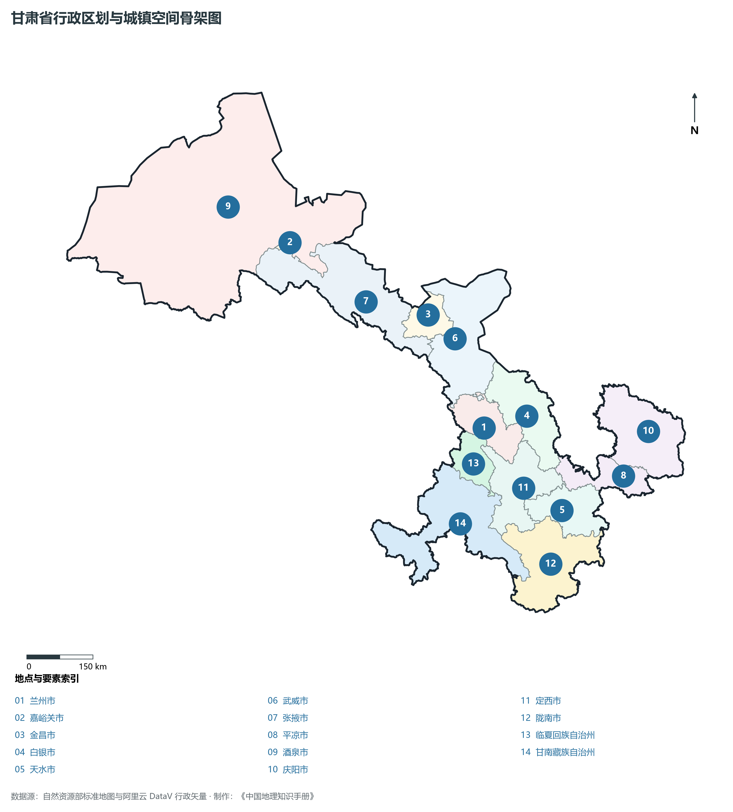
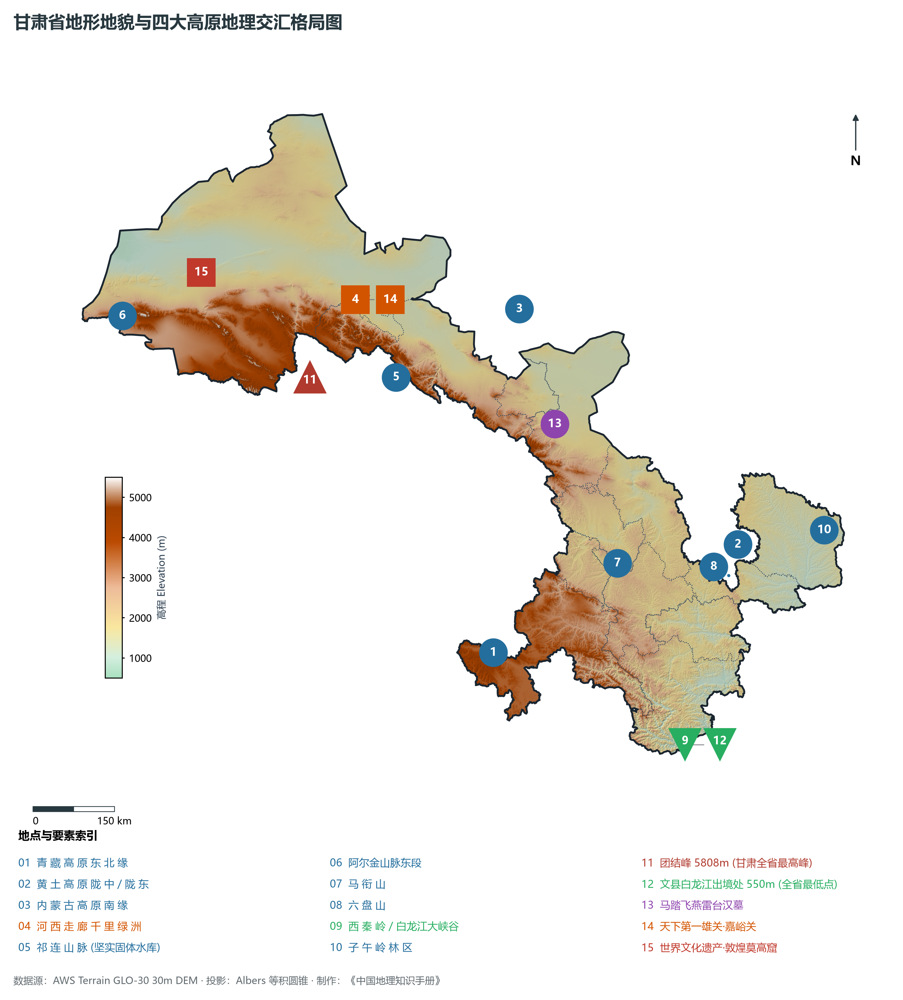
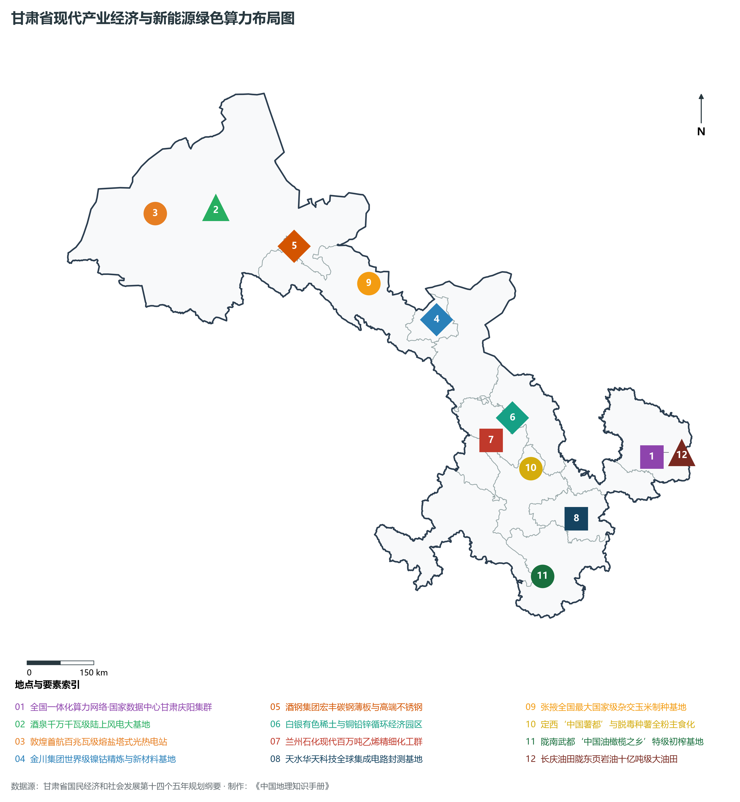
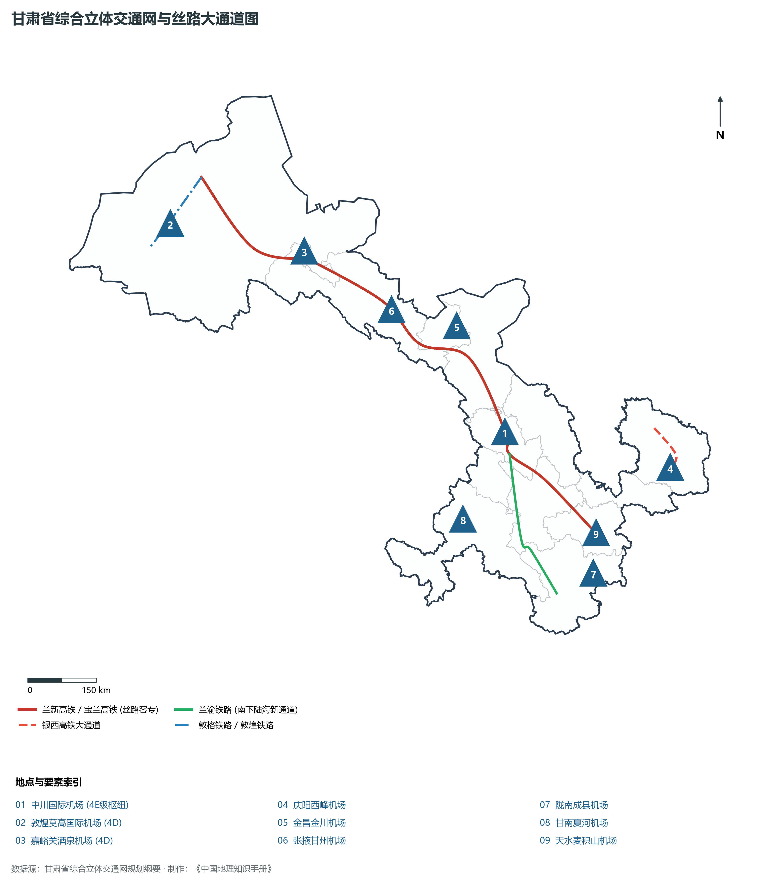
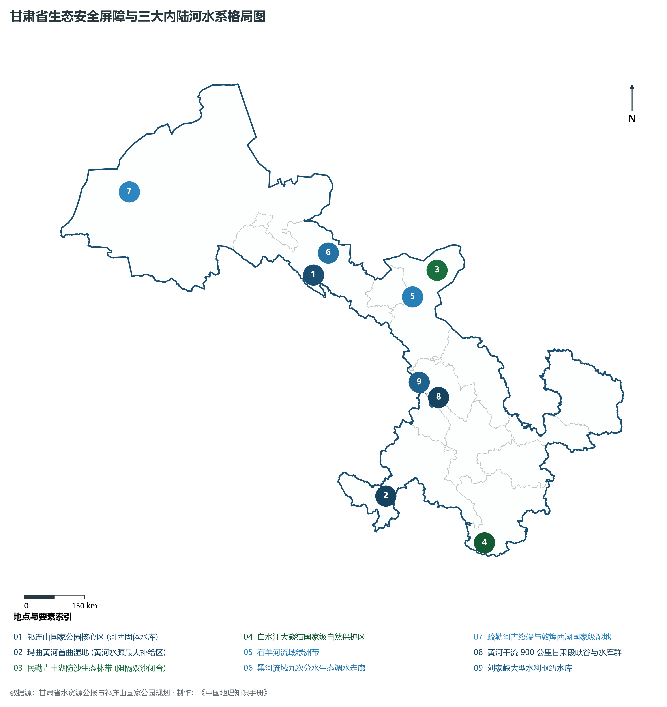

# 30.0 甘肃省地理统揽

在中国版图的宏伟腹地，甘肃省宛如一柄金碧交辉、斜倚西北的“如意”瑰宝——其首枕于陇东深厚黄土大塬，其柄蜿蜒于巍巍祁连与大漠戈壁之间的河西走廊，自东南向西北绵延逾 **1 600 km**。地理坐标介于东经 92°13′—108°46′、北纬 32°11′—42°57′ 之间，地跨亚热带、暖温带、中温带与青藏高原高寒区四大热量气候带，同时衔接湿润、半湿润、半干旱与极端干旱四大干湿气候区。甘肃是我国最重要的地缘与生态复合战略走廊，是黄土高原、青藏高原、内蒙古高原与秦岭山系四大宏大地理单元交融汇聚的枢纽中枢，更是横贯欧亚大陆、通达中西亚古丝绸之路的历史咽喉与新时代共建“一带一路”向西开放的黄金通道。全省土地总面积 **42.58 万 km²**（位居全国第七位），下辖 12 个地级市与 2 个自治州（共 14 个地级行政单元），2024 年末常住人口达 **2 465.0 万人**，2024 年全省地区生产总值（GDP）达到 **13 002.9 亿元**（按不变价格计算同比增长 5.8%，增速居全国前列）。

甘肃是一部刻写在崇山峻岭与戈壁大漠间的中华文明宏伟史诗。早在远古时期，秦安大地湾遗址便燃起了八千年前的农耕薪火，马家窑文化以灵动飘逸的漩涡纹与水波纹将史前彩陶艺术推向巅峰；华夏人文始祖伏羲画八卦、启文明，天水由此享有“羲皇故里”之誉；周先祖不窋、公刘在陇东庆阳董志塬教民稼穑，奠定了厚重悠久的周秦农耕基业；秦人先祖在西汉水畔的陇南礼县垂钓放牧、繁衍生息，“秦起西陲”由此筑牢一统天下的霸业基石；汉武帝元狩二年（前 121 年），骠骑将军霍去病两度出陇西大破匈奴，汉王朝在此依序设立“河西四郡”——**武威**（彰显武功军威）、**张掖**（张国臂掖以通西域）、**酒泉**（城下有泉其水若酒）、**敦煌**（敦者大也、煌者盛也），凿通古丝绸之路陆路大动脉；张骞凿空、玄奘西行、班超投笔、鸠摩罗什驻锡凉州，东西方文明在莫高窟的崖壁上璀璨激荡千年；明初于走廊西狭筑天下第一雄关——嘉峪关，奠定西陲咽喉锁钥；长征时期，红军长征在陇南哈达铺作出奔赴陕北的伟大战略决策，红军三大主力在白银会宁实现胜利大会师，写下了震古烁今的革命壮歌；新中国成立初期，玉门油田被誉为“中国石油工业的长子”，兰州石化崛起为西北最大的重化工基地，刘家峡水电站铸就“万里黄河第一坝”；走进新时代，国家首个千万千瓦级风电大基地在酒泉戈壁拔地而起，“东数西算”全国一体化算力网络甘肃庆阳集群澎湃运行，金张掖制种玉米守护国家粮食种业安全，甘肃正以“绿色赋能、丝路再兴”的宏伟姿态，挺立于祖国大西北的壮美天地。

---

## 一、省情速览

甘肃省是我国西北地区向西开放的战略门户、国家重要的生态安全屏障、现代综合能源大基地与国家战略矿产资源保障区。

| 核心指标 | 全省数据 | 全国位次 / 占比 / 特征 |
|:---|:---|:---|
| **土地总面积** | 425 800 km² | 全国第 7 位（占全国陆地面积约 4.4%） |
| **常住人口 (2024)** | 2 465.0 万人 | 兰州、天水、定西、陇南为全省人口稠密大市 |
| **常住人口城镇化率** | 56.5% | 嘉峪关市最高（94.2%），兰州市超 84.5% |
| **地区生产总值 (GDP)** | 13 002.9 亿元 (2024) | 突破 1.3 万亿元大关，连续多年增速位居全国前列 |
| **人均 GDP** | 52 750 元 | 金昌市（超 14 万元）、嘉峪关市（超 12 万元）领跑全省 |
| **三次产业结构** | 12.8 : 34.2 : 53.0 | 现代工业与特色农业、现代服务业协同跃进 |
| **地貌最高点 / 最低点** | 团结峰 5 808 m / 文县白龙江河谷 550 m | 相对垂直高差高达 5 258 m，居北方各省前茅 |
| **森林覆盖率 / 草原面积** | 11.33% / 1 790 万公顷 | 祁连山林区、白龙江林区与甘南草原核心生态屏障 |
| **绿色能源装机** | 风光新能源装机超 6 000 万千瓦 | 新能源装机占比超 60%，全国首批绿色电能外送省份 |

**图 30-00-2 甘肃省行政区划与城镇空间骨架图**：图上编号与地点、要素索引对应。

---

## 二、自然地理：四大高原交汇与祁连山生态水塔

**图 30-00-1 甘肃省地形地貌与四大高原地理交汇格局图**：图上编号与地点、要素索引对应。

### 1. “两屏三带”与四大地理单元交织
甘肃地形极其复杂奇峻，整体呈西北至东南狭长的“玉如意”形态，海拔极差达到惊人的 **5 258 m**：

- **祁连山高山冰冻圈（西部生命水塔）**：横亘于河西走廊南侧，冰川雪峰绵延千余公里，最高峰团结峰（5 808 m）终年积雪，发育了千余条现代冰川，是石羊河、黑河、疏勒河河西三大内陆河的天然固体蓄水库；
- **河西走廊戈壁绿洲带（丝路咽喉廊道）**：东西长约 1 000 km、宽数公里至百余公里不等，祁连山冰雪融水汇入山前冲积扇与平原，滋养了武威、张掖、酒泉、敦煌等连珠成串的富庶绿洲；
- **陇中—陇东黄土高原（千沟万壑与天下大塬）**：渭河、泾河干支流深度侵蚀切割，地形破碎，拥有天下面积最大、土层最深厚的董志塬，以及经过数十年梯田工程治理的“大地指纹”；
- **甘南高原与西秦岭山地（高寒草甸与陇上江南）**：西南部甘南高原地处青藏高原东缘，平均海拔在 3 000 m 以上，水草丰美；南部陇南文县、武都则深切入白龙江、白水江峡谷，年均气温高、降水丰沛，生长着亚热带常绿阔叶林与高山竹林。

### 2. 四大干湿带与复杂微气候矩阵
甘肃横跨中温带、暖温带、北亚热带与高原高寒带：

- **年降水量极差悬殊**：陇南东南端文县、康县年降水量高达 800—1 000 mm，气候温润潮湿；而西北端敦煌与瓜州年降水量不足 50 mm，蒸发量却高达 2 500 mm 以上；
- **季风与西风的拉锯分界**：乌鞘岭（3 562 m）是东亚季风到达的最西北边界，岭东受夏季风润泽，岭西则深陷干旱干寒的西风内陆环流。

---

## 三、建置沿革与丝路文明根脉

甘肃之名取自古代**甘州**（今张掖）与**肃州**（今酒泉）之首字，元代设立甘肃行中书省，标志着甘肃作为省级独立建置之始。

1. **先秦农耕与秦人崛起**：八千年前大地湾先民烧造彩陶、种植黍稷；周祖不窋在庆阳开辟农耕制度；秦非子在天水、礼县为周孝王牧马受封“秦赢”，开启从陇山走向咸阳的崛起序章；
2. **两汉开拓与河西四郡**：汉武帝元狩二年击退匈奴，筑汉长城、设河西四郡与阳关、玉门关，“列四郡、据两关”，丝路贸易商旅不绝、使者相望于道；
3. **魏晋隋唐多元文化大熔炉**：莫高窟千佛现壁、麦积山东方雕塑馆绝壁造像、炳灵寺石窟飞天展翅、天梯山石窟首开北凉模式；玄奘由凉州出境历尽险阻取经天竺；
4. **明清锁钥与近现代长征会师**：明代重修嘉峪关、山海关两端长城体系；左宗棠抬棺西征收复新疆，沿途在河西走廊植柳数千里（“左公柳”）；1936 年 10 月红一、二、四方面军在会宁胜利会师，奠定革命根据地大本营；
5. **当代战略重镇**：一五计划期间兰州石化、白银有色、酒泉钢铁奠定工业骨架；酒泉卫星发射中心与东风航天城托举中国航天问天之路。

---

## 四、经济地理与绿色能源算力枢纽

**图 30-00-4 甘肃省现代产业经济与新能源绿色算力布局图**：图上编号与地点、要素索引对应。

### 1. “大国重器”与战略有色冶金新材料

- **祖国镍都·金昌金川集团**：拥有世界第三大硫化铜镍矿床，镍、钴产量居全国第一位，高纯金属材料应用于航空航天与量子计算；
- **钢城·酒钢集团**：西北最大碳钢与不锈钢生产基地，核电用钢、锌铝镁镀层光伏支架板市场占有率全国领先；
- **铜城白银与稀土基地**：白银有色集团铜铅锌循环经济园区与甘肃稀土新材料基地，构建起有色金属高端精深加工产业链；
- **集成电路封测高地·天水华天科技**：封装测试规模位列全国前三、全球前列，成为我国半导体产业链的坚实支柱。

### 2. 国家新能源综合基地与“东数西算”战略引擎

- **酒泉全国首个千万千瓦级风电基地**：河西走廊变身为“陆上三峡”，玉门、瓜州风机连绵成海，首航高原型熔盐塔式光热电站成为超级绿色奇观；
- **庆阳国家数据中心算力集群**：全国“东数西算”八大枢纽节点之一，数字经济与绿色能源协同，算力规模破万 PFlops，承接东部海量实时算力需求；
- **特高压外送电力通道**：酒泉至湖南 ±800 千伏特高压直流输电工程，源源不断将祁连走廊的“风光绿电”直送华中腹地。

### 3. 高原特色农业与“甘味”知名品牌

- **全国最大杂交玉米制种基地（张掖）**：供种量占全国大田玉米用种量的三分之一以上，坚决筑牢国家“种业芯片”防线；
- **中国薯都与千年药乡（定西）**：马铃薯脱毒种薯全国领跑，岷县当归、陇西黄芪享誉“天下药仓”；
- **高原夏菜与特色果林**：兰州百合与榆中高原夏菜西菜东调，天水花牛苹果、静宁苹果、武都油橄榄均列入国家地理标志保护产品。

---

## 五、综合立体交通与陆桥大通道

**图 30-00-3 甘肃省综合立体交通网与丝路大通道图**：图上编号与地点、要素索引对应。

1. **“八纵八横”高铁网陆桥主通道**：徐兰—兰新高铁横贯全省 1 600 余公里，自天水、定西、兰州穿祁连山隧道至张掖、酒泉、嘉峪关出境入疆，实现全线动车组飞驰；
2. **横贯南北的大动脉**：银西高铁连通庆阳与西安、银川；兰渝铁路穿越崇山峻岭南下重庆，打通西部陆海新通道陆路出海主干线；兰张三四线高铁贯通武威；
3. **高速公路网骨干**：连霍高速（G30）、京藏高速（G6）、青兰高速（G22）、福银高速（G70）四通八达，县县通高速目标全面实现；
4. **“一枢纽八支线”民航布局**：以兰州中川国际机场（4E 级）为核心枢纽，敦煌莫高、嘉峪关酒泉、庆阳、金昌、张掖、陇南、甘南夏河、天水等支线机场构筑起覆盖全省的空中丝路桥梁。

---

## 六、生态安全屏障与大江大河大湖治理

**图 30-00-5 甘肃省生态安全屏障与三大内陆河水系格局图**：图上编号与地点、要素索引对应。

1. **祁连山国家公园体制试点**：坚决守护河西走廊生命线，全面退出矿山与违法水电，恢复冰川水源涵养林，雪豹、白唇鹿等旗舰野生动物种群显著增长；
2. **黄河上游生态水源涵养区（玛曲湿地）**：黄河在甘南玛曲画出“天下黄河第一弯”，流入玛曲湿地为黄河干流补充了约 40% 的径流量，被称为黄河的“蓄水池”；
3. **三大内陆河精准分水生态奇迹**：
   - **黑河**：实行跨省跨区域科学调度，干流连续二十余年向内蒙古居延海实施生态输水，东居延海重现百平方公里浩渺碧波；
   - **石羊河**：实施重点流域流域综合治理，民勤青土湖地下水位回升并形成大面积水面，成功阻隔了腾格里与巴丹吉林两大沙漠合拢；
   - **疏勒河**：修复敦煌西湖湿地与玉门关周边植被，古河道重漾生机。

---

## 七、十四市州空间分工与发展格局

甘肃省统筹构建“一核三带”区域发展格局：

| 发展板块 | 涵盖市州 | 面积 (km²) | 2024 GDP (亿元) | 核心功能定位与主要地理地标 |
|:---|:---|:---|:---|:---|
| **兰白核心都市圈** | 兰州市、白银市 | 33 185 | 4 362.0 | 全省政治经济文化科教极核、国家级兰州新区、现代重化工业与稀土新材料高地 |
| **河西走廊经济带** | 酒泉、嘉峪关、张掖、金昌、武威 | 269 457 | 3 402.0 | 千里丝路绿洲走廊、千万千瓦风电光伏大基地、世界文化遗产莫高窟与现代有色冶金 |
| **陇东综合能源带** | 庆阳市、平凉市 | 38 444 | 1 895.0 | 陇东综合能源基地、董志塬黄土大农业、东数西算庆阳国家枢纽与平凉煤电化基地 |
| **陇东南特色产业带** | 天水市、陇南市、定西市 | 61 858 | 2 180.0 | 羲皇故里、麦积山东方雕塑馆、中国薯都中药材大市场与陇上江南油橄榄基地 |
| **甘南临夏民族经济区** | 临夏州、甘南州 | 46 690 | 740.0 | 黄河首曲水源涵养地、拉卜楞寺、炳灵寺石窟、刘家峡水电站与特色文化生态旅游区 |
