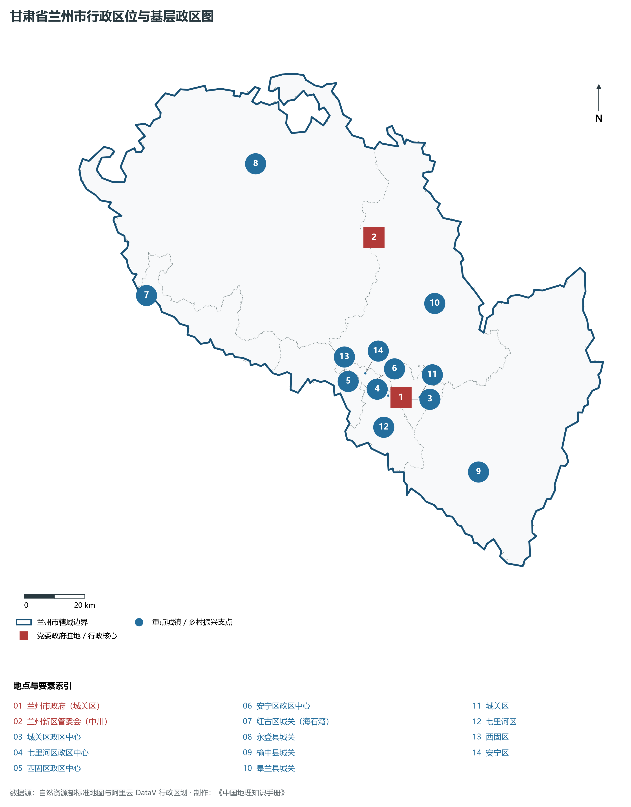
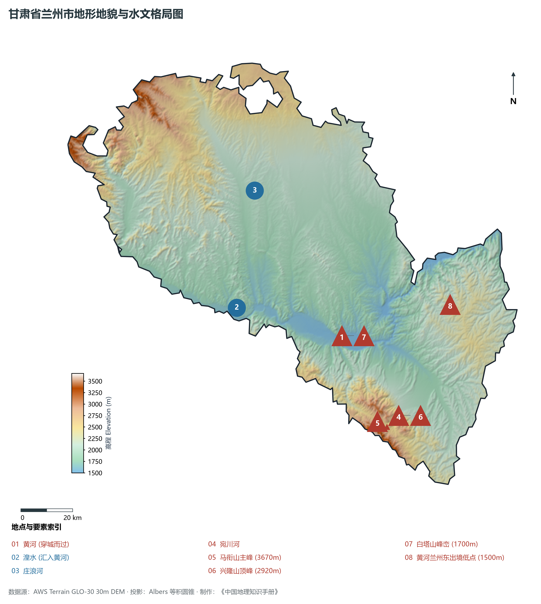
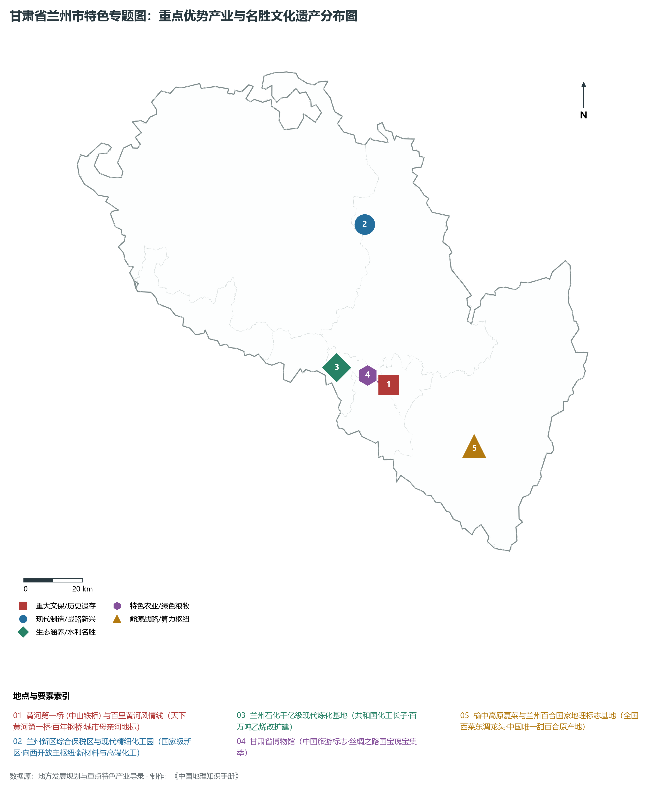
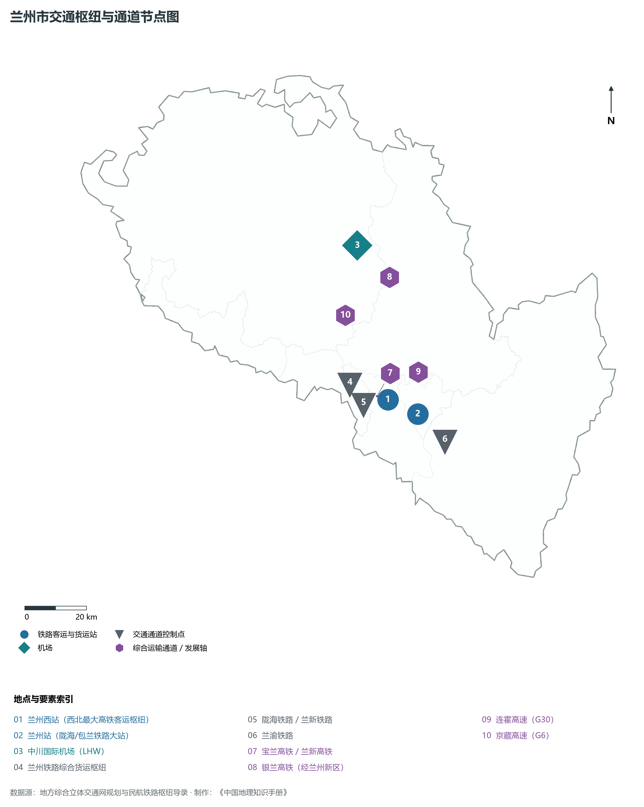
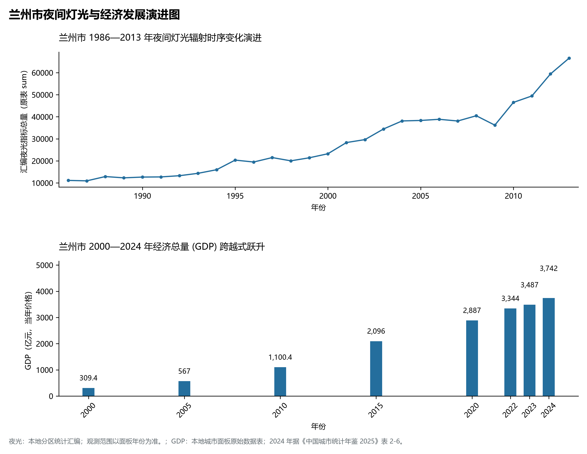

# 30.1 兰州市

兰州市。2024 年常住人口 **444 万人**，常住人口城镇化率 **85.83%**，地区生产总值 **3,742 亿元**（当年价格），人均地区生产总值 **84,460 元**，三次产业构成为 **2 : 33.15 : 64.85**。

兰州是一座沉淀了两千余年金戈铁马与水陆交融的塞上雄城。早在秦汉之际，这里便是连接中原与西域、青藏高原与蒙古高原的交通枢纽与渡口咽喉；西汉昭帝始元六年（前 81 年）设金城县，取“金城汤池”坚不可摧之意；十六国时期西秦在此建都；隋开皇元年（581 年）废郡置州，因城南白塔山与皋兰山对峙而首度设立“兰州”；明清时期，兰州成为陕甘总督府驻地与西北边陲防务指挥枢纽；光绪年间，陕甘总督左宗棠在此创办兰州制造局与兰州织呢局，点燃西北近代民族工业的曙光；宣统元年（1909 年），横跨黄河两岸的中山铁桥落成，赢得了“天下黄河第一桥”的世纪美誉；“一五”时期，国家在此集中布局兰州石化、兰州炼油厂等一批苏联援建“156 项”重点工程，使兰州一举成长为新中国重型工业体系中的“石化长子”；新时代以来，全国第五个国家级新区——**兰州新区**在秦王川盆地拔地而起，宝兰高铁、兰新高铁、银兰高铁与中欧班列纵横交织，兰州百合与高原夏菜名扬全国，百里黄河风情线如诗如画，兰州正加速成长为黄河流域高质量发展与新时代西部大开发的先锋旗舰城市。

---

## 一、市情速览

兰州市是甘肃省经济体量最大、人口集聚度最高、创新要素最密集的大城市，综合功能承载力稳居西北前茅。

| 核心指标 | 全市数值与空间分布 | 全国 / 全省战略定位 |
|:---|:---|:---|
| **行政区划面积** | 13 086 km² | 黄河河谷盆地占 20%，山地与黄土梁峁占 80% |
| **常住人口** | 444 万人 | 2024 年，全市；年鉴公布口径 |
| **常住人口城镇化率** | 85.83% | 2024 年，全市；年鉴公布口径 |
| **人口密度** | 338 人/km² | 中心城区高达 4 500—8 000 人/km²，山区低于 80 人/km² |
| **地区生产总值 (GDP)** | 3,742 亿元 | 2024 年，全市；年鉴公布口径 |
| **人均 GDP** | 84,460 元/人 | 2024 年，全市；年鉴公布口径 |
| **产业三次结构** | 2.1 : 33.2 : 64.7 | 服务业占主导地位，现代石化装备与数字经济稳步跃升 |
| **行政区划架构** | 辖 5 区、3 县、1 国家级新区 | 城关、七里河、西固、安宁、红古 5 区；永登、榆中、皋兰 3 县；兰州新区 |
| **核心战略定位** | 黄河上游特大城市与向西开放枢纽 | 国家石化基地、丝绸之路经济带核心节点、兰西城市群核心 |

**图 30-01-1 甘肃省兰州市行政区位与基层政区图**：图上编号与地点、要素索引对应。

---

## 二、自然地理：两山夹一河、秦王川盆地与百里黄河风情线

兰州市地处青藏高原向黄土高原过渡带，整体地势西南高、东北低，地貌表现为“狭长盆地串联、黄河切穿峡谷、高山梁峁环绕”。

### 1. 地形地貌：皋兰山与白塔山对峙的河谷盆地
全境地貌可划分为黄河河谷盆地、秦王川山间平原与高山丘陵三大地貌单元：

- **黄河穿城河谷峡谷盆地**：东西长约 40 km、南北宽约 2—8 km，海拔普遍在 **1 500—1 600 m**。黄河自西向东劈山穿峡流过，南依皋兰山与阿干镇丘陵，北峙白塔山与九州台。河谷阶地平坦，形成了由西向东串珠分布的西固平原、安宁平原、七里河平原与城关平原；
- **秦王川黄土剥蚀堆积平原**：位于市区以北约 50 km 的永登县与皋兰县交界处，海拔在 **1 900—2 100 m** 之间，地域辽阔平坦，面积达数万公顷，是甘肃内陆罕见的成片开阔平地，为国家级兰州新区提供了极其宏阔的城市拓展空间；
- **外围高中山区**：全境最高峰位于市区东南部的榆中县**马衔山主峰**，海拔高达 **3 670.0 m**，山顶终年低温，发育有第四纪冰川遗迹与高山草甸；黄河自榆中县青城出境处海拔仅 **1 500.0 m**，全境相对高差达 **2 170 m**。

**图 30-01-2 甘肃省兰州市地形地貌与水文格局图**：图上编号与地点、要素索引对应。

### 2. 气候特征：温带半干旱大陆性季风气候
兰州光热资源丰富，降水偏少，夏无酷暑，冬无严寒：

- **气温与温差**：年平均气温在 **10.3—11.2 ℃** 之间，1 月平均气温 -5.3 ℃，7 月平均气温 22.4 ℃，夏季由于地处峡谷且海拔较高，气候凉爽舒适，是西北知名的避暑之都；昼夜温差常年达 12—15 ℃；
- **降水时空分异**：年降水量约 **320—360 mm**，70% 以上集中在 7—9 月，蒸发量高达 1 400 mm 以上。

### 3. 河流水系：母亲河干流与引大入秦宏伟水利
兰州是黄河流域的核心水利枢纽：

- **黄河干流过境**：黄河在兰州市境内流长约 **152 km**，年平均径流量超 300 亿立方米，水流穿城激荡，孕育了以中山桥、水车博览园为代表的“百里黄河风情线”；
- **主要支流**：湟水（红古海石湾汇入）、庄浪河（纵贯永登）、宛川河（流经榆中）等，为河谷阶地提供丰富水源；
- **引大入秦超级工程**：引大通河水跨流域输往秦王川盆地，总干渠与分干渠长达数百公里，穿山隧洞密布，将千年干旱荒原浇灌成现代生态绿洲与新区工业基地。

---

## 三、建置沿革与文化根脉

兰州是多元丝路文化与黄河水运文明交融的璀璨结晶。

### 1. 汉置金城与丝路黄河古渡

- **金城关与丝路重驿**：西汉设金城郡，因地势险固而得名。汉唐时期，金城是丝绸之路南道、中道跨越黄河西去凉州与青海的必经要冲，留下了“西出阳关无故人、东过金城有大渡”的商旅盛景；
- **左宗棠督陕甘与近代实业**：清末陕甘总督部院设于城关，左宗棠设兰州制造局造枪炮、修黄河水利、植左公柳，推动西北近代化进程；
- **中山铁桥（天下黄河第一桥）**：1909 年由德国泰来洋行设计施工建造，全长 234 m，铁桁凌空、飞架南北，见证了兰州百余年沧桑巨变。

### 2. 国宝瑰宝与陇原文脉汇聚

- **甘肃省博物馆与“铜奔马”**：甘肃省博物馆坐落于七里河区，珍藏有中国旅游标志——武威雷台汉墓出土的东汉青铜器“铜奔马”（马踏飞燕）、汉代简牍与元代彩陶，代表了丝路文物艺术的最高水准；
- **金城黄河文化与非遗牛肉面**：兰州牛肉面享有“中华第一面”美誉，讲究“一清二白三红四绿五黄”，已走向全球数十个国家；兰州水车与羊皮筏子则是黄河古老水运文明的鲜活化石。

**图 30-01-4 甘肃省兰州市特色专题图：重点优势产业与名胜文化遗产分布图**：图上编号与地点、要素索引对应。

---

## 四、经济地理：现代石化长子、先进装备制造与新质算力引擎

兰州依托雄厚工业底蕴，坚决推进重工业绿色低碳转型，构建起以现代石化、生物医药、新材料、装备制造和数字经济为主导的现代化产业体系。

### 1. 现代石化与高端化学品新基地

- **兰州石化公司转型跨越**：作为新中国第一套催化裂化装置、第一座合成橡胶厂所在地，兰州石化近年来全面实施百万吨乙烯改扩建与减油增化工程，医用聚烯烃、高端合成橡胶与超高分子量特种树脂打破国外垄断；
- **兰州新区精细化工园区**：承接东部先进化工产业转移，规划建设超大规模绿色低碳精细化工大基地，重点发展医药中间体、电子化学品与新能源电池材料。

### 2. 先进装备与重离子肿瘤治疗装置

- **重离子科技国之重器**：中科院近代物理研究所自主研发的医用重离子加速器肿瘤治疗装置在兰州成功应用，技术指标达到世界顶尖水平，构建起以重离子医疗为核心的高端医疗器械产业集群；
- **重型装备与真空技术**：兰石集团（“中国石化机械摇篮”）、兰州真空等龙头企业在超深钻机、炼化承压容器领域技术实力领先。

### 3. 高原夏菜与兰州百合国家地理标志

- **高原夏菜西菜东调龙头**：榆中县地处冷凉高地，产出的甘蓝、菜花、娃娃菜品质极佳，直供粤港澳大湾区与长三角，年交易量数百万吨；
- **兰州百合独特珍品**：七里河区西果园等高山丘陵拥有全国唯一的甜百合种植基地，瓣大肉厚、甘甜清爽。

---

## 五、综合立体交通走廊

兰州是全国重要的铁路、公路、航空综合交通大枢纽之一。

**图 30-01-3 兰州市交通枢纽与通道节点图**：图上编号与地点、要素索引对应。

1. **“高铁双十字”枢纽**：宝兰客专（徐兰客专）与兰新高铁横贯东西，银兰高铁向北连通银川，兰渝铁路直插西南入川渝，在建兰张三四线高铁与西成铁路加速推进，兰州西站日吞吐高铁客流超十万人次；
2. **国家高速公路纵横网**：G30 连霍高速、G6 京藏高速、G75 兰海高速、G22 青兰高速在兰州枢纽交汇；
3. **中川国际机场三期扩建**：4E 级国际空港，三期工程新建 T3 航站楼与双跑道，设计年旅客吞吐量达 3 800 万人次，构建向西开放空中丝绸之路门户枢纽。

---

## 六、区县空间分区与极值矩阵

**图 30-01-5 兰州市夜间灯光与经济发展演进图**：各面板按标注的观测年份、指标和单位列示。

| 区县单元 | 面积 (km²) | 常住人口 (万人) | 2024年GDP (亿元) | 城镇化率 (%) | 核心功能定位与主要地理地标 |
|:---|:---|:---|:---|:---|:---|
| **城关区** | 220 | 148.5 | 1 220.0 | 99.2% | 省委省政府驻地、全省政经文化金融极核、五泉山、白塔山公园 |
| **七里河区** | 397 | 71.2 | 615.0 | 92.5% | 兰州西站高铁枢纽、甘肃省博物馆、百里黄河风情线核心段、兰州百合基地 |
| **西固区** | 385 | 36.8 | 485.0 | 91.8% | 共和国石化工业长子所在地、兰州石化百万吨乙烯基地、河口古镇 |
| **安宁区** | 86 | 45.2 | 340.0 | 98.6% | 全省科教文教核心区、十山连珠生态绿带、桃园农文旅产业园 |
| **红古区** | 535 | 14.5 | 135.0 | 68.5% | 海石湾镇政区中心、兰西城市群重要工业节点、湟水河生态涵养区 |
| **永登县** | 6 090 | 28.5 | 165.0 | 45.2% | 引大入秦骨干受水区、鲁土司衙门古建筑群、玫瑰特色产业基地 |
| **榆中县** | 3 301 | 47.8 | 260.0 | 52.8% | 马衔山全境最高峰、兴隆山国家级自然保护区、全国高原夏菜集散基地 |
| **皋兰县** | 2 556 | 10.5 | 85.0 | 44.5% | 什川世界第一古梨园、黄河奇峡大峡谷、现代旱作节水农业 |
| **兰州新区** | (直管区) | 39.5 | 345.0 | 76.5% | 第五届国家级新区、中川国际机场枢纽、综合保税区与现代精细化工基地 |

2024 年统计来源：《中国城市统计年鉴 2025》表 2-1、2-6、2-7（2024 年，全市）。其他年份 GDP 据本地城市面板“原始数据”表，单位为亿元、当年价格。
