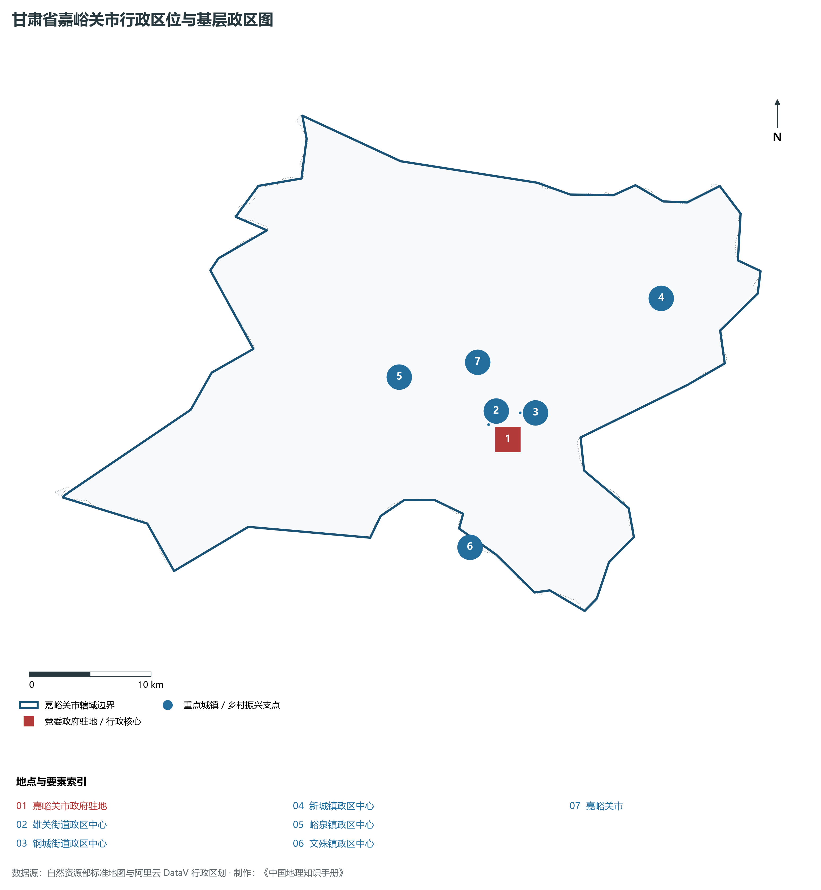
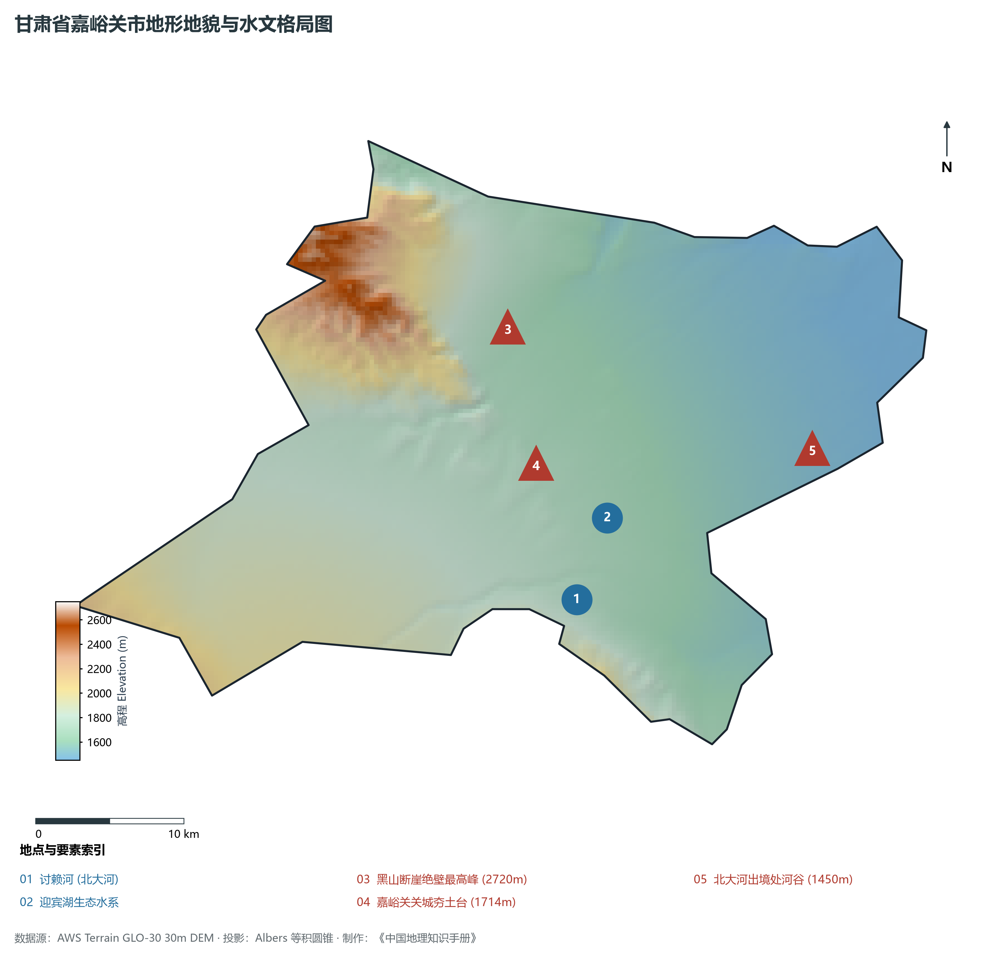
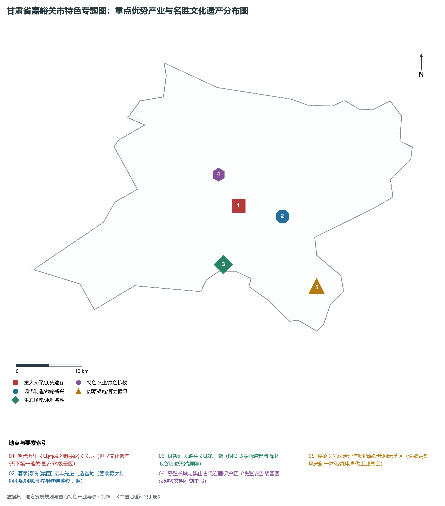
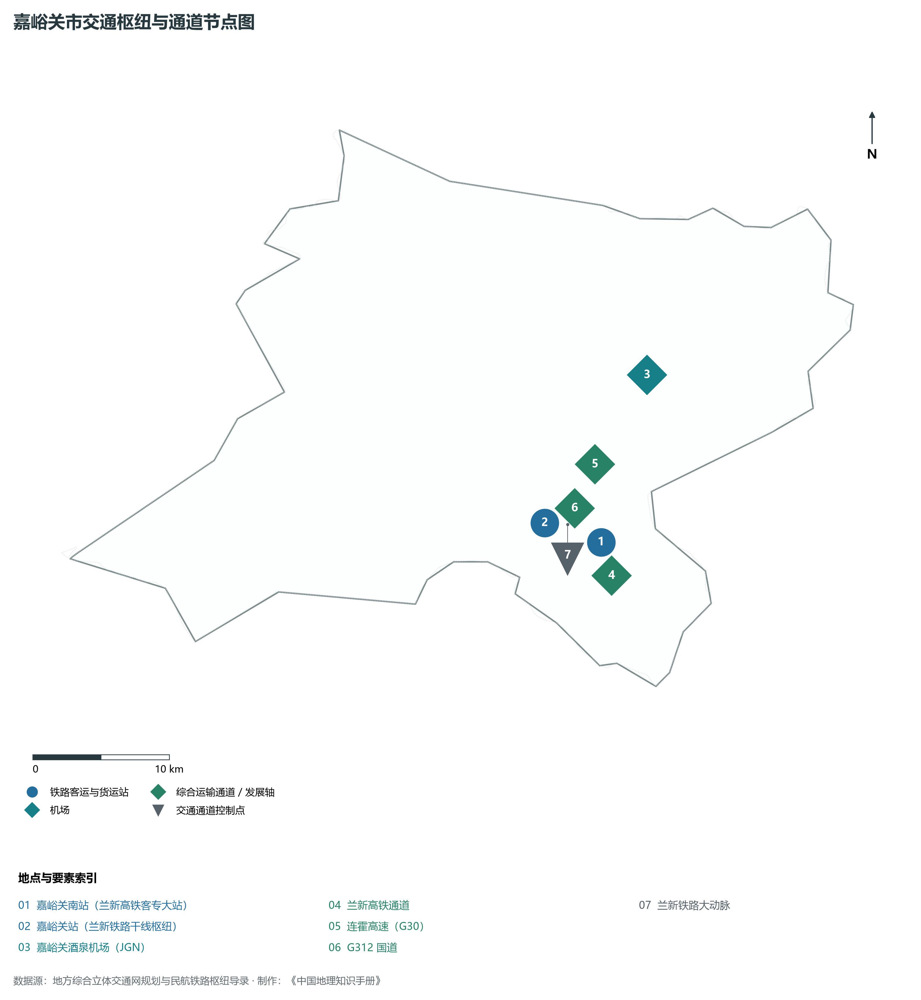
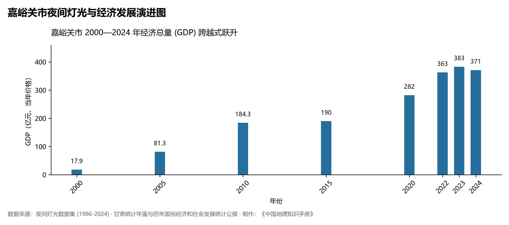

# 30.2 嘉峪关市

嘉峪关市，别称“雄关”、“钢城”，是甘肃省辖地级市，古丝绸之路交通咽喉与边防要塞、中国明代万里长城西端起点，国家历史文化名城，也是我国西部重要的现代化钢铁工业基地和全国首批优秀旅游城市。地处甘肃省西北部、河西走廊中西段最狭窄的石关峡隘口处，地理坐标介于东经 97°46′—98°29′、北纬 39°38′—40°01′ 之间。南枕白雪皑皑的祁连山脉文殊山，北依险峻嵯峨的黑山绝壁，两山对峙如门，横贯其间的戈壁隘道仅数里之遥，素有“河西第一隘口”、“中西第一通衢”之壮誉。2024 年常住人口 **32 万人**，常住人口城镇化率 **94.75%**，地区生产总值 **371 亿元**（当年价格），人均地区生产总值 **117,665 元**，三次产业构成为 **1.96 : 49.78 : 48.26**。

嘉峪关是一座因古代长城设防而扬名、因现代工业崛起而建置的“关钢一体”新兴现代化绿洲工矿城市。明洪武五年（1372 年），宋国公冯胜在此勘察定址筑城设关，始名“嘉峪关”，取“嘉峪山麓、雄关天成”之意；数百年来，关楼壁垒森严、飞檐凌空，见证了古代中国向西沟通欧亚大陆的辉煌画卷；20 世纪 50 年代末，大批共和国建设者踏冰卧雪挺进茫茫戈壁，掀开镜铁山铁矿开发与酒泉钢铁公司（酒钢）建设的历史序幕；1965 年设立嘉峪关市，成为新中国以大型重工企业为依托设立的典型工业城市；嘉峪关市也是全省唯一不设市辖区、实行“市—街道（镇）”两级扁平化行政体制的地级市。新时代以来，嘉峪关依托世界文化遗产长城关城与酒钢集团先进制造，坚决推进钢铁与有色新材料升级、风光新能源开发与全域旅游融合，实现了从荒漠戈壁到全国文明城市、国家生态园林城市与现代化工业旅游名城的璀璨蝶变。

---

## 一、市情速览

嘉峪关市空间规模精悍、工业实力强劲、城市化水平极高、生态环境优美，是河西走廊高质量发展的工业明珠。

| 核心指标 | 全市数值与空间分布 | 全国 / 全省战略定位 |
|:---|:---|:---|
| **行政区划面积** | 1 224 km² | 全省面积最小地级市，城市建成区集中于东南部 |
| **常住人口** | 32 万人 | 2024 年，全市；年鉴公布口径 |
| **常住人口城镇化率** | 94.75% | 2024 年，全市；年鉴公布口径 |
| **人口密度** | 260 人/km² | 城区局部超过 1 800 人/km²，外围戈壁荒滩人烟稀少 |
| **地区生产总值 (GDP)** | 371 亿元 | 2024 年，全市；年鉴公布口径 |
| **人均 GDP** | 117,665 元/人 | 2024 年，全市；年鉴公布口径 |
| **产业三次结构** | 1.5 : 68.5 : 30.0 | 典型重化工业支撑格局，第二产业占比近七成 |
| **行政区划架构** | 不设区地级市（辖 2 街道、3 镇） | 雄关街道、钢城街道；峪泉镇、新城镇、文殊镇 |
| **核心战略定位** | 丝路长城文化高地与先进合金材料基地 | 明长城西端地标、西北最大不锈钢及特钢研发制造基地 |

**图 30-02-1 甘肃省嘉峪关市行政区位与基层政区图**：图上编号与地点、要素索引对应。

---

## 二、自然地理：河西咽喉、黑山对峙与北大河水系

嘉峪关市位于河西走廊“蜂腰”地带，地势南高北低、自西南向东北倾斜，海拔在 **1 450—2 720 m** 之间，构成戈壁、断崖、峡谷与冲积洪积平原相交织的干旱荒漠地貌。

### 1. 地形地貌：祁连北麓与黑山对峙形成的石关峡
全境主要由黑山低山断崖、文殊山丘陵、讨赖河峡谷与酒泉—嘉峪关山前倾斜平原四大单元构成：

- **黑山断块低山**：位于市区西北部，最高峰海拔达 **2 720.0 m**，山势险峻陡峭，多为裸露黑褐色坚硬变质岩，是长城北侧天然的防御屏障；
- **文殊山构造丘陵**：位于市区南部，与黑山遥相呼应，构成南北夹持走廊咽喉的天然地貌骨架；
- **讨赖河大峡谷**：北大河（讨赖河）自祁连山奔涌北下，深切戈壁平原形成数十米乃至近百米深的陡峭断崖峡谷，明代在峡谷绝壁之巅筑就长城第一墩，使峡谷与绝壁成为不可逾越的防御深堑；
- **戈壁阶地与绿洲平原**：中部为冲积洪积形成的微倾斜戈壁砾石平原，土层薄、砾石密布，经现代人工引水绿化，形成了林木苍翠的现代化园林城市。

**图 30-02-2 甘肃省嘉峪关市地形地貌与水文格局图**：图上编号与地点、要素索引对应。

### 2. 气候特征：典型温带大陆性荒漠干旱气候
嘉峪关地处亚欧大陆腹地，气候干旱干燥，日照极其充沛，风沙大、昼夜温差悬殊：

- **光温条件**：年平均气温约 **7.5—8.5 ℃**，极端最低温 -28.6 ℃，极端最高温 36.8 ℃。年日照时数长达 **3 000—3 100 小时**，是甘肃发展大型光伏电站与光热发电的黄金纬度区；
- **干旱少雨**：年平均降水量仅 **85—110 mm**，而年蒸发量高达 **2 100 mm** 以上，蒸发量是降水量的 20 余倍；年均无霜期约 140—160 天。

### 3. 河流水系：祁连雪水哺育的讨赖河与城市人工湖群
水资源是荒漠钢城生存和发展的根本生命线：

- **讨赖河（北大河）**：发源于祁连山托勒山与疏勒南山之间，向北穿峡注入酒嘉盆地，在嘉峪关境内流长 40 余公里，年径流量约 6.8 亿立方米，是酒钢工业生产、城市居民生活与农业灌溉的核心水源；
- **城市生态水网**：建设了迎宾湖、东湖生态旅游景区与讨赖河生态文化景区，形成了水面开阔的戈壁人工湿地网络，有效改善了局地微气候。

---

## 三、建置沿革与文化根脉

嘉峪关是华夏长城防御文明与近代三线工业文明在此交相辉映的典范。

### 1. 明代长城西端第一雄关与丝路军垒

- **天下第一雄关**：嘉峪关关城始建于明洪武五年（1372 年），历经 168 年营建完工。关城由外城、内城、瓮城、罗城、城壕等严整防御体系构成，内城周长 640 m，东翁城门名“光化”，西翁城门名“柔远”，气魄恢宏，居庸关、山海关、嘉峪关并称长城三大奇观，被誉为“天下第一雄关”；
- **长城第一墩与悬壁长城**：讨赖河墩作为明代长城最西端起点，坐落于深达 80 米的绝壁之上；悬壁长城攀附于黑山陡峭山脊，有“西部八达岭”之称；
- **黑山岩画与魏晋壁画墓**：黑山岩画描绘了战国至西汉游牧民族的狩猎、操练生活；新城魏晋墓群出土的彩绘砖画（包括著名的“驿使图”）生动再现了古代邮驿与丝路商贸民俗，是中国邮政标志的灵感来源。

### 2. 工业拓荒与“铁人”般的酒钢精神

- **西北钢铁巨擘诞生**：1958 年，国家设立酒泉钢铁公司，五湖四海的钢铁拓荒者云集嘉峪关黑山脚下；经历三上两下的艰苦创业，1970 年炼出第一炉铁水，使茫茫荒漠崛起为西北最大的现代化钢铁联合企业；
- **不设区市的扁平现代治理**：改革开放后伴随企业社会职能剥离，嘉峪关市推行无行政区划扁平化治理模式，形成行政层级少、办事效率高、公共服务均等化的典范模式。

**图 30-02-4 甘肃省嘉峪关市特色专题图：重点优势产业与名胜文化遗产分布图**：图上编号与地点、要素索引对应。

---

## 四、经济地理：西北钢铁航母、高品质特种合金与新能源高地

嘉峪关市依托酒泉钢铁（集团）有限责任公司，形成了以钢铁、铝业、新能源装备、先进金属新材料为主导的强有力现代工业体系。

### 1. 酒钢集团：西北最大的碳钢、不锈钢及铝电基地

- **现代化特种钢铁制造**：酒钢年产粗钢超千万吨，形成碳钢薄板、热轧宽带钢、中厚板、高速线材等全系列产品，锌铝镁合金镀层钢板、高级汽车结构钢、新能源电工钢达到国际先进水平；
- **国内领先的不锈钢集群**：酒钢宏兴不锈钢分公司拥有世界先进的冷轧、热轧不锈钢生产线，核电用不锈钢、抗菌不锈钢、超高抗腐蚀特种不锈钢广泛应用于国家重大工程；
- **电解铝与现代铝深加工**：构建起“煤—电—铝—铝深加工”一体化完整产业链，高纯铝、航空铝板带与高档铝合金型材产能规模稳步增长。

### 2. 戈壁新能源与绿电就地消纳

- **千万千瓦级光伏治沙基地**：利用周边开阔平坦的荒漠戈壁，加快建设风光储一体化新能源电站，推动绿电直供高耗能合金冶炼与铝电深加工；
- **绿色微电网与氢能冶金试验**：积极开展氢能冶金前沿试验，推进钢铁产业绿色超低排放与“双碳”目标下的深层低碳转型。

### 3. 丝路长城全域文旅与研学经济

- **世界文化遗产金字招牌**：依托嘉峪关关城国家 5A 级景区，深化长城国家文化公园嘉峪关段建设，打造丝路文化大景区、悬壁滑翔、方特欢乐世界等文旅IP，年接待国内外游客千万级人次。

---

## 五、综合立体交通走廊

嘉峪关扼守河西走廊交通咽喉，是西北进出新疆的重要综合立体交通大枢纽。

**图 30-02-3 嘉峪关市交通枢纽与通道节点图**：图上编号与地点、要素索引对应。

1. **“双轨贯通”铁路动脉**：
   - **兰新高速铁路**：穿境而过，嘉峪关南站是连接甘新青三省区的骨干高铁客运枢纽站；
   - **兰新铁路**：新中国通往新疆的干线铁路大动脉，嘉峪关站承担着极其繁重的重型货运中转与编组职能；
2. **高等级公路网纵横交织**：G30 连霍高速公路横贯全境，G312 国道自东向西穿城而过，实现与酒泉同城化无缝对接，酒嘉快速通道构筑了“双子城”半小时紧密通勤圈；
3. **嘉峪关酒泉机场（4D 级空港）**：甘肃河西走廊最早通航的民用机场，2023 年改扩建完成后具备保障波音 737、空客 A320 等大中型客机全天候起降能力，通达北京、上海、广州、成都、西安等主要枢纽。

---

## 六、区县空间分区与极值矩阵

**图 30-02-5 嘉峪关市夜间灯光与经济发展演进图**：各面板按标注的观测年份、指标和单位列示。

嘉峪关市实行扁平化街道和镇直管体制，下辖 2 个街道、3 个建制镇：

| 行政单元 | 面积 (km²) | 常住人口 (万人) | 主导产业与功能定位 | 核心地理标志与关键节点 |
|:---|:---|:---|:---|:---|
| **雄关街道** | 约 35 | 16.8 | 市委市政府驻地、行政商务中心、科教文卫金融极核 | 嘉峪关迎宾湖公园、五一文化广场、嘉峪关南站 |
| **钢城街道** | 约 45 | 11.2 | 酒钢集团总部与工业厂区驻地、产业工人宜居组团 | 酒钢厂区、东湖生态景区、宏兴不锈钢生产基地 |
| **峪泉镇** | 约 420 | 1.8 | 长城文旅融合示范镇、世界遗产保护区、生态林牧 | 嘉峪关关城 5A 景区、长城第一墩、悬壁长城 |
| **新城镇** | 约 360 | 1.2 | 现代节水绿洲农业、果蔬大棚基地、历史古墓葬群 | 新城魏晋壁画墓群、优质洋葱与高原蜜瓜种植园 |
| **文殊镇** | 约 364 | 0.8 | 农旅康养小镇、城郊休闲农业、文殊山石窟文化区 | 文殊山石窟、讨赖河大峡谷漂流段、特色民俗村 |

2024 年统计来源：《中国城市统计年鉴 2025》表 2-1、2-6、2-7（2024 年，全市）。其他年份 GDP 据本地城市面板“原始数据”表，单位为亿元、当年价格。
