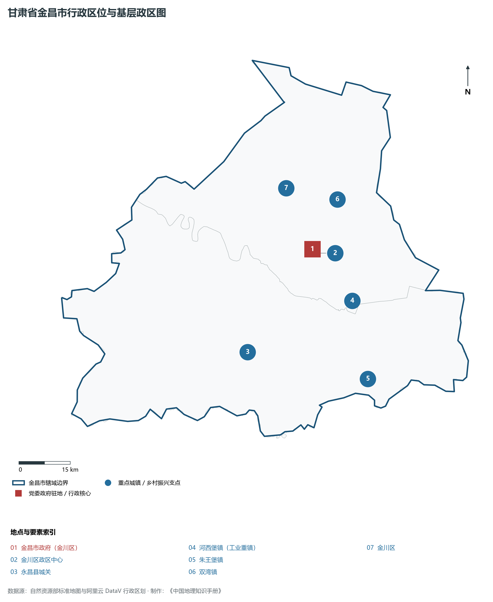
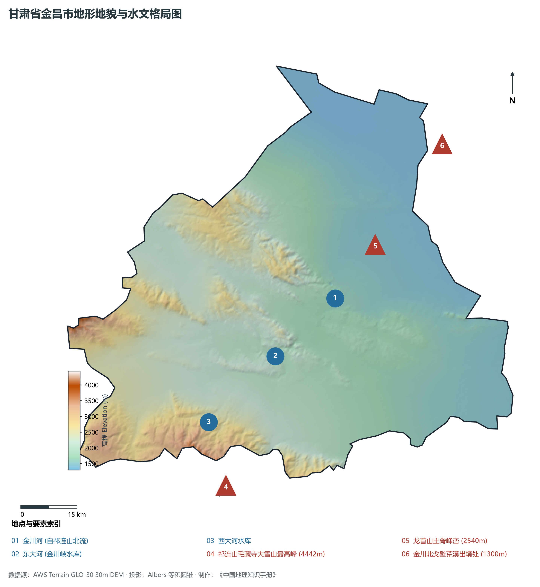
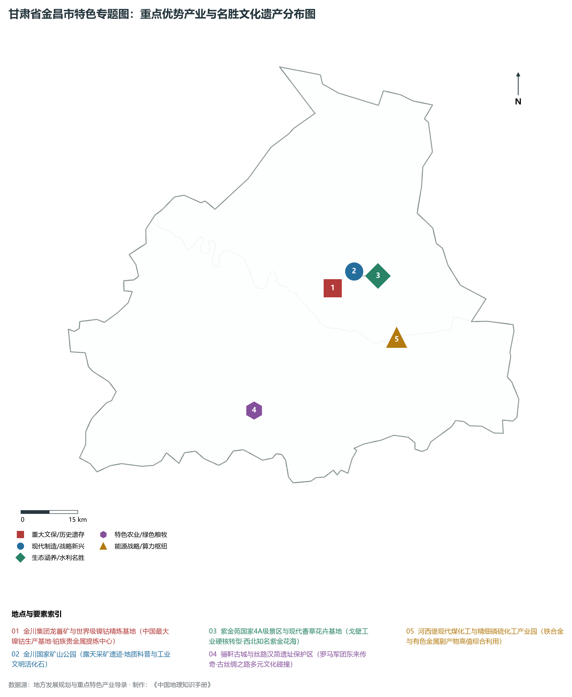
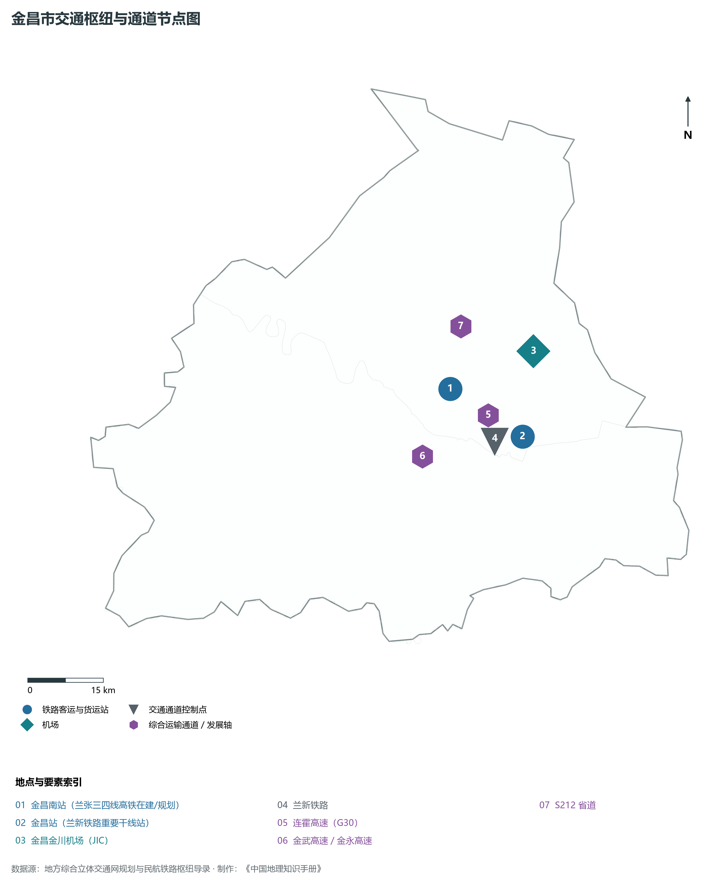
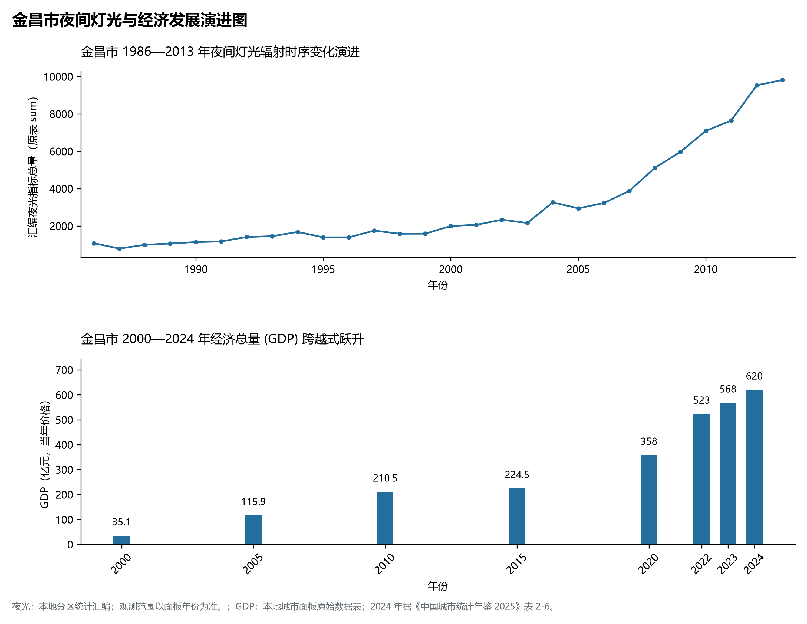

# 30.3 金昌市

金昌市。2024 年常住人口 **43 万人**，常住人口城镇化率 **80.54%**，地区生产总值 **620 亿元**（当年价格），人均地区生产总值 **143,784 元**，三次产业构成为 **5.45 : 67.45 : 27.1**。

金昌是一座典型的“因矿兴企、因企设市”的新兴工业绿洲。20 世纪 50 年代以前，这里还是一片沉寂荒凉、飞沙走石的戈壁滩与古老的丝路驿站；1958 年，甘肃地质局地质队在白家嘴子意外发现世界第二大硫化铜镍矿床，一举摘掉了新中国“贫镍”的帽子；1959 年国家决定成立金川有色金属公司，来自天南地北的开拓者战风沙、斗严寒，在戈壁荒原建成了中国最大的镍钴生产基地和铂族贵金属提炼中心；1981 年，国务院正式批准设立地级金昌市，取“金川”与“永昌”各一字命名，开创了现代工业化与城市化并驾齐驱的时代新篇。新时代以来，金昌坚决摆脱传统“一矿独大”的路径依赖，金川集团强势挺进世界 500 强前列，全面推进镍钴深加工、新能源电池材料、高纯有色金属及精细化工“全产业链”转型升级，同时大力打造“紫金花海”生态名片，昔日的戈壁硬核工矿城已升华为名副其实的现代工业花园城市。

---

## 一、市情速览

金昌市工业基础极其深厚、创新动力强劲、人均创税创利极高，是甘肃工业现代化的领军城市与硬核脊梁。

| 核心指标 | 全市数值与空间分布 | 全国 / 全省战略定位 |
|:---|:---|:---|
| **行政区划面积** | 7 549 km² | 祁连山南缘山地与龙首山北戈壁盆地各半 |
| **常住人口** | 43 万人 | 2024 年，全市；年鉴公布口径 |
| **常住人口城镇化率** | 80.54% | 2024 年，全市；年鉴公布口径 |
| **人口密度** | 58 人/km² | 市区聚集度超 800 人/km²，北部戈壁地带不足 10 人/km² |
| **地区生产总值 (GDP)** | 620 亿元 | 2024 年，全市；年鉴公布口径 |
| **人均 GDP** | 143,784 元/人 | 2024 年，全市；年鉴公布口径 |
| **产业三次结构** | 4.8 : 71.2 : 24.0 | 工业主导型经济，第二产业产值突破 430 亿元 |
| **行政区划架构** | 辖 1 市辖区、1 县 | 金川区（市区驻地）、永昌县（历史古邑） |
| **核心战略定位** | 祖国镍都与世界级有色新材料基地 | 国家战略性关键矿产安全屏障、河西走廊新能源材料核心 |

**图 30-03-1 甘肃省金昌市行政区位与基层政区图**：图上编号与地点、要素索引对应。

---

## 二、自然地理：祁连屏南、龙首横亘与荒漠绿洲系统

金昌全境地貌兼具雪山、戈壁、绿洲与沙丘，地势由西南向东北阶梯状倾斜，海拔在 **1 300—4 442 m** 之间，相对高差超过 3 140 m。

### 1. 地形地貌：高山、盆地、中低山与荒漠阶地
境内自南向北依次展开三大自然地理单元：

- **祁连山南缘中山与极高山区**：位于永昌县南部，山脊高耸入云，毛藏寺大雪山最高峰海拔达 **4 442.0 m**，发育有终年积雪、现代冰川与丰茂的高山草甸、针叶水源涵养林；
- **永昌山间倾斜盆地与绿洲**：位于祁连山与龙首山之间，地势开阔平坦，土层深厚，是河西走廊重要的自流灌溉粮麦与高原冷凉蔬菜种植基地；
- **龙首山剥蚀中山与北部荒漠**：龙首山主脊海拔在 2 540 m 上下，蕴藏着举世闻名的金川铜镍超大型岩浆熔离矿床；山体以北延伸至内蒙古巴丹吉林与腾格里沙漠交界洼地，最低海拔降至 **1 300.0 m**。

**图 30-03-2 甘肃省金昌市地形地貌与水文格局图**：图上编号与地点、要素索引对应。

### 2. 气候特征：温带大陆性温凉干旱荒漠气候
气候冷凉干燥，光热充沛，降水稀少，昼夜温差大：

- **气温与光照**：年平均气温在 **4.8—7.9 ℃** 之间，市区平均气温约 7.5 ℃；年日照时数长达 **2 800—3 100 小时**，太阳总辐射量极大；
- **降水蒸发极度悬殊**：南部祁连山区年降水量可达 350—500 mm，而中北部盆地与戈壁荒漠年降水量仅 **110—150 mm**，年潜在蒸发量却高达 **1 800—2 200 mm**；无霜期约为 130—150 天。

### 3. 河流水系：内陆石羊河水系支流哺育绿洲
金昌地表水系全属石羊河流域：

- **东大河与西大河**：发源于祁连山冰雪冻土，两河在永昌盆地汇集入金川峡水库，出库后称金川河，向东北切穿龙首山峡谷流经金川市区，最终隐没于北戈壁；
- **金川峡水库与西大河水库**：作为绿洲防洪、城市供水与有色冶金工业用水的命脉工程，常年蓄积纯净的高山融雪水，滋养着绿洲万顷农田与百万居民。

---

## 三、建置沿革与文化根脉

金昌既有两千余年丝路汉唐的历史尘烟，更有新中国一代代工业地质拓荒者的热血赞歌。

### 1. 丝路古驿、骊靬探秘与御山圣容

- **西汉置县与丝路咽喉**：永昌在西汉元狩二年（前 121 年）纳入汉朝版图，汉宣帝神爵二年（前 60 年）置骊靬县，传说曾安置罗马战俘军团，留下中西文化交流千古之谜；明洪武年间设立永昌卫，筑石城以卫丝路；
- **圣容寺与北朝石窟**：位于永昌县城关附近的御山圣容寺始建于北周，保存有唐代双塔与汉魏造像，玄奘法师西行曾在此驻留弘法；
- **明长城与古烽燧**：永昌境内明代长城蜿蜒数十里，与汉长城烽燧互为表里，是河西长城文化带的关键组成部分。

### 2. 艰苦奋斗的金川“镍都精神”与矿山公园

- **戈壁找矿的世纪奇迹**：1958 年地质队员的一块含镍孔雀石，揭开了金川超大型矿床面纱；第一代金川工人“搭帐篷、挖地窨、喝苦水”，攻克了含水破碎超深井开采与闪速炉冶炼世界级难关，形成了“艰苦奋斗、务实创新”的金川精神；
- **金川国家矿山公园**：由亚洲最大的露天矿采矿坑（东西长 1 300 米、南北宽 700 米、垂直深 310 米）改建而成，巍峨壮丽的人工矿坑与绿化奇迹共同构筑了中国工业遗产的经典殿堂。

**图 30-03-4 甘肃省金昌市特色专题图：重点优势产业与名胜文化遗产分布图**：图上编号与地点、要素索引对应。

---

## 四、经济地理：有色新材料硅谷、新能源电池之都与绿色化工

金昌市紧紧依托金川集团“链主”地位，全力打造有色金属新材料、新能源和新能源电池两个千亿级产业集群。

### 1. 金川集团：世界级战略有色金属与贵金属生产研发

- **镍钴战略支柱地位牢固**：金川集团是世界领先的镍、钴生产商和中国最大的铂族贵金属提炼中心，镍、钴产量分别位居全球前列，高纯电解镍、电积镍保障了国家航空航天、舰船核能等尖端工程的核心材料需求；
- **有色合金延伸与深加工**：高精铜带、电子超薄铜箔、镍基耐腐蚀合金、医用镍钛形状记忆合金实现大批量自主生产，打破多项关键技术壁垒。

### 2. 新能源动力电池与负极新材料集群

- **“电池原材料之都”跨越发展**：利用本地丰沛的镍、钴、铜、锰资源与低成本绿电，先后引进行业龙头布局高镍三元正极材料、磷酸铁锂材料、动力电池封装与储能电池产线；
- **绿色风光储一体化发展**：依托龙首山北麓浩瀚戈壁建设千万千瓦级大型风电光伏大基地，形成源网荷储高度协同的新型绿电供应格局。

### 3. 河西堡循环经济与高原特色现代农业

- **河西堡化工联产**：以冶炼烟气回收制酸为基础，联合周边煤炭与磷矿资源，打造全国重要的硫化工、磷化工、化肥与新型建筑材料循环工业区；
- **冷凉果蔬与优质牛羊**：永昌县地处冷凉高寒带，出产的高原夏菜、优质胡萝卜、优质酿酒葡萄与永昌肉羊享誉西北。

---

## 五、综合立体交通走廊

金昌地处河西走廊咽喉要道，路网完善，客货运输便捷通畅。

**图 30-03-3 金昌市交通枢纽与通道节点图**：图上编号与地点、要素索引对应。

1. **铁路干线与高铁展望**：
   - **兰新铁路**：穿境而过，设河西堡站（金昌站），是亚欧大陆桥大容量铁路客货运大动脉；
   - **兰张三四线高铁**：连接兰州与张掖的高速铁路中川至武威段已通车，武威至张掖段规划途经金昌并设**金昌南站**，全面融入丝路高铁快捷通道；
2. **高等级公路网互联互通**：G30 连霍高速公路东西横贯永昌县与河西堡，金武高速、金永高速将金川区与永昌县及周边主要工矿物流节点严密串联；
3. **金昌金川机场（4C 级民航机场）**：位于市区北部戈壁，已开通直达北京、上海、成都、兰州、西安等枢纽航线，构筑起现代化空中商贸走廊。

---

## 六、区县空间分区与极值矩阵

**图 30-03-5 金昌市夜间灯光与经济发展演进图**：各面板按标注的观测年份、指标和单位列示。

金昌市现辖 1 个市辖区、1 个县：

| 县区单元 | 面积 (km²) | 常住人口 (万人) | 2024年GDP (亿元) | 城镇化率 (%) | 核心功能定位与主要地理地标 |
|:---|:---|:---|:---|:---|:---|
| **金川区** | 3 017 | 26.2 | 435.0 | 88.5% | 市委市政府驻地、金川集团总部、国家级经济技术开发区、紫金苑景区 |
| **永昌县** | 4 532 | 17.3 | 180.0 | 54.2% | 河西走廊千年历史名城、圣容寺、骊靬古城、金川峡水库、河西堡循环化工园区 |

2024 年统计来源：《中国城市统计年鉴 2025》表 2-1、2-6、2-7（2024 年，全市）。其他年份 GDP 据本地城市面板“原始数据”表，单位为亿元、当年价格。
