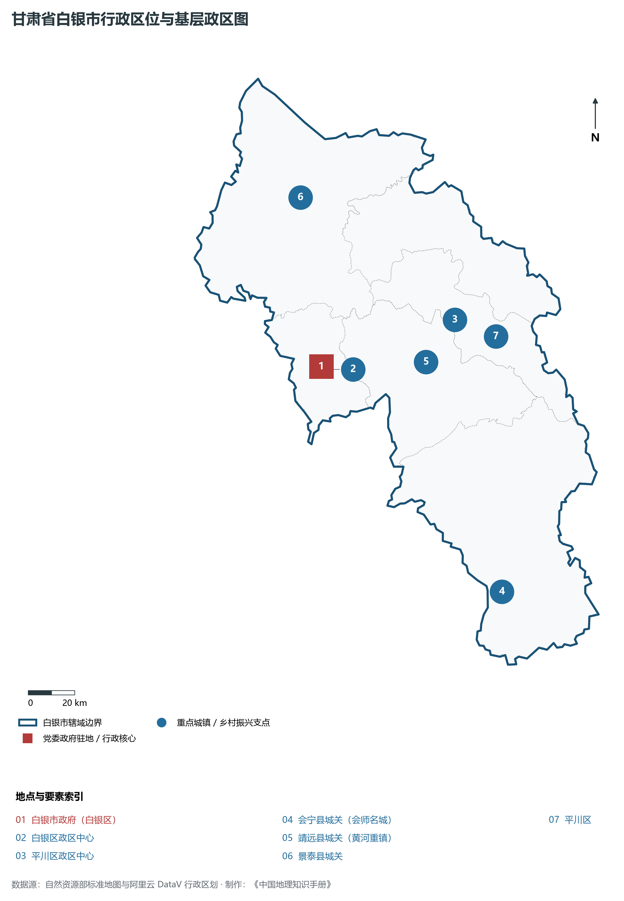
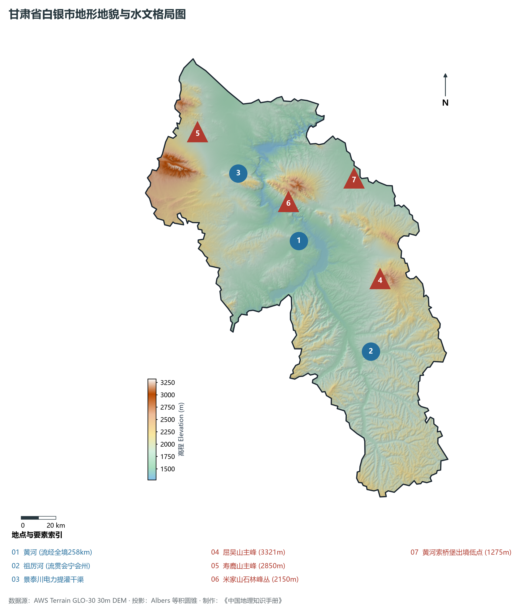
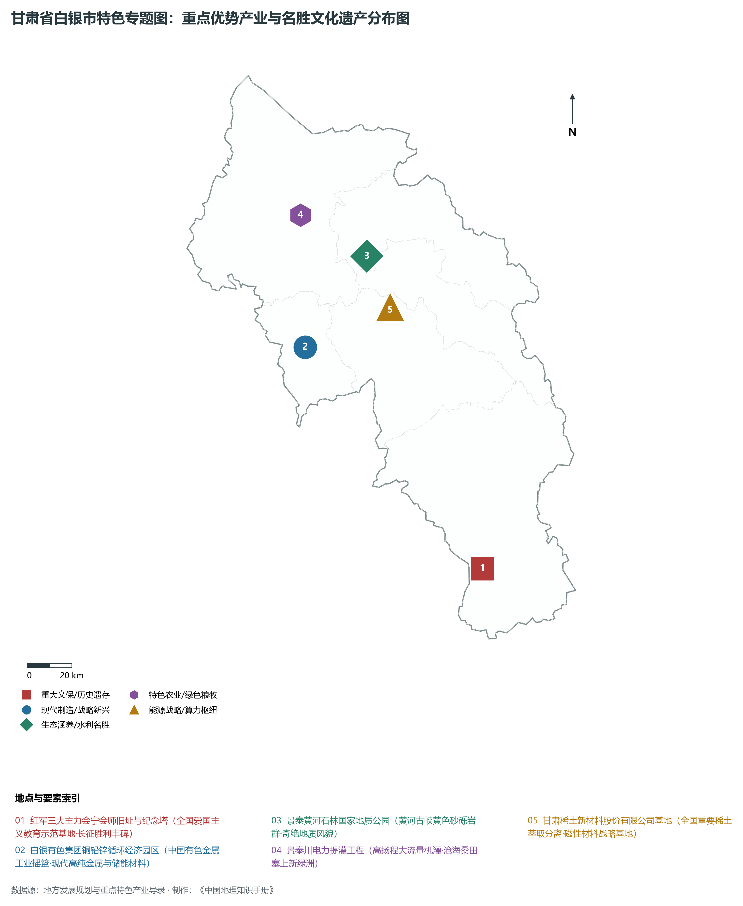
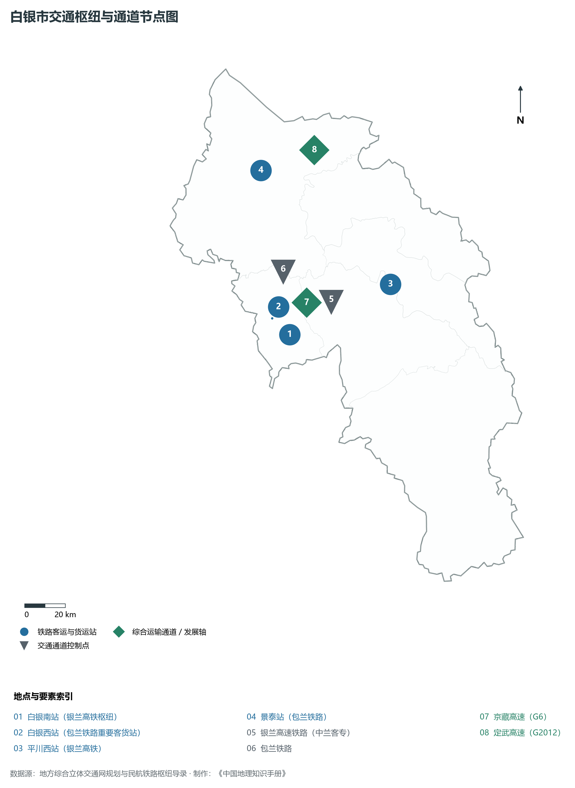
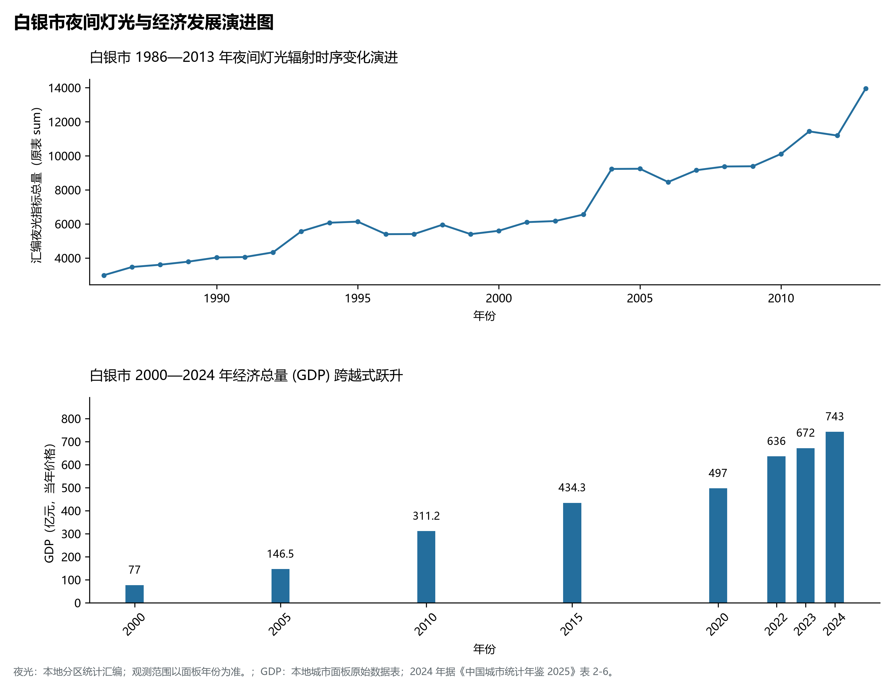

# 30.4 白银市

白银市，享誉中外的“中国铜城”，是甘肃省辖地级市，全国知名的老工业基地、国家有色金属和稀土新材料产业基地、黄河上游多民族聚居的历史文化重镇，也是中国工农红军三大主力胜利会师的崇高革命圣地。地处甘肃省中部、腾格里沙漠边缘与黄土高原北缘交会地带，地理坐标介于东经 104°00′—105°26′、北纬 35°33′—37°38′ 之间。九曲黄河自兰州奔腾而来，在白银。2024 年常住人口 **148 万人**，常住人口城镇化率 **60.81%**，地区生产总值 **743 亿元**（当年价格），人均地区生产总值 **50,055 元**，三次产业构成为 **16.57 : 38.51 : 44.92**。

白银是一座因金属矿业而崛起的传奇工业名城，更是一片浸润着华夏文明基因与红色记忆的热土。明朝洪武年间，朝廷在此设立官方矿场“办银”，得名“白银厂”，遐迩闻名；20 世纪 50 年代，新中国“一五”时期将白银列为全国 156 项重点工程重镇，白银有色金属公司由此诞生，通过开创性的大爆破剥离与现代闪速冶炼，产出全国三分之一以上的铜硫产品，创造了铜产量连续多年领跑全国的辉煌业绩，被誉为“中国有色金属工业摇篮”；1936 年 10 月，中国工农红军第一、二、四方面军在会宁县城胜利会师，宣告了两万五千里长征的伟大胜利，谱写了中国革命史上的壮丽史诗；20 世纪 70 年代，为彻底扭转甘肃中部干旱苦瘠面貌，国家在此兴建“中华第一提灌”——景泰川电力提灌工程，引黄河水翻越群山荒滩，创造了塞外荒原变万顷良田的人间奇迹。新时代以来，白银全面深化国家资源枯竭型城市转型升级，高纯铜、铅锌、稀土催化新材料与新能源装备欣欣向荣，银兰高铁飞速驰骋，黄河石林鬼斧神工，白银正大步迈向高质量发展的时代新征程。

---

## 一、市情速览

白银市跨越黄河两岸，工业门类齐备，红色底蕴与生态景观兼备，是甘肃中部连接兰西城市群与宁夏沿黄城市群的关键节点。

| 核心指标 | 全市数值与空间分布 | 全国 / 全省战略定位 |
|:---|:---|:---|
| **行政区划面积** | 20 099 km² | 黄土丘陵占 65%，山地占 25%，河谷平川占 10% |
| **常住人口** | 148 万人 | 2024 年，全市；年鉴公布口径 |
| **常住人口城镇化率** | 60.81% | 2024 年，全市；年鉴公布口径 |
| **人口密度** | 75 人/km² | 白银市区达 800 人/km²，北部旱作丘陵与沙荒地偏稀 |
| **地区生产总值 (GDP)** | 743 亿元 | 2024 年，全市；年鉴公布口径 |
| **人均 GDP** | 50,055 元/人 | 2024 年，全市；年鉴公布口径 |
| **产业三次结构** | 16.5 : 44.5 : 39.0 | 工业支撑扎实，现代农业（小杂粮/果蔬）特色鲜明 |
| **行政区划架构** | 辖 2 区、3 县 | 白银区、平川区；会宁县、靖远县、景泰县 |
| **核心战略定位** | 循环有色高地与黄河上游重要生态枢纽 | 国家有色及稀土新材料基地、黄河流域生态保护典范、长征精神红色名片 |

**图 30-04-1 甘肃省白银市行政区位与基层政区图**：图上编号与地点、要素索引对应。

---

## 二、自然地理：九曲黄河穿境、黄土梁峁与石林地貌

白银地处黄土高原西北边缘、祁连山东延余脉与腾格里沙漠南缘交织带，全境山峦连绵、沟壑纵横、黄河穿切，海拔在 **1 275—3 321 m** 之间。

### 1. 地形地貌：中低山地、黄土梁峁沟壑与黄河深切阶地
全境地貌大体可分为中低山区、黄土丘陵沟壑区与冲积黄河台地：

- **黄河穿流切蚀阶地**：黄河自兰州界入白银，经白银区、靖远县、平川区至景泰县索桥堡出境，流长 258 km。黄河在坚硬的砂砾岩层与黄土台塬间切出大峡、小峡等壮丽峡谷，形成深切开阔的河谷阶地；
- **中部与南部黄土丘陵**：会宁县与靖远县南部属典型的陇中黄土高原梁峁沟壑区，梁峁起伏、水土流失严重，经多年综合治理形成层层叠叠的生态梯田；
- **屈吴山与寿鹿山构造中高山**：屈吴山主峰海拔高达 **3 321.0 m**，为白银境内最高点，山体雄伟挺拔；寿鹿山海拔 2 850 m，是甘蒙边界天然的绿色生态屏障；
- **景泰黄河石林**：位于景泰县中泉镇龙湾村，为新生代早更新世形成的巨厚黄色砂砾岩群，在重力坍塌与地表水长期冲蚀下，演化成峰林耸立、绝壁万仞的罕见奇观。

**图 30-04-2 甘肃省白银市地形地貌与水文格局图**：图上编号与地点、要素索引对应。

### 2. 气候特征：温带半干旱大陆性季风气候
日照充足，温凉干燥，降水时空分布极不均衡：

- **气温与光照**：年平均气温在 **6.0—9.2 ℃** 之间，年日照时数长达 **2 500—2 800 小时**，积温较高，适宜果品糖分沉淀与喜光作物生长；
- **少雨蒸发强**：年降水量由南向北递减，南部会宁约 350—400 mm，北部景泰降至 **180—220 mm**，而全域年平均蒸发量在 **1 500—2 400 mm**，属于典型资源型缺水干旱地带。

### 3. 河流水系：母亲河干流与引水提灌奇迹
黄河是白银社会经济发展的血脉依托：

- **黄河干流**：多年平均入白银水量约 300 亿立方米，白银境内建有大峡水电站、乌金峡水电站等水利枢纽；
- **祖厉河**：黄河一级支流，发源于定西会宁南部，流贯会宁、靖远汇入黄河，含沙量极大；
- **景泰川电力提灌工程（景电工程）**：被誉为“中华第一提灌”，泵站多级扬水高达数百米，总干渠横穿崇山戈壁，累计引黄河水上百亿立方米，将昔日荒无人烟的景泰荒滩变成了塞上绿洲与粮仓。

---

## 三、建置沿革与文化根脉

白银历史积淀丰厚，是长征丰碑的铸就之地与古渡文明的繁盛之邦。

### 1. 汉唐渡口、丝路驿站与边防索桥

- **黄河索桥渡与丝路北线**：景泰索桥堡自汉唐以来就是大军过河与丝路商旅由陇中北入河西走廊、西夏要塞的战略咽喉，明代筑铁索吊桥飞架黄河，成为西北著名的古渡要冲；
- **靖远钟鼓楼与平川法泉寺**：靖远古称会州，自汉代起即置乌兰县，钟鼓楼古朴凝重；平川法泉寺北魏开凿，融佛道儒三教造像于石窟崖壁之中。

### 2. 红军三大主力会师与长征胜利丰碑

- **会宁红军会师旧址**：1936 年 10 月，红一、二、四方面军历经千难万险胜利汇聚会宁城，三军大会师标志着长征胜利结束，红军会师纪念塔、会师楼巍然屹立，成为全国最重要的爱国主义教育和革命传统教育圣地；
- **大墩梁与慢牛坡战斗**：红军在此阻击敌军精锐，红五军军长董振堂等烈士血染陇原，奠定了中国革命走向全面胜利的基石。

### 3. 新中国工业长子的“铜城记忆”

- **万吨大爆破**：1956 年白银露天矿实施了举世闻名的万吨级大规模露天定向爆破，将白银深藏的铜矿体彻底掀露出来，创下中国采矿史奇迹；
- **三线与有色精神**：数十万建设者扎根白银，孕育出“艰苦奋斗、开拓创新、敢为人先、追求卓越”的白银精神，为共和国早期国防工业提供大量急需的电解铜与稀散金属。

**图 30-04-4 甘肃省白银市特色专题图：重点优势产业与名胜文化遗产分布图**：图上编号与地点、要素索引对应。

---

## 四、经济地理：有色稀土新材料、黄河水利灌溉与红色生态农业

白银市立足老工业基地综合优势，推动有色金属、精细化工、稀土深加工和新型能源协同发力。

### 1. 白银有色与稀土新材料支柱

- **白银有色集团综合产业链**：全国大型铜铅锌冶炼加工企业，近年来大力发展高纯阴极铜、微细电子铜线、电子级高纯铅锌以及伴生稀贵金属（金、银、硒、碲）提取，构建绿色低碳循环经济新范式；
- **甘肃稀土新材料**：平川区依托白银深厚工业沉淀，发展成为全国知名的稀土萃取分离、稀土抛光粉、高性能钕铁硼磁性材料与储氢合金研发基地。

### 2. 精细化工与西部陶都集群

- **银东工业园区现代精细化工**：依托银光化学等骨干企业，延伸 TDI（甲苯二异氰酸酯）、聚氨酯及工程塑料产业链；
- **平川陶瓷文化与工业建材**：平川区黏土矿产富集，年产建筑陶瓷、日用美术陶瓷上亿平方米，是西北规模最大的现代化陶瓷产业集群。

### 3. 沿黄现代高效农业与会宁旱作特产

- **靖远与景泰沿黄灌区**：利用黄河水利与充足光热，大力发展日光温室蔬菜、枸杞、大枣与景泰高原硒砂瓜；
- **会宁小杂粮与全省“肉羊大县”**：会宁是全国知名的“小杂粮之乡”，糜子、燕麦、豌豆等绿色杂粮远销全国；肉羊年出栏量超百万只。

---

## 五、综合立体交通走廊

白银市是兰白都市圈与丝绸之路经济带的重要交通枢纽。

**图 30-04-3 白银市交通枢纽与通道节点图**：图上编号与地点、要素索引对应。

1. **“银兰高铁”迈入高铁时代**：
   - **银兰高速铁路（中兰客专）**：全线建成通车，在境内设立**白银南站**、**平川西站**，使白银到兰州仅需约 30 分钟，到银川仅需 1.5 小时，打通了甘宁两省区高速直联通道；
   - **包兰铁路干线**：横贯景泰、白银区与平川，承担着华北至西北干线煤炭与工业原材料重载集疏运职能；
2. **高等级公路网内通外联**：G6 京藏高速公路穿白银而过，G2012 定武高速横贯北部景泰，白银至兰州高速通道实现半小时互通，构建兰白 1 小时紧密协同圈。

---

## 六、区县空间分区与极值矩阵

**图 30-04-5 白银市夜间灯光与经济发展演进图**：各面板按标注的观测年份、指标和单位列示。

白银市现辖 2 个市辖区、3 个县：

| 县区单元 | 面积 (km²) | 常住人口 (万人) | 2024年GDP (亿元) | 城镇化率 (%) | 核心功能定位与主要地理地标 |
|:---|:---|:---|:---|:---|:---|
| **白银区** | 1 372 | 34.2 | 260.0 | 85.5% | 市委市政府驻地、全省重工业与有色新材料核心极核、白银南站、水川湿地 |
| **平川区** | 2 106 | 19.8 | 115.0 | 66.8% | 西北陶都、煤炭能源与稀土新材料高地、平川西站、法泉寺石窟 |
| **会宁县** | 6 439 | 43.5 | 112.0 | 41.2% | 红军长征会师胜地、全省农业大县与高考状元县、红军长征胜利纪念馆 |
| **靖远县** | 5 809 | 38.5 | 135.0 | 42.5% | 黄河重镇、沿黄灌区现代果蔬之都、乌金峡水利枢纽、靖远羊羔肉名优产区 |
| **景泰县** | 4 373 | 14.5 | 90.0 | 50.8% | 景泰川电力提灌样板区、黄河石林国家地质公园、寿鹿山森林公园、索桥古渡 |

2024 年统计来源：《中国城市统计年鉴 2025》表 2-1、2-6、2-7（2024 年，全市）。其他年份 GDP 据本地城市面板“原始数据”表，单位为亿元、当年价格。
