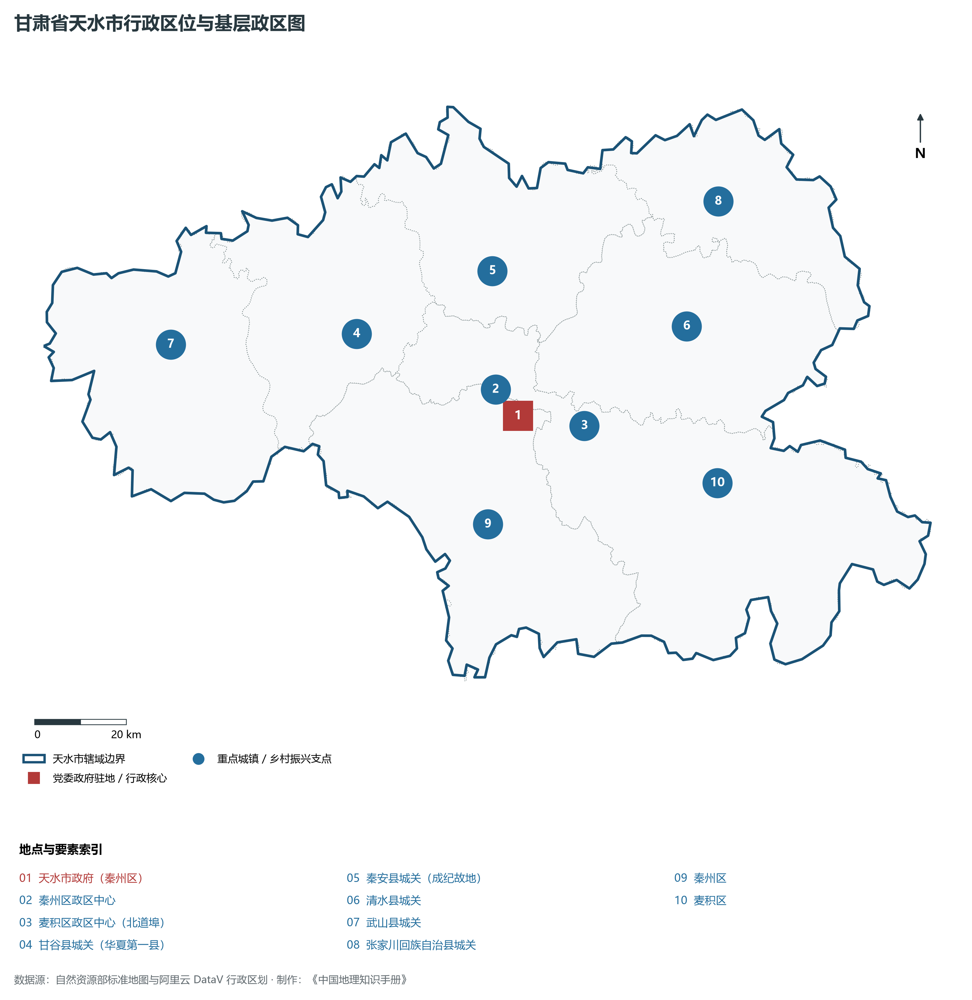
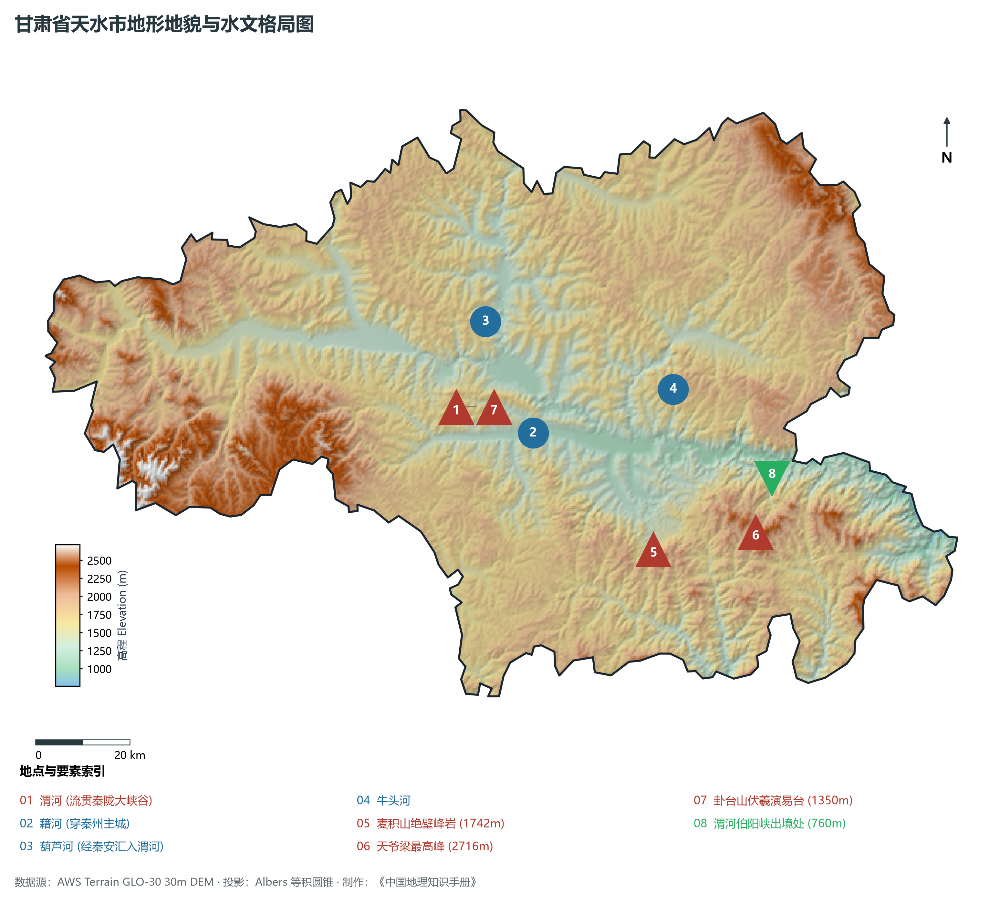
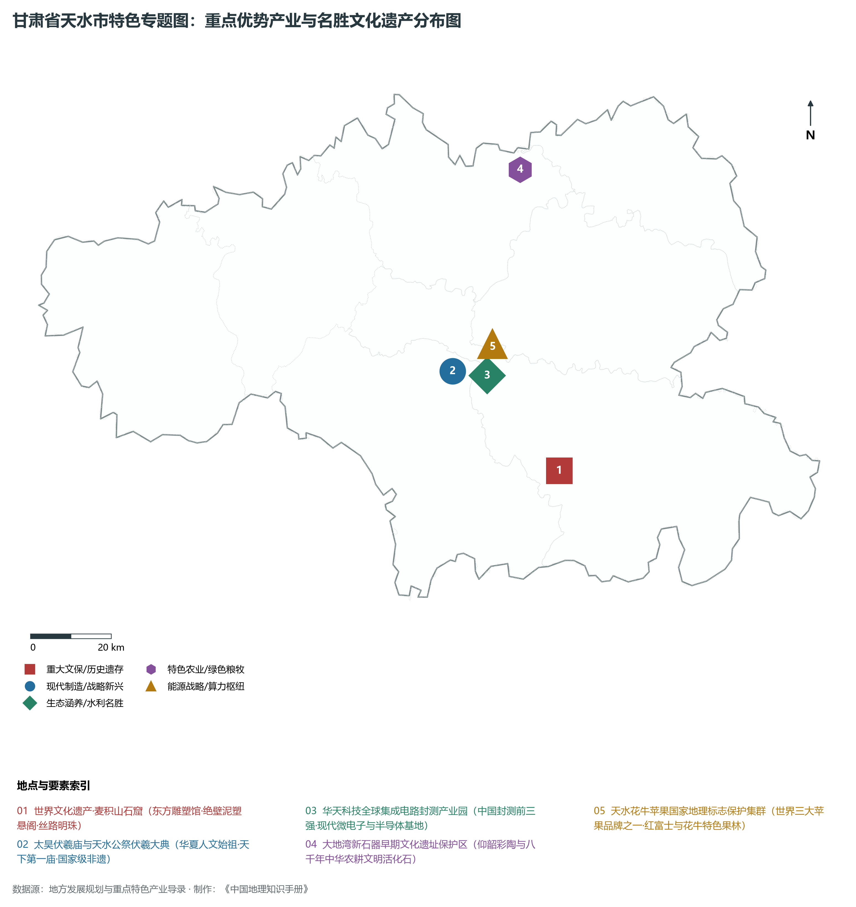
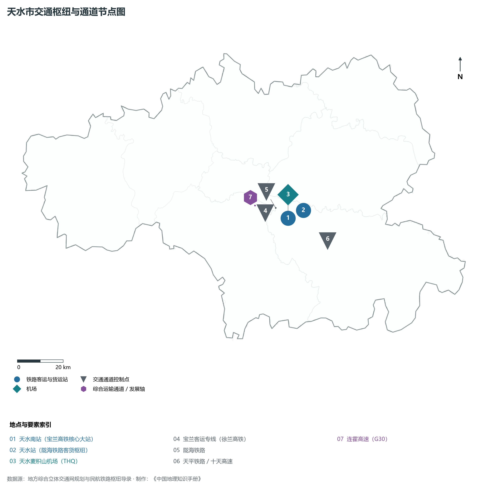
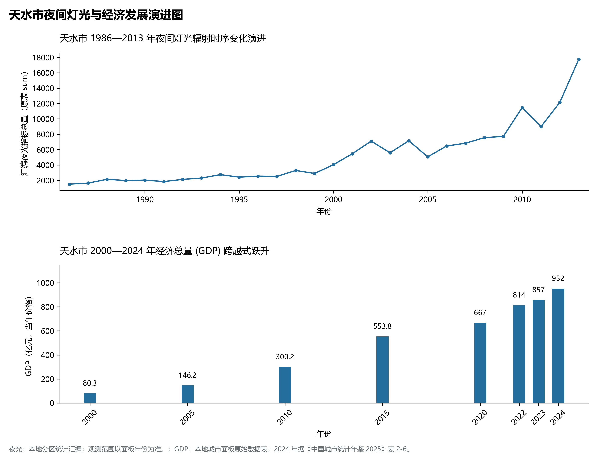

# 30.5 天水市

天水市，古称“秦州”、“成纪”，享有“羲皇故里”、“东方雕塑馆”与“陇上江南”的崇高美誉，是甘肃省辖地级市，关中平原城市群次核心城市、国家历史文化名城、华夏文明与中华民族重要发祥地，也是我国老工业三线建设先进装备与集成电路封装重镇。地处甘肃省东南部、陕甘川三省交界处，渭河中上游峡谷与西秦岭山地盆地过渡带，地理坐标介于东经 104°35′—106°44′、北纬 34°05′—35°10′ 之间。南依秀丽葱郁的西秦岭群山，北接陇东黄土高原丘陵沟壑，清澈的渭河自西向东横贯。2024 年常住人口 **289 万人**，常住人口城镇化率 **50.45%**，地区生产总值 **952 亿元**（当年价格），人均地区生产总值 **32,842 元**，三次产业构成为 **18.26 : 21.72 : 60.02**。

天水是一座人文历史深邃、文脉绵延八千年的中华元典圣域。相传华夏人文始祖伏羲女娲诞生于此，伏羲在此“画八卦、结网罟、取火种”，肇启了华夏早期文明曙光；秦安大地湾遗址距今 8 000 年左右，出土了中国最早的彩陶、最早的宫殿式地坪与粟类碳化作物，被誉为黄河流域史前文明的重大丰碑；西周秦人始祖非子在此因为周孝王牧马有功而获封“秦”邑，拉开了秦人崛起、横扫六合、一统天下的雄浑序幕；三国时期，诸葛亮六出祁山、姜维大战铁笼山等波澜壮阔的传奇故事在此广为流传；北魏至隋唐时期开凿的**麦积山石窟**，以孤峰绝壁与数千尊生动传神的泥塑造像驰名中外，作为“丝绸之路：长安—天山廊道的路网”核心节点列入世界文化遗产；“三线建设”时期，长城电工、星火机床、天光半导体等国家战略骨干企业内迁入驻，孕育出全国知名的机械装备与集成电路微电子基地；华天科技崛起为全球封测三强，天水花牛苹果享誉全球，天水麻辣烫火爆出圈，天水正成为融厚重文脉、现代智造与山水诗意于一身的陇原名城。

---

## 一、市情速览

天水市人口稠密、区位优越、物产丰饶、工业基础坚实，是甘肃省实施“强工业”与“强县域”行动的核心承载地。

| 核心指标 | 全市数值与空间分布 | 全国 / 全省战略定位 |
|:---|:---|:---|
| **行政区划面积** | 14 325 km² | 西秦岭中山峡谷与陇中黄土梁峁过渡地带 |
| **常住人口** | 289 万人 | 2024 年，全市；年鉴公布口径 |
| **常住人口城镇化率** | 50.45% | 2024 年，全市；年鉴公布口径 |
| **人口密度** | 206 人/km² | 全省人口密度最高的地级市之一，河谷川道达 1 200 人/km² |
| **地区生产总值 (GDP)** | 952 亿元 | 2024 年，全市；年鉴公布口径 |
| **人均 GDP** | 32,842 元/人 | 2024 年，全市；年鉴公布口径 |
| **产业三次结构** | 20.5 : 26.5 : 53.0 | 现代服务业过半，三线工业与高品质林果业协同并进 |
| **行政区划架构** | 辖 2 区、5 县 | 秦州区、麦积区；甘谷县、秦安县、清水县、武山县、张家川回族自治县 |
| **核心战略定位** | 华夏文明寻根圣地与微电子装备制造高地 | 世界遗产麦积山、全球集成电路封测龙头基地、关中平原城市群副中心 |

**图 30-05-1 甘肃省天水市行政区位与基层政区图**：图上编号与地点、要素索引对应。

---

## 二、自然地理：陇上江南、两山夹一河与温润季风气候

天水市位于中国大陆南北地理分界线秦岭的西端，地貌兼具青藏高原东北边缘、黄土高原与秦岭山地的过渡特征，全境呈“两山夹一谷、多河穿岭出”的地形骨架，海拔在 **760—2 716 m** 之间。

### 1. 地形地貌：西秦岭北麓与渭河峡谷盆地
全境地貌可清晰划分为南部中山区、中部渭河谷地与北部黄土梁峁区：

- **西秦岭中山森林区**：麦积区南部与秦州南部山势叠翠、云雾缭绕，天爷梁最高峰海拔高达 **2 716.0 m**，森林覆盖率超过 60%，麦积山红砂岩奇峰如麦垛般拔地而起，海拔 1 742 m，山色孤秀；
- **中部渭河河谷盆地**：自武山县洛门经甘谷、秦州至麦积区北道埠，渭河两岸阶地平坦宽阔，海拔在 1 100—1 400 m 之间，聚集了天水 70% 以上的人口与工业产能；
- **北部黄土丘陵区**：秦安、清水北部与甘谷北部呈现黄土塬峁交错、千沟万壑的典型黄土地貌，经数十年梯田绿化，漫山遍野覆盖着郁郁葱葱的果园；
- **渭河出境最低点**：渭河沿峡谷穿流向东流入陕西宝鸡，出境处麦积区伯阳峡海拔仅 **760.0 m**，为天水全境最低处，相对高差近 2 000 m。

**图 30-05-2 甘肃省天水市地形地貌与水文格局图**：图上编号与地点、要素索引对应。

### 2. 气候特征：温带半湿润大陆性季风气候
得益于秦岭阻隔冬季西北寒流，天水享有“陇上小江南”之称：

- **温润适中**：年平均气温在 **10.7—11.5 ℃** 之间，极端最低温 -19.2 ℃，极端最高温 38.2 ℃；夏无酷暑，冬无严寒，四季分明；
- **降水相对丰富**：年平均降水量达 **500—600 mm**，南部西秦岭山区可达 700 mm 以上，空气湿度高，春雨充沛，年无霜期长达 170—190 天，非常适宜北方落叶果树与中药材生长。

### 3. 河流水系：黄河最大支流渭河与其庞大干支网
天水全境均属于黄河流域黄河最大支流渭河水系：

- **渭河干流**：发源于定西鸟鼠山，自西向东流贯武山、甘谷、秦州、麦积四县区，在天水境内流长 246 km，年平均径流量超 30 亿立方米；
- **藉河与葫芦河**：藉河横穿秦州主城区，建有“藉河风情线”城市大型人工水景；葫芦河发源于宁夏西吉，流经静宁、秦安汇入渭河，是古成纪文明的母亲河；
- **牛头河与东柯河**：源出西秦岭深山，水质清冽，哺育了麦积山国家级风景名胜区周边万顷林海。

---

## 三、建置沿革与文化根脉

天水是“三皇之首”伏羲故里与丝路石窟艺术之都。

### 1. 华夏元典文明、大地湾与秦人肇基

- **伏羲庙与公祭伏羲大典**：天水市秦州区伏羲庙始建于元代、扩建于明清，是全国规模最大、保存最完好的纪念伏羲氏的古代宗祠建筑群；每年公祭伏羲大典升格为国家级祭典，海内外华人同胞在此遥拜人文始祖；
- **大地湾遗址**：位于秦安县五营镇，年代跨越距今 8000 至 4800 年，发现了中国最早的旱作农耕、原始彩陶、彩绘地画和规整木骨泥墙房屋，确立了黄河上游早期文明核心地位；
- **秦人牧马崛起之地**：甘谷县早在公元前 688 年设“冀县”，被史学界公认为“华夏第一县”；秦公先祖在此休养生息，开启了波澜壮阔的秦帝国基业。

### 2. 世界文化遗产麦积山石窟

- **东方雕塑陈列馆**：麦积山石窟建于十六国后秦时期，历经北魏、西魏、北周、隋、唐、宋、元、明、清十余个朝代不断开凿，现存窟龛 221 个、泥塑与石刻造像 10 645 尊、壁画 1 300 余平方米。造像以神态慈悲温婉、衣纹流丽飘逸、世俗亲和感极强而著称，与莫高窟、云冈石窟、龙门石窟并称为中国四大石窟；
- **麦积烟雨与悬阁飞栈**：高达数千米的红砂绝壁上栈道凌空横搭十二层，雨后山岚薄雾缭绕，构成了震撼人心的自然与人文融合绝景。

### 3. 三线铸剑与微电子芯片传奇

- **三线装备基地奠基**：20 世纪 60 年代，长城开关、星火机床、天水锻压、风动工具等大批企业布局天水峡谷，奠定了西北装备制造业雄厚基石；
- **华天科技**：原天水国营永红器材厂（第七四九厂）经历体制改革与自主突破，成长为全球排名前三、中国领先的半导体微电子与集成电路封装测试跨国企业。

**图 30-05-4 甘肃省天水市特色专题图：重点优势产业与名胜文化遗产分布图**：图上编号与地点、要素索引对应。

---

## 四、经济地理：集成电路与电工电器先进制造、花牛苹果品牌农业

天水市立足“老工业基地”深厚沉淀与“陇上江南”生态本底，加快构建现代装备制造、特色果蔬与文化旅游三足鼎立的现代产业格局。

### 1. 微电子与电工电器先进制造高地

- **集成电路封测全国龙头**：华天科技以先进封装、晶圆级封装、汽车电子封测为突破口，带动天水微电子上下游集聚，形成了西北地区极具国际竞争力的半导体封装产业集群；
- **输变电装备与数控机床**：长城电工在中高压开关柜、特种继电保护领域居国内第一方阵；星火机床在大重型卧式车床、精密数控轧辊磨床领域打破国外技术封锁。

### 2. 天水花牛苹果与高原特色农业

- **花牛苹果世界级品牌**：天水花牛苹果是与美国蛇果、日本富士齐名的世界三大著名苹果品牌之一，果实高桩红艳、肉质细腻甘甜，全市苹果种植面积超百万亩，产品畅销 30 多个国家；
- **秦安蜜桃与特色蔬菜**：秦安县是“中国桃之乡”；武山县是“中国高原韭菜之乡”，蔬菜大棚沿渭河两岸绵延数十里，常年直供全国大中城市。

### 3. 文旅康养与特色餐饮产业

- **天水麻辣烫文化现象**：麦积花椒香气扑鼻、甘谷辣椒油润红亮、武山粉条劲道滑爽，共同成就了天水麻辣烫的爆火，带动全域文旅接待量突破性增长；
- **麦积山温泉与森林康养**：武山矿泉、麦积街亭温泉水质优良，打造丝绸之路经济带上知名森林温泉康养度假名片。

---

## 五、综合立体交通走廊

天水自古为陇右交通要冲，是兰州、西安两大省会之间的重要节点与陇东南交通枢纽。

**图 30-05-3 天水市交通枢纽与通道节点图**：图上编号与地点、要素索引对应。

1. **“徐兰高铁”骨干节点**：
   - **宝鸡至兰州高速铁路（徐兰高铁核心段）**：全线贯通并在天水设**天水南站**、**甘谷站**、**武山站**，天水至兰州仅需 1 小时 15 分钟，至西安仅需 1 小时 30 分钟，正式步入关中平原与兰西城市群双重辐射圈；
   - **陇海铁路干线**：百年陇海穿天水东西全境，天水站是特等铁路客货运枢纽；
2. **高速公路网四通八达**：G30 连霍高速横穿渭河峡谷，G7011 十天高速自天水向东南直达汉中、十堰，天平高速、平天高速实现了天水与平凉、庆阳的高速互联；
3. **天水麦积山机场与三里店综合客运枢纽**：天水麦积山机场开通飞往西安、南京、重庆等重点城市航班，正加快迁建中滩新机场，构建现代化空铁联运门户。

---

## 六、区县空间分区与极值矩阵

**图 30-05-5 天水市夜间灯光与经济发展演进图**：各面板按标注的观测年份、指标和单位列示。

天水市现辖 2 个市辖区、4 个县、1 个自治县：

| 县区单元 | 面积 (km²) | 常住人口 (万人) | 2024年GDP (亿元) | 城镇化率 (%) | 核心功能定位与主要地理地标 |
|:---|:---|:---|:---|:---|:---|
| **秦州区** | 2 442 | 65.5 | 280.0 | 79.5% | 市委市政府驻地、全市政治文化商业极核、伏羲庙、玉泉观、天水古城 |
| **麦积区** | 3 452 | 56.8 | 230.0 | 72.8% | 东方雕塑馆麦积山、天水南站高铁枢纽、华天科技产业园、街亭温泉 |
| **甘谷县** | 1 572 | 51.5 | 115.0 | 41.5% | 华夏第一县、大象山石窟、甘谷辣椒地理标志、关中天水先进机械配套 |
| **秦安县** | 1 601 | 42.5 | 95.0 | 38.6% | 大地湾文化发源地、中国桃之乡、女娲祠、陇中旱作梯田果林示范 |
| **清水县** | 2 012 | 24.5 | 68.0 | 40.2% | 轩辕黄帝诞生地、赵充国陵园、温泉森林康养、生态林果基地 |
| **武山县** | 2 011 | 37.8 | 80.0 | 42.5% | 水帘洞石窟悬崖壁画、中国韭菜之乡、武山矿泉、武山鸳鸯玉产地 |
| **张家川回族自治县** | 1 235 | 16.6 | 27.0 | 38.5% | 马家塬战国车舆遗址、关山天然草场、特色清真餐饮肉牛养殖 |

2024 年统计来源：《中国城市统计年鉴 2025》表 2-1、2-6、2-7（2024 年，全市）。其他年份 GDP 据本地城市面板“原始数据”表，单位为亿元、当年价格。
