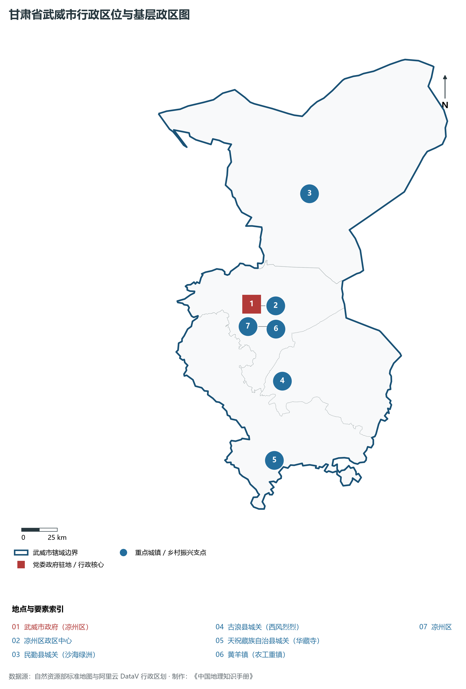
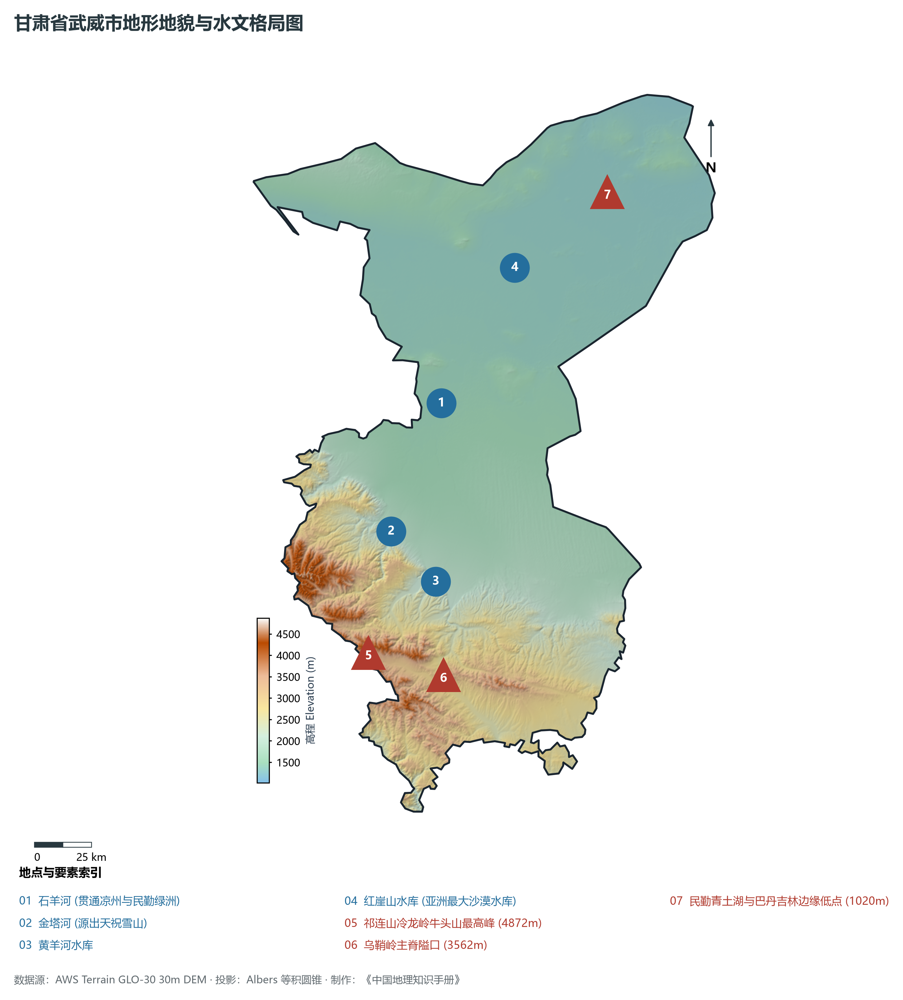
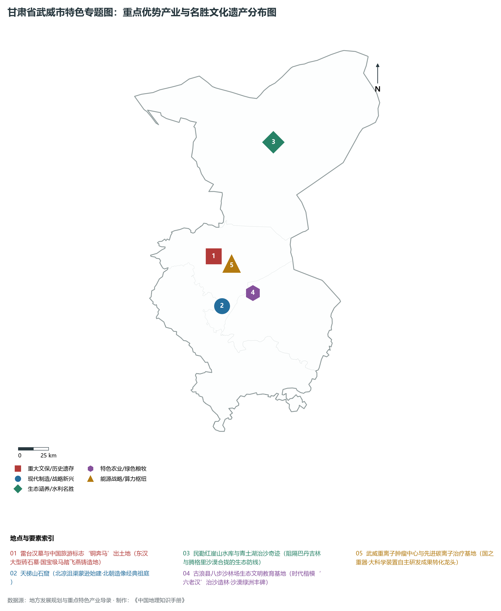
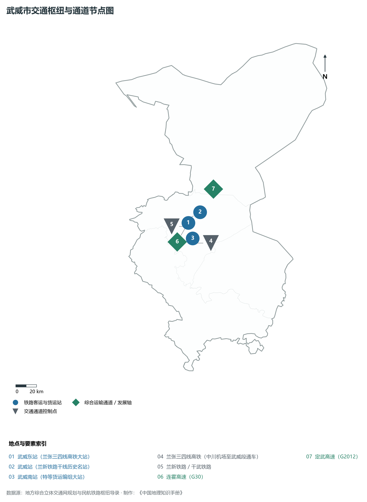
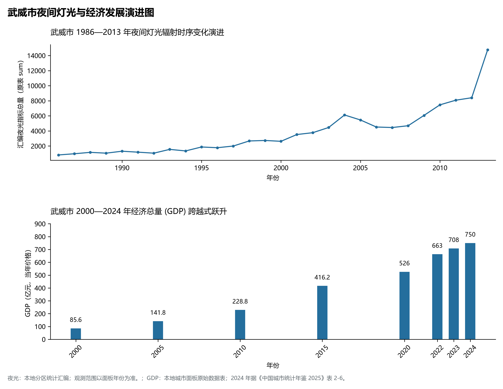

# 30.6 武威市

武威市。2024 年常住人口 **142 万人**，常住人口城镇化率 **52.34%**，地区生产总值 **750 亿元**（当年价格），人均地区生产总值 **52,644 元**，三次产业构成为 **30.89 : 20.83 : 48.28**。

武威是一座沉淀了两千余年丝路风华与金戈铁马的千古名郡。汉武帝元狩二年（前 121 年），骠骑将军霍去病两击匈奴，收复河西走廊，汉武帝为彰显大汉帝国“武功军威到达西极”，始设“武威郡”；魏晋南北朝时期，前凉、后凉、南凉、北凉以及西夏相继在此建都立政，使凉州成为群雄逐鹿、文教鼎盛的北方文化副中心与丝路西行首府；唐代凉州繁华冠绝塞北，高适、王翰、王之涣等大诗人留下了“凉州词”等千古绝唱；1969 年，凉州雷台汉墓出土了一具东汉青铜器“铜奔马”（马踏飞燕），构思巧妙、气韵生动，1983 年被国家旅游局确定为**中国旅游标志**；武威也是藏传佛教纳入中央行政统辖的关键历史见证地，1247 年萨迦班智达与蒙古王子阔端在凉州百塔寺举行著名的“凉州会盟”，发表《萨迦班智达致蕃人书》，确立了西藏正式归入中国版图的历史法理；新中国成立后，面对巴丹吉林与腾格里两大沙漠夹击，古浪县八步沙林场“六老汉”三代人扎根荒漠誓死治沙，创造了享誉全国的生态绿色奇迹；国内首台完全自主知识产权的重离子肿瘤治疗装置在此投入临床运行，武威正从“丝路重镇”跃升为“科技名城”与“绿色生态绿洲典范”。

---

## 一、市情速览

武威市地域辽阔、雪山与沙漠交织、农业基础雄厚、生态屏障极其重要，是甘肃落实黄河流域与内陆河流域高水平生态保护的攻坚前沿。

| 核心指标 | 全市数值与空间分布 | 全国 / 全省战略定位 |
|:---|:---|:---|
| **行政区划面积** | 32 347 km² | 祁连山水源涵养区 30%，绿洲平原 35%，荒漠沙漠 35% |
| **常住人口** | 142 万人 | 2024 年，全市；年鉴公布口径 |
| **常住人口城镇化率** | 52.34% | 2024 年，全市；年鉴公布口径 |
| **人口密度** | 45 人/km² | 凉州区绿洲平原达 200 人/km²，北部沙漠边缘极度稀疏 |
| **地区生产总值 (GDP)** | 750 亿元 | 2024 年，全市；年鉴公布口径 |
| **人均 GDP** | 52,644 元/人 | 2024 年，全市；年鉴公布口径 |
| **产业三次结构** | 31.5 : 21.5 : 47.0 | 第一产业占比居河西各市之首，现代农业与服务业双强 |
| **行政区划架构** | 辖 1 市辖区、2 县、1 自治县 | 凉州区；民勤县、古浪县；天祝藏族自治县 |
| **核心战略定位** | 河西走廊门户要塞与石羊河流域生态防线 | 中国旅游标志马踏飞燕故里、八步沙时代楷模发祥地、石羊河流域治理样板 |

**图 30-06-1 甘肃省武威市行政区位与基层政区图**：图上编号与地点、要素索引对应。

---

## 二、自然地理：祁连屏障、石羊河走廊与双沙夹峙绿洲

武威地处祁连山与内蒙古高原的接触断陷带，整体地势西南极高、东北低洼，全境由高山雪峰、冲洪积绿洲斜原向荒漠盆地倾斜，海拔在 **1 020—4 872 m** 之间，垂直落差高达 3 852 m。

### 1. 地形地貌：祁连中山、走廊绿洲平原与外围沙海
全境划分为南部祁连山区、中部走廊平原区与北部沙漠干旱区三大截然不同的地貌单元：

- **南部祁连山中山与极高山**：天祝藏族自治县南部与古浪南部横亘着冷龙岭与乌鞘岭。冷龙岭主峰牛头山海拔高达 **4 872.0 m**，为武威全境最高峰；乌鞘岭海拔 3 562 m，是河西走廊与陇中高原的地理分界线，山势陡峻，气候高寒冷凉；
- **中部走廊洪积冲积绿洲平原**：自乌鞘岭向北倾斜展开，由石羊河及其支流冲积而成，海拔 1 400—1 800 m，地势坦荡，土壤肥沃，引水灌溉历史悠久，是武威城市空间与农耕经济的核心载体；
- **北部腾格里与巴丹吉林沙漠**：民勤县三面环沙，地势降至海拔 **1 020.0 m**（青土湖低洼处），沙漠流动沙丘与灌丛沙堆广布，是阻止两大沙漠合拢的关键生态锁钥。

**图 30-06-2 甘肃省武威市地形地貌与水文格局图**：图上编号与地点、要素索引对应。

### 2. 气候特征：温带大陆性干旱荒漠气候与高寒山地气候
垂直气候分异极其显著，光照充沛，干燥度极高：

- **气温分异**：南部高寒山区年平均气温 -0.5—4.5 ℃，中南部走廊平原年均温 7.8—8.6 ℃，北部民勤荒漠年均温 8.8 ℃；
- **降水与蒸发**：天祝祁连山区年降水量达 400—600 mm，中部凉州平原年降水仅 160—200 mm，而北部民勤降水量仅 **110 mm** 左右，蒸发量却高达 **2 600 mm** 以上，降水少而蒸发烈是武威生态保护的最大硬约束。

### 3. 河流水系：河西三大内陆河之一石羊河水系
石羊河是武威赖以生存的母亲河：

- **石羊河水系**：发源于祁连山北麓，由西向东由大雪河、金塔河、西营河、黄羊河、古浪河等 8 条支流组成，年径流量约 15 亿立方米，汇合流贯凉州绿洲后进入民勤盆地；
- **红崖山水库**：位于民勤县城以北 30 km 处，是**亚洲最大沙漠水库**，蓄水面积达 15 平方公里，保障了民勤绿洲工农业与防沙林的生命之水；
- **青土湖碧波重现**：经过二十年“石羊河流域重点治理”，干涸了半个多世纪的石羊河尾闾湖泊青土湖重现数十平方公里水域与湿地，彻底阻断了巴丹吉林与腾格里沙漠的合拢。

---

## 三、建置沿革与文化根脉

武威汇聚汉唐气象、西夏雄风、五凉遗风与时代楷模精神，文化根脉无比厚重。

### 1. 马踏飞燕、汉简瑰宝与天梯祖庭

- **中国旅游标志“马踏飞燕”**：1969 年出土于凉州雷台汉墓，铜奔马三足腾空、飞掠一鸟，线条遒劲潇洒，被郭沫若先生定名为“马踏飞燕”，成为中华民族走向世界的最具辨识度的文化符号；
- **天梯山石窟（中国石窟鼻祖）**：位于凉州区城南天梯山，北凉国主沮渠蒙逊于公元 412 年开凿，开创了著名的“凉州模式”，直接影响了云冈、龙门石窟的营造规制；
- **武威文庙（陇右学宫之冠）**：始建于明代，规模宏大，保存有历代珍贵匾额与罕见的西夏碑（重修凉州感应塔碑），是了解西夏文字与历史的绝世稀珍。

### 2. 凉州会盟与中华统一历史坐标

- **凉州会盟百塔寺**：公元 1247 年，西藏萨迦派宗教领袖萨迦班智达·贡噶坚赞与蒙古宗王阔端在凉州白塔寺举行会谈，和平解决了西藏归属问题，百塔林立、法号长鸣，奠定了统一多民族国家的重要基石。

### 3. 八步沙林场“六老汉”当代治沙精神

- **三代愚公战风沙**：古浪县八步沙地处腾格里沙漠南缘，曾被称为“沙逼人退”的绝境。郭朝明、贺发林等“六老汉”在 20 世纪 80 年代初按下手印联户承包治沙，三代人接力坚守 40 余年，造林封育数十万亩，彻底筑牢了河西走廊生态长城，被中宣部授予“时代楷模”崇高荣誉。

**图 30-06-4 甘肃省武威市特色专题图：重点优势产业与名胜文化遗产分布图**：图上编号与地点、要素索引对应。

---

## 四、经济地理：国家绿色农产品基地、重离子高端医疗科技与新能源装备

武威市抢抓丝绸之路经济带与双碳战略机遇，推动特色现代农业高质高效、先进制造与绿色新能源融合共进。

### 1. 全国现代节水高效农业与食品加工基地

- **沿山沿川沿沙现代农牧**：大力推进“以水定产”，培育壮大凉州优质果蔬、民勤蜜瓜与红枣、古浪香菇、天祝白牦牛与高原夏菜产业集群，武威是甘肃最大现代设施农业和奶酪乳业基地；
- **全国最大肉羊良种繁育基地**：古浪与民勤肉羊饲养量超千万只，现代化圈舍与标准化育肥形成西北著名的羊肉全产业链示范基地。

### 2. 国之重器重离子肿瘤治疗与先进医疗器械

- **武威重离子中心临床先驱**：由中科院近代物理研究所自主研发的我国首台完全自主知识产权碳离子肿瘤治疗系统在武威重离子医院投入正式临床运营，累计治疗海内外恶性肿瘤患者数千例，打造世界一流离子医疗高地；
- **重离子周边高端装备集聚**：协同推进医用加速器组件制造、生物医药与高性能放疗耗材本地化配套。

### 3. 腾格里沙漠绿色风光电基地

- **新能源规模化开发**：在凉州与民勤沙漠戈壁布局数百万千瓦光伏治沙与风电基地，探索“板上发电、板下种植、板间治沙”立体循环生态经济模式。

---

## 五、综合立体交通走廊

武威扼守亚欧大陆桥与进出河西走廊的第一门户，陆路交通四通八达。

**图 30-06-3 武威市交通枢纽与通道节点图**：图上编号与地点、要素索引对应。

1. **“兰张三四线”高铁大动脉**：
   - **兰州至张掖三四线高铁**：兰州新区至武威东段已正式开通运营，使武威全面接入全国高铁网，武威至兰州行车时间缩短至 1.5 小时以内，设**武威东站**、**古浪北站**、**天祝西站**；
   - **兰新铁路与干武铁路**：干武铁路连接内蒙古乌海与包兰铁路，武威南站是西北地区举足轻重的特等铁路编组大站；
2. **高速公路骨架密集**：G30 连霍高速东西纵贯，G2012 定武高速向东直达中卫、银川，金武高速、凉古高速全面实现市域半小时通达。

---

## 六、区县空间分区与极值矩阵

**图 30-06-5 武威市夜间灯光与经济发展演进图**：各面板按标注的观测年份、指标和单位列示。

武威市现辖 1 个市辖区、2 个县、1 个自治县：

| 县区单元 | 面积 (km²) | 常住人口 (万人) | 2024年GDP (亿元) | 城镇化率 (%) | 核心功能定位与主要地理地标 |
|:---|:---|:---|:---|:---|:---|
| **凉州区** | 4 907 | 101.5 | 525.0 | 62.5% | 市委市政府驻地、全市政经文教极核、雷台汉墓、文庙、武威东站、重离子中心 |
| **民勤县** | 15 908 | 18.2 | 98.0 | 45.2% | 防沙治沙最前沿、红崖山水库、青土湖生态湿地、民勤蜜瓜地理标志基地 |
| **古浪县** | 5 047 | 16.8 | 82.0 | 38.5% | 时代楷模八步沙林场、西路军九军烈士陵园、优质肉羊与设施香菇产业基地 |
| **天祝藏族自治县** | 6 485 | 8.7 | 50.0 | 41.2% | 乌鞘岭天然门户、马牙雪山天池、天堂寺、中国白牦牛原产地、高原冷凉蔬菜 |

2024 年统计来源：《中国城市统计年鉴 2025》表 2-1、2-6、2-7（2024 年，全市）。其他年份 GDP 据本地城市面板“原始数据”表，单位为亿元、当年价格。
