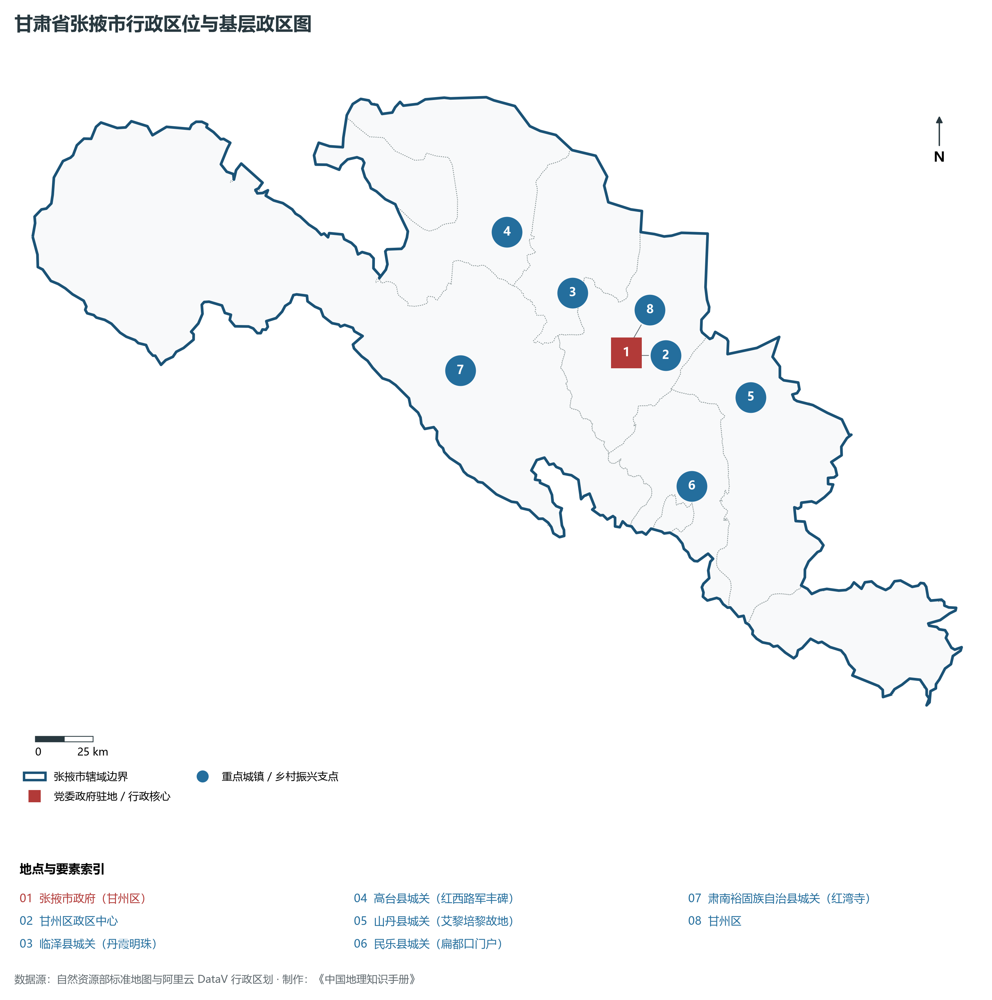
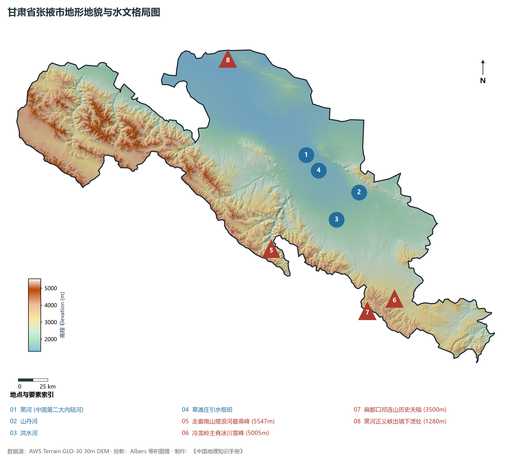
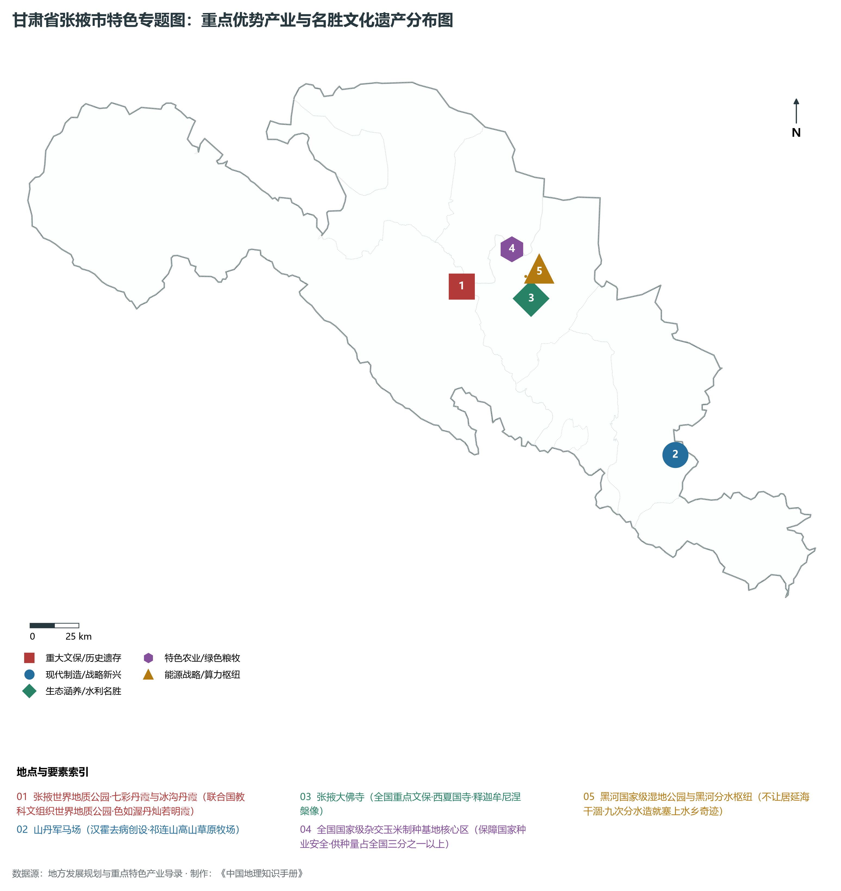
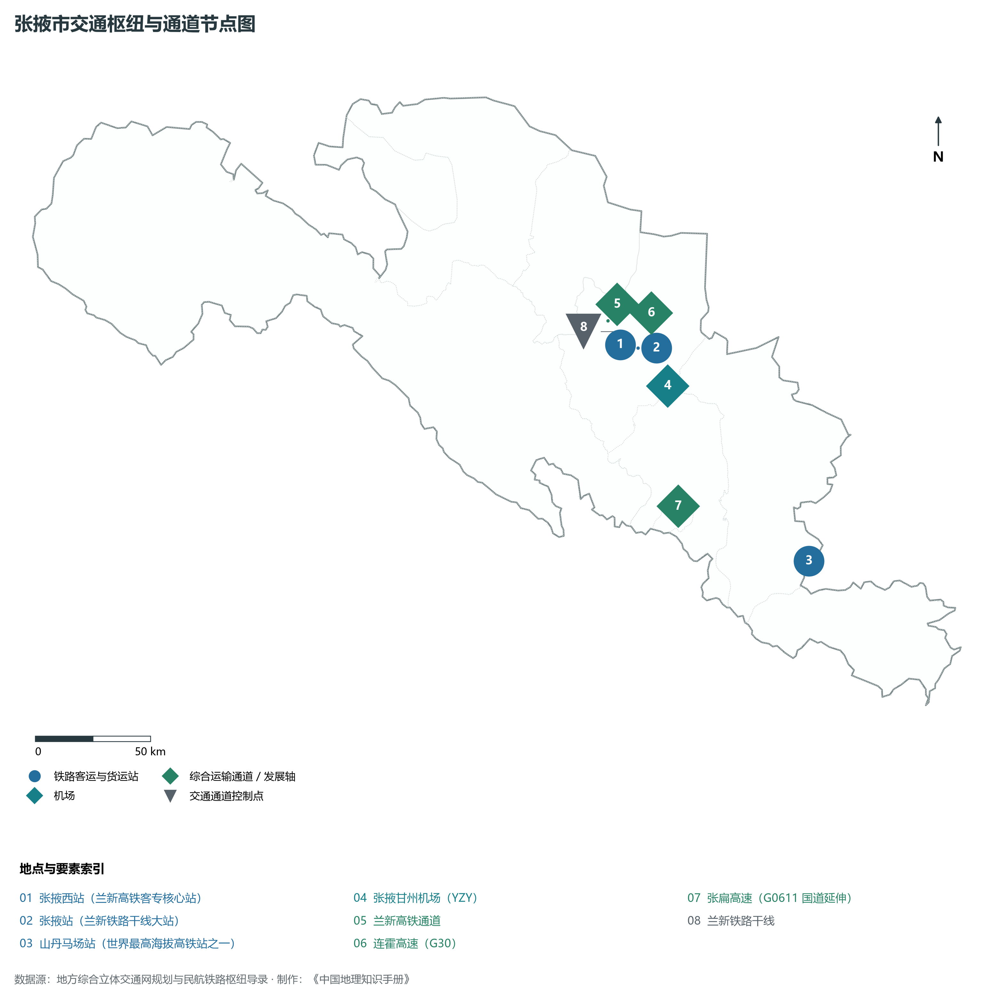
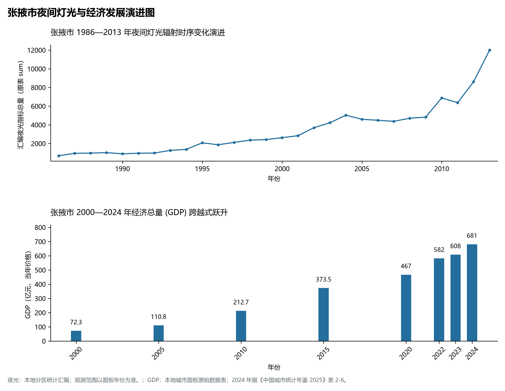

# 30.7 张掖市

张掖市。2024 年常住人口 **110 万人**，常住人口城镇化率 **56.29%**，地区生产总值 **681 亿元**（当年价格），人均地区生产总值 **61,772 元**，三次产业构成为 **25.62 : 20.59 : 53.79**。

张掖是一座深深刻印着汉唐雄风与多民族融合史诗的丝路枢纽名城。汉武帝元狩二年（前 121 年），骠骑将军霍去病大破匈奴，“断匈奴之臂，张中国之掖（腋）”，始置“张掖郡”，取“张国臂掖、以通西域”之宏旨；隋炀帝大业五年（609 年），杨广亲率大军西巡张掖，在山丹焉支山接见西域二十七国君王使节，举办了人类历史上最早的万国经贸博览盛会；宋代西夏在此建立甘州黑水镇燕军司，修建了气势恢宏的张掖大佛寺，寺内保存有全国最大的西夏室内木胎泥塑卧佛；明清时期甘州为陕西行都司与甘凉道治所，是统领河西军政的最高首府；山丹军马场地处祁连山水草丰美之地，自汉代霍去病屯兵育马起已延续 2 100 余年，是世界上历史最悠久、规模最宏大的马场；新西兰国际友人路易·艾黎在此创办培黎工艺学校，铸就了“手脑并用、创造分析”的培黎精神；新时代以来，张掖全力扛起祁连山生态修复政治责任，全面执行黑河分水生态调配，张掖七彩丹霞惊艳寰宇，全国三分之一以上的杂交玉米良种源自于此，张掖正昂首迈向绿色转型与生态文明建设的高质量发展新阶段。

---

## 一、市情速览

张掖市生态战略地位极端重要、自然景观举世无双、现代种业全国称冠，是河西走廊高质量绿色发展的典型代表。

| 核心指标 | 全市数值与空间分布 | 全国 / 全省战略定位 |
|:---|:---|:---|
| **行政区划面积** | 36 443 km² | 祁连山生态涵养区 45%，黑河中游绿洲 30%，北山荒漠 25% |
| **常住人口** | 110 万人 | 2024 年，全市；年鉴公布口径 |
| **常住人口城镇化率** | 56.29% | 2024 年，全市；年鉴公布口径 |
| **人口密度** | 31 人/km² | 甘州区绿洲平原达 140 人/km²，高山草场与戈壁偏稀 |
| **地区生产总值 (GDP)** | 681 亿元 | 2024 年，全市；年鉴公布口径 |
| **人均 GDP** | 61,772 元/人 | 2024 年，全市；年鉴公布口径 |
| **产业三次结构** | 30.5 : 21.0 : 48.5 | 第一产业与文旅第三产业双驱动，国家种业重镇 |
| **行政区划架构** | 辖 1 市辖区、4 县、1 自治县 | 甘州区；临泽县、高台县、山丹县、民乐县；肃南裕固族自治县 |
| **核心战略定位** | 祁连山国家公园核心区与国家种业安全基地 | 全国最大杂交玉米制种基地、世界地质公园、丝路文旅高地 |

**图 30-07-1 甘肃省张掖市行政区位与基层政区图**：图上编号与地点、要素索引对应。

---

## 二、自然地理：祁连冰雪、黑河润泽与七彩丹霞绝景

张掖地处祁连山中段与阿拉善地块之间的山前断陷走廊，地形起伏极大，南高北低、自东南向西北倾斜，全境海拔在 **1 280—5 547 m** 之间，垂直落差达 4 267 m。

### 1. 地形地貌：祁连极高山、走廊倾斜平原与北山低山
全境自南向北由三大地貌单元平行排列而成：

- **祁连山南缘极高山地**：走廊南山与冷龙岭拔地而起，肃南裕固族自治县境内的**走廊南山摆浪河最高峰**海拔高达 **5 547.0 m**，为张掖第一高峰；山顶终年积雪，发育有众多现代大陆性冰川，是黑河、石羊河的重要发源地；
- **黑河走廊冲积冲积平原绿洲**：黑河穿出祁连山莺落峡后，冲积出地势坦荡、水草丰茂的甘州平原与临泽、高台绿洲，海拔在 1 350—1 600 m 之间，形成了“不望祁连山顶雪，错将张掖认江南”的塞上水乡风貌；
- **合黎山与龙首山北山低山荒漠**：位于走廊北侧，山体干旱裸露，黑河在正义峡穿出峡谷进入内蒙古额济纳旗，峡口处海拔仅 **1 280.0 m**，为张掖全境最低洼处；
- **张掖七彩丹霞与冰沟丹霞**：位于临泽与肃南交界处，为白垩系红层经喜马拉雅构造运动抬升与风化剥蚀形成的彩色丘陵地貌，红、黄、橙、白、青灰等色彩呈层状交错，如彩练覆野。

**图 30-07-2 甘肃省张掖市地形地貌与水文格局图**：图上编号与地点、要素索引对应。

### 2. 气候特征：温带大陆性温凉干旱绿洲气候
光热极其充足，降水少而干燥，昼夜温差悬殊：

- **气温与光照**：年平均气温在 **3.5—7.8 ℃** 之间，平原绿洲区平均气温约 7.5 ℃；年日照时数长达 **3 000—3 200 小时**，是全国光能资源最富集的地区之一，积温充足，光合作用极为旺盛；
- **降水时空分异**：南部高山年降水量可达 400—600 mm，而中部走廊平原年降水量仅 **120—150 mm**，北部荒漠降至 100 mm 以下；年潜在蒸发量达 1 800—2 100 mm。

### 3. 河流水系：中国第二大内陆河——黑河中游生态命脉
黑河是张掖的生命源泉与生态根基：

- **黑河干流穿境**：黑河发源于青海祁连山，自莺落峡出山后流贯张掖全境长达 200 余公里，年出山径流量约 16 亿立方米；
- **草滩庄水利枢纽与张掖国家湿地公园**：草滩庄枢纽有效调控黑河干流与灌溉渠道，在甘州城郊滋养出总面积达 6.2 万亩的张掖国家湿地公园，形成芦苇丛生、候鸟翔集的西北罕见城市湿地；
- **黑河分水生态壮举**：二十余年来张掖严格执行国家黑河跨省分水指令，累计向下游内蒙古额济纳旗输送生态水逾百亿立方米，使东居延海连续二十年不干涸，实现了上下游生态多赢共生。

---

## 三、建置沿革与文化根脉

张掖历史悠久绵长，是丝路文化、佛教石窟与多民族融合的东方典范。

### 1. 汉置张掖、万国经贸与西夏大佛

- **张国臂掖与河西四郡**：汉武帝设张掖郡，自此成为中原经略西域、屯田通商的枢纽核心；
- **隋炀帝西巡与焉支山盛会**：公元 609 年，隋炀帝西巡登临扁都口入张掖，在焉支山大宴高昌、突厥等二十七国使节，开创了国家元首亲临丝路主持万国经贸的千古盛事；
- **张掖大佛寺（西夏国寺）**：始建于西夏永安元年（1098 年），正殿为全国最大的西夏木结构建筑，殿内供奉的释迦牟尼木胎泥塑卧佛长达 34.5 米、肩宽 7.5 米，气势恢宏、神态安详，寺内珍藏数千卷明代永乐北藏佛经，是国宝级佛教艺术圣殿；
- **马蹄寺石窟群**：建于十六国北凉时期，石窟悬空开凿于三十三天绝壁之上，融汉传佛教、藏传佛教于一体。

### 2. 山丹军马场：世界上最悠久的皇家军马场

- **两千年军马摇篮**：公元前 121 年，骠骑将军霍去病收复河西后在此建立军马场；这里地处祁连山冷龙岭下大草原，水草极其丰茂，两千年来为历代中原王朝繁育了数以百万计的战马与战备优良骡马，如今也是亚洲最大马场与经典生态影视拍摄基地。

### 3. 肃南裕固族自治县：全国独有的古老民族

- **裕固族家园**：肃南县是全国唯一的裕固族自治县，裕固族系古代回鹘人后裔，完整保留了独特的民族服饰、萨玛舞与游牧歌谣，构筑起祁连山多彩的人文画卷。

**图 30-07-4 甘肃省张掖市特色专题图：重点优势产业与名胜文化遗产分布图**：图上编号与地点、要素索引对应。

---

## 四、经济地理：国家玉米种业硅谷、全域文旅大景区与现代农业

张掖市立足良好的水土光热组合与绝美的自然人文底蕴，打造全国种业安全基石、绿色食品深加工与丝路国际旅游名城。

### 1. 全国最大的杂交玉米制种基地

- **国家战略“种业芯片”**：张掖玉米制种面积常年稳定在 100 万亩以上，年产杂交玉米种子超 **4.5 亿公斤**，占全国大田玉米用种量的 **35% 以上**，是全国规模最大、机械化程度最高、品质最稳定的国家级玉米制种核心基地，“全国每三粒玉米种子就有一粒来自张掖”；
- **现代种业全链条配套**：中种集团、隆平高科、先正达等国内外百余家知名种业企业设立研发基地，拥有国际先进的果穗烘干与自动成套加工中心。

### 2. 国际知名七彩丹霞文旅大IP

- **联合国教科文组织世界地质公园**：张掖七彩丹霞景区年接待游客突破 300 万人次，热气球唯美飞行、丹霞摄影采风与丝路研学游蓬勃兴起，带动住宿、餐饮、演艺全产业链繁荣发展。

### 3. 现代生态寒旱农业与特色畜牧

- **绿色有机农产品集群**：张掖是西北重要的高原夏菜、优质酿酒葡萄、食用菌和特色中药材生产基地；
- **优质牛羊全产业链**：依托丰富秸秆饲料资源，大力培育张掖肉牛与肃南高山细毛羊，高品质牛肉直供北京、上海等高端生鲜市场。

---

## 五、综合立体交通走廊

张掖自古为河西走廊咽喉驿站，现已形成高速铁路、国道干线、高速公路与航空联运的现代立体走廊。

**图 30-07-3 张掖市交通枢纽与通道节点图**：图上编号与地点、要素索引对应。

1. **“兰新高铁”走廊骨干**：
   - **兰新高速铁路**：贯穿张掖东西全境，设**张掖西站**、**临泽南站**、**高台南站**；新建世界最高海拔高铁客运站之一的**山丹马场站**（海拔 3 108 米），极大方便了祁连山深处各族群众与文旅出行；
   - **兰新铁路**：干线重型货运中枢，张掖站、高台站承担大宗粮油及工业品外运；
2. **高速公路网高效覆盖**：G30 连霍高速横穿全境；张掖至扁都口高速公路（G0611 组成部分）打通了穿越祁连山直通青海西宁的高速大通道；
3. **张掖甘州机场（4C 级空港）**：开通直飞北京、上海、广州、成都、西安、兰州等主要大城市航线，架设空中快速通道。

---

## 六、区县空间分区与极值矩阵

**图 30-07-5 张掖市夜间灯光与经济发展演进图**：各面板按标注的观测年份、指标和单位列示。

张掖市现辖 1 个市辖区、4 个县、1 个自治县：

| 县区单元 | 面积 (km²) | 常住人口 (万人) | 2024年GDP (亿元) | 城镇化率 (%) | 核心功能定位与主要地理地标 |
|:---|:---|:---|:---|:---|:---|
| **甘州区** | 3 661 | 51.8 | 325.0 | 68.2% | 市委市政府驻地、全市政经文化商贸中心、张掖大佛寺、张掖国家湿地公园、张掖西站 |
| **临泽县** | 2 727 | 11.5 | 88.0 | 52.5% | 张掖七彩丹霞核心景区、全国制种玉米大县、临泽小枣原产地、沙桥古驿 |
| **高台县** | 4 459 | 12.8 | 85.0 | 48.6% | 中国工农红军西路军纪念馆、正义峡黑河出境水利、黑河黑泉湿地、优质酿酒葡萄 |
| **山丹县** | 5 402 | 15.2 | 75.0 | 49.5% | 山丹军马场、焉支山国家森林公园、路易·艾黎培黎学校旧址、山丹汉明长城 |
| **民乐县** | 3 678 | 17.5 | 55.0 | 46.2% | 扁都口古代关隘、生态工业园区、高原特色马铃薯与优质小油菜基地 |
| **肃南裕固族自治县** | 16 516 | 3.7 | 24.0 | 58.5% | 全国唯一裕固族自治县、祁连山国家公园核心区、冰沟丹霞、马蹄寺石窟、摆浪河雪峰 |

2024 年统计来源：《中国城市统计年鉴 2025》表 2-1、2-6、2-7（2024 年，全市）。其他年份 GDP 据本地城市面板“原始数据”表，单位为亿元、当年价格。
