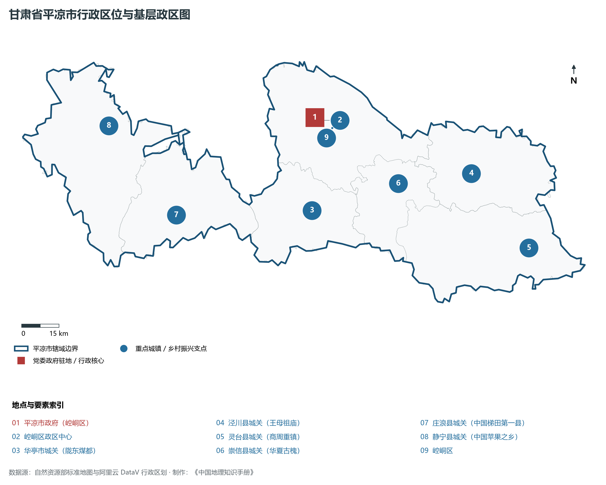
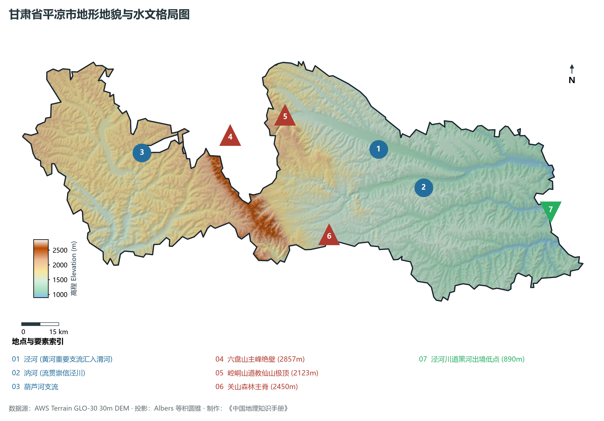
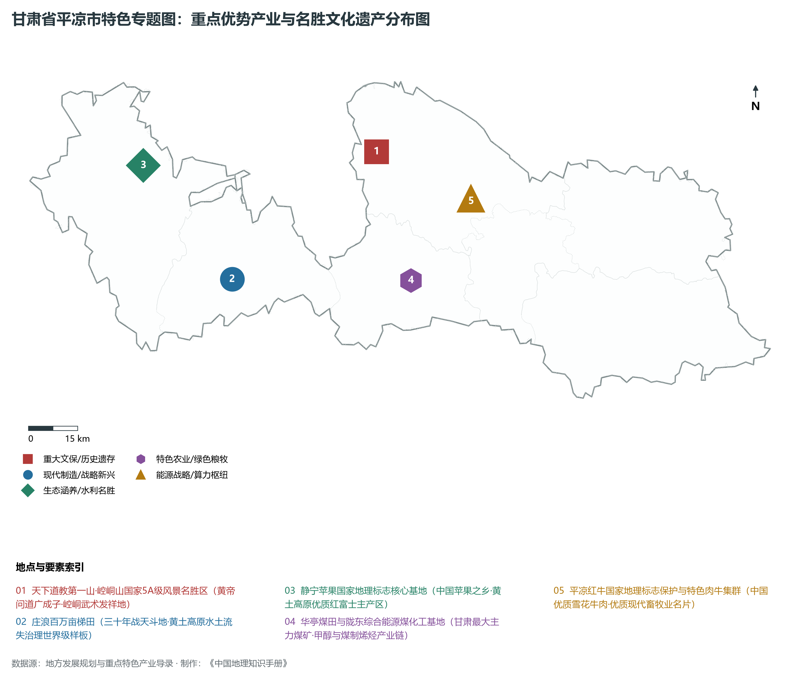
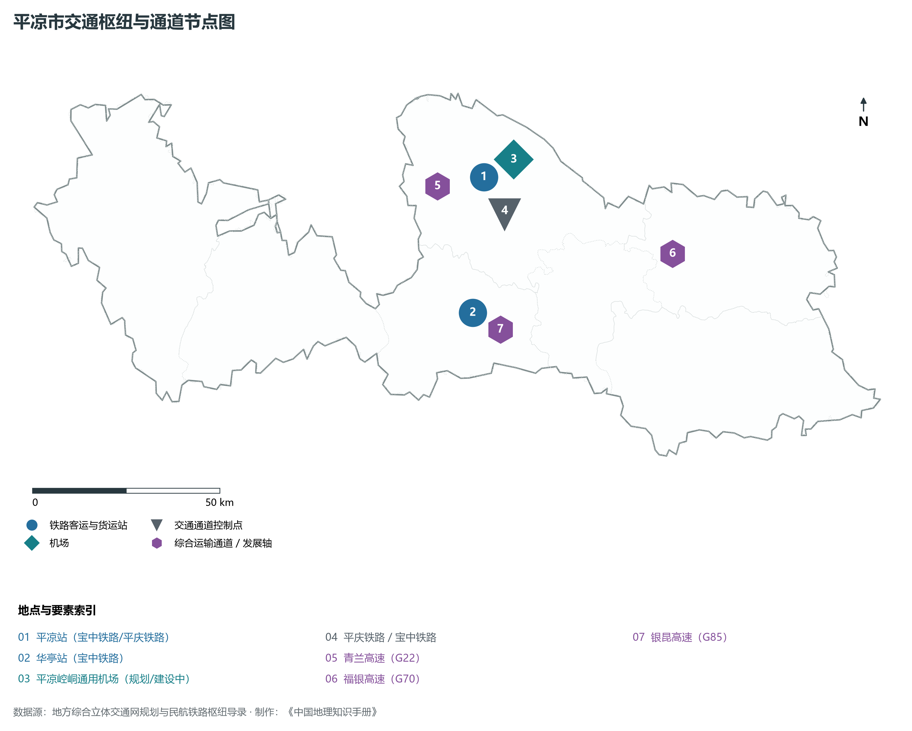
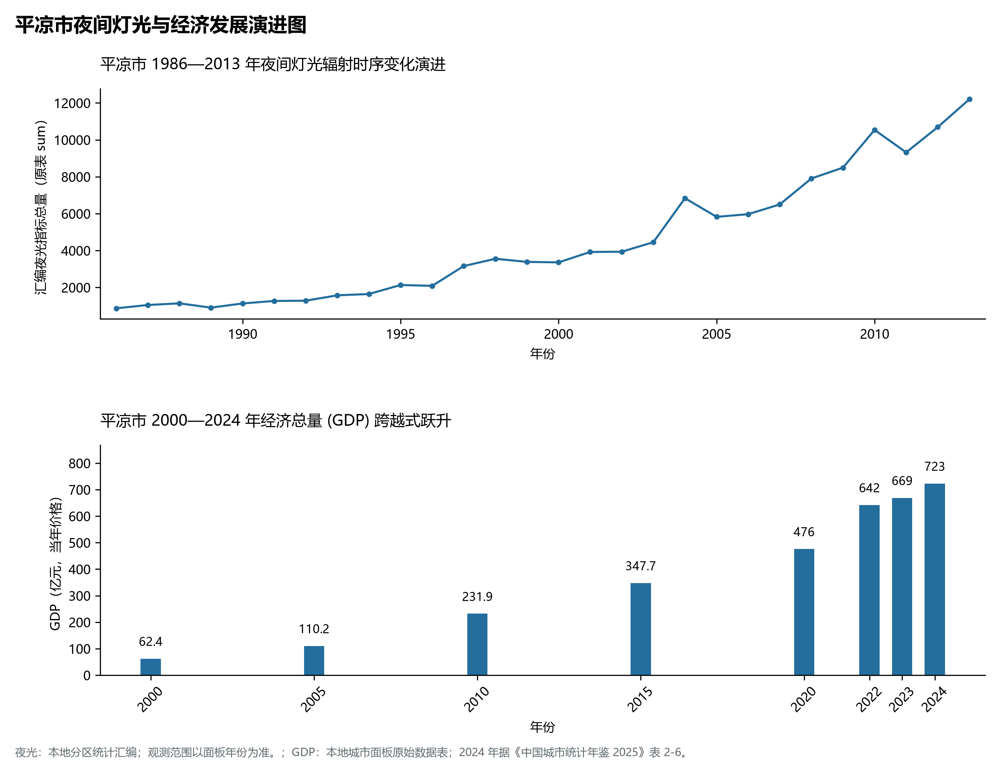

# 30.8 平凉市

平凉市。2024 年常住人口 **177 万人**，常住人口城镇化率 **49.5%**，地区生产总值 **723 亿元**（当年价格），人均地区生产总值 **40,623 元**，三次产业构成为 **22.65 : 30.3 : 47.05**。

平凉是一座文化渊源极其深厚、融合道家玄理与丝路古韵的华夏文明名邦。相传人文始祖轩辕黄帝曾亲登平凉崆峒山，向隐居于此的广成子“问道”，开启了华夏道家哲学的源流，崆峒山因此被尊为“天下道教第一山”，崆峒武术与少林、武当、峨眉、昆仑并称为中国五大传统武术流派；西晋太康三年（282 年）取“平定凉国”、“平定西凉”之意正式设立“平凉”，平凉之名自此载入史册；唐宋时期平凉为丝绸之路东段北道之要津，商贾云集、驮铃悠扬，赢得了“西出长安第一城”与“陇东旱码头”的赞誉；平凉也是中华旱作农耕文明与水土流失治理的一座不朽丰碑：庄浪县数十万人民历经三十余年鏖战，战天斗地改造山河，建成了全国第一个梯田化县，成为黄土高原水土保持的“世界奇迹”；静宁县依托独特的黄土土质与昼夜温差，培育出驰名中外的“静宁苹果”；华亭煤田作为全省最大的现代化主力煤矿，源源不断输送光热能源。新时代以来，平凉深耕煤电化一体化、平凉红牛、静宁苹果三大千亿级与百亿级全产业链，青兰、福银、银昆三条国家高速大动脉纵横交织，平凉正奋力谱写黄土高原绿色低碳崛起的新篇章。

---

## 一、市情速览

平凉市能源资源富集、生态特色农业优势显著、道文化底蕴独树一帜，是陇东南连接关中与大西北的战略承接地。

| 核心指标 | 全市数值与空间分布 | 全国 / 全省战略定位 |
|:---|:---|:---|
| **行政区划面积** | 11 325 km² | 六盘山山地占 25%，黄土残塬沟壑区占 60%，河川阶地占 15% |
| **常住人口** | 177 万人 | 2024 年，全市；年鉴公布口径 |
| **常住人口城镇化率** | 49.5% | 2024 年，全市；年鉴公布口径 |
| **人口密度** | 162 人/km² | 泾河川道聚集度超 400 人/km²，山区与深沟梁峁较疏 |
| **地区生产总值 (GDP)** | 723 亿元 | 2024 年，全市；年鉴公布口径 |
| **人均 GDP** | 40,623 元/人 | 2024 年，全市；年鉴公布口径 |
| **产业三次结构** | 26.5 : 30.5 : 43.0 | 煤电能化与第三产业文旅商贸协同驱动，第一产业质效俱优 |
| **行政区划架构** | 辖 1 区、1 县级市、5 县 | 崆峒区；华亭市；泾川县、灵台县、崇信县、庄浪县、静宁县 |
| **核心战略定位** | 陇东综合能源基地核心区与绿色农特产品之都 | 天下道教第一山崆峒山、中国梯田化第一县庄浪、平凉红牛与静宁苹果原产地 |

**图 30-08-1 甘肃省平凉市行政区位与基层政区图**：图上编号与地点、要素索引对应。

---

## 二、自然地理：六盘雄峙、泾水穿流与黄土大塬梁峁

平凉市地处黄土高原中部丘陵沟壑区，地形自西向东倾斜，地貌兼具断块中山、黄土台塬、梁峁沟壑与侵蚀川谷，海拔在 **890—2 857 m** 之间，相对高差近 2 000 m。

### 1. 地形地貌：六盘中山森林屏障、泾河谷地与千沟万壑黄土区
全境由三大地貌单元组合而成：

- **六盘山与关山中山森林区**：六盘山主脊耸立于市域西部，华亭与崆峒西界处最高峰海拔达 **2 857.0 m**，山体陡峭，森林繁茂，是黄土高原干旱海里的“湿岛”与泾河水系核心发源涵养地；关山横亘南部，苍松翠柏，林木丰茂；
- **崆峒山丹霞孤峰地貌**：崆峒山属于白垩系砾岩形成的险峻丹霞与岩溶混合地貌，海拔 **2 123.0 m**，峭壁如削、怪石嶙峋，泾河与胭脂河在山脚交汇合抱；
- **泾河中游侵蚀堆积川谷盆地**：泾河横贯崆峒、崇信、泾川，冲积出地势较平坦的河谷阶地，海拔在 900—1 200 m 之间，是平凉市人口密集与工农业主要承载地；
- **黄土丘陵梁峁沟壑区**：静宁、庄浪与灵台县大部属黄土梁峁沟壑，土层深厚（厚达数十米至百米），历史上水土流失严重，经过数十年庄浪梯田工程整治，黄土荒原变为了山间翡翠；
- **全境最低出境处**：泾河在泾川县黑河汇流出境处海拔降至 **890.0 m**，为平凉全境最低点。

**图 30-08-2 甘肃省平凉市地形地貌与水文格局图**：图上编号与地点、要素索引对应。

### 2. 气候特征：温带半干旱大陆性季风气候
四季分明，雨热同季，夏无酷暑，冬无严寒：

- **气温分异**：年平均气温在 **8.5—10.5 ℃** 之间，最冷月（1 月）均温约 -4.5 ℃，最热月（7 月）均温约 22.0 ℃，崆峒避暑资源优越；
- **降水适中但蒸发大**：年平均降水量在 **450—600 mm** 之间，由西北向东南逐渐增加，降水集中于 7—9 月并多暴雨；年蒸发量在 1 400—1 800 mm 之间；年日照时数长达 **2 300—2 600 小时**，积温较高，昼夜温差大，极为有利于苹果糖分蓄积与色泽着重。

### 3. 河流水系：黄河重要二级支流泾河水系全覆盖
平凉是泾河的重要源头与中游干流涵养区：

- **泾河干流**：源出宁夏六盘山东麓，自崆峒区入平凉，经崇信、泾川汇流黑河出境入陕，平凉境内干流长 123 km，年径流量约 4.5 亿立方米；
- **汭河与达溪河**：汭河流贯华亭、崇信至泾川汇入泾河；达溪河流经灵台注入黑河，两岸川台地是优质粮果高产地带；
- **葫芦河水系**：发源于宁夏西吉，流经静宁、庄浪西南注入天水渭河。

---

## 三、建置沿革与文化根脉

平凉是道家发祥源地、伏羲母系文脉与革命老区的辉煌汇聚地。

### 1. 黄帝问道崆峒与天下第一道山

- **黄帝问道广成子**：据《庄子·在宥》记载，轩辕黄帝曾登临崆峒山，向仙人广成子请教治国修身之道，确立了崆峒山作为中国道教第一发祥圣地的历史地位；
- **三教合一与崆峒武术**：崆峒山历代道观寺院林立，释道儒三教融汇；崆峒派武术以奇兵刃、化劲力独树一帜，成为中国武林传统五大名派之一；
- **王母祖庙与回山石窟**：泾川回山相传为西王母降生与周穆王、汉武帝会晤西王母之地，建有回中山王母宫与大云寺，大云寺曾数次出土隋唐舍利金棺银椁与石函佛舍利，轰动海内外。

### 2. 庄浪梯田：战天斗地的生态文明丰碑

- **全国梯田化第一县**：庄浪地处六盘山西麓，山多地薄、干旱少雨。从 1964 年起，庄浪全县人民用双手、铁锹与架子车，苦战 34 个春秋，在 400 余条梁峁沟壑上推平构筑了近百万亩水平梯田，梯田化率达 90% 以上，荣获联合国水土保持“全球五百佳”提名，被誉为“中国梯田化第一县”；
- **大地雕刻的绿色丰碑**：层层梯田如链似带从山脚盘绕到山顶，将昔日千疮百孔的荒山秃岭化作万顷波涛的“塞上粮仓”。

### 3. 丝路旱码头与红色将台会师前奏

- **陇东商贸名城**：明清以来，平凉凭借连接陕甘宁的咽喉区位，羊毛、皮革、皮张交易极盛，享有“丝路旱码头”之称；
- **陕甘革命根据地重要依托**：红二十五军长征途经平凉，在泾川四坡村击毙敌少将旅长马廷祥；红军长征三大主力在会宁会师前夕，多次穿行平凉静宁、庄浪界，播撒下坚不可摧的革命火种。

**图 30-08-4 甘肃省平凉市特色专题图：重点优势产业与名胜文化遗产分布图**：图上编号与地点、要素索引对应。

---

## 四、经济地理：陇东综合能源基地、静宁苹果与平凉红牛金字招牌

平凉市立足资源赋存与地理生态，全面打响煤电化、优质苹果与特色畜牧三大主导产业攻坚战。

### 1. 陇东综合能源与现代煤化工基地

- **华亭煤田现代化开发**：华亭市是全省最大的产煤基地，煤质优良，探明储量超 30 亿吨，依托华亭煤业建成了千万吨级大型机械化绿色智能矿井群；
- **煤电一体化与煤制烯烃产业链**：平凉电厂等百万千瓦火电基地源源向华东输电，华亭 60 万吨甲醇与煤制聚丙烯项目深度延伸，实现了煤炭由传统“燃料”向现代“原料”的绿色跨越；
- **灵台新煤田开发**：灵台矿区数十亿吨优质动力煤全面拉开整装井田开发序幕，正在打造甘肃新增特大型煤电外送基地。

### 2. 静宁苹果：中国高品质红富士巅峰品牌

- **中国苹果之乡**：静宁县全境海拔适中、土壤深厚、日照充足，静宁苹果以“着色鲜艳、果形端庄、酸甜适度、极耐储运”享誉全球，种植面积超百万亩，品牌价值突破 **160 亿元**，产品远销东南亚、中东和欧洲，多次斩获全国农博会金奖。

### 3. 平凉红牛：国宴级优质雪花牛肉新名片

- **国家地理标志保护产品**：平凉红牛以皮薄骨细、肉质鲜嫩、大理石花纹丰富著称，是中国优良地方黄牛选育代表品种，被列入全国高端雪花牛肉核心供应名录，全链条产值达百亿元。

---

## 五、综合立体交通走廊

平凉是陕甘宁交汇区陆路干线要道，由“末梢”加快向“次枢纽”迈进。

**图 30-08-3 平凉市交通枢纽与通道节点图**：图上编号与地点、要素索引对应。

1. **铁路网络内通外畅**：
   - **宝中铁路**：北连中卫、南接宝鸡，横贯崆峒区与华亭市，是陇东煤炭南运与客运重要干线；
   - **平凉至庆阳铁路（平庆铁路）**：国家中长期铁路网重点工程，设计时速 160 公里（预留 200 公里），正加速建设，通车后将连通银西高铁，彻底终结平凉通往西安的高速铁路空白；
2. **“三横两纵”高速公路大通道**：
   - **G22 青兰高速**：东西向贯通平凉，直达兰州与西安；
   - **G70 福银高速**：东南向穿过泾川直抵关中咸阳、西安核心区；
   - **G85 银昆高速**：纵贯华亭，向南穿越秦岭直插四川盆地；
   - 平绵高速（G8513）平凉至天水段通车，实现市域县县通高速。

---

## 六、区县空间分区与极值矩阵

**图 30-08-5 平凉市夜间灯光与经济发展演进图**：各面板按标注的观测年份、指标和单位列示。

平凉市现辖 1 个市辖区、1 个县级市、5 个县：

| 县区单元 | 面积 (km²) | 常住人口 (万人) | 2024年GDP (亿元) | 城镇化率 (%) | 核心功能定位与主要地理地标 |
|:---|:---|:---|:---|:---|:---|
| **崆峒区** | 1 936 | 54.5 | 230.0 | 66.8% | 市委市政府驻地、全市政经文化商贸核心、崆峒山 5A 景区、平凉站、柳湖公园 |
| **华亭市** | 1 183 | 19.8 | 135.0 | 62.5% | 陇东煤都、煤化工深加工基地、莲花台国家级风景名胜区、现代工业强县 |
| **泾川县** | 1 409 | 24.2 | 75.0 | 41.5% | 西王母文化发源地、大云寺王母宫 4A 景区、百里石窟长廊、泾川温泉 |
| **灵台县** | 2 038 | 16.5 | 60.0 | 38.6% | 皇甫谧故里与针灸医学源头、灵台新煤田开发前沿、灵台达溪河生态果园 |
| **崇信县** | 850 | 9.5 | 45.0 | 45.2% | 华夏古槐王故里、龙泉寺山水园林名胜、公刘农耕文化、高品质平凉红牛基地 |
| **庄浪县** | 1 553 | 31.5 | 82.0 | 39.5% | 中国梯田化第一县、云崖寺国家地质公园、梯田有机马铃薯与庄浪粉条原产地 |
| **静宁县** | 2 356 | 27.5 | 88.0 | 41.2% | 中国苹果之乡、静宁红富士百亿级果品集散交易中心、成纪故城文化遗存 |

2024 年统计来源：《中国城市统计年鉴 2025》表 2-1、2-6、2-7（2024 年，全市）。其他年份 GDP 据本地城市面板“原始数据”表，单位为亿元、当年价格。
