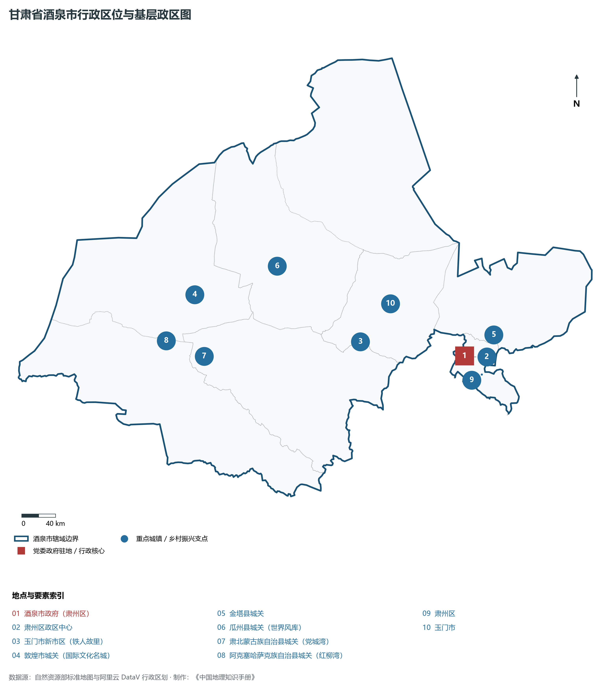
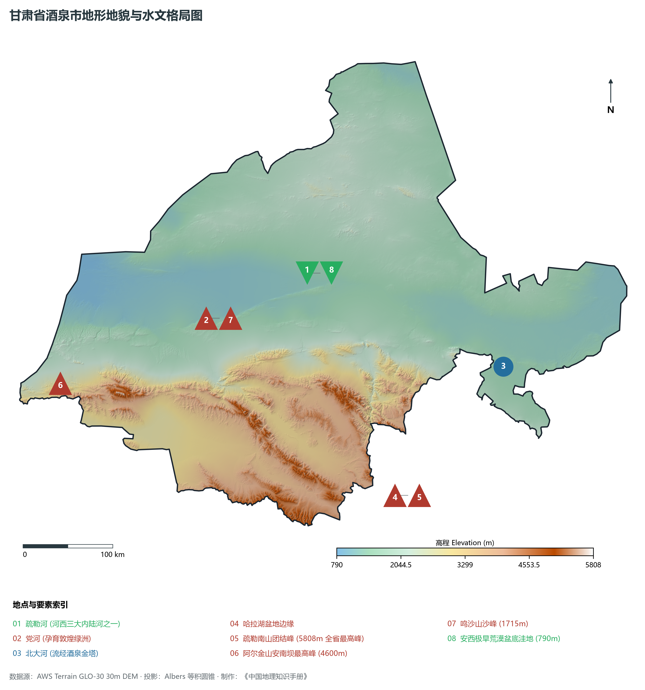
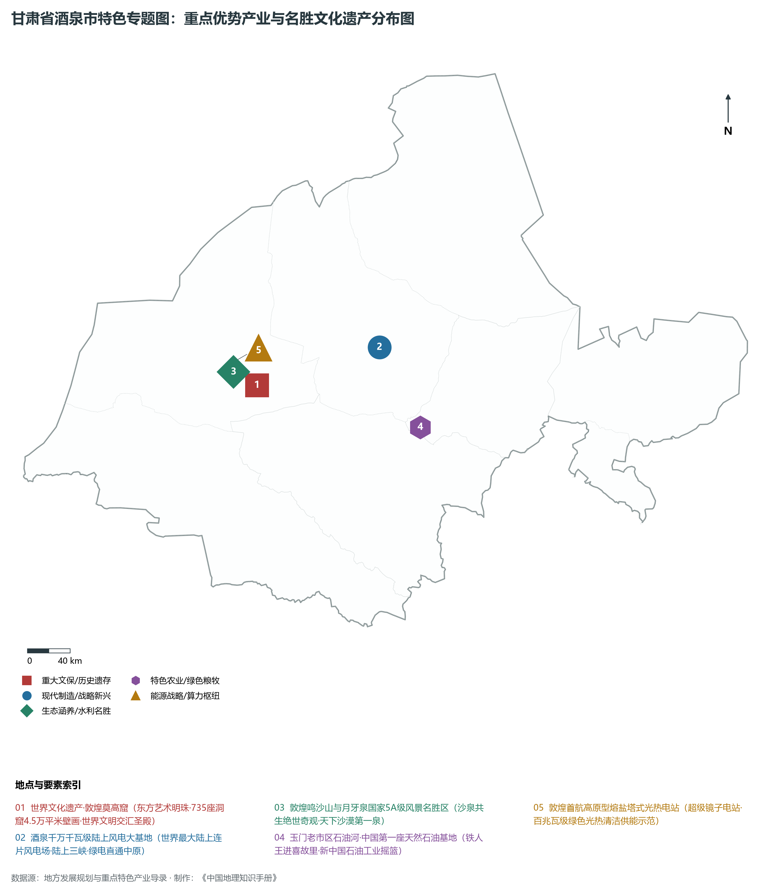
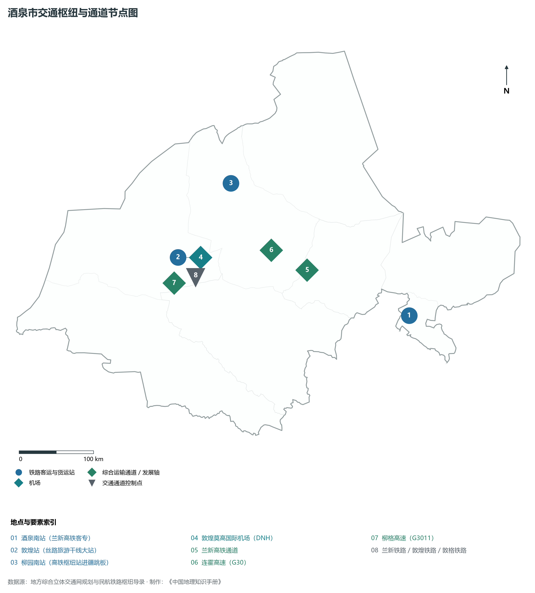
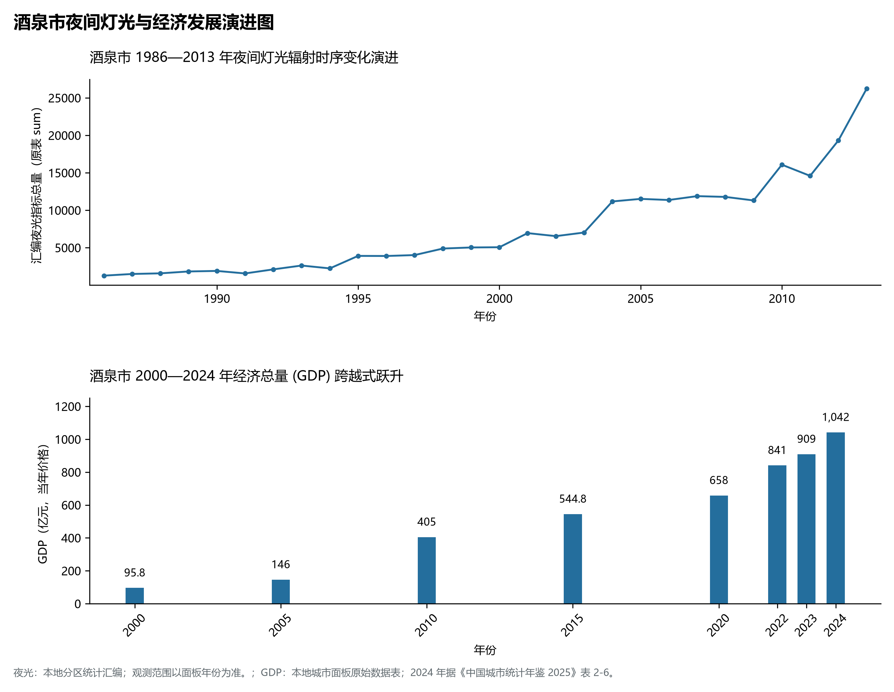

# 30.9 酒泉市

酒泉市。2024 年常住人口 **104 万人**，常住人口城镇化率 **68.25%**，地区生产总值 **1,042 亿元**（当年价格），人均地区生产总值 **99,992 元**，三次产业构成为 **14.24 : 45.85 : 39.91**。

酒泉是一部流淌着华夏雄风、世界文明对话与航天筑梦史诗的千古奇篇。西汉元狩二年（前 121 年），汉武帝开辟河西四郡，骠骑将军霍去病破匈奴倾御酒于泉与将士同饮，始名“酒泉”；汉武帝列四郡、据两关，阳关与玉门关巍然雄踞戈壁，“西出阳关无故人”、“春风不度玉门关”的唐诗名句传诵千载；前秦建元二年（366 年），乐僔和尚在鸣沙山东麓大泉河畔开凿了第一个石窟，揭开了**敦煌莫高窟**历经千余年营造、拥有 735 个洞窟、4.5 万平方米壁画与 2 000 多身彩塑的世界文化瑰宝序幕，成为世界上规模最大、延续时间最长、内容最丰富的佛教艺术圣地；敦煌藏经洞的发现，催生了享誉全球的国际显学——“敦煌学”；酒泉是新中国现代工业与国防科技从无到有、走向辉煌的红色摇篮：1939 年，我国第一座天然石油基地——玉门油田在此开发，孕育出以“铁人”王进喜为代表的石油工人伟大品格，撑起了新中国早期石油工业的半壁江山；金塔县境内的酒泉卫星发射中心（东风航天城），是中国创建最早、规模最大的综合型导弹与卫星发射试验基地，从我国第一颗人造地球卫星“东方红一号”，到第一艘载人飞船“神舟五号”，再到中国空间站天和核心舱升空，中华民族千百年的“飞天梦想”从这里化为壮丽现实；新世纪以来，国家在酒泉戈壁建设了全国首个千万千瓦级风电基地，百兆瓦级熔盐塔式光热电站如镜面海洋在戈壁绽放，酒泉正全面建成国家现代新能源基地与丝路国际文化交往名城。

---

## 一、市情速览

酒泉市域辽阔无垠、战略纵深宏大、风光能源极其丰饶、世界级文化地标闪耀，是我国保障国家战略安全与丝路开放的重要支点。

| 核心指标 | 全市数值与空间分布 | 全国 / 全省战略定位 |
|:---|:---|:---|
| **行政区划面积** | 191 894 km² | **全省第一大市**（占全省 42%），荒漠戈壁占 60% 以上 |
| **常住人口** | 104 万人 | 2024 年，全市；年鉴公布口径 |
| **常住人口城镇化率** | 68.25% | 2024 年，全市；年鉴公布口径 |
| **人口密度** | 5.5 人/km² | 全省密度最低，肃州绿洲平原集中，边远荒漠低于 1 人/km² |
| **地区生产总值 (GDP)** | 1,042 亿元 | 2024 年，全市；年鉴公布口径 |
| **人均 GDP** | 99,992 元/人 | 2024 年，全市；年鉴公布口径 |
| **产业三次结构** | 13.5 : 46.5 : 40.0 | 新能源装备制造与绿电外送为主导，文旅第三产业极其兴旺 |
| **行政区划架构** | 辖 1 区、2 县级市、2 县、2 自治县 | 肃州区；玉门市、敦煌市；金塔县、瓜州县；肃北蒙古族自治县、阿克塞哈萨克族自治县 |
| **核心战略定位** | 丝路文化圣殿与国家级新能源重镇 | 莫高窟世界文化遗产保护地、中国航天发祥地、首个千万千瓦级陆上风电基地 |

**图 30-09-1 甘肃省酒泉市行政区位与基层政区图**：图上编号与地点、要素索引对应。

---

## 二、自然地理：冰川极顶、疏勒清流与浩瀚极旱荒漠

酒泉市地处青藏高原西北缘向塔里木盆地与内蒙古高原过渡带，整体地势南高北低、自西南向东北倾斜，全境海拔在 **790—5 808 m** 之间，相对高差超过 5 000 m，自然地理垂直分带极其雄伟完整。

### 1. 地形地貌：高山雪峰、走廊盆地、风蚀丘陵与浩瀚戈壁
全境由四大宏观地貌单元构成：

- **祁连山南缘极高山与高原冰川区**：肃北蒙古族自治县南部的祁连山疏勒南山主峰——**团结峰（岗则吾结）**，海拔高达 **5 808.0 m**，为**甘肃省全境最高点**；山地冰川密布，是疏勒河与党河的永恒冰雪源泉；阿尔金山主脊横亘西南部，平均海拔超 4 000 m；
- **山前冲积洪积倾斜平原与绿洲**：肃州平原、金塔绿洲、玉门绿洲、敦煌绿洲呈星罗棋布的孤岛状分布在祁连山出山口外围，土壤多为冲积沙壤土，是维系干旱荒漠人类文明的生命之岛；
- **极旱荒漠与剥蚀低山残丘**：市域中部与北部被戈壁砾石荒原（黑戈壁、白戈壁）大面积覆盖，瓜州北山干旱荒漠地带最低海拔降至 **790.0 m**，是全境地势最低点；
- **鸣沙山风成沙丘地貌**：位于敦煌盆地南部，由细沙堆积成起伏如浪的高大沙垄，沙随风鸣，沙水交织出世界罕见的自然奇观。

**图 30-09-2 甘肃省酒泉市地形地貌与水文格局图**：图上编号与地点、要素索引对应。

### 2. 气候特征：暖温带极端干旱大陆性荒漠气候
酒泉深处内陆，海洋水汽极难抵达，具有典型干燥极旱、日照超长、昼夜温差巨大的荒漠气候：

- **极度干燥与极少降水**：全域年平均降水量仅 **40—80 mm**，自东向西、自南向北递减，敦煌仅 39 mm，安西瓜州仅 45 mm，而年蒸发量高达 **2 400—3 200 mm**，蒸发量是降水量的 40—80 倍；
- **日照冠绝全省**：年日照时数长达 **3 200—3 400 小时**，年均太阳能辐射量达 6 300 兆焦/平方米，是全国光伏与光热发电条件最优秀的黄金地带之一；
- **风力资源富集（世界风库）**：瓜州县地处河西狭长通道与荒漠气压差前沿，被称为“世界风库”，年有效风速利用小时数超 3 000 小时。

### 3. 河流水系：河西三大内陆河之一疏勒河水系
酒泉地表水完全依靠祁连山冰雪消融供给：

- **疏勒河干流**：发源于祁连山托勒南山，流经肃北、玉门、瓜州，在双塔水库以下逐渐断流，全长 670 km，是河西走廊三大内陆河中第二大河；
- **党河**：疏勒河一级支流，发源于党河南山，流经党河水库直达敦煌盆地，是哺育敦煌绿洲与莫高窟两千年文明唯一的母亲河；
- **北大河（讨赖河）**：流贯肃州区金塔绿洲，最终注入内蒙古弱水河。

---

## 三、建置沿革与文化根脉

酒泉是多元丝路文明的殿堂、汉简长城的活化石与航天飞天的现代交响。

### 1. 敦煌莫高窟：世界四大文明汇流唯一的圣殿

- **世界文化遗产莫高窟**：莫高窟建于鸣沙山东麓崖壁，拥有自十六国、北朝、隋、唐、五代、宋、西夏、元直至明清的 735 个洞窟。壁画生动展示了西方净土、反弹琵琶、飞天漫舞等艺术经典，藏经洞出土了数万件汉文、藏文、梵文、回鹘文等珍贵古代文献，被著名学者季羡林誉为“世界上唯一由中国、印度、希腊、伊斯兰四大文化体系汇流之地”；
- **阳关与玉门关遗址**：两关作为汉代长城经略西域的西境大门，保存有汉代长城烽燧、大方盘城（河仓城），是中华民族边塞诗歌文化的永恒精神图腾。

### 2. 中国航天摇篮与“东风精神”

- **酒泉卫星发射中心（东风航天城）**：位于金塔县东北部巴丹吉林沙漠深处，建于 1958 年，是中国最早建成的航天发射场。在此成功发射了中国第一枚地地导弹、第一颗人造地球卫星“东方红一号”、第一艘无人试验飞船“神舟一号”以及历次神舟载人飞船和天宫空间实验室，孕育了“特别能吃苦、特别能战斗、特别能攻关、特别能奉献”的载人航天精神。

### 3. 玉门油田与石油“铁人精神”

- **新中国石油长子**：1939 年孙健初等老一辈地质学家在老市区发现石油，玉门油田为抗战与建国初期提供了急需的石油供应；新中国成立后，玉门作为“摇篮”，向大庆、胜利、克拉玛依、长庆等各大油田输送了数以万计的技术骨干和工人队伍，以王进喜为代表的“宁可少活二十年，拼命也要拿下大油田”的铁人精神代代流传。

**图 30-09-4 甘肃省酒泉市特色专题图：重点优势产业与名胜文化遗产分布图**：图上编号与地点、要素索引对应。

---

## 四、经济地理：全国首个千万千瓦级风电基地、现代化工与丝路文旅

酒泉市依托无与伦比的戈壁绿电空间与深厚文化遗产，打造国家重要的新能源及装备制造大基地、现代化工及国际文旅名城。

### 1. 全球最大陆上连片风电与光热示范基地

- **“陆上三峡”风电工程**：酒泉是国家批准建设的全国第一个千万千瓦级风电大基地，主要集中在瓜州与玉门戈壁，风电装机超 2 000 万千瓦，风电巨塔如林、银翼飞旋；
- **世界级高原型塔式熔盐光热电站**：敦煌首航节能 100 兆瓦熔盐塔式光热电站拥有 1.2 万面巨型定日镜，在百米集热塔周围形成震撼的“超级镜子八卦阵”，可实现 24 小时连续稳定清洁供电；
- **酒泉至湖南 ±800 千伏特高压直流输电**：将戈壁浩瀚的风光绿电千里迢迢直送华中电网，年外送绿电数百亿度。

### 2. 现代装备制造与高新技术产业

- **风光氢储装备全产业链**：东方电气、金风科技、远景能源、陕建等风电主机、叶片、塔筒、逆变器制造企业齐聚酒泉经开区，形成完备的新能源高端装备集聚区；
- **玉门与金塔现代化工**：依托本地石油化工与煤化工资源，发展精细化工与石化下游高附加值材料。

### 3. 丝路研学游与国际文化旅游

- **敦煌文化国际影响力**：年举办“丝绸之路（敦煌）国际文化博览会”，推动文旅深度融合，打造《又见敦煌》、《乐动敦煌》等大型实景演出，文旅产业成长为高质量发展的绿色支柱。

---

## 五、综合立体交通走廊

酒泉自古为亚欧大陆桥咽喉要道，现代交通网络通达四海。

**图 30-09-3 酒泉市交通枢纽与通道节点图**：图上编号与地点、要素索引对应。

1. **“高铁+普速”双十字铁路骨干**：
   - **兰新高速铁路**：贯穿全境，设**酒泉南站**、**玉门站**、**柳园南站**，其中柳园南站是连接甘新咽喉的枢纽中转站；
   - **敦煌铁路与敦格铁路**：连接兰新铁路与青藏铁路，使敦煌向南穿越阿尔金山直达青海格尔木，构建了西北西南大迂回环线铁路；
2. **高速公路网直插大漠西疆**：G30 连霍高速横穿东西，G3011 柳格高速自柳园南下敦煌直达青海，形成了连通新疆、西藏、青海的干线网络；
3. **敦煌莫高国际机场（4E 级民用空港）**：甘肃省继兰州中川之后第二个国际航空口岸，开通至北京、上海、广州、成都、杭州及国际直飞航线。

---

## 六、区县空间分区与极值矩阵

**图 30-09-5 酒泉市夜间灯光与经济发展演进图**：各面板按标注的观测年份、指标和单位列示。

酒泉市现辖 1 个市辖区、2 个县级市、2 个县、2 个自治县：

| 县区单元 | 面积 (km²) | 常住人口 (万人) | 2024年GDP (亿元) | 城镇化率 (%) | 核心功能定位与主要地理地标 |
|:---|:---|:---|:---|:---|:---|
| **肃州区** | 3 349 | 45.8 | 415.0 | 78.5% | 市委市政府驻地、全市政经商贸核心、西汉酒泉胜迹、酒泉南站、酒嘉一体化主战场 |
| **玉门市** | 13 500 | 14.5 | 185.0 | 66.8% | 中国石油工业长子铁人摇篮、玉门风电大基地、赤金峡水利风景区 |
| **敦煌市** | 31 200 | 18.8 | 165.0 | 72.5% | 世界遗产敦煌莫高窟、鸣沙山月牙泉、玉门关阳关遗址、敦煌莫高国际机场 |
| **金塔县** | 18 800 | 12.2 | 82.0 | 48.5% | 中国航天发祥地、酒泉卫星发射中心后勤驻地、金塔万亩沙漠胡杨林 |
| **瓜州县** | 24 100 | 13.5 | 115.0 | 54.5% | 世界风库、全国千万千瓦风电重镇、锁阳城世界遗产遗址、大地之子雕塑群 |
| **肃北蒙古族自治县** | 66 748 | 1.5 | 15.0 | 75.2% | 甘肃土地面积最大县、全省最高峰团结峰、党河大峡谷、马鬃山矿区、雪山蒙古族风情 |
| **阿克塞哈萨克族自治县** | 34 197 | 0.9 | 8.0 | 80.5% | 全省唯一哈萨克族自治县、阿尔金山国家级自然保护区、多坝沟胡杨峡、高原哈萨克民俗 |

2024 年统计来源：《中国城市统计年鉴 2025》表 2-1、2-6、2-7（2024 年，全市）。其他年份 GDP 据本地城市面板“原始数据”表，单位为亿元、当年价格。
