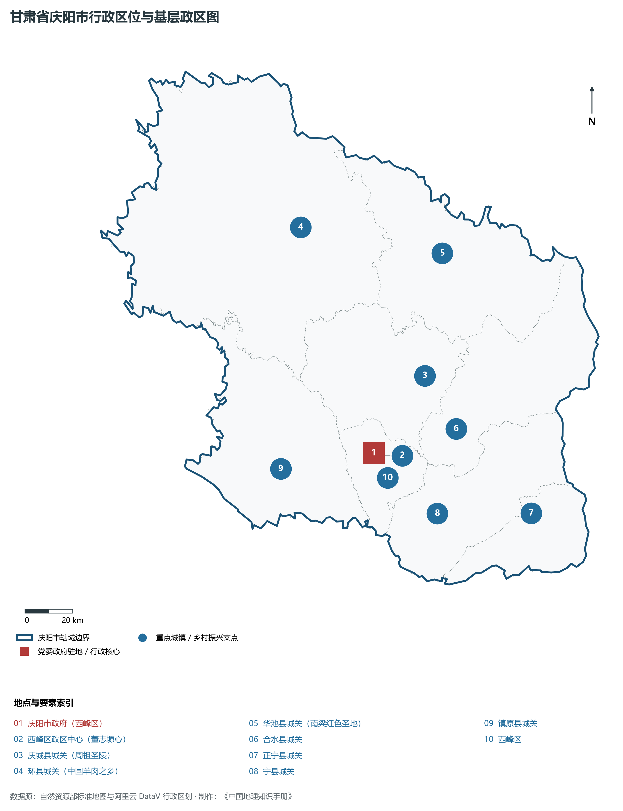
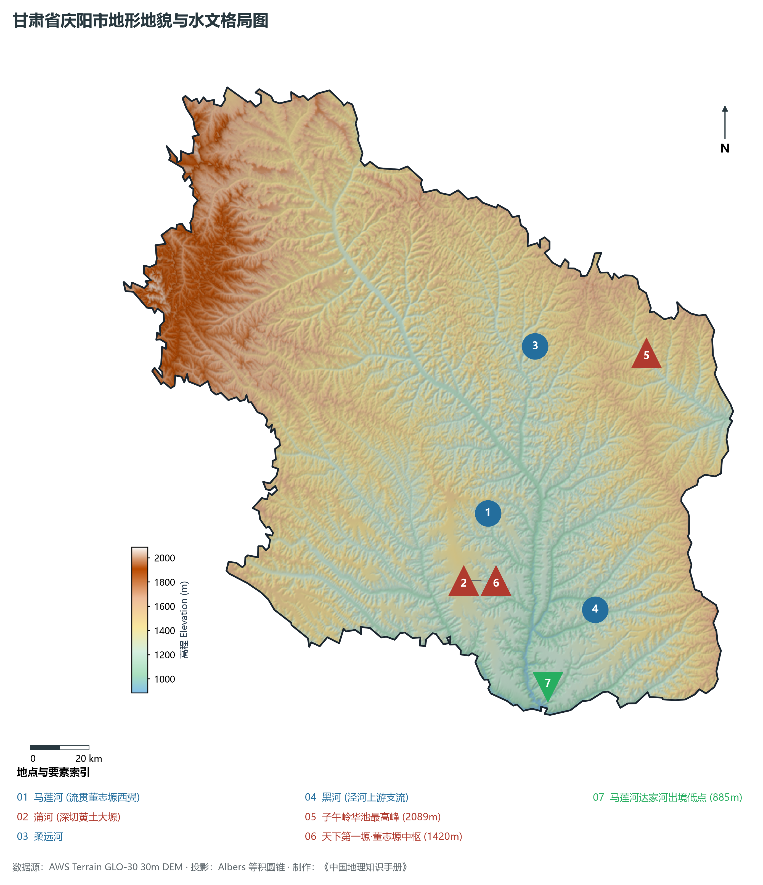
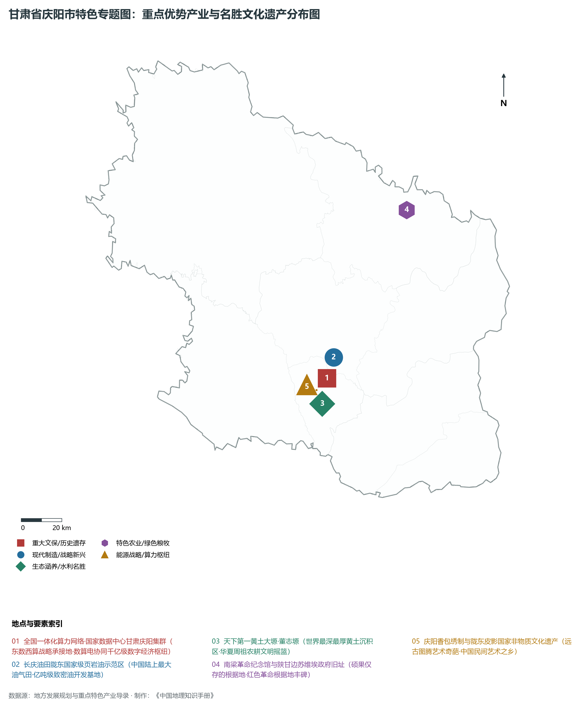
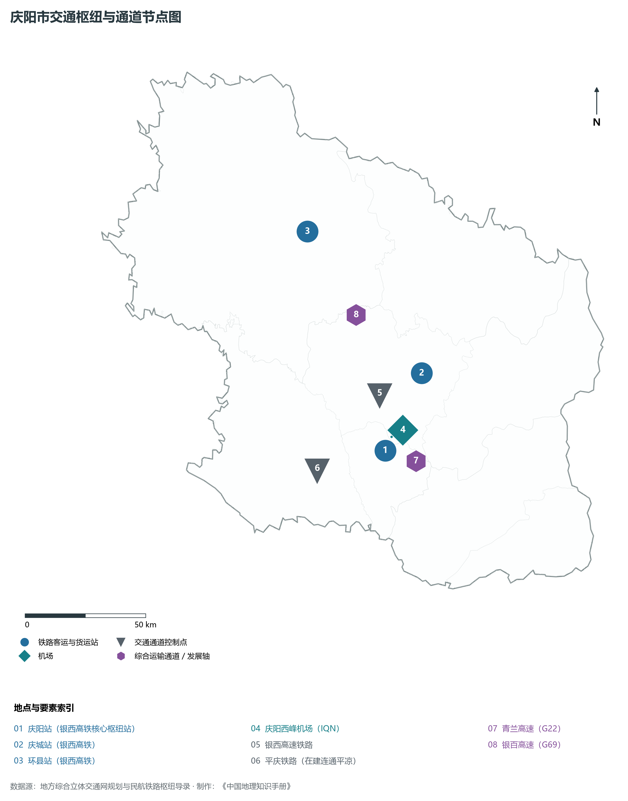
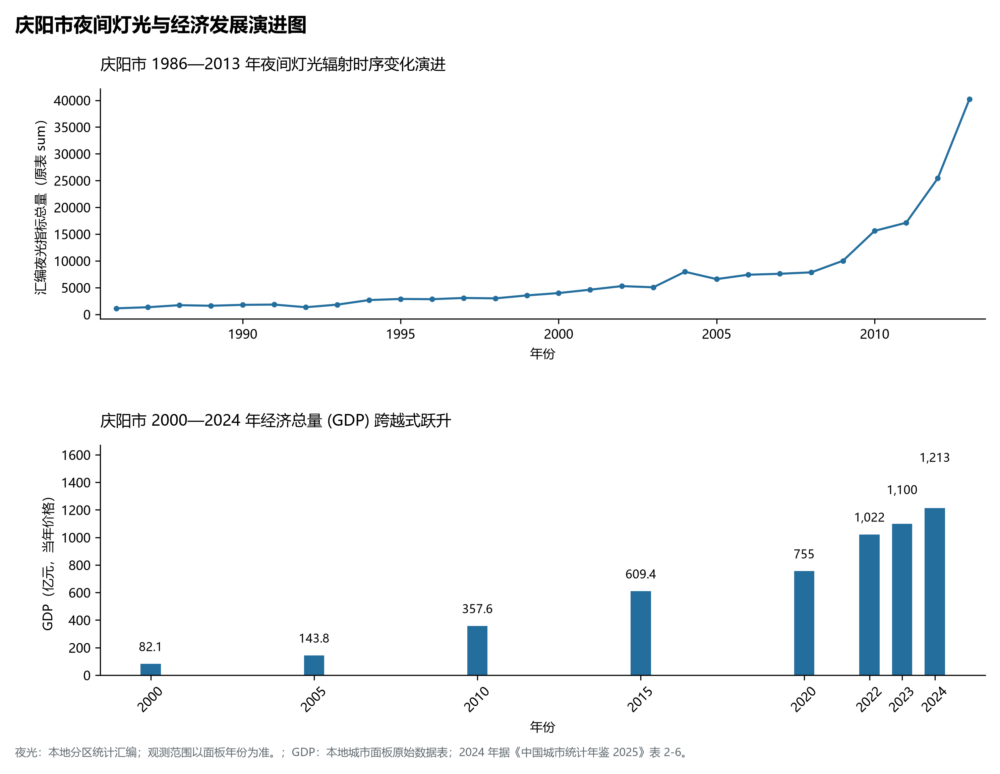

# 30.10 庆阳市

庆阳市。2024 年常住人口 **213 万人**，常住人口城镇化率 **46.56%**，地区生产总值 **1,213 亿元**（当年价格），人均地区生产总值 **56,987 元**，三次产业构成为 **10.92 : 52.72 : 36.36**。

庆阳是一方承载着中华文明农耕火种与中国革命壮烈史诗的神圣厚土。这里拥有世界上黄土覆盖最厚、保存最完整的黄土残塬——**董志塬**，黄土堆积深达两百余米，沃野千里，孕育了中华农耕文明最初的晨曦；相传中华民族人文始祖轩辕黄帝曾在此与歧伯论医，成就了医学宝典《黄帝内经》；周先祖不窋、鞠陶在此教民稼穑、陶复陶穴，开启了辉煌八百年的周王朝发祥宏业；庆阳南梁是陕甘边革命根据地的中心，20 世纪 30 年代初刘志丹、谢子长、习仲勋等老一辈无产阶级革命家在此创建了陕甘边苏维埃政府，建立了以南梁为中心的革命根据地，为长征中的党中央和红军主力提供了落脚点，也是走向抗日战争的出发点，赢得了“硕果仅存”的历史赞誉；20 世纪 70 年代初，长庆油田在庆阳马岭出油，数十万石油工人转战陇东，探明了中国陆上最大的亿吨级低渗—特低渗致密油气田与页岩油大田；庆阳也是“中国香包刺绣之乡”，庆阳香包与陇东皮影被列入国家级非物质文化遗产名录；新时代以来，庆阳乘势而上，承担起国家“东数西算”战略重任，全国一体化算力网络国家枢纽节点（甘肃·庆阳）与全国十大国家数据中心集群落地生根，华为、中国电信、中国移动等算力巨头齐聚陇东，银西高铁呼啸飞驰，庆阳正昂首迈向“数算电协同”引领的数字经济千亿新蓝海。

---

## 一、市情速览

庆阳市资源极为富集、经济体量庞大、数字算力崛起、红色底蕴崇高，是甘肃向东融入关中平原与国家算力大网的战略重镇。

| 核心指标 | 全市数值与空间分布 | 全国 / 全省战略定位 |
|:---|:---|:---|
| **行政区划面积** | 27 119 km² | 黄土塬面占 20%，丘陵沟壑区占 60%，子午岭森林占 20% |
| **常住人口** | 213 万人 | 2024 年，全市；年鉴公布口径 |
| **常住人口城镇化率** | 46.56% | 2024 年，全市；年鉴公布口径 |
| **人口密度** | 80 人/km² | 董志塬塬面高达 400 人/km²，北部残塬梁峁相对稀疏 |
| **地区生产总值 (GDP)** | 1,213 亿元 | 2024 年，全市；年鉴公布口径 |
| **人均 GDP** | 56,987 元/人 | 2024 年，全市；年鉴公布口径 |
| **产业三次结构** | 14.5 : 51.5 : 34.0 | 典型工业主导型经济，油气开采、绿色算力与特色农业鼎足 |
| **行政区划架构** | 辖 1 区、7 县 | 西峰区；庆城县、环县、华池县、合水县、正宁县、宁县、镇原县 |
| **核心战略定位** | 陇东综合能源基地中枢与全国一体化算力网络枢纽 | 国家数据中心集群、国家级页岩油示范区、南梁革命根据地纪念地 |

**图 30-10-1 甘肃省庆阳市行政区位与基层政区图**：图上编号与地点、要素索引对应。

---

## 二、自然地理：天下第一黄土塬、子午岭林海与马莲河水系

庆阳地处陇东黄土高原中心地带，地形北高南低、东西两侧隆起、中轴深凹开阔，海拔在 **885—2 089 m** 之间。

### 1. 地形地貌：巨厚黄土大塬、深切峡谷与天然森林屏障
全境地貌可清晰划分为三大单元：

- **天下第一黄土大塬——董志塬**：横跨西峰、庆城、宁县、合水四县区，南北长约 110 km、东西宽约 18—32 km，总面积达 915 平方公里，是黄土高原上保存最完整、面积最大的残留黄土塬，地表平坦如砥，土层深厚达 200 余米，是全国知名的优质高产粮仓；
- **东部子午岭天然森林生态区**：纵贯华池、合水、正宁东部，是陇东高原与关中平原的天然分水岭，最高峰位于华池县东界，海拔达 **2 089.0 m**，森林茂密，乔灌丛生，有“黄土高原绿色明珠”之称，是甘肃重要的水源涵养地；
- **西北黄土梁峁丘陵侵蚀区**：环县、镇原大部属典型黄土丘陵，冲沟如刀刻斧凿，梁峁起伏，经长年封山育林与小流域综合治理，生态植被显著恢复；
- **全境最低出境点**：南部马莲河与黑河在宁县达家河汇流处，出境海拔降至 **885.0 m**。

**图 30-10-2 甘肃省庆阳市地形地貌与水文格局图**：图上编号与地点、要素索引对应。

### 2. 气候特征：温带半干旱大陆性季风气候
日照充足，温凉干燥，降水主要集中在夏秋季：

- **气温与光能**：年平均气温在 **8.5—10.8 ℃** 之间，年日照时数长达 **2 400—2 650 小时**，太阳总辐射量大，无霜期约 150—180 天；
- **降水空间分布**：受季风影响，年平均降水量在 **450—600 mm** 之间，由东南向西北逐渐递减，东南部正宁、宁县可达 650 mm，西北部环县约 400 mm，年蒸发量在 1 400—1 700 mm 之间。

### 3. 河流水系：黄河支流泾河水系马莲河网络
庆阳境内河流全部汇入黄河二级支流泾河：

- **马莲河（境内第一大河）**：全长 375 km，流贯环县、庆城、西峰、宁县，年径流量约 4 亿立方米，因两岸黄土剥蚀冲刷，含沙量居全国内陆河前列；
- **蒲河与柔远河**：深切黄土塬边缘，两岸形成了落差数十米的冲蚀峡谷；
- **葫芦河与洪德河**：为北部旱作区提供重要的生态补水通道。

---

## 三、建置沿革与文化根脉

庆阳是农耕文化祖源、红色革命摇篮与民间民俗艺术殿堂。

### 1. 周祖发祥与歧黄医学圣地

- **周祖农耕文化**：庆城县周祖陵坐落于东山之巅，周先祖不窋在此率民开荒耕作、教化四方，为周王朝克商立国奠定了八百年的农业与制度根基；
- **岐黄医祖圣地**：华夏医学鼻祖歧伯出生于庆阳，与轩辕黄帝谈医论道，开创了《黄帝内经》之宏章，庆阳被中华中医药学会命名为“岐黄文化传承基地”。

### 2. 陕甘边根据地与南梁精神

- **硕果仅存的南梁**：1934 年 11 月，陕甘边苏维埃政府在华池县南梁荔园堡正式宣告成立，习仲勋同志当选为苏维埃政府主席。南梁根据地与陕北根据地连成一片，成为土地革命战争后期全国“硕果仅存”的完整革命根据地，为党中央和红军长征落脚陕北提供了坚强基石；
- **南梁精神传承**：以“面向群众、坚守信念、顾全大局、求实开拓”为核心内涵的南梁精神，成为新时代陇东儿女砥砺前行的强大动力源泉。

### 3. 民间艺术瑰宝：庆阳香包与陇东皮影

- **中国香包刺绣之乡**：庆阳香包传承数千年，刺绣针法细腻生动，图案融合了虎、蛙、蛇等古代图腾寓意，被称为“穿在身上的远古史书”，每年举办庆阳香包民俗文化节；
- **陇东道情皮影戏**：牛皮镂刻精美传神，唱腔苍凉激昂，是中国皮影艺术与戏曲活化石。

**图 30-10-4 甘肃省庆阳市特色专题图：重点优势产业与名胜文化遗产分布图**：图上编号与地点、要素索引对应。

---

## 四、经济地理：国家东数西算绿色算力高地、亿吨级油气基地与陇东粮仓

庆阳市立足能源资源与区位空间叠加优势，构建起“传统能源支撑、新兴算力领跑、现代粮油畜禽协同”的现代经济格局。

### 1. 全国一体化算力网络甘肃庆阳国家数据中心集群

- **“东数西算”核心战略载体**：庆阳作为甘肃省唯一的国家算力枢纽节点，规划建设了 1.7 万亩国家数据中心集群产业园；
- **数算电协同千亿新引擎**：依托陇东丰富充足的低成本煤电与风光绿电，先后引进中国电信、中国移动、中国联通、华为、阿里云、燧原科技等行业龙头，已建成投产标准机架数万架，算力规模跨越 10 000 P（PFLOPS），打造面向京津冀、长三角、粤港澳大湾区的“全国最大的绿色算力基地”与“人工智能推理中心”。

### 2. 长庆油田陇东页岩油与千亿方天然气基地

- **亿吨级大型页岩油田**：长庆油田庆城页岩油田是国内首个探明储量超 10 亿吨的规模化整装页岩油田，水平井三维压裂开采技术达到国际顶尖水平；
- **陇东煤电化大基地**：正宁核桃峪、宁县新庄等千万吨级特大型现代化煤矿投产，百万千瓦级高参数绿色火电机组通过陇东至山东 ±800 千伏特高压工程直送华东。

### 3. 董志塬优质小麦、苹果与环县中国羊谷

- **陇东粮仓保供基地**：董志塬高产农田常年稳产优质冬小麦与大豆，是全省最重要的商品粮基地；
- **环县羊肉享誉全国**：环县肉羊饲养量达数百万只，依托优质天然牧草与沙葱饲育，环县羊肉获国家地理标志保护认证，打造百亿级全产业链“中国羊谷”。

---

## 五、综合立体交通走廊

庆阳全面告别偏远闭塞，跃升为关中平原与陕甘宁交界的重要立体交通节点。

**图 30-10-3 庆阳市交通枢纽与通道节点图**：图上编号与地点、要素索引对应。

1. **“银西高铁”接入全国高铁主网**：
   - **银川至西安高速铁路**：纵贯庆阳南北全境，在境内设立**环县站**、**曲子站**、**庆城站**、**庆阳站**、**宁县站**，庆阳到西安仅需 1 小时，到银川约 1.5 小时，全面融入关中 1 小时通勤核心圈；
   - **在建平庆铁路**：自庆阳站向西南延伸至平凉，打通陇东连接关中平原与兰州的第二客货大通道；
2. **高速公路网纵横互联**：G22 青兰高速东西横跨，G69 银百高速南北纵贯董志塬，甜永高速、雷西高速等省道干线通达全域各县城；
3. **庆阳西峰机场（4C 级空港）**：开通飞往北京、上海、广州、深圳、成都、西安、兰州等国内重要经济中心航线，年吞吐旅客近百万人次。

---

## 六、区县空间分区与极值矩阵

**图 30-10-5 庆阳市夜间灯光与经济发展演进图**：各面板按标注的观测年份、指标和单位列示。

庆阳市现辖 1 个市辖区、7 个县：

| 县区单元 | 面积 (km²) | 常住人口 (万人) | 2024年GDP (亿元) | 城镇化率 (%) | 核心功能定位与主要地理地标 |
|:---|:---|:---|:---|:---|:---|
| **西峰区** | 996 | 48.5 | 390.0 | 78.5% | 市委市政府驻地、全市政经文化商贸核心、全国算力枢纽园区、庆阳站、北石窟寺 |
| **庆城县** | 2 673 | 24.2 | 165.0 | 45.2% | 周祖农耕文化发源地、马岭油田核心区、周祖陵 4A 景区、马莲河湿地 |
| **环县** | 9 236 | 28.5 | 185.0 | 42.5% | 全省土地大县、中国羊肉之乡、陕甘宁盐环定革命老区、环州故城、皮影之乡 |
| **华池县** | 3 776 | 12.8 | 85.0 | 41.5% | 南梁革命根据地、子午岭绿色生态屏障、陕甘边苏维埃政府旧址、大凤川风景区 |
| **合水县** | 2 941 | 14.5 | 72.0 | 40.2% | 黄河古象出土地、子午岭国家级森林公园、陇东特色林果药材基地 |
| **正宁县** | 1 307 | 18.2 | 95.0 | 43.5% | 正宁百万千瓦调峰电厂、核桃峪特大型绿色煤矿、宫河优质苹果基地 |
| **宁县** | 2 633 | 36.8 | 120.0 | 44.2% | 董志塬南大门、新庄特大型煤矿、政平古渡、早胜牛肉名优原产地 |
| **镇原县** | 3 557 | 34.0 | 68.0 | 37.8% | 潜夫王符故里、北石窟寺下寺石窟、陇东优质小杂粮与中药材基地 |

2024 年统计来源：《中国城市统计年鉴 2025》表 2-1、2-6、2-7（2024 年，全市）。其他年份 GDP 据本地城市面板“原始数据”表，单位为亿元、当年价格。
