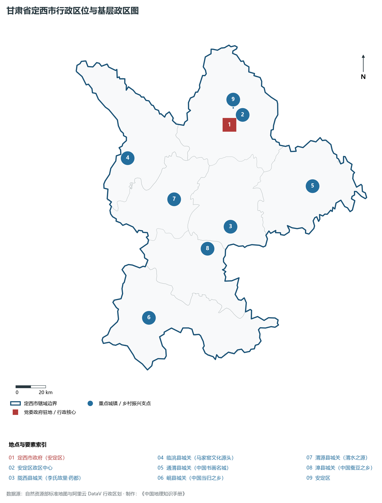
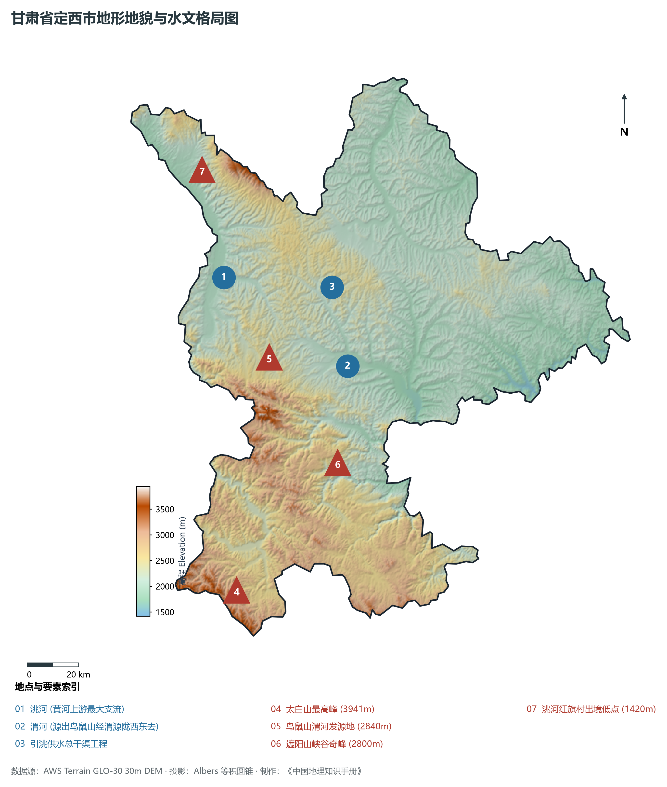
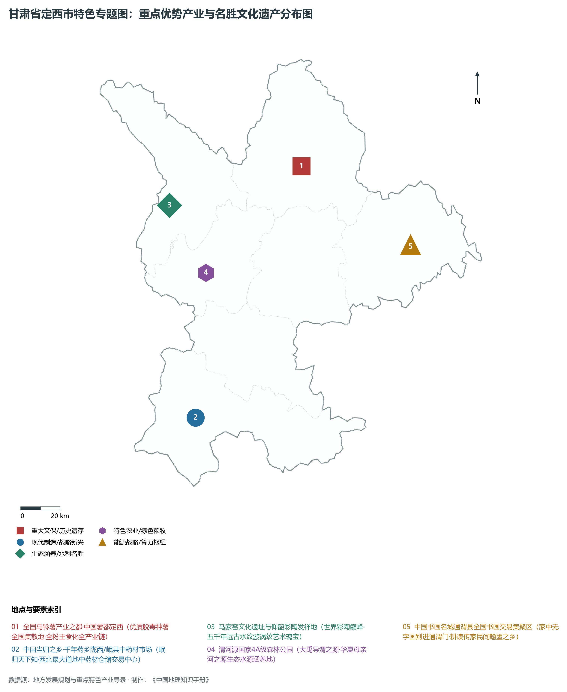
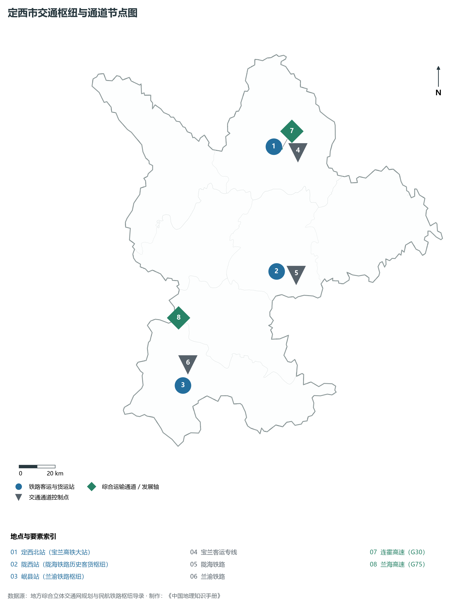
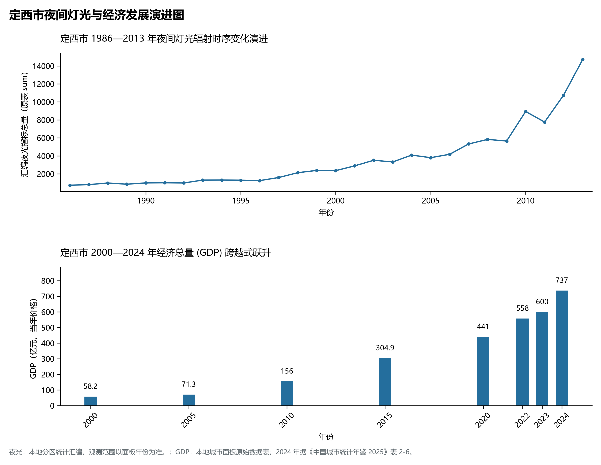

# 30.11 定西市

定西市。2024 年常住人口 **247 万人**，常住人口城镇化率 **42.89%**，地区生产总值 **737 亿元**（当年价格），人均地区生产总值 **29,744 元**，三次产业构成为 **16.53 : 21.86 : 61.61**。

定西是一部镌刻着远古文明辉煌、千年水利求索与脱贫攻坚奇迹的壮丽史诗。早在五千年前的新石器时代晚期，马家窑文化在临洮洮河西岸发祥，以流畅奔放的水波纹、漩涡纹彩陶饮誉全球，被公认为世界彩陶艺术的最高峰；秦汉以降，陇西李氏在此开基立业，李白自称“陇西布衣”，陇西堂成为全球华侨寻根溯源的宗族圣殿；战国秦长城西端起点位于临洮二十里铺，始皇长子扶苏、大将蒙恬在此留下金戈铁马的历史印迹；渭源鸟鼠同穴山被古籍《尚书·禹贡》尊为华夏“大禹导渭”的地理源头；近现代历史上，定西曾因常年干旱少雨、植被稀疏，被清代陕甘总督左宗棠发出“苦瘠甲于天下”的沉重浩叹；联合国粮食开发署亦曾于 1982 年将其评估为“不具备人类生存基本条件”的极贫区域；新中国成立后特别是党的十八大以来，定西人民发扬“人一之我十之、人十之我百之”的甘肃精神，坚持不懈战天斗地修梯田、打水窖，将昔日贫瘠荒山化作“中国梯田治理典范”；历经半个多世纪论证建设的“引洮供水工程”于新时代全线通水，洮河清流入陇中，彻底圆了定西数百万群众引水润旱的百年梦想；定西将昔日的“救命薯”升级为百亿级“致富薯”，将满山当归、党参、黄芪打造成“千年药都”，宝兰高铁与兰渝铁路在此交汇，定西彻底撕掉了“苦瘠”标签，阔步迈向产业兴旺、生态优美的崭新天地。

---

## 一、市情速览

定西市区位通达、资源特色鲜明、生态转型成效卓著，是连接兰白都市圈与甘南、陇南大生态区的关键纽带。

| 核心指标 | 全市数值与空间分布 | 全国 / 全省战略定位 |
|:---|:---|:---|
| **行政区划面积** | 19 610 km² | 黄土丘陵沟壑区占 60%，西秦岭高中山占 40% |
| **常住人口** | 247 万人 | 2024 年，全市；年鉴公布口径 |
| **常住人口城镇化率** | 42.89% | 2024 年，全市；年鉴公布口径 |
| **人口密度** | 128 人/km² | 洮河、渭河两岸川台密集，南部高寒山区相对稀疏 |
| **地区生产总值 (GDP)** | 737 亿元 | 2024 年，全市；年鉴公布口径 |
| **人均 GDP** | 29,744 元/人 | 2024 年，全市；年鉴公布口径 |
| **产业三次结构** | 25.5 : 22.5 : 52.0 | 现代特色农业基石稳固，商贸流通与物流第三产业占半壁 |
| **行政区划架构** | 辖 1 区、6 县 | 安定区；通渭县、陇西县、临洮县、渭源县、漳县、岷县 |
| **核心战略定位** | 中国薯都与千年药乡·黄河上游重要水源区 | 全球彩陶之峰马家窑文化源地、全国最大马铃薯脱毒种薯繁育基地 |

**图 30-11-1 甘肃省定西市行政区位与基层政区图**：图上编号与地点、要素索引对应。

---

## 二、自然地理：高山峡谷交错、洮渭双水奔涌与黄土高坡

定西地处黄土高原向青藏高原与秦岭山脉的三重过渡接触带，地势西南高峻、东北起伏，全境海拔在 **1 420—3 941 m** 之间，相对落差超过 2 500 m。

### 1. 地形地貌：西秦岭高中山、渭洮河谷与陇中黄土梁峁
全境由三大地貌地带自南向北递变：

- **南部西秦岭高中山地**：岷县、漳县南部横亘着迭山与太白山，太白山最高峰海拔高达 **3 941.0 m**，为定西全境最高峰；山高林密，植被繁茂，发育有高山草甸、冷杉暗针叶林与深切峡谷，是阻隔干旱风沙的重要生态屏障；
- **中部洮河与渭河冲积盆谷阶地**：渭河流贯渭源、陇西，洮河流经岷县、临洮，两岸形成连绵数十公里的川台地与洪积扇，海拔在 1 600—2 000 m 之间，是定西粮油与城镇主要分布带；
- **北部黄土丘陵梁峁沟壑区**：安定区、通渭县与临洮北部属于典型黄土高原梁峁沟壑区，黄土层深厚，降水稀少；
- **洮河出境最低点**：洮河在临洮县北端红旗村出境汇入刘家峡水库，出境海拔为 **1 420.0 m**。

**图 30-11-2 甘肃省定西市地形地貌与水文格局图**：图上编号与地点、要素索引对应。

### 2. 气候特征：温带半干旱大陆性季风气候与高寒山地气候
气候冷凉干燥，光照充分，降水自东南向西北递减：

- **气温与光照**：年平均气温在 **5.5—8.0 ℃** 之间，年日照时数长达 **2 200—2 500 小时**，夏季无酷热，昼夜温差大（达 12—16 ℃），非常利于马铃薯块茎淀粉积累与中药材有效成分合成；
- **降水空间分异**：南部岷县、漳县山区年降水量达 550—650 mm，气候湿润；中北部安定区、通渭县年降水量仅 **350—400 mm**，而蒸发量达 1 500 mm 以上，春旱频繁。

### 3. 河流水系：黄河最大支流渭河之源与洮河骨干水系
定西是黄河上游两大核心支流的发源与流贯重地：

- **渭河（华夏大禹导渭之源）**：发源于渭源县城西南鸟鼠山清泉峡，经渭源、陇西东流进入天水，在定西境内流长 124 km；
- **洮河（黄河上游最大支流）**：发源于青海，自碌曲、卓尼入岷县，在大折弯处北切流经临洮，在定西境内流长 148 km，年径流量达 53 亿立方米；
- **引洮供水宏伟工程**：从卓尼九甸峡水库引水，穿透数十座崇山隧洞，总干渠和干线长达数千公里，将洮河清流输往定西安定、通渭、陇西等干旱缺水腹地，彻底改写了陇中干渴历史。

---

## 三、建置沿革与文化根脉

定西是中华早期彩陶文化的峰峦、李唐氏族发祥之邦与现代书画艺术名城。

### 1. 马家窑文化：世界远古彩陶的艺术巅峰

- **彩陶圣殿**：1924 年瑞典学者安特生在临洮县马家窑村发现距今 5000—4000 年的新石器时代晚期遗址。马家窑彩陶以橙黄色陶胎打底，黑彩绘制漩涡纹、波浪纹、同心圆纹与蛙神纹，造型典雅，线条流转如天际云烟，代表了世界远古彩陶烧造与绘画的最高水平；
- **辛店文化与齐家文化交融**：洮河谷地成为中国早期青铜与玉石文明交流的核心走廊。

### 2. 陇西李氏与天下郡望

- **陇西堂发端**：秦昭襄王二十八年（前 279 年）置陇西郡，李崇为首任郡守，开创了中古第一望族“陇西李氏”；唐代尊陇西为祖籍皇脉，陇西李家龙宫保存完好，全球李氏宗亲常年来此寻根问祖；
- **战国秦长城西起首**：临洮望儿咀与新添长城遗存，是两千多年前秦帝国抵御西戎的钢铁长城西端起点。

### 3. 中国民间书画名城通渭与耕读传家

- **通渭书画文化现象**：通渭民间崇尚翰墨，拥有“家中无字画，别进通渭门”的醇厚民风，全县书画装裱、创作与收藏者达数万人，年书画交易额数亿元，被文化部命名为“中国民间文化艺术（书画）之乡”。

**图 30-11-4 甘肃省定西市特色专题图：重点优势产业与名胜文化遗产分布图**：图上编号与地点、要素索引对应。

---

## 四、经济地理：中国薯都全产业链、千年药乡与现代循环产业

定西市紧抓特色资源禀赋，做大做强马铃薯、中药材、特色果蔬、畜禽养殖与新型工业体系。

### 1. “中国薯都”百亿级马铃薯产业帝国

- **脱毒种薯供应全国**：定西马铃薯种植面积超 300 万亩，原原种年繁育能力超 16 亿粒，脱毒种薯外销全国二十余个省份；
- **全粉与主食化加工**：拥有爱味客、薯香园等现代化龙头企业，马铃薯精淀粉、变性淀粉、全粉、休闲膨化食品全链条增值，由“温饱薯”彻底跃升为“百亿级产业支柱”。

### 2. “中国药都”与“天然药仓”

- **西北道地中药材第一大市**：岷县是著名的“中国当归之乡”（岷归产销量占全国 70% 以上）；陇西是“中国黄芪之乡”，渭源是“中国党参之乡”，全市道地中药材种植面积超 200 万亩；
- **全国中药材价格晴雨表**：陇西首阳、岷县梅川建成了全国排名前列的现代仓储交易中心，年交易量百万吨以上，正推进现代中药饮片、破壁提取与生物制药高端跨越。

### 3. 生态铝电与装备制造新拓展

- **安定与陇西工业园区**：依托西北铝加工厂等骨干企业，发展高档铝箔、特种工业铝型材及新能源关键零部件；
- **高原冷凉蔬菜与牛羊乳肉**：定西冷凉高原出产的芹菜、甘蓝、娃娃菜远销粤港澳，草畜一体化健康推进。

---

## 五、综合立体交通走廊

定西位居甘肃中部，是连接兰州向东出陕、向南入川渝的黄金枢纽交汇点。

**图 30-11-3 定西市交通枢纽与通道节点图**：图上编号与地点、要素索引对应。

1. **“双高铁十字”铁路网形成**：
   - **宝鸡至兰州高铁（徐兰客专）**：东西向贯通安定与通渭，设**定西北站**、**通渭站**，定西至兰州仅需 30 分钟；
   - **兰渝铁路大动脉**：南北向纵贯定西南部岷县、漳县，设**岷县站**、**漳县站**，打通了定西直达重庆、成都的客货大动脉；
   - **陇海铁路**：横穿陇西与安定南部，陇西站是百年陇海干线重要编组与客运枢纽；
2. **高速公路网密集成型**：G30 连霍高速东西贯穿，G75 兰海高速南北穿行临洮与岷县，通定高速、定临高速、陇漳高速全面建成通车，实现市域“县县通高速”；
3. **客货枢纽与现代物流**：定西综合客运枢纽、中国薯都物流港构建了现代化冷链与大宗工业品多式联运走廊。

---

## 六、区县空间分区与极值矩阵

**图 30-11-5 定西市夜间灯光与经济发展演进图**：各面板按标注的观测年份、指标和单位列示。

定西市现辖 1 个市辖区、6 个县：

| 县区单元 | 面积 (km²) | 常住人口 (万人) | 2024年GDP (亿元) | 城镇化率 (%) | 核心功能定位与主要地理地标 |
|:---|:---|:---|:---|:---|:---|
| **安定区** | 3 638 | 42.5 | 155.0 | 62.5% | 市委市政府驻地、全市政经商贸核心、中国薯都核心区、定西北站、西岩寺 |
| **通渭县** | 2 905 | 32.5 | 68.0 | 38.5% | 中国民间文化艺术（书画）之乡、榜罗镇会议旧址、通渭温泉、梯田小杂粮 |
| **陇西县** | 2 408 | 44.2 | 145.0 | 50.2% | 千年药乡核心交易市场、陇西堂李氏发祥地、陇海铁路枢纽、西北铝合金加工基石 |
| **临洮县** | 2 851 | 51.5 | 135.0 | 45.8% | 马家窑文化发源地、洮河绿洲平川农业、秦长城西端起点、岳麓山风景名胜区 |
| **渭源县** | 2 065 | 31.8 | 65.0 | 39.5% | 华夏渭河发源地、鸟鼠山清泉峡、中国党参之乡、天井峡地质公园 |
| **漳县** | 2 164 | 18.5 | 38.0 | 37.8% | 贵清山与遮阳山国家级风景名胜区、中国蚕豆之乡、漳县岩盐矿产基地 |
| **岷县** | 3 579 | 29.8 | 44.0 | 40.2% | 中国当归之乡、太白山自然保护区、兰渝铁路岷县站、二郎山革命烈士陵园 |

2024 年统计来源：《中国城市统计年鉴 2025》表 2-1、2-6、2-7（2024 年，全市）。其他年份 GDP 据本地城市面板“原始数据”表，单位为亿元、当年价格。
