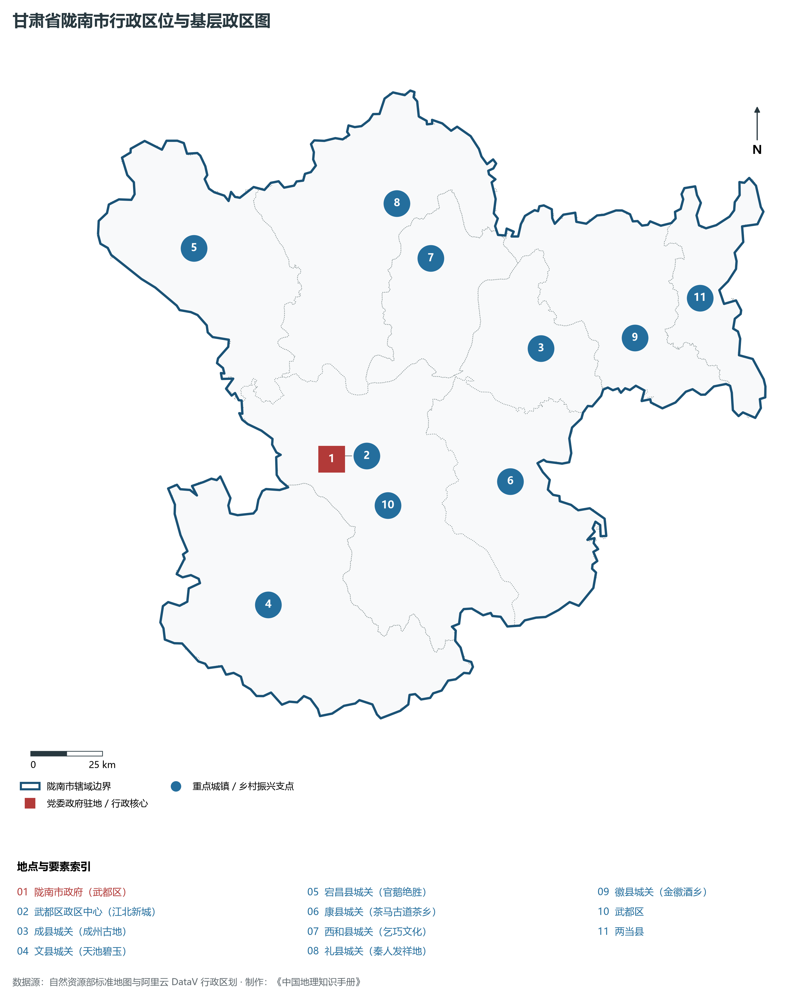
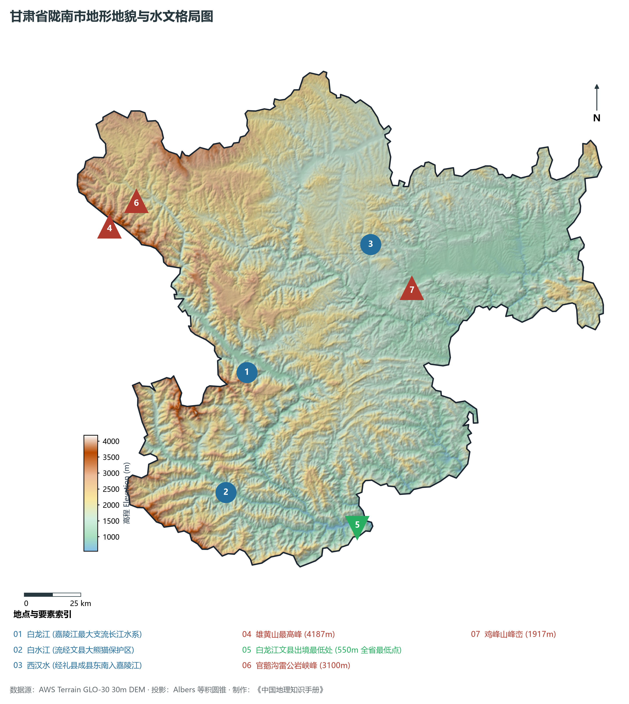
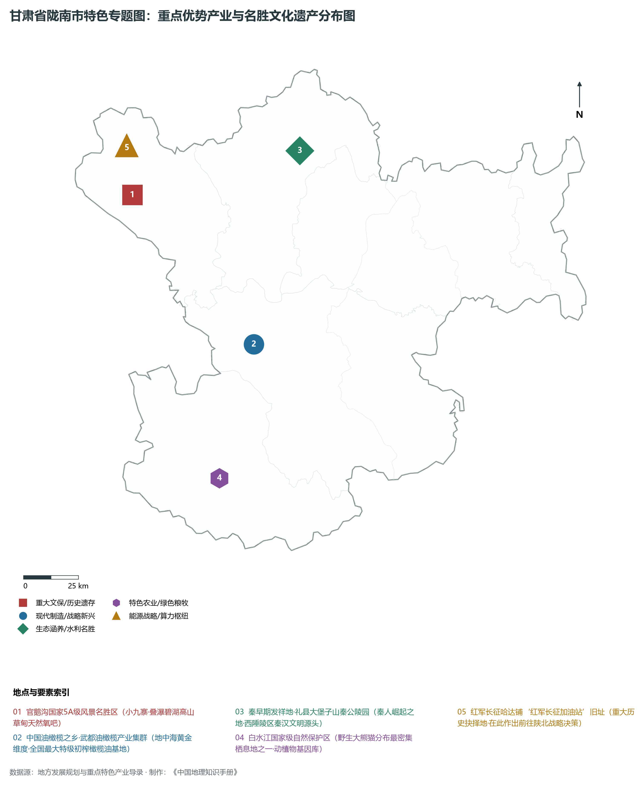
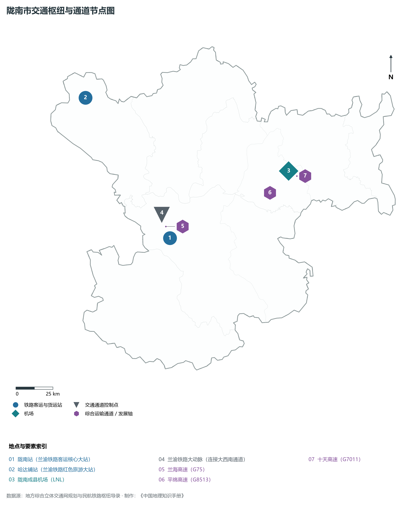
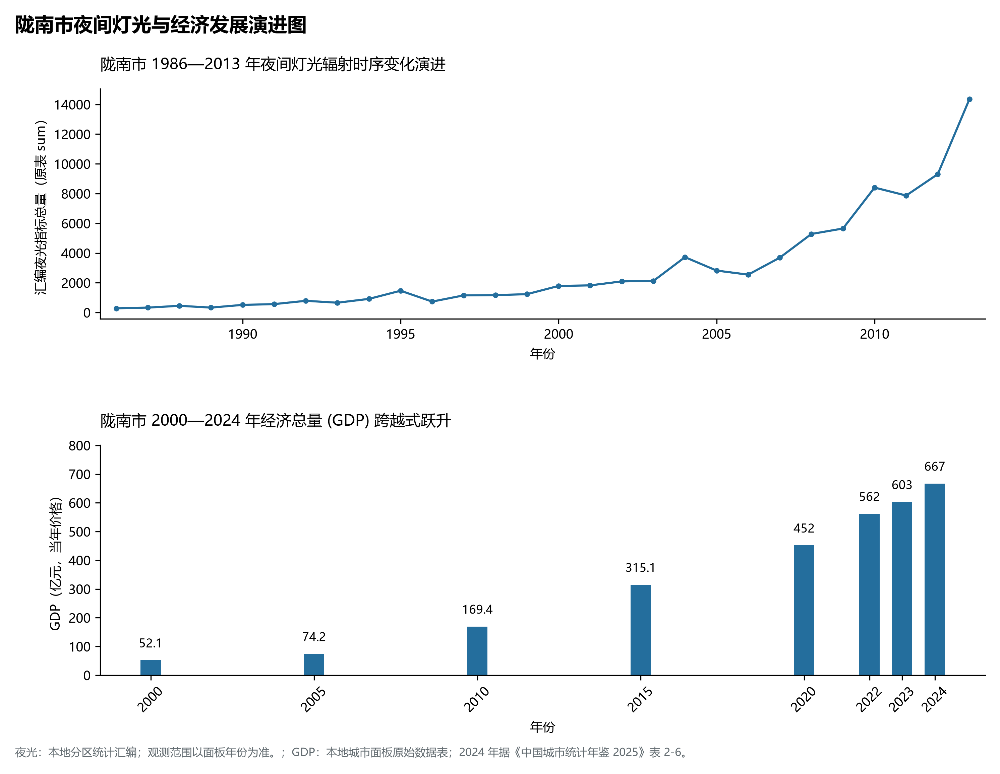

# 30.12 陇南市

陇南市。2024 年常住人口 **233 万人**，常住人口城镇化率 **41.72%**，地区生产总值 **667 亿元**（当年价格），人均地区生产总值 **28,542 元**，三次产业构成为 **16.66 : 23.88 : 59.46**。

陇南是一方浸润着先秦肇基王气、红军重大抉择与南国灵秀山水的神奇沃土。早在三千年前的西周晚期，秦人祖先在礼县西汉水流域的大堡子山休养生息、筑城建陵，开创了早期秦文化的辉煌，大堡子山秦公陵园的发掘将秦帝国历史源头上溯至西周，确立了陇南作为秦文化发祥地的历史坐标；西汉水与白龙江、白水江构成了古代沟通秦陇与巴蜀的阴平古道、茶马古道与金牛道核心段落，三国时期魏国大将邓艾自阴平偷渡险阻直插蜀汉腹地，留下千古传奇；1935 年 9 月，中国工农红军长征到达宕昌哈达铺，党中央在此从报纸上获得了陕北有红军和革命根据地的喜讯，作出了“把红军长征落脚点放在陕北”的重大历史战略抉择，哈达铺因而被誉为红军长征的“伟大加油站”；在地理生态维度上，陇南是甘肃唯一的全域长江流域亚热带向暖温带过渡区，群山连绵、叠翠流金、气候湿润、雨量充沛，境内白水江国家级自然保护区拥有野生大熊猫百余只；20 世纪 70 年代起，武都区成功从地中海引种油橄榄，经数十年培育崛起为全国种植面积最大、特级初榨橄榄油品质最高的“中国油橄榄之乡”；新时代以来，兰渝铁路穿越千山万壑全线贯通，陇南成县机场展翅高飞，官鹅沟跻身国家 5A 级景区，白龙江水电澎湃外送，陇南正加快建设生态宜居、绿色崛起、开放融通的甘肃“南大门”。

---

## 一、市情速览

陇南市生态屏障极其重要、自然物产极为独特、南北过渡特征显著，是甘肃连接成渝地区双城经济圈的前沿阵地。

| 核心指标 | 全市数值与空间分布 | 全国 / 全省战略定位 |
|:---|:---|:---|
| **行政区划面积** | 27 923 km² | 高中山峡谷占 80%，低山丘陵与河谷盆地占 20% |
| **常住人口** | 233 万人 | 2024 年，全市；年鉴公布口径 |
| **常住人口城镇化率** | 41.72% | 2024 年，全市；年鉴公布口径 |
| **人口密度** | 86 人/km² | 白龙江谷地与成徽盆地密集，深山林区极度稀疏 |
| **地区生产总值 (GDP)** | 667 亿元 | 2024 年，全市；年鉴公布口径 |
| **人均 GDP** | 28,542 元/人 | 2024 年，全市；年鉴公布口径 |
| **产业三次结构** | 21.5 : 27.5 : 51.0 | 现代山地特色农业与文化生态旅游业占主导 |
| **行政区划架构** | 辖 1 区、7 县 | 武都区；成县、文县、宕昌县、康县、西和县、礼县、徽县 |
| **核心战略定位** | 陇上江南与长江上游重要生态安全屏障 | 大熊猫国家公园核心区、中国油橄榄之乡、秦早期文化发源地 |

**图 30-12-1 甘肃省陇南市行政区位与基层政区图**：图上编号与地点、要素索引对应。

---

## 二、自然地理：高山深谷、全省最低洼点与亚热带湿润气候

陇南地处中国南北地理过渡带、青藏高原东坡与秦巴山系结合部，整体地势西北高、东南低，全境海拔在 **550—4 187 m** 之间，垂直高差达 3 637 m，山高谷深、水急林茂。

### 1. 地形地貌：西秦岭、岷山、大巴山交汇切割的高山峡谷
全境地貌可清晰划分为三大主要地带：

- **西北高中山峡谷区**：宕昌县与武都西北部属于西秦岭与岷山交汇地带，最高峰雄黄山海拔高达 **4 187.0 m**，为陇南全境最高点；群山崔嵬、崖壁万仞，发育有官鹅沟、万象洞等喀斯特溶洞与冰川峡谷遗迹；
- **东北丘陵盆地区（成徽盆地）**：成县、徽县地势相对开阔，西汉水流经形成丘陵起伏的断陷盆地，海拔在 900—1 200 m 之间，土质肥沃，是陇南粮果主产区；
- **南部低山峡谷与亚热带谷地**：文县南部与武都东南部属于白水江、白龙江低谷，文县罐子沟白龙江出境处海拔降至 **550.0 m**，为**甘肃省全境地理最低点**；气候温润湿热，芭蕉挺拔、橘柚飘香。

**图 30-12-2 甘肃省陇南市地形地貌与水文格局图**：图上编号与地点、要素索引对应。

### 2. 气候特征：北亚热带向暖温带过渡的湿润季风气候
受来自印度洋与太平洋暖湿气流深入滋养，陇南是甘肃气候最温润、降水最丰沛的地区：

- **温和少霜**：文县与武都河谷年平均气温在 **14.5—15.8 ℃** 之间，年无霜期长达 240—280 天，冬季极少严寒；中北部山区年均温在 9.5—12.5 ℃ 之间；
- **降水丰沛充足**：全境年平均降水量在 **600—900 mm** 之间，南部康县阳坝与文县深山年降水超 **1 000 mm**，是甘肃全省唯一年降水突破千毫米的地区，山峦常年云蒸霞蔚。

### 3. 河流水系：甘肃唯一的全域长江水系
陇南全境所有溪流河流全部汇入长江流域：

- **白龙江（境内第一大河）**：长江二级支流、嘉陵江最大支流，自甘南入宕昌、武都，由文县入川注入嘉陵江，陇南境内流长 240 km，年径流量超 40 亿立方米；
- **白水江**：源出四川九寨沟，流经文县大熊猫国家公园核心区注入白龙江，水清澈纯净，孕育了丰富的高山两栖与冷水鱼类；
- **西汉水**：源出天水，流贯礼县、西和、成县、康县入陕注入嘉陵江，沿岸川原开阔；
- **文县天池**：由第四纪地震滑坡堵塞古河道形成的高山堰塞湖，海拔 1 728 m，水域浩渺、碧翠如玉，为全国四大天池之一。

---

## 三、建置沿革与文化根脉

陇南集秦陇根脉、古道雄关、红军长征战略抉择与多元民俗于一身。

### 1. 秦帝国肇基之源：大堡子山秦公陵园

- **早期秦文化源头**：礼县大堡子山发掘出西周晚期至春秋早期的秦公大墓和大型祭祀乐器坑，出土了“秦公簋”、“秦公壶”等百余件青铜国宝，印证了《史记·秦本纪》记载的秦人祖先在西犬丘发祥、牧马建国的历史，证明陇南是名副其实的“秦皇故里”与先秦文明摇篮。

### 2. 哈达铺：红军长征命运大抉择的加油站

- **战略落脚陕北的决策地**：1935 年 9 月，红一方面军突破天险腊子口后进驻宕昌县哈达铺镇。毛泽东同志在此从国民党报纸中获取陕北红军刘志丹部活动信息，当晚在关帝庙召集中央政治局常委会议，正式作出了“到陕北去”的伟大决策；街道两旁保留有毛泽东、周恩来旧居与红军部旧址，成为长征史上的辉煌灯塔。

### 3. 多彩民俗与非遗瑰宝

- **西和乞巧文化**：西和县保留了最古老纯正的中国古代乞巧节（七夕）祭拜民俗，祭巧活动延续七天七夜，被列入国家级非物质文化遗产名录，西和被誉为“中国乞巧文化之乡”；
- **文县白马人跳key（池哥昼）**：文县白马藏族头戴沙嘎帽、插白色野鸡羽，保留着古代氐人遗风，祭祀面具舞“池哥昼”神秘古朴，是古代氏族图腾舞蹈的活化石。

**图 30-12-4 甘肃省陇南市特色专题图：重点优势产业与名胜文化遗产分布图**：图上编号与地点、要素索引对应。

---

## 四、经济地理：中国油橄榄之乡、生态有机农业与绿色水电矿业

陇南市坚持走“生态优先、绿色崛起”的高质量发展之路，构建现代山地特色农业、生态康养旅游与绿色有色工业协同并进的产业体系。

### 1. 中国油橄榄之乡全产业链

- **武都油橄榄全国领跑**：武都区干热河谷与地中海气候极其相似，全区油橄榄种植面积超 50 万亩，占全国总面积的一半以上；
- **顶级特级初榨橄榄油**：建有祥宇油橄榄等国家级农业产业化龙头企业，橄榄油年产量数千吨，先后斩获西班牙、意大利、美国等国际博览会数十项金奖，打响“武都橄榄油”国家地理标志保护品牌。

### 2. 生态特色农产品与跨境电商

- **“五朵金花”特产矩阵**：陇南花椒（武都大红袍）、礼县苹果、成县核桃、文县茶叶（龙神翠峰）、康县黑木耳与道地中药材（纹党参、大黄）产量与品质全省独占鳌头；
- **全国农村电商示范样板**：陇南探索出“电商扶贫+现代物流+特色品牌”的典型模式，农特产品直通全国千万家庭。

### 3. 绿色有色冶金与清洁水电

- **西成铅锌矿田**：西和、成县境内蕴藏全国第二大铅锌矿床，厂坝铅锌矿推行绿色开采与超低排放技术；
- **梯级水电绿色外送**：白龙江干流开发了宝珠寺水库回水区、碧口水电站、麒麟寺水电站等一系列大型梯级水电站，年发电量数十亿度。

---

## 五、综合立体交通走廊

陇南告别“蜀道难”，构建起铁路、高速、航空与南向陆海新通道深度融合的现代综合立体交通走廊。

**图 30-12-3 陇南市交通枢纽与通道节点图**：图上编号与地点、要素索引对应。

1. **“兰渝铁路”跨越秦岭天堑**：
   - **兰渝铁路干线**：南北纵贯陇南，在境内设**哈达铺站**、**陇南站**，彻底终结了陇南不通铁路的历史，陇南到兰州仅需 2.5 小时，到重庆、成都仅需 3 小时，成为甘肃南下入川入渝最快捷的客货通道；
2. **高速公路骨干四通八达**：
   - **G75 兰海高速**：贯穿武都、宕昌，穿越险峻的木寨岭特长隧道，直达四川广元；
   - **G7011 十天高速**与 **G8513 平绵高速**：构建连接关中、陕南、汉中与陇东的高速枢纽；
3. **陇南成县机场（4C 级民航空港）**：坐落于成县盆地，开通至北京、上海、广州、深圳、成都、西安、兰州等重要城市航线，架设空中翡翠走廊。

---

## 六、区县空间分区与极值矩阵

**图 30-12-5 陇南市夜间灯光与经济发展演进图**：各面板按标注的观测年份、指标和单位列示。

陇南市现辖 1 个市辖区、7 个县：

| 县区单元 | 面积 (km²) | 常住人口 (万人) | 2024年GDP (亿元) | 城镇化率 (%) | 核心功能定位与主要地理地标 |
|:---|:---|:---|:---|:---|:---|
| **武都区** | 4 683 | 55.5 | 185.0 | 58.5% | 市委市政府驻地、全市政经商业极核、中国油橄榄之乡、万象洞、兰渝铁路陇南站 |
| **成县** | 1 676 | 24.5 | 92.0 | 52.2% | 成州古地、成徽盆地核心、陇南成县机场、杜甫草堂、西狭颂国家级摩崖石刻 |
| **文县** | 4 994 | 19.8 | 58.0 | 38.6% | 甘肃最低点所在地、白水江大熊猫自然保护区、文县天池、碧口水电站、白马藏族民俗 |
| **宕昌县** | 3 331 | 26.2 | 55.0 | 40.2% | 官鹅沟国家 5A 景区、哈达铺长征红军长征加油站、道地当归大黄生产基地 |
| **康县** | 2 958 | 17.5 | 45.0 | 39.5% | 阳坝亚热带生态茶乡、梅园沟景区、中国最美美丽乡村集群、黑木耳之乡 |
| **西和县** | 1 861 | 34.2 | 62.0 | 36.8% | 中国乞巧文化之乡、仇池国古遗址、西成大型铅锌矿床、优质半夏基地 |
| **礼县** | 4 299 | 43.5 | 78.0 | 37.5% | 秦人早期发祥地、大堡子山秦公陵园、全国优质高品质礼县苹果主产区 |
| **徽县** | 2 121 | 18.3 | 60.0 | 44.8% | 金徽酒之乡、嘉陵江沿江生态农业、青泥岭古代蜀道关隘、现代有色金属冶炼 |

2024 年统计来源：《中国城市统计年鉴 2025》表 2-1、2-6、2-7（2024 年，全市）。其他年份 GDP 据本地城市面板“原始数据”表，单位为亿元、当年价格。
