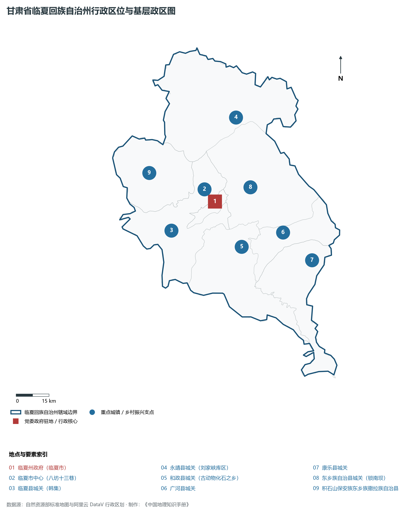
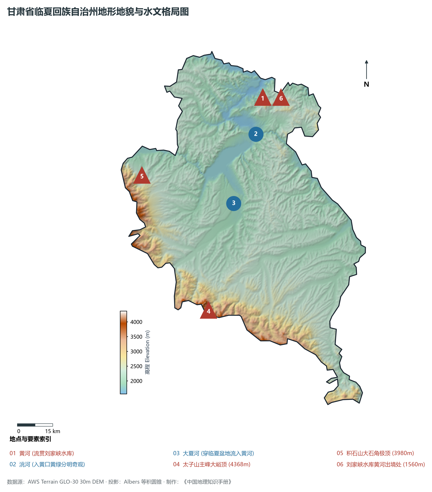
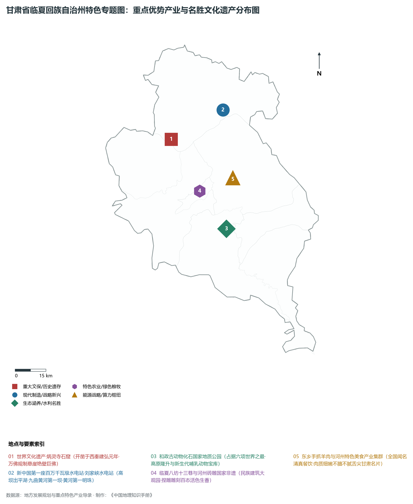
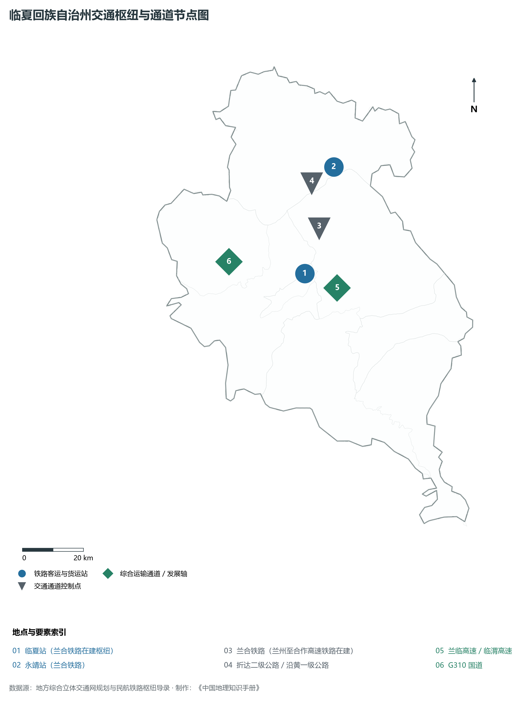
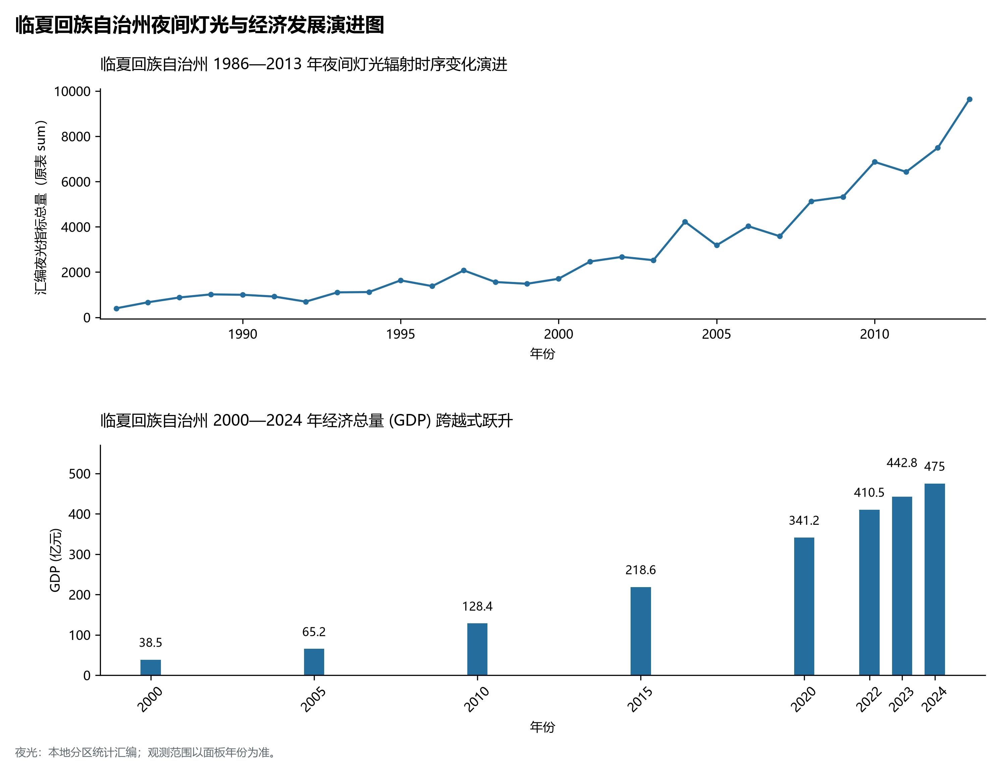

# 30.13 临夏回族自治州

临夏回族自治州，古称“枹罕”、“河州”，享有“花儿临夏”、“茶马古市要塞”、“黄河明珠”、“中国彩陶之乡”与“西部砖雕之都”的盛名，是甘肃省下辖的两个民族自治州之一，全国仅有的两个回族自治州之一，古丝绸之路南道与唐蕃古道重要枢纽要冲，世界文化遗产炳灵寺石窟所在地，也是黄河上游新中国第一座百万千瓦级大型水电站——刘家峡水电站所在地。地处甘肃省中部偏西南、青藏高原东北缘向黄土高原过渡带的黄河与洮河、大夏河交汇谷地，地理坐标介于东经 102°41′—103°40′、北纬 35°10′—36°10′ 之间。南依巍峨险峻、终年戴雪的西秦岭北支太子山脉，北枕黄河与小积石山，滔滔黄河自青海龙羊峡劈山而出，在临夏北部永靖县境内深切峡谷、蓄积平湖。东邻定西市临洮县，西连青海省海东市循化撒拉族自治县、民和回族土族自治县，南接甘南藏族自治州夏河县、合作市与卓尼县，东北与兰州市红古区、西固区隔河相望。全境土地总面积 **8 169 km²**，常住人口 **212.5 万人**，回、东乡、保安、撒拉等少数民族人口占 **60% 以上**；城镇化率达 **40.5%**；2024 年地区生产总值（GDP）跨上 **475.0 亿元**新台阶，人均 GDP 约 **22 352 元人民币**。

临夏是一方融合多民族历史文脉、远古生命演化遗存与宏伟水电水利的交响乐章。这里地质演化极其罕见，和政县出土了占据六项世界之最的新生代哺乳动物化石群，包括世界上独一无二的和政羊、世界上最大的真马埃氏马与世界最大的三趾马动物群，被誉为欧亚大陆晚新生代古生物化石的黄金圣殿；两千年前汉昭帝始元六年（前 81 年）置枹罕县，历代设河州府，成为历代中原王朝统领西戎、经略安多的军政重镇；这里是古代汉藏茶马互市的核心要津，商贾辐辏、马帮连绵，被赞誉为“陇上旱码头”与“茶马古市”；世界文化遗产**炳灵寺石窟**开凿于西秦建弘元年（420 年），在黄河积石峡险峻红砂崖壁上雕凿佛像千尊，保存有中国石窟中最早的纪年题记，被誉为黄河三峡沿岸的艺术皇冠；临夏是新中国治水史上的一座不朽丰碑：1958 年动工、1969 年首台机组发电的**刘家峡水电站**，是我国自行勘测、设计和建造的第一座百万千瓦级大型水电站，斩断黄河、高峡平湖，形成了水面浩渺的“黄河三峡”奇景，黄河在此不仅不浑浊，反而呈现碧绿纯净的“高原千岛湖”绝景；洮河在此注入黄河，两水交汇处黄绿分明，形成蔚为壮观的“双色河”天下奇观；临夏还是“中国民间花儿之乡”，传唱千年的河州花儿高亢婉转，入选联合国人类非物质文化遗产代表作名录；河州砖雕、临夏雕漆技艺超群，八坊十三巷古朴典雅；新时代以来，临夏全面打赢脱贫攻坚战，加速推进灾后恢复重建与乡村振兴，兰合铁路全面铺轨，折达公路风景如画，临夏正昂首阔步迈向现代文明与生态繁荣相辉映的现代民族自治名州。

---

## 一、州情速览

临夏回族自治州区位优越、民族特色极其浓郁、文化遗存世界级、水利资源充沛，是兰西城市群绿色生态康养后花园。

| 核心指标 | 全州数值与空间分布 | 全国 / 全省战略定位 |
|:---|:---|:---|
| **行政区划面积** | 8 169 km² | 黄土丘陵占 55%，高中山山地占 35%，河谷川台占 10% |
| **常住人口** | 212.5 万人 (2024 年末)；七普 210.98 万人 | 人口密集型自治州，临夏市、临夏县、东乡县人口超 30 万 |
| **常住人口城镇化率** | 40.5% (2024 年) | 临夏市达 78% 以上，小城镇与特色农业聚落密集 |
| **人口密度** | 260 人/km² | 全省人口密度最高的市州之一，大夏河川道达 800 人/km² |
| **地区生产总值 (GDP)** | 475.0 亿元 (2024 年，现价) | 第三产业（特色文旅、清真餐饮、商贸）拉动强劲 |
| **人均 GDP** | 约 22 352 元人民币 | 农业人口比重高，现代高效农业与民族食品加工增收明显 |
| **产业三次结构** | 20.0 : 21.5 : 58.5 | 第三产业占近六成，文旅康养、特色餐饮与现代物流主导 |
| **行政区划架构** | 辖 1 县级市、5 县、2 自治县 | 临夏市；临夏县、康乐县、永靖县、广河县、和政县；东乡族自治县、积石山自治县 |
| **核心战略定位** | 丝路名州与黄河上游水利生态明珠 | 世界文化遗产炳灵寺、和政古动物化石群、刘家峡百万千瓦水电基地 |

**图 30-13-1 甘肃省临夏回族自治州行政区位与基层政区图**：图上编号与地点、要素索引对应。

---

## 二、自然地理：太子山屏南、黄河穿峡筑湖与高寒干旱复合过渡

临夏全境地处黄土高原与青藏高原两大地质构造单元的碰撞交接地带，全境山峦起伏、河谷深切、黄土与红层岩体交织，海拔在 **1 560—4 368 m** 之间。

### 1. 地形地貌：高山雪峰、中低山丘陵与黄河阶地峡谷
全州地貌可划分为三大鲜明板块：

- **南部西秦岭支脉太子山中山高山区**：横跨康乐、和政、临夏县与积石山南部，主峰大峪顶海拔高达 **4 368.0 m**，为临夏全境第一高峰；山顶常年积雪，植被以高山草甸、冷杉天然林与灌丛为主，是临夏地表径流的大水塔；
- **中部黄土侵蚀梁峁低中山盆地区**：广河、和政、东乡大部属于黄土丘陵，冲沟发育极其密集，土壤质地松散，经长年综合治理构筑了梯田生态屏障；
- **北部黄河与洮河深切红砂岩峡谷与平湖区**：永靖县境内黄河切穿龙汇峡、刘家峡、炳灵峡，红砂岩峭壁对峙如刀削，高坝拦水形成浩瀚数十平方公里的深水人工湖库区；
- **黄河出境最低点**：黄河在永靖县盐锅峡与兰州西固交界出境处，海拔降至 **1 560.0 m**。

**图 30-13-2 甘肃省临夏回族自治州地形地貌与水文格局图**：图上编号与地点、要素索引对应。

### 2. 气候特征：温带半干旱大陆性季风气候与高原冷凉气候
光照充分，冬无严寒，夏无酷暑，垂直气候变化极其剧烈：

- **气温与光照**：年平均气温在 **6.3—9.0 ℃** 之间，平川河谷平均气温约 8.5 ℃，年日照时数长达 **2 400—2 600 小时**，夏季气候清爽宜人，是西北知名避暑胜地；
- **降水空间分异**：南部高山迎风坡年降水量达 600—750 mm，中部浅山区约 450—500 mm，而北部黄河河谷永靖、东乡干旱区年降水仅 **350—400 mm**，年蒸发量在 1 400—1 700 mm 之间。

### 3. 河流水系：黄河干流与两大一级支流汇流
临夏是黄河流域水系极其密集的天然水利枢纽：

- **黄河干流过境**：黄河自积石山县大河家入境，蜿蜒穿行临夏北部 180 余公里，先后建有积石峡、炳灵峡、刘家峡、盐锅峡、八盘峡等大型水利水电枢纽；
- **洮河（黄河最大支流）**：自甘南流出，在临洮与永靖交界处注入刘家峡水库，入黄口泥沙泛黄与黄河碧波形成“半河清澈半河黄”的旷世奇观；
- **大夏河**：源自青海甘南，斜穿临夏盆地与临夏市主城区，是临夏回族自治州最亲切的“母亲河”。

---

## 三、建置沿革与文化根脉

临夏集古生物奇观、丝路古渡、石窟瑰宝、中国花儿与古建砖雕艺术于一身。

### 1. 和政古动物化石群：世界级晚新生代生命圣殿

- **六项世界之最**：和政古动物化石博物馆珍藏化石标本数万件，涵盖晚渐新世巨犀动物群、中中新世铲齿象动物群、晚中新世三趾马动物群和早更新世真马动物群四大哺乳动物群，占据“世界上最丰富的铲齿象化石、最大的真马化石、最大的鬣狗化石、独一无二的和政羊化石”等六项世界之最，是研究青藏高原隆升与亚洲季风演化的全球地质教科书。

### 2. 世界文化遗产炳灵寺石窟

- **黄河崖壁上的佛国瑰宝**：始凿于西秦建弘元年（420 年），在小积石山大寺沟两岸红砂岩峭壁上开凿了 216 个窟龛、815 尊造像和近千平方米壁画。169 窟为全国已知最早有明确纪年的石窟洞窟，造像兼具汉晋古朴与印度犍陀罗艺术风格，2014 年作为丝绸之路核心遗产点列入世界文化遗产。

### 3. 人类非遗河州花儿与河州砖雕

- **大西北民歌之魂“河州花儿”**：临夏是“中国花儿之乡”，莲花山花儿会、松鸣岩花儿会每年吸引十余万各族歌手引吭高歌，被列入联合国教科文组织人类非物质文化遗产代表作名录；
- **河州砖雕与八坊十三巷**：临夏砖雕集透雕、浮雕、线刻于一体，繁而不乱、细致入微；临夏市“八坊十三巷”完整保护了回族传统四合院落与砖雕门楼，被誉为西北民族建筑与民俗文化的活态大观园。

**图 30-13-4 甘肃省临夏回族自治州特色专题图：重点优势产业与名胜文化遗产分布图**：图上编号与地点、要素索引对应。

---

## 四、经济地理：特色文旅康养、绿色民族食品与黄河清洁水电

临夏州立足“生态立州、文旅兴州、产业强州”战略，打造沿黄现代水电能源、特色食品加工与全域文旅大景区。

### 1. 黄河三峡清洁能源走廊

- **百万千瓦级绿色水电骨干**：刘家峡水电站总装机超 135 万千瓦，年发电量逾 50 亿度，承担西北电网调峰调频核心任务；
- **抽水蓄能与风光储一体化**：推进永靖等大型抽水蓄能电站与库区光伏电站建设，形成水风光互补的绿色清洁能源高地。

### 2. 独具魅力的民族特色食品与牛羊全产业链

- **东乡手抓羊肉全国名牌**：东乡羊肉以肉质细嫩、无膻味、富含微量元素闻名全国，全州肉羊年出栏数百万人次，形成了从生态养殖、冷链屠宰到全国连锁餐饮的百亿级产业；
- **特色清真牛羊肉与调味品**：康乐县、临夏县现代草畜一体化基地快速发展，河州清真牛羊肉直供全国各大商超与穆斯林市场。

### 3. 全域文旅与牡丹产业康养

- **临夏紫斑牡丹名动天下**：临夏培植紫斑牡丹已有千年历史，株高花大，打造“河州牡丹月”文旅品牌，发展牡丹油、牡丹花茶等高附加值精深加工；
- **黄河三峡与避暑乡村游**：炳灵石林、太极岛湿地、松鸣岩风景区吸引兰州及周边游客，乡村旅游带动万户农民家门口增收致富。

---

## 五、综合立体交通走廊

临夏正迎来铁路与高速建设的黄金期，全面融入省会兰州半小时通勤经济圈。

**图 30-13-3 临夏回族自治州交通枢纽与通道节点图**：图上编号与地点、要素索引对应。

1. **“兰合高铁”开启高铁时代**：
   - **兰州至合作铁路（兰合铁路）**：全长 147 公里，设计时速 200 公里，在临夏州境内设立**永靖站**、**临夏站**，全面铺轨施工，建成后临夏到兰州仅需 30 分钟，彻底终结临夏不通客运火车的历史；
2. **高速公路网密集编织**：
   - 兰临高速、临渭高速、临大高速（临夏至大河家）、康乐至临洮高速相继通车；
   - 折达二级公路横跨刘家峡水库库区，成为西北最美的沿黄山水风情观光线；
3. **黄河水运旅游航线**：开通从刘家峡大坝至炳灵寺石窟的高速游艇与豪华游轮航道，构成西北独一无二的黄河水上文旅走廊。

---

## 六、区县空间分区与极值矩阵

**图 30-13-5 临夏回族自治州夜间灯光与经济发展演进图**：各面板按标注的观测年份、指标和单位列示。

临夏回族自治州现辖 1 个县级市、5 个县、2 个自治县：

| 县市单元 | 面积 (km²) | 常住人口 (万人) | 2024年GDP (亿元) | 城镇化率 (%) | 核心功能定位与主要地理地标 |
|:---|:---|:---|:---|:---|:---|
| **临夏市** | 88 | 38.5 | 125.0 | 79.5% | 州府驻地、全州政经商贸文化极核、八坊十三巷、东公馆、红园、河州牡丹基地 |
| **临夏县** | 1 212 | 34.2 | 82.0 | 38.2% | 韩集新城、太子山天池水源涵养区、现代日光温室蔬菜、优质肉牛繁育基地 |
| **永靖县** | 1 864 | 18.2 | 75.0 | 45.6% | 百万千瓦刘家峡水电站、世界遗产炳灵寺石窟、炳灵石林、太极岛国家湿地公园 |
| **和政县** | 960 | 18.5 | 42.0 | 37.8% | 六项世界之最和政古动物化石馆、松鸣岩国家级风景名胜区、高原啤特果之乡 |
| **广河县** | 538 | 25.5 | 48.0 | 38.5% | 齐家文化发祥地、全国知名皮革毛皮交易集散地、齐家文化博物馆、特色手工业 |
| **康乐县** | 1 083 | 24.5 | 45.0 | 36.8% | 莲花山国家级自然保护区、莲花山花儿盛会、现代草畜平衡示范、绿色生态中药材 |
| **东乡族自治县** | 1 510 | 30.5 | 42.0 | 35.2% | 全国唯一东乡族自治县、东乡手抓羊肉发祥地、锁南坝新城、东乡刺绣产业园 |
| **积石山保安族东乡族撒拉族自治县** | 914 | 22.6 | 16.0 | 34.5% | 全国唯一保安族自治县、保安腰刀国家非遗、大河家黄河古渡、大石角主峰 |
