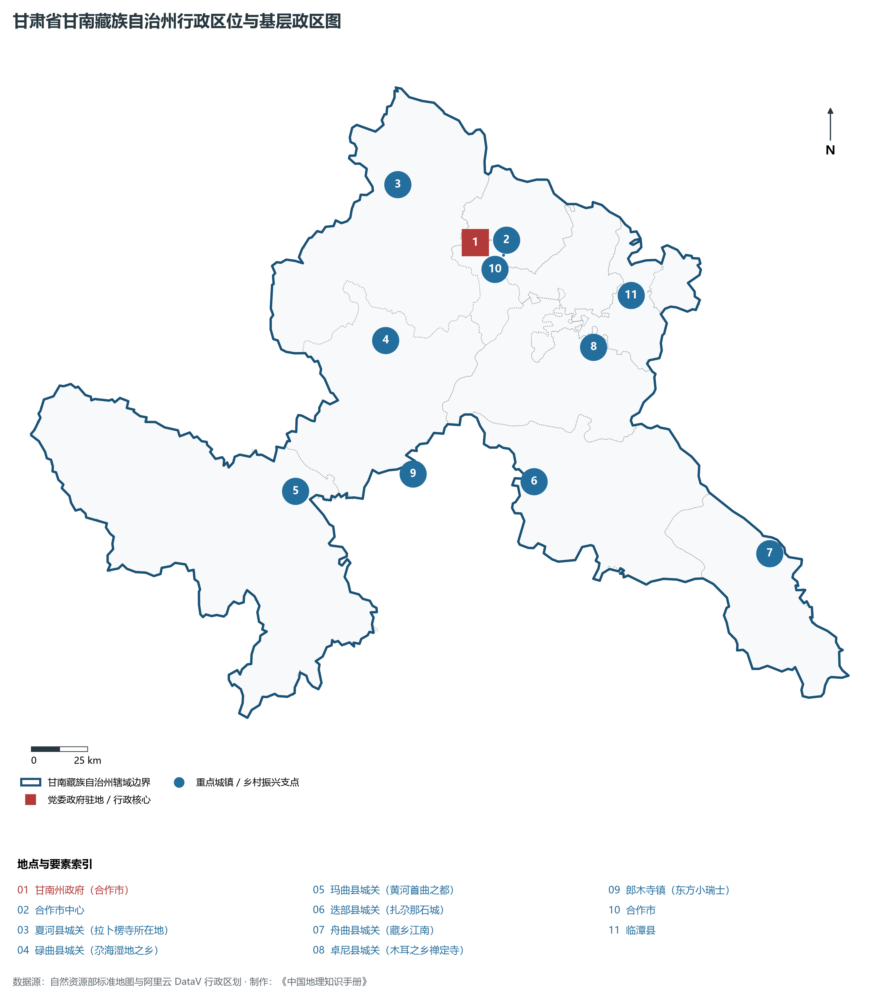
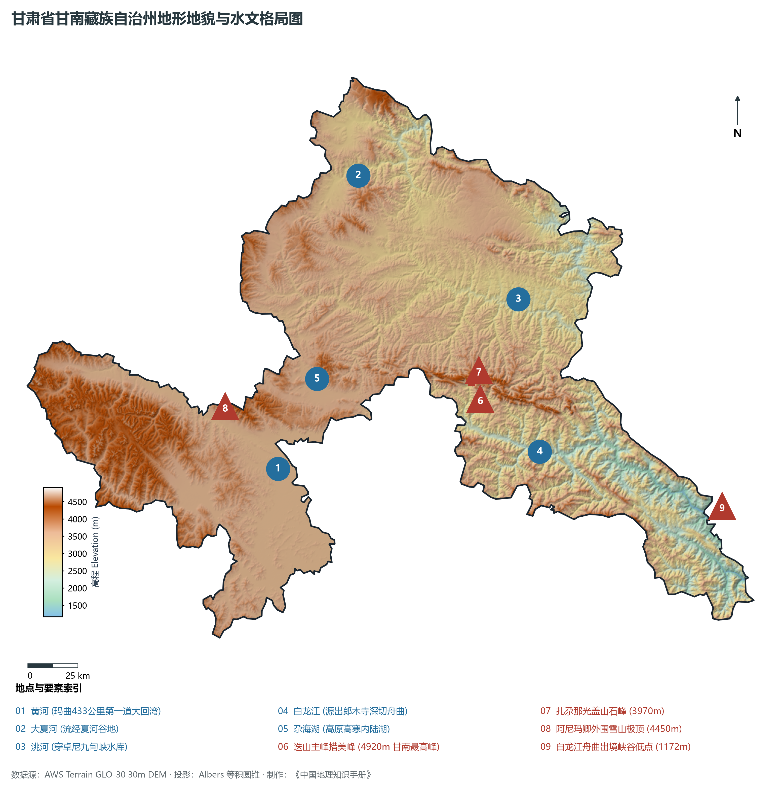
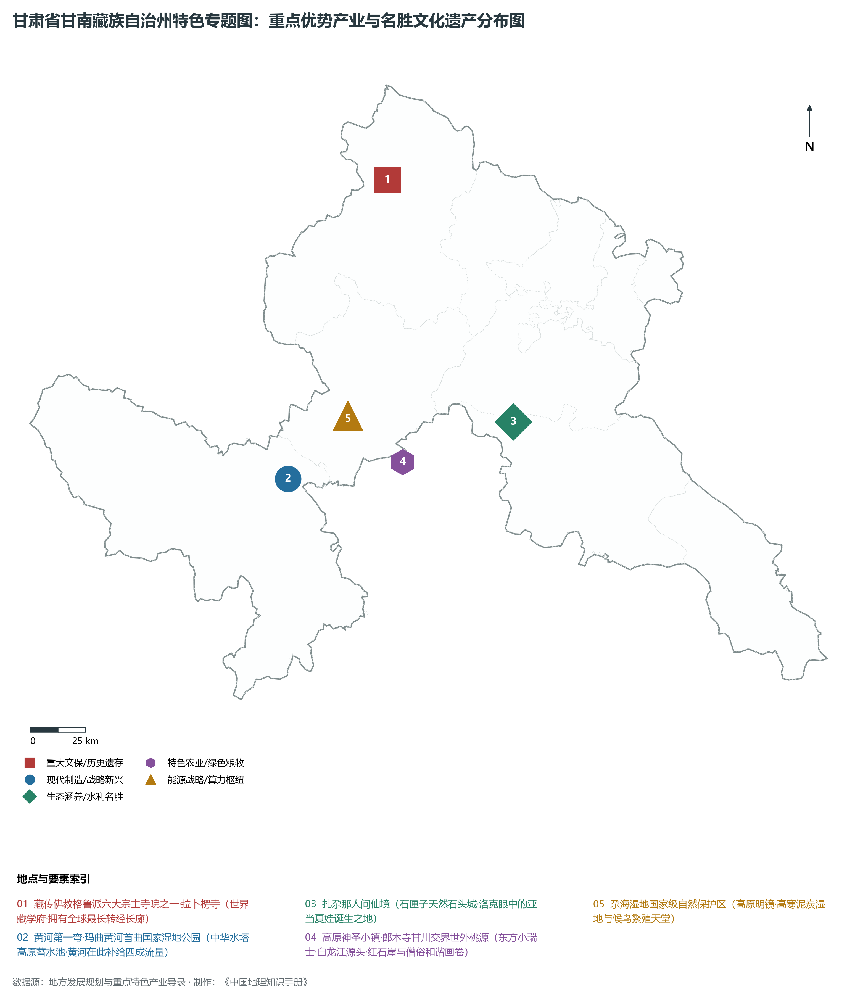
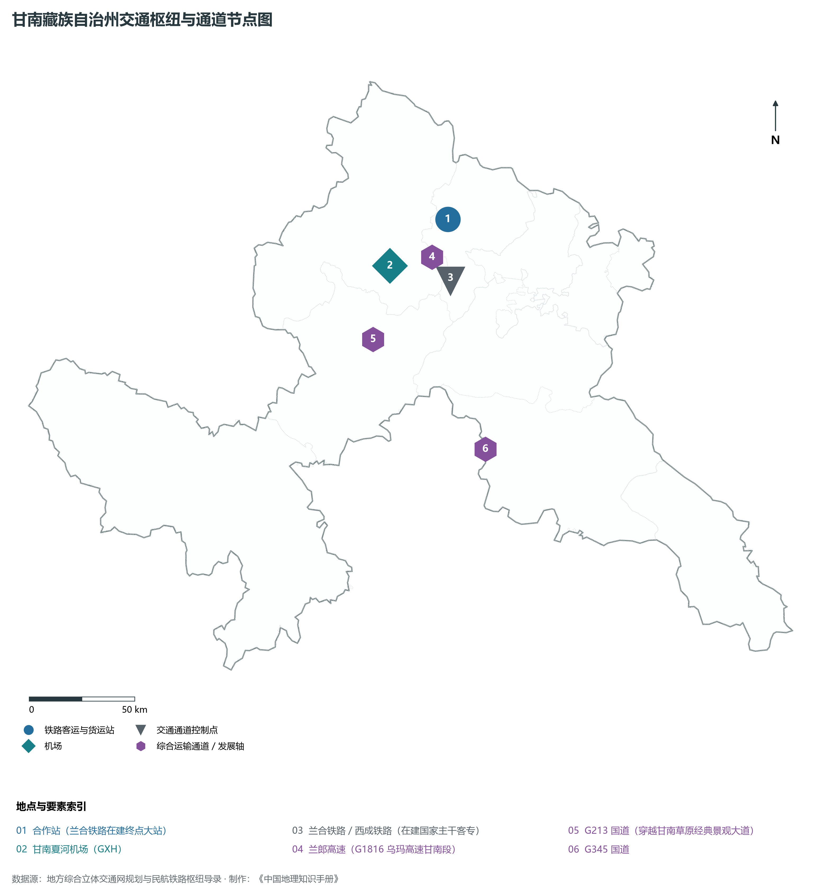
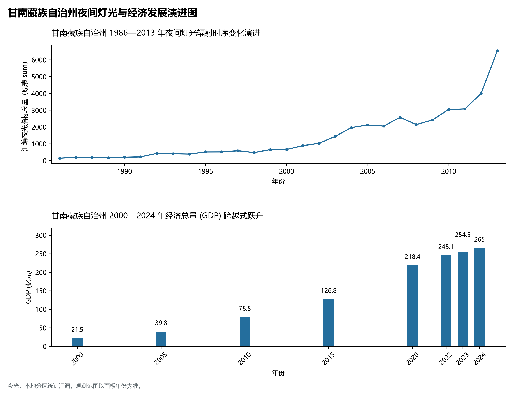

# 30.14 甘南藏族自治州

甘南藏族自治州，享有“高原明珠”、“九色甘南”、“藏区现代化先行区”、“黄河第一弯水源涵养地”与“户外天堂扎尕那”的美誉，是甘肃省下辖的两个民族自治州之一，青藏高原东北边缘重要的生态安全屏障、黄河上游核心水源补给涵养区、藏传佛教格鲁派六大宗主寺院之一拉卜楞寺所在地，也是联合国粮农组织全球重要农业文化遗产（扎尕那农林牧复合系统）所在地。地处甘肃省西南部、青藏高原东北边缘向黄土高原与秦岭山脉过渡的甘青川三省交界地带，地理坐标介于东经 100°46′—104°44′、北纬 33°06′—35°34′ 之间。南邻四川省阿坝藏族羌族自治州若尔盖县、阿坝县与九寨沟县，西南接青海省果洛藏族自治州久治县、玛沁县，西连青海省黄南藏族自治州河南蒙古族自治县、同仁市，北接临夏回族自治州与定西市岷县、漳县，东邻陇南市宕昌县。全境土地总面积 **38 521 km²**，常住人口 **69.5 万人**，藏族人口占 **56.8%**；城镇化率达 **44.8%**；2024 年地区生产总值（GDP）达到 **265.0 亿元**，人均 GDP 突破 **3.8 万元**。

甘南是一片闪耀着藏传佛教宏伟艺术、红军长征天险壮举与人与自然和谐共生的圣洁净土。夏河县大夏河畔的**拉卜楞寺**始建于清康熙四十八年（1709 年），由第一世嘉木样活佛创建，拥有规模庞大的六大学院、四十八座佛殿和五百余座僧舍，拥有世界上最长的转经长廊（全长 3.5 公里、转经筒达 2 000 余个），被誉为“世界藏学府”；甘南玛曲县是全国唯一以“黄河”命名的县份（藏语“玛曲”即黄河），九曲黄河在玛曲大草原上绕出长达 433 公里的宏伟“第一大回湾”，为黄河中下游补充了近 **40% 的径流量**，被誉为黄河流域名副其实的“蓄水池”与“中华水塔”；迭部县境内的**扎尕那**是一座由高耸云天的灰岩石峰围成的天然石头城，早在 20 世纪初美籍奥地利探险家约瑟夫·洛克在此考察时便惊叹：“我平生未见如此绮丽的景色，如果是《创世纪》的作者看到迭部的美景，就会把亚当和夏娃的诞生地放在这里”；甘南也是中国革命军事史上的重要转折地：1935 年 9 月，红一方面军长征经过迭部，长征勇士飞夺天险**腊子口**，砸碎了国民党军企图将红军围歼于雪山草地的险恶图谋，彻底打开了北上抗日的胜利坦途；郎木寺镇地跨甘川两省，红石崖峻拔、白龙江初生、僧俗和谐相处，被西方游客赞为“东方小瑞士”；新时代以来，甘南州率先在全国打响“全域无垃圾”绿色革命，实现了草原不见塑料、景区一尘不染的生态奇迹，九色甘南全域旅游享誉海内外，夏河机场航班畅通，兰合铁路与西成铁路加速建设，甘南正阔步走向生态美、产业优、百姓富的雪域高原新时代。

---

## 一、州情速览

甘南藏族自治州生态屏障极其关键、文旅资源世界级、高原特色畜牧优势显著，是青藏高原与黄河源区绿色崛起的标杆典范。

| 核心指标 | 全州数值与空间分布 | 全国 / 全省战略定位 |
|:---|:---|:---|
| **行政区划面积** | 38 521 km² | 高原天然草甸占 65%，冷温带针叶林占 25%，河谷占 10% |
| **常住人口** | 69.5 万人 (2024 年末)；七普 69.19 万人 | 合作市、夏河县相对集聚，玛曲、碌曲草原地广人稀 |
| **常住人口城镇化率** | 44.8% (2024 年) | 州府合作市超 70%，牧民定居点与生态旅游集聚区蓬勃发展 |
| **人口密度** | 18 人/km² | 全省密度最低的区域之一，玛曲大草原低于 6 人/km² |
| **地区生产总值 (GDP)** | 265.0 亿元 (2024 年，现价) | 生态优先、绿色发展，以生态文旅与现代高原畜牧业为主导 |
| **人均 GDP** | 约 38 129 元人民币 | 高原牦牛藏羊产值提升与全域旅游带动人均持续攀升 |
| **产业三次结构** | 28.5 : 15.5 : 56.0 | 第三产业文旅主导，高原特色现代畜牧业为基础支撑 |
| **行政区划架构** | 辖 1 县级市、6 县 | 合作市；夏河县、碌曲县、玛曲县、迭部县、舟曲县、卓尼县 |
| **核心战略定位** | 黄河上游水源涵养区与藏区生态文明高地 | 黄河第一弯水源保护区、世界藏学府拉卜楞寺、扎尕那全球农业文化遗产 |

**图 30-14-1 甘肃省甘南藏族自治州行政区位与基层政区图**：图上编号与地点、要素索引对应。

---

## 二、自然地理：青藏东缘、黄河首曲回环与高山峡谷交织

甘南全境地处青藏高原东北缘向黄土高原与西秦岭的阶梯过渡带，整体地势西南极高、东北低落，山川纵横、河水激荡，海拔在 **1 172—4 920 m** 之间，垂直高差达 3 748 m。

### 1. 地形地貌：青藏高平原、高耸石灰岩峰丛与深切峡谷
全州由三大地貌单元组合构成：

- **西南部青藏高平原草甸沼泽区**：玛曲县、碌曲县西南部为海拔 3 400—3 800 m 的高平原草甸与泥炭沼泽，地形平缓起伏，水草极其丰美，黑颈鹤、大天鹅栖息于尕海湖畔；
- **中部与东南部西秦岭迭山高山峡谷区**：迭部县、卓尼县境内耸立着高耸入云的迭山山系，主峰**措美峰**海拔高达 **4 920.0 m**，为甘南州最高峰；石灰岩岩溶地貌发育极度壮观，扎尕那石城如巨型石笋直插苍穹；
- **东北部低山黄土过渡丘陵盆地区**：合作盆地、大夏河谷与洮河沿岸阶地，海拔在 2 500—3 000 m 之间，是甘南农业与城镇的主要集中分布区；
- **白龙江峡谷最低出境处**：白龙江向东深切舟曲县境，至舟曲大峪沟出境处海拔降至 **1 172.0 m**，为甘南全境最低点。

**图 30-14-2 甘肃省甘南藏族自治州地形地貌与水文格局图**：图上编号与地点、要素索引对应。

### 2. 气候特征：高原高寒湿润气候向大陆性季风过渡
冬长无夏，春秋相连，气候冷凉湿润，紫外线辐射强烈：

- **气温分异**：全州大部分地区年平均气温在 **1.5—4.5 ℃** 之间，玛曲高平原年均温仅 1.8 ℃，极端最低温达 -28.0 ℃；唯有东南部舟曲深切河谷年均温达 13.0 ℃，享有“藏乡小江南”之称；
- **降水充沛**：全州年平均降水量达 **550—800 mm**，南部迭部、舟曲深山降水超 700 mm，且多地形雨和高山阵雪，年蒸发量在 1 100—1 400 mm 之间，湿润系数高，水热条件优于西北其他干旱区域。

### 3. 河流水系：黄河干流水源涵养区与长江支流白龙江源头
甘南横跨黄河、长江两大流域，是名副其实的高原水塔：

- **黄河干流首曲大回环**：黄河自青海久治流经玛曲境内，形成 433 公里蜿蜒宏伟的大转弯后复入青海，注入玛曲沼泽草甸的水量占黄河总径流量的 40% 以上，维系着黄河流域大动脉的生命之水；
- **洮河与大夏河**：洮河发源于碌曲西倾山，穿卓尼九甸峡奔流入临夏，是黄河上游最大支流；大夏河源自夏河，流向临夏盆地；
- **长江水系白龙江**：发源于甘川交界的郎木寺红石崖下，水流清澈奔腾，经迭部、舟曲进入陇南注入嘉陵江；
- **尕海湖（高寒泥炭湿地）**：甘肃最大的高原内陆淡水湖，水域面积十余平方公里，是黄河上游珍贵的高原生态湿地。

---

## 三、建置沿革与文化根脉

甘南融藏传佛教显密学院、红军长征天险突破、农林牧复合古法于一体，是中华多元文化大家庭中瑰丽的雪域翡翠。

### 1. 世界藏学府：拉卜楞寺与安多藏传佛教

- **藏传佛教格鲁派宗主寺院**：夏河拉卜楞寺正式全称为“扎西奇寺”，由第一世嘉木样活佛建于 1709 年，是甘南藏族自治州最高政教与宗教学术中心；寺内设闻思学院、时轮学院、医学院、喜金刚学院等六大学院，保留了数万册珍贵藏文木刻版贝叶经与大藏经，是世界上藏学研究和教学体系最完备的学院型寺院；
- **米拉日巴佛阁与禅定寺**：合作市九层米拉日巴佛阁巍峨庄严；卓尼禅定寺始建于元代，为安多藏区最早的古刹之一。

### 2. 扎尕那：联合国全球重要农业文化遗产

- **天然石头城的人与自然交响**：位于迭部县益哇乡，四周山峰如刀劈斧削，藏寨错落分布在山坳与梯田之间。千百年来当地藏族群众摸索出高山林地保护、山腰农田种植青稞与油菜、高山草场放牧牦牛的“垂直空间复合利用模式”，2018 年被联合国粮农组织认定为“全球重要农业文化遗产”，吸引全球探险与户外爱好者纷至沓来。

### 3. 腊子口战役：天险突围的长征丰碑

- **红军长征开辟胜利通道**：1935 年 9 月，红一方面军长征到达迭部腊子口。面对绝壁夹峙、仅容一桥通过的悬崖天险，红军突击队攀登悬崖绝壁，从敌军背后发起致命一击，成功攻克天险腊子口，彻底粉碎了敌军的截击企图，开辟了红军挺进陕甘的大门；腊子口战役纪念碑巍然耸立在峡谷之巅。

**图 30-14-4 甘肃省甘南藏族自治州特色专题图：重点优势产业与名胜文化遗产分布图**：图上编号与地点、要素索引对应。

---

## 三、经济地理：高原有机畜牧业、全域生态文旅与清洁绿色水电

甘南州坚持“生态立州、旅游富民”战略，做优高原牦牛藏羊特色产业，培育壮大全域无垃圾生态文化旅游业。

### 1. 高原有机畜牧业与“甘南牦牛”地理标志

- **绿色有机畜产品生产基地**：玛曲、碌曲、夏河天然草场连绵，甘南牦牛、玛曲欧拉羊、甘南藏羊存栏量数百万头只，牦牛奶、牦牛肉干、藏羊毛制品畅销全国；
- **全产业链生态屠宰与乳品精深加工**：华羚酪蛋白等国家级高新技术企业自主研发酪蛋白深加工技术，产销量占全国 80% 以上，将传统放牧提升至生物营养健康新高度。

### 2. 全域无垃圾与“九色甘南”文旅金名片

- **首创全域无垃圾生态典范**：甘南自 2015 年起推行全域无垃圾、全域无塑料，数万名党员干部群众持之以恒净化草原山川，被生态环境部命名为全国“绿水青山就是金山银山”实践创新基地；
- **全域旅游品牌大爆发**：打造“九色甘南香巴拉”国际旅游品牌，扎尕那徒步、玛曲格萨尔赛马节、桑科草原露营、郎木寺国际摄影节成为大西北顶尖文旅IP。

### 3. 洮河与大夏河梯级水电绿色保障

- **九甸峡水利枢纽工程**：卓尼九甸峡水库总装机数十万千瓦，既是甘肃“引洮工程”的水源总龙头，也是高原清洁电能外送的重要支柱。

---

## 四、综合立体交通走廊

甘南正从深山草甸的“交通末端”蜕变为连接甘川青的大通道枢纽。

**图 30-14-3 甘南藏族自治州交通枢纽与通道节点图**：图上编号与地点、要素索引对应。

1. **“高铁入甘南”梦圆在即**：
   - **西宁至成都铁路 / 兰州至合作铁路**：国家中长期高速铁路大动脉正在甘南全线推进，在甘南州府设立**合作站**，并南下贯穿碌曲通往九寨沟、成都，建成后合作到兰州仅需 1 小时，到成都仅需 4 小时；
2. **高速公路网直插雪域大草原**：
   - **G1816 乌玛高速（兰州至合作至郎木寺段）**：全线贯通至合作市，并向南延伸至碌曲、玛曲与四川若尔盖，全州实现高速大通道联通；
   - **G213 国道**：中国最著名的国道景观大道之一，纵贯桑科草原、尕海湖至四川松潘；
3. **甘南夏河机场（4C 级高原民用机场）**：海拔 3 203 米，开通直飞成都、西安、兰州、重庆等重点枢纽航线，构建雪域高空丝路。

---

## 五、区县空间分区与极值矩阵

**图 30-14-5 甘南藏族自治州夜间灯光与经济发展演进图**：各面板按标注的观测年份、指标和单位列示。

甘南藏族自治州现辖 1 个县级市、6 个县：

| 县市单元 | 面积 (km²) | 常住人口 (万人) | 2024年GDP (亿元) | 城镇化率 (%) | 核心功能定位与主要地理地标 |
|:---|:---|:---|:---|:---|:---|
| **合作市** | 2 670 | 10.8 | 65.0 | 72.5% | 州府驻地、全州政经科教交通核心、九层米拉日巴佛阁、当周草原、合作站 |
| **夏河县** | 6 274 | 8.8 | 42.0 | 48.2% | 世界藏学府拉卜楞寺、桑科草原、达尔宗圣湖、甘南夏河机场、藏医药研发 |
| **碌曲县** | 5 189 | 3.8 | 25.0 | 45.6% | 尕海国家级湿地保护区、郎木寺东方小瑞士、则岔石林、优质藏羊繁育基地 |
| **玛曲县** | 10 190 | 5.8 | 32.0 | 42.5% | 黄河首曲第一弯、欧拉羊之乡、格萨尔赛马文化节、阿米欧日神山 |
| **迭部县** | 5 108 | 5.2 | 30.0 | 43.8% | 联合国全球重要农业文化遗产扎尕那、天险腊子口战役纪念地、措美峰最高峰 |
| **舟曲县** | 3 010 | 13.5 | 38.0 | 38.5% | 藏乡江南、白龙江峡谷风光、翠峰山风景区、沙滩国家级森林公园 |
| **卓尼县** | 5 694 | 10.2 | 33.0 | 39.5% | 洮砚之乡、大峪沟国家 4A 景区、九甸峡水利枢纽、禅定古寺、特色木耳产业 |
