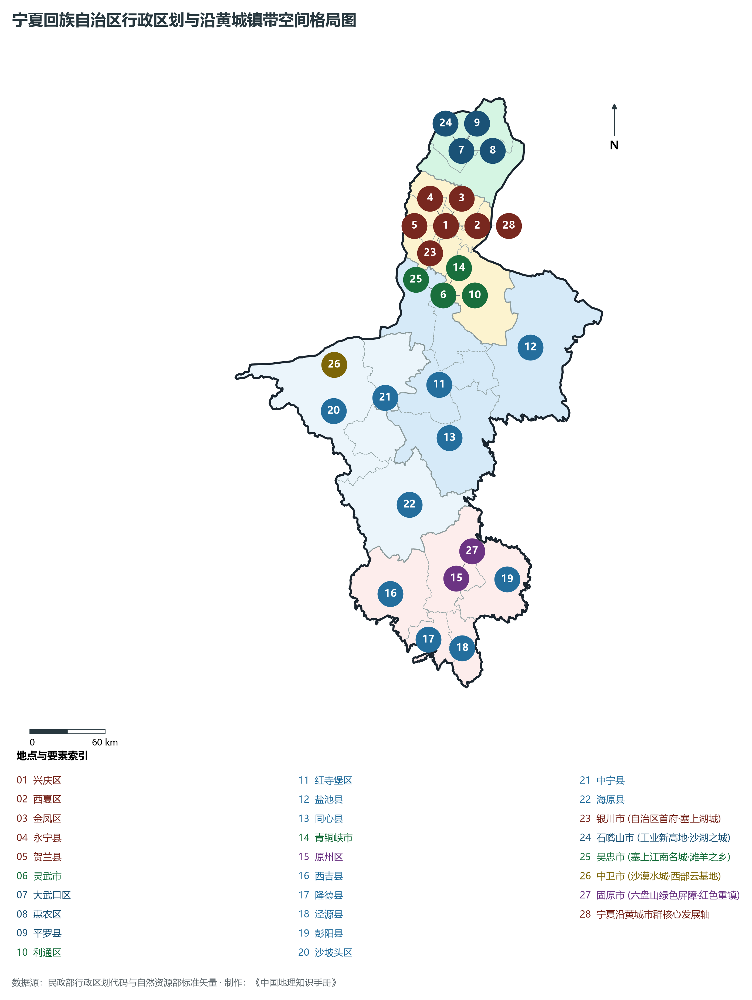
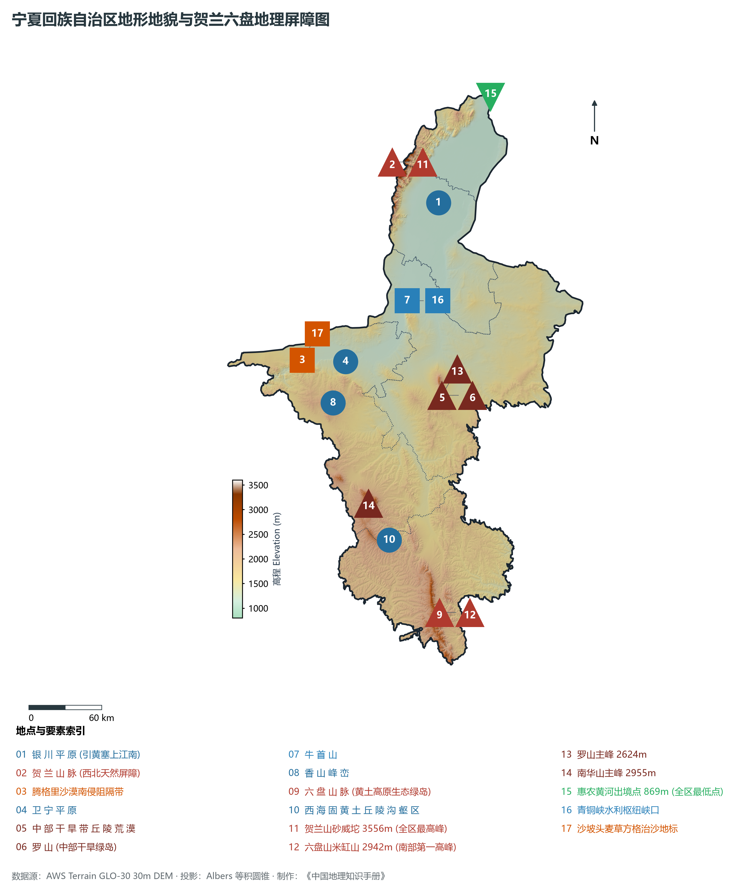
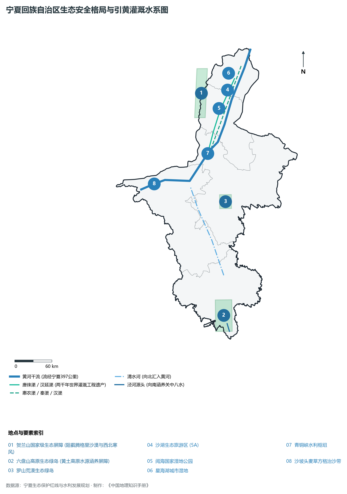
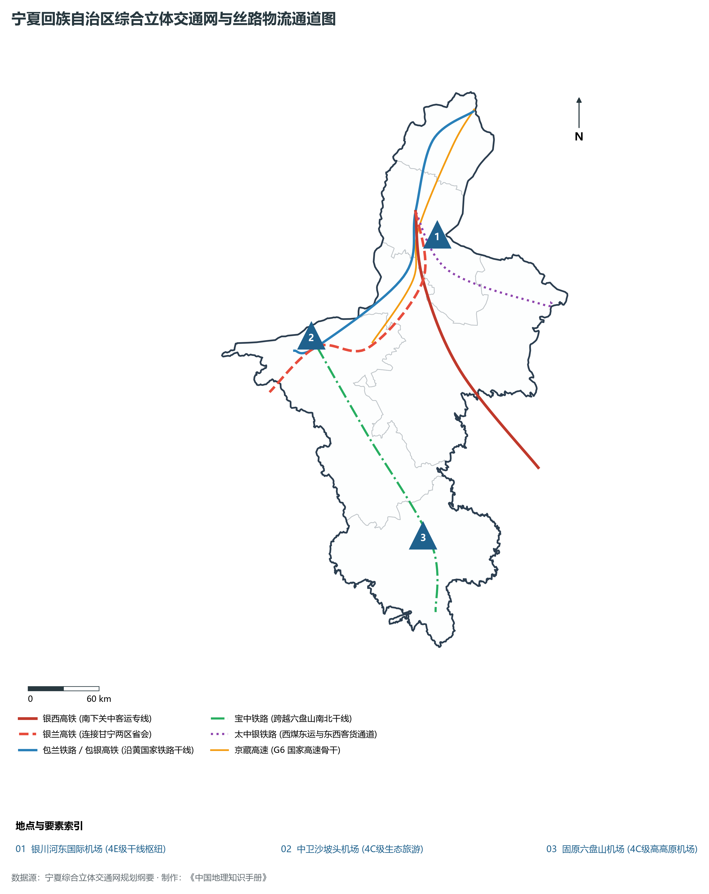
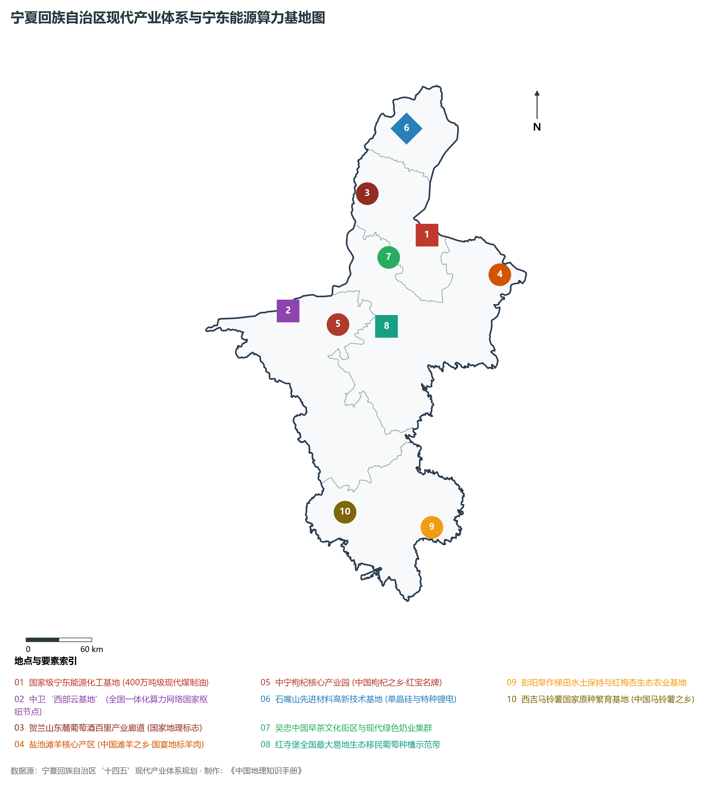

# 31.0 宁夏回族自治区地理统揽

在中国西北内陆的壮丽版图上，宁夏回族自治区宛如一叶青翠欲滴的芭蕉翡翠，嵌卧于黄河九曲回肠与腾格里沙漠、毛乌素沙地、黄土高原交汇相拥的战略中枢。地理坐标介于东经 104°17′—107°39′、北纬 35°14′—39°23′ 之间，南北纵长约 **456 km**，东西横宽约 **250 km**。全区陆地总面积 **6.64 万 km²**，是我国五大少数民族自治区中面积最小、但单位面积水利开发强度最高、人均水浇绿洲平原最丰裕的生态战略高地。下辖 5 个地级市（银川市、石嘴山市、吴忠市、固原市、中卫市），包含 9 个市辖区、2 个县级市、11 个县（共 22 个县级行政区）。2024 年末全区常住人口达 **729.0 万人**，常住人口城镇化率达 **67.5%**，2024 年全区地区生产总值（GDP）预计达到 **5 515.0 亿元**（按不变价格计算同比增长约 5.6%），人均 GDP 突破 7.5 万元。

“天下黄河富宁夏，塞上江南生九渠。”黄河发源于青海、奔腾穿过甘肃峡谷后，自中卫黑山峡浩荡入境，横贯全境 **397 km**，在宁夏平原舒缓流淌、润泽四方，铸就了享誉中外的“塞上江南”。早在秦汉时期，蒙恬北逐匈奴、移民屯垦，初凿秦渠、汉渠；汉唐以降，历代修浚，唐徕渠、汉延渠、惠农渠等千古名渠纵横交错，形成了无坝引水、自流灌溉的两千年引黄古灌区（入选世界灌溉工程遗产）；巍巍贺兰山如巨大屏障斜倚西北，最高峰砂威坨海拔 **3 556 m**，坚决阻挡了腾格里沙漠与西伯利亚严寒冷锋的侵袭，东麓山前冲积倾斜平原形成了享誉全球的葡萄酒黄金种植带；巍巍六盘山如生态绿岛横亘南部，主峰米缸山海拔 **2 942 m**，以高山水源涵养林护卫泾河与关中平原；包兰铁路在沙坡头穿越茫茫腾格里沙漠，中国人民首创“麦草方格”生物机械固沙奇迹，荣获联合国全球 500 佳环境奖；新时代的宁东能源化工基地崛起为世界单体最大煤制油项目与国家重要现代能源化工基地；中卫“西部云基地”晋升为全国一体化算力网络国家八大枢纽节点之一。从古老的贺兰山岩画、西夏王陵、水洞沟旧石器文化，到长征翻越六盘山的胜利绝唱与将台堡会师丰碑，宁夏正以“建设黄河流域生态保护和高质量发展先行区”的战略使命，谱写人与自然和谐共生的新时代华章。

---

## 一、区情速览

宁夏回族自治区是我国向西开放的重要窗口、国家能源战略储备与转换枢纽、西北地区重要生态安全屏障以及黄河流域高质量发展的排头兵。

| 核心指标 | 全区数据 | 战略定位 / 占比 / 特征 |
|:---|:---|:---|
| **土地总面积** | 66 400 km² | 全国第 27 位（占全国陆地面积约 0.69%） |
| **常住人口 (2024)** | 729.0 万人 | 银川市人口占全区近 40%，人口沿黄高度集聚 |
| **常住人口城镇化率** | 67.5% | 银川市城镇化率达 82.5%，沿黄城市群超 75% |
| **地区生产总值 (GDP)** | 5 515.0 亿元 (2024) | 突破 5 500 亿元大关，经济综合实力跃上新台阶 |
| **人均 GDP** | 75 650 元 | 银川市与石嘴山市人均 GDP 接近 10 万元 |
| **三次产业结构** | 8.2 : 46.8 : 45.0 | 现代工业能级持续增强，现代服务业支撑稳固 |
| **地貌最高点 / 最低点** | 贺兰山砂威坨 3 556 m / 惠农黄河出境处 869 m | 全区地势南高北低，相对垂直高差达 2 687 m |
| **黄河过境长度 / 灌溉面积** | 397 km / 引黄灌区逾 860 万亩 | 人均拥有水浇耕地与水资源可用量居西北首位 |
| **清洁能源与算力装机** | 新能源装机超 3 600 万千瓦 / 国家算力枢纽 | 全国首个新能源综合示范区，中卫标准机架超 8 万架 |

**图 31-00-2 宁夏回族自治区行政区划与沿黄城镇带空间格局图**：图上编号与地点、要素索引对应。

---

## 二、自然地理：贺兰屏障、黄河绿洲与六盘水塔

**图 31-00-1 宁夏回族自治区地形地貌与贺兰六盘地理屏障图**：图上编号与地点、要素索引对应。

### 1. 三大地貌单元与阶梯过渡
宁夏地势南高北低，平均海拔在 1 100—2 000 m 之间，按形态与成因划分为三大显著差异的自然地理区：

- **北部银川平原与引黄灌区（塞上江南）**：北起石嘴山惠农、南至青铜峡，西倚贺兰山、东临鄂尔多斯台地，海拔 1 100—1 200 m。黄河及其古今灌渠在此冲积形成沃野平畴，湖泊棋布、稻香鱼跃，素有“塞上明珠”之美誉；
- **中部干旱带丘陵荒漠区（生态修复前沿）**：介于青铜峡至固原原州区之间，包括卫宁平原南缘、同心、盐池、红寺堡及海原北部。地表多为剥蚀低山、剥蚀残丘及洪积缓坡，分布有独立生态绿岛罗山（2 624 m）、香山（2 368 m）和牛首山（1 774 m），降水稀少（200—350 mm），植被以荒漠草原为主；
- **南部六盘山黄土丘陵沟壑区（高原绿色水塔）**：包括固原原州区、西吉、隆德、泾源、彭阳五县区。海拔普遍在 1 600—2 900 m，地表覆盖深厚第四纪黄土，水土流失历史严重（西海固地区）；横亘其间的六盘山林木葱郁、飞瀑清泉，年降水量达 600—800 mm，是西北黄土高原难得的湿岛与生态水源涵养区。

### 2. 季风边缘与强烈大陆性半干旱气候
宁夏地处我国季风区向非季风区的过渡带，属于典型温带大陆性半干旱与干旱气候：

- **光热充沛、昼夜温差大**：全区年日照时数在 2 800—3 200 小时之间，太阳辐射总量居全国第四位，昼夜温差常年达 12—16 ℃，极利于瓜果、甜菜、酿酒葡萄和枸杞等作物的糖分与芳香物质积累；
- **降水梯度分明、蒸发量巨大**：自南向北降水量从固原六盘山区的 600—800 mm 锐减至石嘴山惠农区的不足 180 mm，而蒸发量由南向北自 1 200 mm 激增至 2 200 mm 以上。水资源呈现“天上水不足、地下水苦咸、唯赖黄河水”的极端客水依赖特征。

---

## 三、水文水系与引黄古灌区世界水利奇迹

**图 31-00-5 宁夏回族自治区生态安全格局与引黄灌溉水系图**：图上编号与地点、要素索引对应。

### 1. 黄河干流与两千年古灌体系
宁夏是全国唯一全境属于黄河流域的省区。黄河自中卫南长滩入境，奔涌于黑山峡深谷，至沙坡头出峡进入卫宁平原，经青铜峡古峡入银川平原，最后自石嘴山惠农麻黄沟北上内蒙古：

- **“借河兴邦”的世界灌溉工程遗产**：宁夏引黄灌区已有 2 200 多年历史。西汉屯田军民因势利导，利用黄河在青铜峡出峡处比降大、水位高的自然条件，开凿了秦渠、汉渠、汉延渠等无坝引水渠系；唐代扩建唐徕渠，明代修建惠农渠、大清渠。全区干支渠总长超 **6 000 km**，滋养良田逾 **860 万亩**，成就了中国水利史上与都江堰齐名的工程奇迹；
- **青铜峡水利枢纽与现代化扬黄工程**：新中国成立后修建的青铜峡水利枢纽彻底结束了宁夏两千余年无坝引水的历史；随后相继建成的盐环定扬黄、固海扬黄、红寺堡扬黄等现代扬水工程，将黄河水梯级提升几百米送往干旱塬地，使数十万西海固移民告别缺水历史。

### 2. 支流水系与塞上湖泊湿地
除黄河干流外，全区主要支流包括：

- **清水河**：宁夏境内黄河最大支流，发源于固原开城，由南向北贯穿同心、海原、中宁，在中宁泉眼山汇入黄河，全长 320 km；
- **苦水河**：发源于盐池与同心交界丘陵，向北汇入吴忠黄河段；
- **泾河**：发源于六盘山东麓泾源县，向南穿平凉入关中汇入渭河，是关中平原最重要的生命之源；
- **七十二连湖与塞上水乡湿地**：银川平原与石嘴山低地地下水位高，自古形成湖泊洼淀星罗棋布的奇景。沙湖（5A级沙漠绿洲水域）、银川阅海、宝湖、鸣翠湖及大武口星海湖等，构成了大西北极为罕见的万亩湿地集群，为数百万候鸟迁徙提供了不可替代的生态驿站。

---

## 四、历史文脉与多民族融合壮歌

宁夏是中华民族融合发展与丝绸之路文明交往的金色交汇带：

1. **旧石器发轫与远古艺术瑰宝**：灵武水洞沟遗址揭示了距今 4 万年前远古人类在此繁衍生息的生动图景，是我国最早发掘的旧石器时代文化遗址；贺兰山岩画记录了数千年前游牧民族放牧、祭祀、狩猎与崇拜太阳神的万余幅原始岩画，堪称“中国游牧民族的史前艺术长廊”；
2. **秦汉长城与蒙恬移民屯垦**：秦昭襄王筑战国长城横跨固原；始皇三十二年（前 215 年）蒙恬北击匈奴收复河南地，设富平县（今吴忠、灵武一带），“徙谪戍以充之”，开启引黄灌溉、变沙漠为良田的农耕文明篇章；
3. **丝路北道与唐藩古道要冲**：汉唐时期，原州（今固原）地处丝绸之路东段北道咽喉，商贾辐辏，出土的北周田弘墓波斯银币与萨珊金银器印证了中西贸易的极盛繁荣；灵武古称灵州，唐天宝十五载（756 年），太子李亨在灵武筑坛即位（唐肃宗），聚集关陇军队与朔方节度使郭子仪平定“安史之乱”；
4. **西夏定都与多元文化交融**：公元 1038 年，党项族首领李元昊在兴庆府（今银川）称帝建国，创立西夏王朝，立国 189 年。西夏创制独特的西夏文字，吸纳汉唐礼制与佛教文化，在贺兰山麓留下了规模宏大的九座西夏皇家帝陵与须弥山石窟的盛唐造像；
5. **红色圣地与胜利大会师**：1935 年 10 月，毛泽东率领中央红军长征翻越最后一座高山——六盘山，写下了波澜壮阔的壮丽词章《清平乐·六盘山》（“不到长城非好汉，屈指行程二万”）；1936 年 10 月，红军一、二方面军在西吉将台堡胜利会师，标志着震撼世界的二万五千里长征胜利结束，开辟了中国革命大本营走向胜利的新起点。

---

## 五、综合交通体系与丝路空中陆路走廊

**图 31-00-3 宁夏回族自治区综合立体交通网与丝路物流通道图**：图上编号与地点、要素索引对应。

### 1. 高铁成网与跨省客运大跨越
宁夏曾是我国少数不通高铁的省区之一，近年来铁路建设迎来历史性爆发：

- **银西高铁（向南打通关中大动脉）**：2020 年底开通运营，全长 618 km，最高时速 250 km/h，将银川至西安的运行时间由 14 小时压缩至 3 小时，彻底融入全国高铁大网；
- **银兰高铁（沿黄连接甘宁首府）**：2022 年底全线贯通，串联银川、吴忠、中卫、白银与兰州，形成连接陕甘宁青的重要纽带；
- **包银高铁（向北对接京津冀与呼包鄂）**：全线建成后，银川至北京将实现 4.5 小时通达，全面融入首都经济圈辐射圈。

### 2. 货运干线铁路与国家高速公路网络

- **干线普速铁路**：包兰铁路跨越沙漠，迎水桥编组站是西北最大铁路特等货运枢纽之一；宝中铁路纵贯固原六盘山区南下陕西宝鸡；太中银铁路自银川经吴忠盐池直达华北，是晋陕蒙宁煤炭与大宗货物出海的重载走廊；
- **“三环八射”高速公路网**：京藏高速（G6）、青银高速（G20）、银百高速（G69）、福银高速（G70）、银昆高速（G85）、乌玛高速（G1816）与定武高速（G2012）构成了覆盖全区、通达邻省的高标准公路大通道，县县通高速率达 100%；
- **“一干两支”民用航空枢纽**：银川河东国际机场为 4E 级大型枢纽机场，年旅客吞吐量超千万人次，与中卫沙坡头机场、固原六盘山机场共同构筑起“辐射全国、连通西亚”的空中丝路门户。

---

## 六、现代产业体系与绿色转型“六新六特六优”

**图 31-00-4 宁夏回族自治区现代产业体系与宁东能源算力基地图**：图上编号与地点、要素索引对应。

宁夏立足资源禀赋与环境容量，坚决摆脱粗放依赖，构建以“六新六特六优”为主体的高质量现代产业集群：

### 1. “六新”产业：新型工业化支撑骨架

- **现代煤化工与新型材料**：宁东能源化工基地投资规模超数千亿元，建成世界单体最大 **400 万吨/年煤炭间接液化（煤制油）示范项目**，并向特种蜡、高性能芳烃、芳纶及碳化硅等高端新材料纵深裂变；
- **清洁能源大基地**：充分利用荒漠光热与风能资源，腾格里沙漠千万千瓦级大型风电光伏基地如火如荼，新能源装机比重居全国前列，“绿电”通过宁东直流特高压外送华东、华中；
- **“中国算力之都”中卫西部云基地**：地处全国陆地几何中心，平均气温低、电价低廉、地质构造稳定，获批建设全国一体化算力网络国家枢纽节点。亚马逊 AWS、美团、中国移动、中国电信等数十座超大型绿色数据中心投运，服务器装机规模超百万台，打造面向全国的“东数西算”绿色算力高地。

### 2. “六特”产业：富民兴疆的黄金品牌

- **贺兰山东麓葡萄酒**：地处北纬 38° 酿酒葡萄种植黄金带，拥有砂石砾土透气好、光照充足、干旱少虫害等天赐良机。全区酿酒葡萄种植面积近 60 万亩，建成酒庄 130 余家，荣获千余项国际大奖，“贺兰红”成为享誉世界的中国葡萄酒紫色名片；
- **中宁枸杞（百草之冠·红色药宝）**：中宁是世界枸杞的发源地与核心产区，“中宁枸杞”获国家地理标志保护，向原浆、冻干粉、多糖深加工药品保健品链条跨越；
- **盐池滩羊（国宴首选名肉）**：得益于盐池境内苦咸水与野生甘草、苦豆子等碱性牧草，滩羊肉质细嫩、无膻味、富硒低脂，连续多次登上二十国集团峰会等重大国宴餐桌；
- **高端牛奶与冷凉蔬菜**：宁夏光照好、奶牛疫病少，吴忠与银川建有全国最优质的奶源基地，伊利、蒙牛百亿级智能化乳业加工园落户；固原六盘山区夏无酷暑，彭阳、原州、隆德冷凉蔬菜（西兰花、娃娃菜、芹菜）畅销粤港澳大湾区。

---

## 七、生态安全战略与黄河流域先行区建设

宁夏肩负着“保护黄河生态健康、维护西北生态安全屏障”的政治责任：

1. **三山生态修复与防沙治沙攻坚**：贺兰山全面退出煤炭露天开采与私挖乱采，实施彻底生态环境综合整治；六盘山持续推进天然林保护与退耕还林还草，森林覆盖率达 80% 以上；罗山干旱绿岛实行全域封育禁牧；
2. **腾格里与毛乌素沙地阻击战**：中卫沙坡头通过草方格机械治沙、灌木固沙与引水拉沙造林，将腾格里沙漠边缘向外推移数十公里；盐池县在毛乌素沙地西南边缘实现从“沙进人退”到“人进沙退”的历史性逆转；
3. **黄河水资源刚性约束与节水减排**：落实“以水定城、以水定地、以水定人、以水定产”，在全国率先实行全域水权转换与精准灌溉，工业万元 GDP 用水量显著下降，黄河宁夏段出境水质常年稳定保持在 **Ⅱ类优良标准**。

从贺兰雪峰到黄河古渠，从大漠云海到六盘青松，宁夏回族自治区正以生机盎然的姿态，在黄河流域生态保护与高质量发展的康庄大道上奋勇向前！
