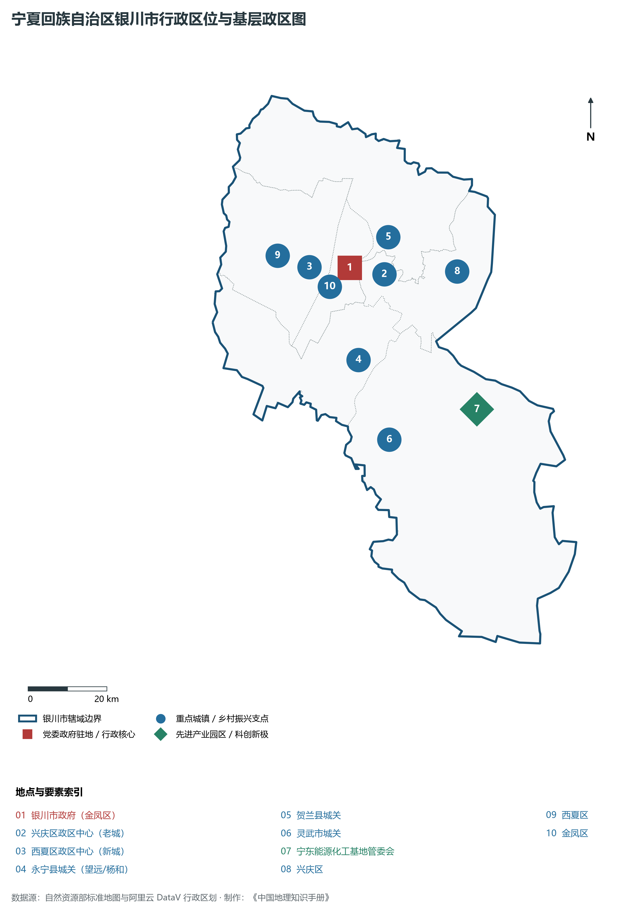
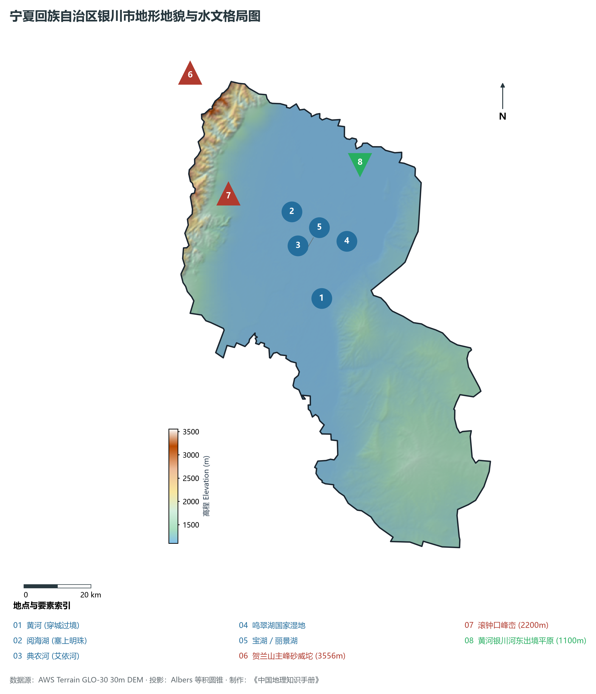
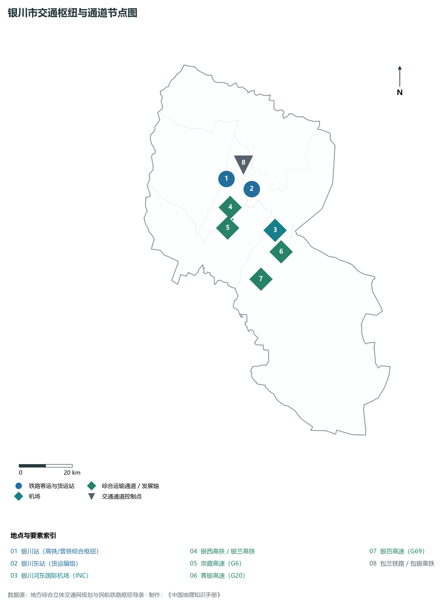
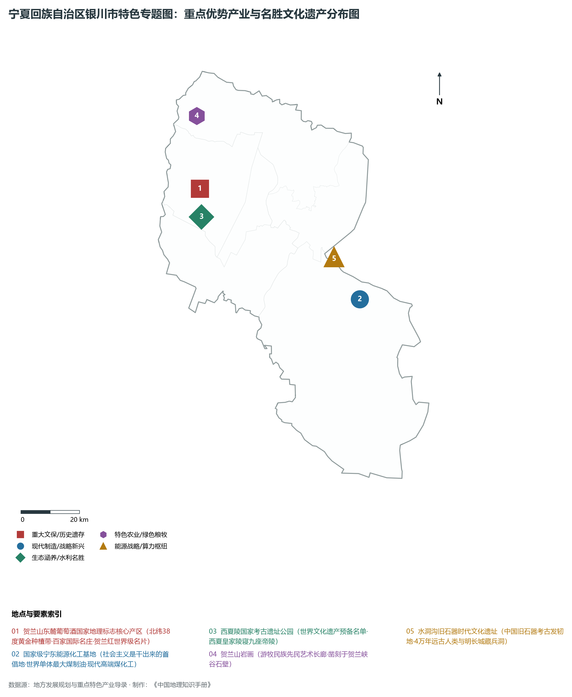
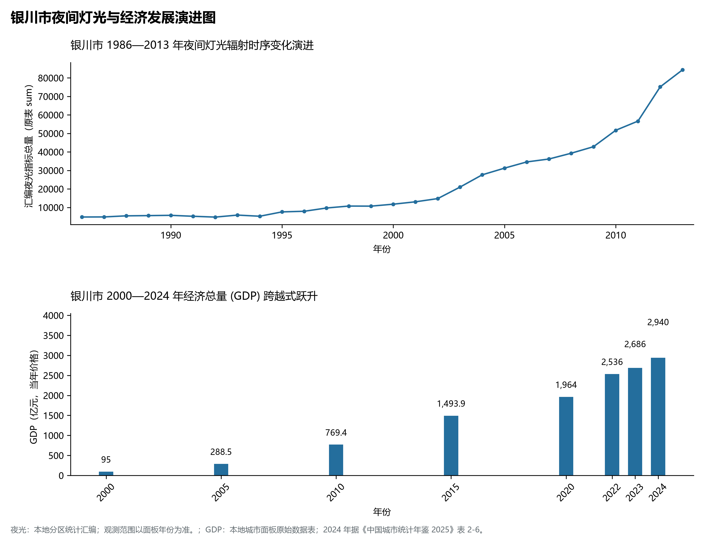

# 31.1 银川市

银川市，宁夏回族自治区首府，全区政治、经济、文化、科研、科教与金融商贸中心，国家历史文化名城，国家向西开放战略门户，黄河中上游区域性中心城市，享有“塞上江南、塞上湖城”之盛誉。地理坐标介于东经 105°49′—106°53′、北纬 37°29′—38°53′ 之间，地处银川平原腹地，西屏巍巍贺兰山，东临浩浩黄河与鄂尔多斯台地边缘，南接吴忠，北连石嘴山。全市行政区域土地。2024 年常住人口 **291 万人**，常住人口城镇化率 **83.35%**，地区生产总值 **2,940 亿元**（当年价格），人均地区生产总值 **100,966 元**，三次产业构成为 **3.51 : 46.66 : 49.83**。

---

## 一、市情速览

| 核心指标 | 全市数据 | 全区位次 / 占比 / 战略特征 |
|:---|:---|:---|
| **土地总面积** | 9 491.0 km² | 占全区 14.3%，地跨引黄平原与宁东荒漠台地 |
| **常住人口 (2024)** | 291 万人 | 2024 年，全市；年鉴公布口径 |
| **常住人口城镇化率** | 83.35% | 2024 年，全市；年鉴公布口径 |
| **地区生产总值 (GDP)** | 2,940 亿元 | 2024 年，全市；年鉴公布口径 |
| **人均 GDP** | 100,966 元/人 | 2024 年，全市；年鉴公布口径 |
| **三次产业结构** | 3.51 : 46.66 : 49.83 | 2024 年，全市；年鉴公布口径 |
| **最高点 / 最低点** | 贺兰山砂威坨 3 556 m / 贺兰沿黄湿地 1 100 m | 东西向高差达 2 456 m，山前倾斜平原沃野千里 |
| **湿地与湖泊面积** | 湖泊湿地水域超 5.3 万公顷 | 阅海、宝湖、鸣翠湖等，西北人均水域第一城 |
| **主导产业格局** | 新型材料、现代煤化工、葡萄酒、高端奶业、电子信息 | “中国新硅都”、全球葡萄酒名庄带与世界级煤化工 |

**图 31-01-1 宁夏回族自治区银川市行政区位与基层政区图**：图上编号与地点、要素索引对应。

---

## 二、自然地理：贺兰屏障、冲积沃野与七十二连湖

**图 31-01-2 宁夏回族自治区银川市地形地貌与水文格局图**：图上编号与地点、要素索引对应。

### 1. 贺兰山脉与山前绿洲屏障
贺兰山在银川市境内自东北向西南绵延百余公里，主峰砂威坨海拔 **3 556 m**，是全区陆地最高峰。巍峨的山体垂直高差达 2 400 m 以上，犹如一道顶天立地的天然屏风，顽强阻挡了来自西伯利亚的干冷气流与西侧腾格里沙漠的漫天狂沙；同时，山体对夏季东南季风产生强烈的地形抬升，在东坡形成丰富的山地降水（400—500 mm）与融雪山泉，滋养了山麓缓坡带，为贺兰山东麓百里葡萄酒庄廊道提供了无可复制的土壤与小气候屏障。

### 2. 黄河穿境与“塞上湖城”水网生态
黄河自永宁县入境，流经灵武市、兴庆区、贺兰县，境内干流全长约 **84 km**。黄河在银川平原比降平缓（约 0.2‰），古今渠系在此肆意蜿蜒。历史上银川平原由于地下水位高、排水不畅与古河道变迁，形成了“七十二连湖”的壮美水乡景观：

- **典农河（艾依河）**：全长 180 km 的人工生态景观水系，串联起唐徕渠末端水系、宝湖、阅海、七子连湖等十余个核心湖泊，构成了纵贯城市南北的生态绿带；
- **阅海湖国家湿地公园**：水域面积超 1.2 万亩，是银川平原面积最大、原始风貌保存最完整的湿地之一，素有“银川之肾”美称；
- **鸣翠湖与黄河湿地**：东部紧邻黄河干流，苇荡丛生、百鸟集翔，构成了大西北干旱半干旱气候区罕见的城市微气候调节圈与绿岛效应。

---

## 三、历史沿革与名胜古迹

银川古称“兴庆府”、“中兴府”，历史悠久，文脉深厚：

1. **史前文明发端**：距今 4 万年前的**水洞沟遗址**（位于灵武市）见证了旧石器时代晚期古人类在这里打制石器、繁衍生息的辉煌足迹，是中国最早发掘的旧石器时代文化遗址；贺兰山贺兰口峡谷内分布着数千幅**贺兰山岩画**，生动记录了远古游牧民族崇拜太阳神、狩猎与舞蹈的艺术杰作；
2. **西夏定都与皇家陵寝**：公元 1038 年党项族首领李元昊在银川正式登基称帝，建国大夏（西夏），定都兴庆府，开创西夏文明。贺兰山东麓现存 9 座西夏皇家帝陵与 250 多座陪葬墓，构成了规模宏大的**西夏陵**国家考古遗址公园，被誉为“东方金字塔”；
3. **历代水利开发与边关重镇**：秦汉置富平县，唐设灵州，明置宁夏卫，清雍正三年（1725 年）设宁夏府。城内现存**承天寺塔**（西塔，建于西夏天佑垂圣元年，高 64.5 m）、**海宝塔**（北塔，楼阁式砖塔，为中国古代佛塔建筑名品）以及明代雄伟的**南门楼**（俗称银川“小天安门”）；
4. **当代文化名片**：西夏区**镇北堡西部影城**依托明清边防烽燧城堡改建，诞生了《大话西游》、《红高粱》、《新龙门客栈》等经典电影，成为中国当代电影走向世界的“摇篮”。

---

## 四、综合交通网与丝路门户枢纽

**图 31-01-3 银川市交通枢纽与通道节点图**：图上编号与地点、要素索引对应。

- **高铁全面连通全国**：银西高铁使银川 3 小时通达西安；银兰高铁使银川 2.5 小时连通兰州；包银高铁（银川至惠农段已率先开通，全线通车在即）将使银川至北京缩短至 4.5 小时；
- **干线普铁与货运编组**：包兰铁路纵贯南北，太中银铁路连接华北，银川东站与灵武铁路专用线为宁东能源基地与先进工业提供了强大的大宗货物外运通道；
- **空中丝路枢纽**：银川河东国际机场（INC）拥有 4E 级飞行区，旅客年吞吐量稳超 1 000 万人次，开通国内外客货航线百余条，是国家面向中亚、西亚和中东地区开放的重要空中门户。

---

## 五、特色优势产业与现代经济演进

**图 31-01-4 宁夏回族自治区银川市特色专题图：重点优势产业与名胜文化遗产分布图**：图上编号与地点、要素索引对应。

**图 31-01-5 银川市夜间灯光与经济发展演进图**：各面板按标注的观测年份、指标和单位列示。

### 1. 现代煤化工航母：国家级宁东能源化工基地
宁东基地规划面积达 3 500 km²，是我国四大现代煤化工示范区之一：

- **世界单体最大煤制油项目**：国家能源集团 400 万吨/年煤炭间接液化项目成功攻克数十项世界级关键技术，产出超清洁柴油、航空煤油、石脑油与高附加值特种蜡，实现“点煤成油”的国家能源战略突破；
- **煤化工向新材料裂变**：宁东基地已延伸出煤制烯烃（年产能超 300 万吨）、高性能芳纶纤维、聚甲醛、锂电电解液及绿氢耦合煤化工产业链，综合能效与清洁生产水平居全国第一方阵。

### 2. “中国新硅都”与光伏全产业链集群
依托低电价优势与绿色电力保障，银川市西夏区与经济技术开发区引进了隆基绿能、中环股份等行业领军企业，建成全球最大的单晶硅棒、单晶硅片生产基地之一，光伏级与半导体级硅材料产能占全国重要份额，形成“工业硅—多晶硅—单晶硅棒—切片—电池组件”的全产业链高端智造基地。

### 3. 贺兰山东麓葡萄酒：世界级紫色名片
银川市贺兰山东麓酿酒葡萄种植面积超 **26 万亩**，集聚了志辉源石、贺兰晴雪、美贺庄园等数十家国内外知名酒庄：

- 严格推行“列级酒庄”管理制度，产区葡萄酒在布鲁塞尔国际葡萄酒大奖赛等顶级赛事中斩获大奖数百项；
- 形成集葡萄种植、酿造加工、文化旅游与酒庄度假于一体的三产融合千亿级紫色产业长廊。

---

## 六、历年经济总量演进指标对照

| 年份 | 地区生产总值（亿元，当年价格） |
|:---|---:|
| 2000 年 | 95 |
| 2005 年 | 288.5 |
| 2010 年 | 769.4 |
| 2015 年 | 1,493.9 |
| 2020 年 | 1,964 |
| 2024 年 | 2,940 |

银川市正以“强首府”战略为引领，以贺兰山生态保护为底线，协同宁东现代能源与沿黄现代农业，昂首迈向现代化现代化区域中心城市的崭新境界！

2024 年统计来源：《中国城市统计年鉴 2025》表 2-1、2-6、2-7（2024 年，全市）。其他年份 GDP 据本地城市面板“原始数据”表，单位为亿元、当年价格。
